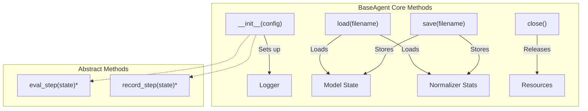
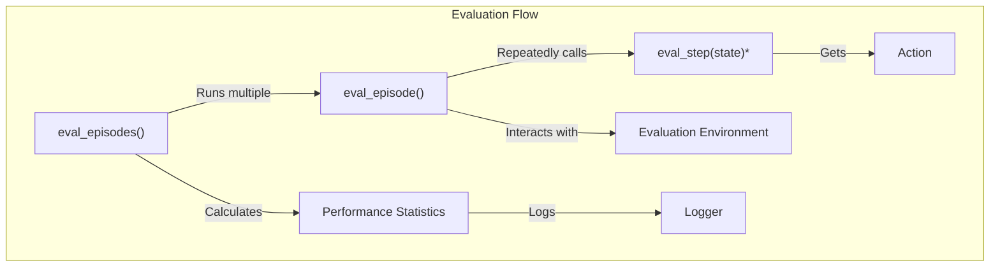
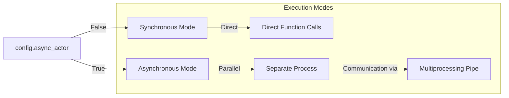
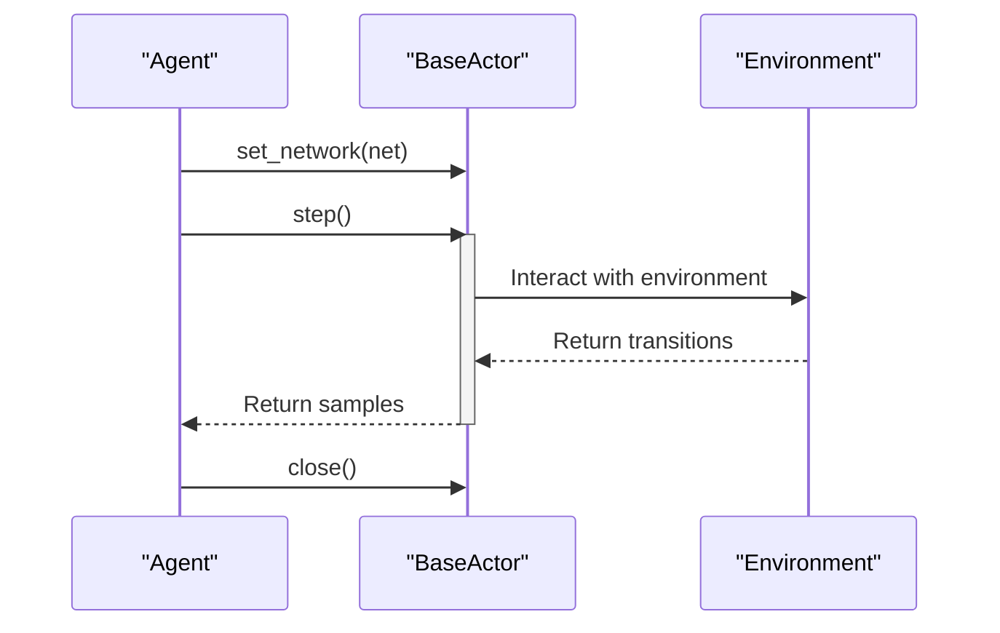
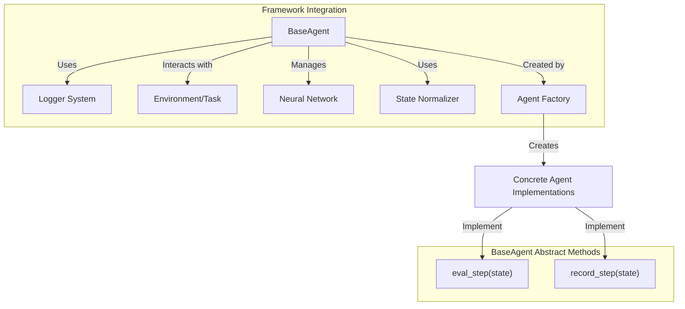
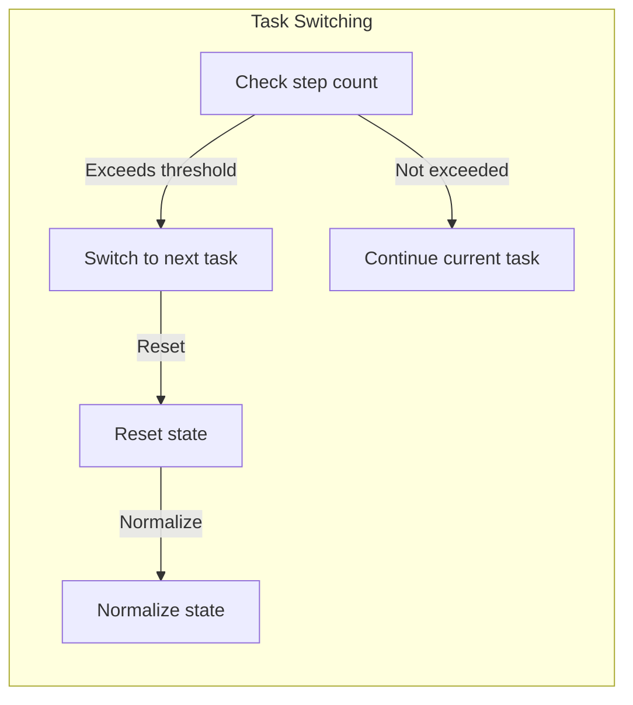

<!-- source: DeepWiki mcp.deepwiki.com · repo ShangtongZhang/DeepRL · page 2.1 Base Agent · fetched 2026-10-30 -->

# Base Agent

<details>
<summary>Relevant source files</summary>

The following files were used as context for generating this wiki page:

- [deep_rl/agent/BaseAgent.py](deep_rl/agent/BaseAgent.py)

</details>


## Purpose and Overview

The Base Agent module provides the foundational architecture for all reinforcement learning agents in the DeepRL framework. It defines common interfaces and functionality that specific agent implementations (like DQN, PPO, DDPG) inherit and extend. The module consists of two main classes: `BaseAgent` and `BaseActor`.

This page focuses on the base agent design and core functionality. For information about specific agent implementations, see:
- [DQN Family](#2.2)
- [Policy Gradient Methods](#2.3)
- [Actor-Critic Methods](#2.4)
- [Hierarchical Reinforcement Learning](#2.5)

## Architecture Overview

The base agent architecture defines the common structure and interfaces that all agents in the framework must implement. It handles the agent-environment interaction loop, evaluation procedures, logging, and state management.

```mermaid
classDiagram
    class "BaseAgent" {
        +config
        +logger
        +task_ind
        +close()
        +save(filename)
        +load(filename)
        +eval_step(state)*
        +eval_episode()
        +eval_episodes()
        +record_online_return(info)
        +switch_task()
        +record_episode(dir, env)
        +record_step(state)*
        +record_obs(env, dir, steps)
    }
    
    class "ConcreteAgents" {
        +network
        +step(state, action, reward, next_state, done)
        +eval_step(state)
        +record_step(state)
    }
    
    BaseAgent <|-- "ConcreteAgents"
    
    note for BaseAgent "Abstract base class with common functionality"
    note for "ConcreteAgents" "DQN, PPO, A2C, DDPG, etc."
```

Sources: [deep_rl/agent/BaseAgent.py:15-106]()

## BaseAgent Class

The `BaseAgent` class serves as an abstract base class for all RL agent implementations. It provides core functionality while requiring specific implementations to define their unique learning and decision-making processes.

### Initialization and Core Methods

The `BaseAgent` initializes with a configuration object that contains all necessary parameters and setups. The key methods include:



Sources: [deep_rl/agent/BaseAgent.py:16-33]()

### Evaluation System

The evaluation system enables assessment of agent performance during training. It provides methods to run evaluation episodes and collect performance statistics.



Sources: [deep_rl/agent/BaseAgent.py:35-60]()

### Key BaseAgent Methods

| Method | Purpose | Implementation |
|--------|---------|----------------|
| `__init__(config)` | Initialize agent with configuration | [BaseAgent.py:16-19]() |
| `save(filename)` | Save agent model and statistics | [BaseAgent.py:24-27]() |
| `load(filename)` | Load agent model and statistics | [BaseAgent.py:29-33]() |
| `eval_step(state)` | Abstract method to choose actions during evaluation | [BaseAgent.py:35-36]() |
| `eval_episode()` | Run a single evaluation episode | [BaseAgent.py:38-47]() |
| `eval_episodes()` | Run multiple evaluation episodes and log results | [BaseAgent.py:49-60]() |
| `record_online_return(info)` | Log episode returns during training | [BaseAgent.py:62-72]() |
| `switch_task()` | Switch between different tasks/environments | [BaseAgent.py:74-83]() |
| `record_episode(dir, env)` | Record episodes for visualization | [BaseAgent.py:85-96]() |

Sources: [deep_rl/agent/BaseAgent.py:15-106]()

## BaseActor Class

The `BaseActor` class implements a process-based actor for asynchronous agent implementations, enabling parallel interaction with environments. It can operate in both synchronous and asynchronous modes.

```mermaid
classDiagram
    class "BaseActor" {
        +STEP : int
        +RESET : int
        +EXIT : int
        +SPECS : int
        +NETWORK : int
        +CACHE : int
        +__init__(config)
        +run()
        +_sample()
        +_transition()*
        +_set_up()*
        +step()
        +close()
        +set_network(net)
    }
    
    class "Pipe Communication" {
        +__pipe
        +__worker_pipe
    }
    
    BaseActor --> "Pipe Communication" : uses
    
    note for BaseActor "Extends mp.Process for parallel execution"
    note for "Pipe Communication" "Communication channel between processes"
```

Sources: [deep_rl/agent/BaseAgent.py:108-183]()

### Synchronous vs Asynchronous Mode

The `BaseActor` can operate in two modes:



Sources: [deep_rl/agent/BaseAgent.py:127-132]()

### Actor Communication Protocol

When running in asynchronous mode, the actor uses a communication protocol through pipes:



Sources: [deep_rl/agent/BaseAgent.py:142-182]()

## Integration with Framework Components

The BaseAgent integrates with several other components in the DeepRL framework:



Sources: [deep_rl/agent/BaseAgent.py:15-106]()

## Implementation Details

### Abstract Methods

The `BaseAgent` declares several abstract methods that must be implemented by concrete agents:

1. `eval_step(state)`: Determines the action to take during evaluation based on the current state.
2. `record_step(state)`: Similar to `eval_step`, but used during episode recording.

These methods define the core decision-making process of an agent and vary based on the specific algorithm.

Sources: [deep_rl/agent/BaseAgent.py:35-36](), [deep_rl/agent/BaseAgent.py:98-99]()

### Task Switching

The `BaseAgent` supports switching between different tasks during training, enabling curriculum learning or multi-task learning scenarios:



Sources: [deep_rl/agent/BaseAgent.py:74-83]()

## Conclusion

The `BaseAgent` and `BaseActor` classes form the foundation of the DeepRL framework's agent architecture. They provide a common structure and interfaces that enable the implementation of diverse reinforcement learning algorithms while sharing core functionality for evaluation, logging, and environment interaction.

Concrete agent implementations extend these base classes to implement specific algorithms such as DQN, PPO, DDPG, and others, each with its unique learning and decision-making mechanisms.

---

