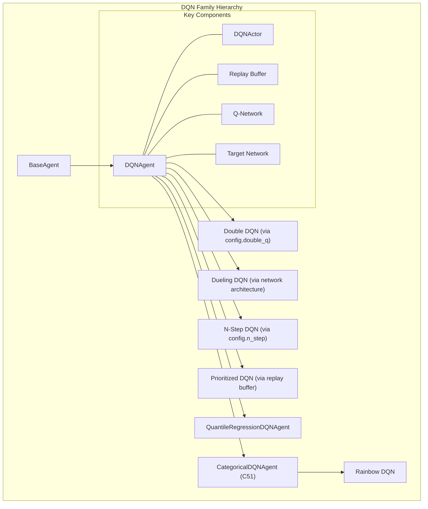
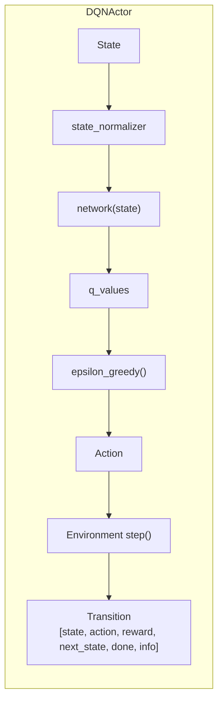
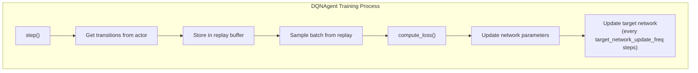
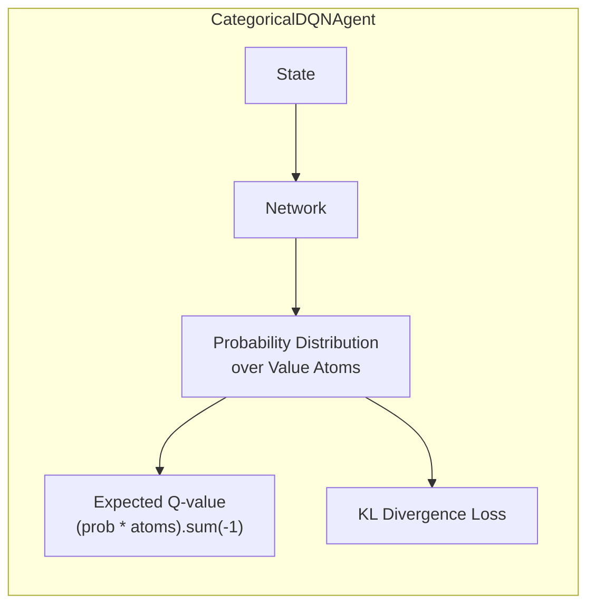
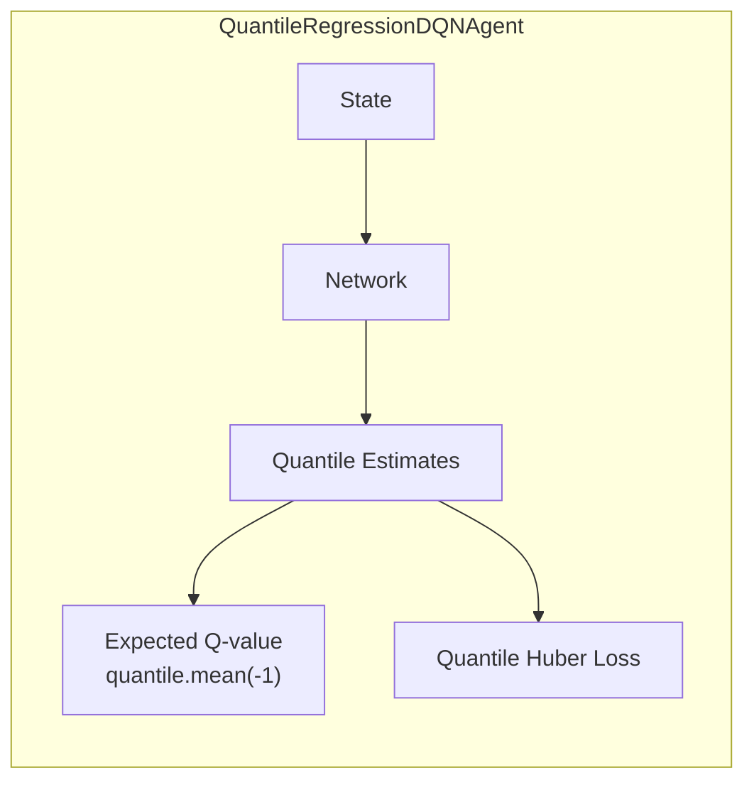
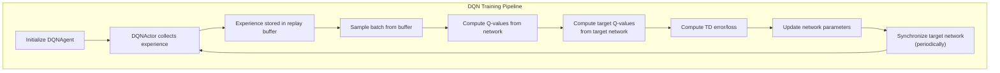

<!-- source: DeepWiki mcp.deepwiki.com · repo ShangtongZhang/DeepRL · page 2.2 DQN Family · fetched 2026-10-30 -->

# DQN Family

<details>
<summary>Relevant source files</summary>

The following files were used as context for generating this wiki page:

- [deep_rl/agent/CategoricalDQN_agent.py](deep_rl/agent/CategoricalDQN_agent.py)
- [deep_rl/agent/DQN_agent.py](deep_rl/agent/DQN_agent.py)
- [deep_rl/agent/QuantileRegressionDQN_agent.py](deep_rl/agent/QuantileRegressionDQN_agent.py)

</details>


The DQN Family section documents the implementation of Deep Q-Network (DQN) and its variants in the DeepRL framework. This page covers the base DQN algorithm and its extensions, including Double DQN, Dueling DQN, Categorical DQN (C51), and Quantile Regression DQN (QR-DQN). For information about policy gradient and actor-critic methods, see [Policy Gradient Methods](#2.3) and [Actor-Critic Methods](#2.4).

## Architecture Overview

DQN is a value-based reinforcement learning method that uses deep neural networks to approximate the action-value function (Q-function). The DeepRL implementation follows a modular design with separate components for experience collection, replay buffer management, and network updates.



Sources: 
- [deep_rl/agent/DQN_agent.py:48-138]()
- [deep_rl/agent/CategoricalDQN_agent.py:27-89]()
- [deep_rl/agent/QuantileRegressionDQN_agent.py:23-77]()

## Base DQN Implementation

The DQN implementation consists of two main classes:
1. `DQNActor`: Handles environment interaction and experience collection
2. `DQNAgent`: Manages the training process, including network updates and target network synchronization

### DQNActor

The `DQNActor` class is responsible for:
- Selecting actions using ε-greedy exploration
- Interacting with the environment
- Collecting transitions (state, action, reward, next_state, done)



Sources:
- [deep_rl/agent/DQN_agent.py:14-45]()

### DQNAgent

The `DQNAgent` implements the core DQN algorithm:
- Initializes the Q-network and target network
- Collects experiences through the actor
- Samples batches from the replay buffer
- Computes TD errors and updates the network
- Periodically updates the target network



Sources:
- [deep_rl/agent/DQN_agent.py:48-138]()

### Key Methods

1. **`compute_loss`**: Implements the TD learning loss for DQN
   ```
   Q-target = reward + discount * max(Q-next)
   Loss = (Q-target - Q(state, action))^2
   ```

2. **`step`**: Main training loop that:
   - Collects transitions from the environment
   - Feeds transitions to the replay buffer
   - Samples batches and updates the network
   - Periodically synchronizes the target network

Sources:
- [deep_rl/agent/DQN_agent.py:81-99]()
- [deep_rl/agent/DQN_agent.py:101-138]()

## DQN Variants

### Double DQN

Double DQN addresses the overestimation bias in vanilla DQN by decoupling action selection and evaluation:
- The online network selects the best action
- The target network evaluates the selected action

In the implementation, this is enabled by setting `config.double_q = True`:

```python
if self.config.double_q:
    best_actions = torch.argmax(self.network(next_states)['q'], dim=-1)
    q_next = q_next.gather(1, best_actions.unsqueeze(-1)).squeeze(1)
else:
    q_next = q_next.max(1)[0]
```

Sources:
- [deep_rl/agent/DQN_agent.py:87-91]()

### N-Step DQN

N-step DQN uses multi-step returns to accelerate learning by incorporating rewards from multiple timesteps:
- Configured via `config.n_step`
- Modifies the target calculation: `q_target = rewards + discount^n_step * q_next * masks`

Sources:
- [deep_rl/agent/DQN_agent.py:94]()

### Prioritized Experience Replay

Prioritized Experience Replay samples transitions based on their TD error magnitude:
- Implemented by using a `PrioritizedReplayBuffer` instead of a regular replay buffer
- Uses importance sampling weights to correct the optimization bias

```python
if isinstance(transitions, PrioritizedTransition):
    priorities = loss.abs().add(config.replay_eps).pow(config.replay_alpha)
    idxs = tensor(transitions.idx).long()
    self.replay.update_priorities(zip(to_np(idxs), to_np(priorities)))
    sampling_probs = tensor(transitions.sampling_prob)
    weights = sampling_probs.mul(sampling_probs.size(0)).add(1e-6).pow(-config.replay_beta())
    weights = weights / weights.max()
    loss = loss.mul(weights)
```

Sources:
- [deep_rl/agent/DQN_agent.py:120-127]()

## Distributional DQN Implementations

The framework implements two main distributional DQN variants: Categorical DQN (C51) and Quantile Regression DQN (QR-DQN).

### Categorical DQN (C51)

Categorical DQN models the Q-value distribution using a discrete probability distribution:



Key implementation details:
- Distributes Q-values across `categorical_n_atoms` atoms between `categorical_v_min` and `categorical_v_max`
- Computes expected Q-values as the expectation of the probability distribution
- Uses KL divergence for the distributional TD learning

Sources:
- [deep_rl/agent/CategoricalDQN_agent.py:27-89]()

### Quantile Regression DQN (QR-DQN)

Quantile Regression DQN approximates the Q-value distribution using quantile regression:



Key implementation details:
- Directly estimates quantiles of the return distribution
- Uses the Huber loss with asymmetric weights for quantile regression
- Computes expected Q-values as the mean of the quantile estimates

Sources:
- [deep_rl/agent/QuantileRegressionDQN_agent.py:23-77]()

## Training Pipeline

The complete DQN training pipeline involves interaction between multiple components:



Key steps in each training iteration:
1. Collect experience through `DQNActor`
2. Store transitions in the replay buffer
3. Sample a batch of transitions
4. Compute the TD target using the target network
5. Update the Q-network to minimize the TD error
6. Periodically update the target network

Sources:
- [deep_rl/agent/DQN_agent.py:101-138]()

## Configuration Options

The behavior of DQN agents can be customized through various configuration parameters:

| Parameter | Description | Default |
|-----------|-------------|---------|
| `double_q` | Use Double DQN algorithm | False |
| `noisy_linear` | Use NoisyNet exploration | False |
| `exploration_steps` | Initial exploration phase steps | 1000 |
| `n_step` | Steps for N-step returns | 1 |
| `target_network_update_freq` | Target network update frequency | 200 |
| `gradient_clip` | Gradient clipping threshold | 10 |
| `categorical_v_min` | Minimum value for C51 | -10 |
| `categorical_v_max` | Maximum value for C51 | 10 |
| `categorical_n_atoms` | Number of atoms for C51 | 51 |
| `num_quantiles` | Number of quantiles for QR-DQN | 200 |

Sources:
- [deep_rl/agent/DQN_agent.py:87-94]()
- [deep_rl/agent/CategoricalDQN_agent.py:32-33]()
- [deep_rl/agent/QuantileRegressionDQN_agent.py:43-45]()

## Integration with Framework

The DQN family agents integrate with the broader DeepRL framework through:

1. **Inheritance from BaseAgent**: All DQN variants extend the `BaseAgent` class
2. **Factory Pattern**: Agents are created through the `AgentFactory` component
3. **Configurable Components**: Neural networks, replay buffers, and optimizers are provided through the config system
4. **Standardized Interface**: Common interface for training and evaluation steps

Sources:
- [deep_rl/agent/DQN_agent.py:48-50]()
- [deep_rl/agent/CategoricalDQN_agent.py:27-29]()
- [deep_rl/agent/QuantileRegressionDQN_agent.py:23-25]()

---

