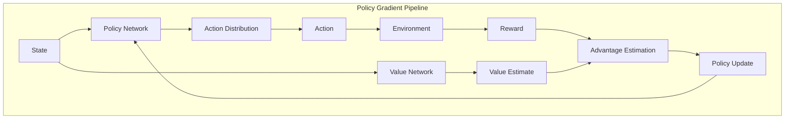
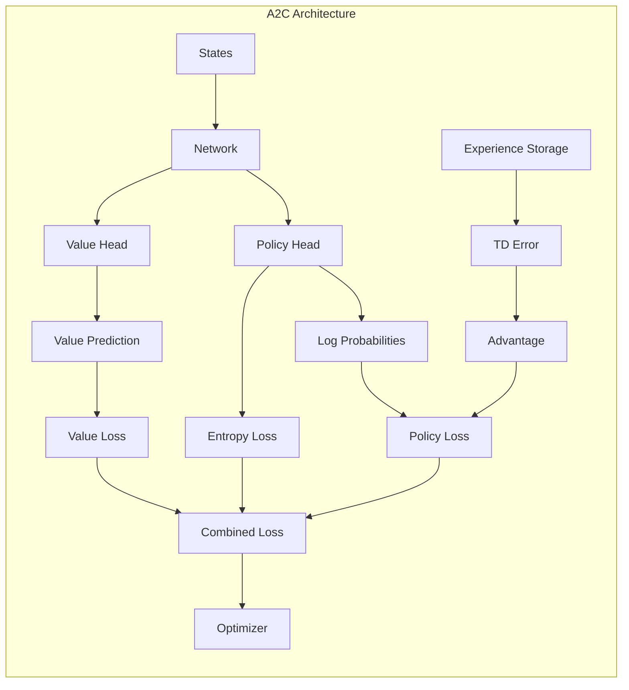
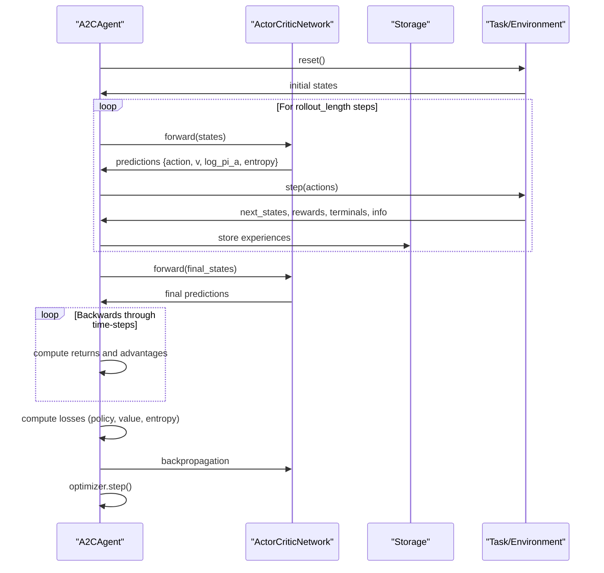
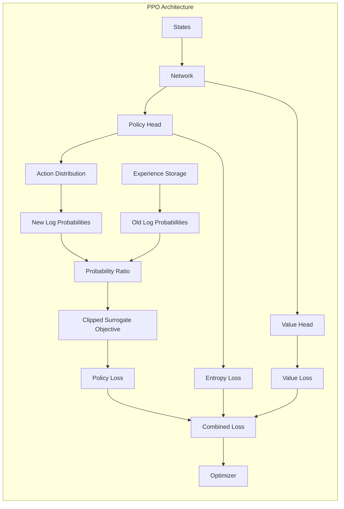
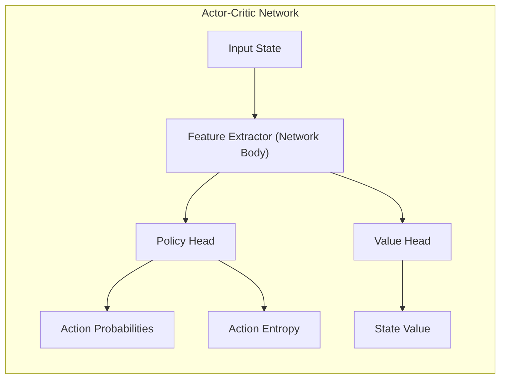
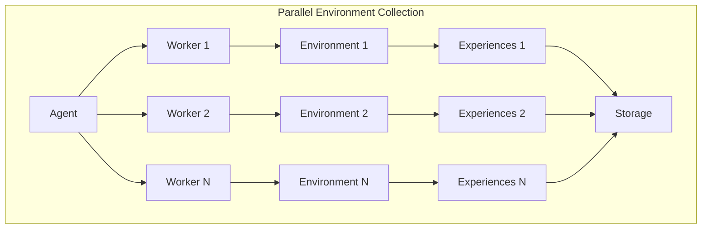

<!-- source: DeepWiki mcp.deepwiki.com · repo ShangtongZhang/DeepRL · page 2.3 Policy Gradient Methods · fetched 2026-10-30 -->

# Policy Gradient Methods

<details>
<summary>Relevant source files</summary>

The following files were used as context for generating this wiki page:

- [deep_rl/agent/A2C_agent.py](deep_rl/agent/A2C_agent.py)
- [deep_rl/agent/NStepDQN_agent.py](deep_rl/agent/NStepDQN_agent.py)
- [deep_rl/agent/OptionCritic_agent.py](deep_rl/agent/OptionCritic_agent.py)

</details>


This page documents the implementation of policy gradient methods in the DeepRL framework. The focus is on algorithms that directly optimize the policy through gradient ascent on the expected return, including Advantage Actor-Critic (A2C) and Proximal Policy Optimization (PPO). For information about actor-critic methods with deterministic policies like DDPG and TD3, see [Actor-Critic Methods](#2.4).

## Policy Gradient Fundamentals

Policy gradient methods learn a parameterized policy that directly maps states to action probabilities. Unlike value-based methods that learn a value function and derive a policy from it, policy gradient methods optimize the policy parameters directly to maximize expected returns.



Sources: [deep_rl/agent/A2C_agent.py]()

### Core Concepts

1. **Direct Policy Parameterization**: Using neural networks to directly output action probabilities
2. **Policy Gradient Theorem**: Provides the mathematical foundation for updating policy parameters
3. **Variance Reduction**: Methods like using advantage functions and baselines to reduce variance
4. **Entropy Regularization**: Encouraging exploration by adding an entropy bonus

## Advantage Actor-Critic (A2C)

A2C is a synchronous variant of the Actor-Critic architecture that uses multiple parallel workers to collect experiences. It maintains both a policy network (actor) and a value network (critic), often sharing parameters.



Sources: [deep_rl/agent/A2C_agent.py:12-65]()

### A2C Implementation

The A2C agent maintains the following components:

- **Network**: A neural network that outputs both policy and value predictions
- **Optimizer**: Updates network parameters based on computed gradients
- **Storage**: Temporarily stores experiences during rollouts

The main training loop follows this process:

1. Collect experiences for a fixed number of steps (rollout length)
2. Compute advantages and returns for each timestep
3. Calculate policy, value, and entropy losses
4. Update network parameters through backpropagation

The implementation supports both standard returns and Generalized Advantage Estimation (GAE).



Sources: [deep_rl/agent/A2C_agent.py:22-64]()

### Key Components in A2C

1. **Storage Mechanism**:
   The `Storage` component handles experience collection and advantage computation:
   ```python
   storage = Storage(config.rollout_length)
   # During rollout
   storage.feed(prediction)
   storage.feed({'reward': tensor(rewards), 'mask': tensor(1 - terminals)})
   # For advantage computation
   advantages = tensor(np.zeros((config.num_workers, 1)))
   returns = prediction['v'].detach()
   ```

2. **Advantage Calculation**:
   A2C supports both standard returns and GAE:
   ```python
   if not config.use_gae:
       advantages = returns - storage.v[i].detach()
   else:
       td_error = storage.reward[i] + config.discount * storage.mask[i] * storage.v[i + 1] - storage.v[i]
       advantages = advantages * config.gae_tau * config.discount * storage.mask[i] + td_error
   ```

3. **Loss Computation**:
   Policy, value, and entropy losses are combined:
   ```python
   policy_loss = -(entries.log_pi_a * entries.advantage).mean()
   value_loss = 0.5 * (entries.ret - entries.v).pow(2).mean()
   entropy_loss = entries.entropy.mean()
   ```

Sources: [deep_rl/agent/A2C_agent.py:43-62]()

### Configuration Options

A2C provides several configuration parameters:

| Parameter | Description |
|-----------|-------------|
| `rollout_length` | Number of steps to collect before updating |
| `num_workers` | Number of parallel workers |
| `discount` | Discount factor for future rewards |
| `use_gae` | Whether to use Generalized Advantage Estimation |
| `gae_tau` | GAE parameter for advantage calculation |
| `entropy_weight` | Weight for entropy bonus to encourage exploration |
| `value_loss_weight` | Weight for value function loss |
| `gradient_clip` | Maximum norm of gradients during updates |

Sources: [deep_rl/agent/A2C_agent.py:13-64]()

## Proximal Policy Optimization (PPO)

PPO is an extension of policy gradient methods that uses a clipped surrogate objective to prevent too large policy updates. It offers improved sample efficiency and stability compared to standard policy gradient methods.



### PPO Key Components

1. **Clipped Surrogate Objective**:
   The core innovation of PPO is the clipped objective that prevents excessively large policy updates:
   ```python
   # Pseudocode representation of PPO's clipped objective
   ratio = new_policy_prob / old_policy_prob
   clipped_ratio = torch.clamp(ratio, 1-epsilon, 1+epsilon)
   loss = -torch.min(ratio * advantage, clipped_ratio * advantage)
   ```

2. **Multiple Epochs**:
   Unlike A2C which performs a single update per rollout, PPO typically performs multiple optimization epochs on the same batch of data:
   ```python
   # Pseudocode for PPO's multiple epoch training
   for _ in range(optimization_epochs):
       # Sample mini-batches from collected experiences
       for mini_batch in sampler:
           # Compute losses and update network
           update_network(mini_batch)
   ```

3. **Value Function Clipping**:
   Many PPO implementations also clip value function updates to stabilize learning.

## Shared Components and Utilities

Policy gradient methods in the DeepRL framework share several components:

### Actor-Critic Network Architecture

Most policy gradient implementations use a shared network architecture with separate heads for policy and value functions:



Sources: [deep_rl/agent/A2C_agent.py:27-28]()

### Experience Storage

The `Storage` class handles experience collection and provides utilities for computing returns and advantages:

```python
# Example from A2C implementation
storage = Storage(config.rollout_length)
storage.feed(prediction)
storage.feed({'reward': tensor(rewards), 'mask': tensor(1 - terminals)})
```

### Parallel Environments

Policy gradient methods often use multiple parallel environments to collect diverse experiences:



Sources: [deep_rl/agent/A2C_agent.py:36]()

## Conclusion

Policy gradient methods in the DeepRL framework follow a common architecture where a neural network outputs both policy and value predictions. The A2C implementation collects fixed-length rollouts and updates the network once per rollout, while PPO (though not explicitly shown in the provided code) would use clipped objectives and multiple optimization passes over the same data.

These methods share core components like the storage mechanism for experience collection, advantage calculation, and similar loss functions combining policy, value, and entropy losses.

---

