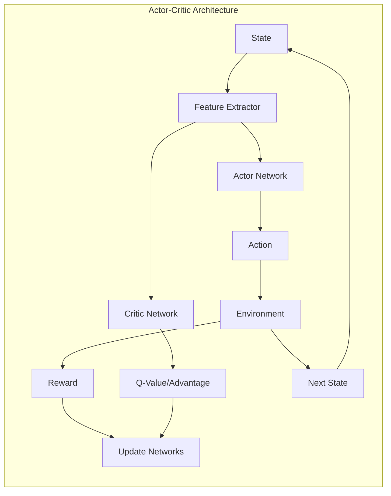
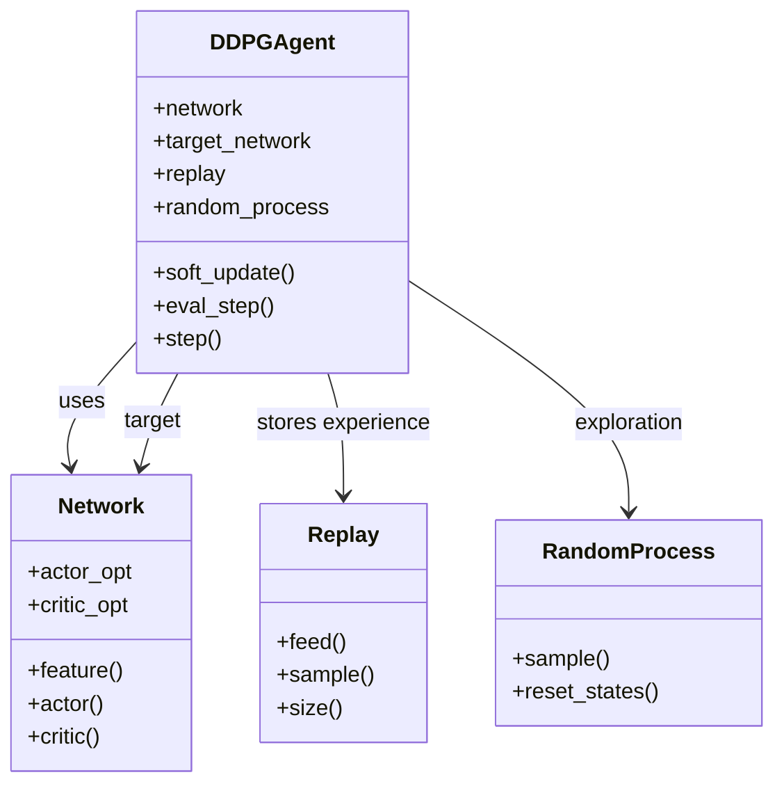
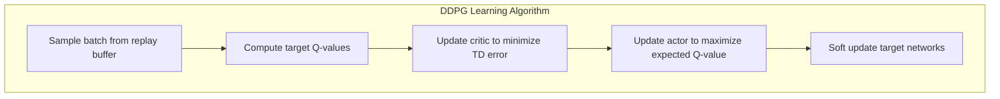
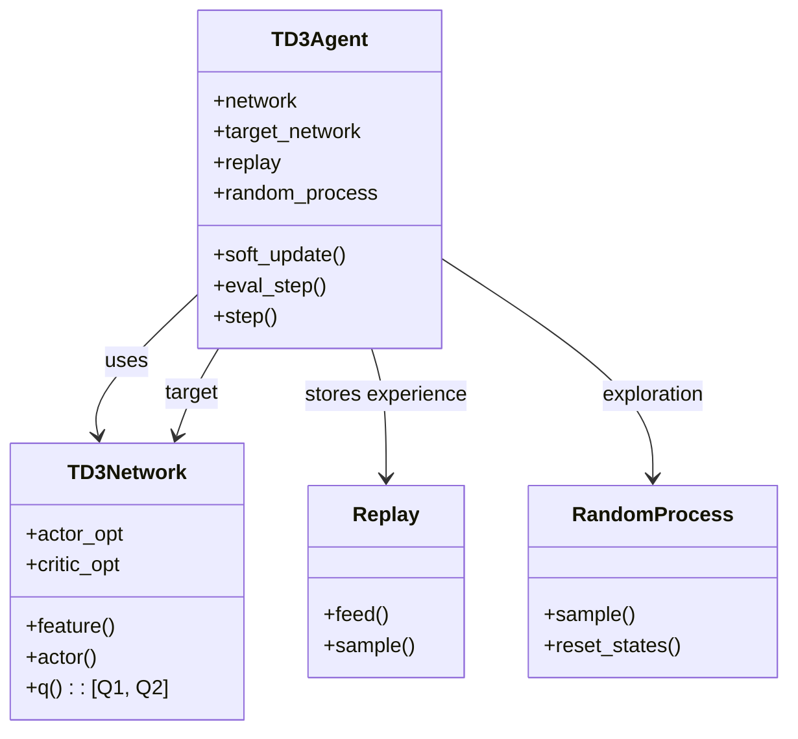
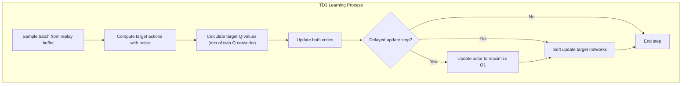
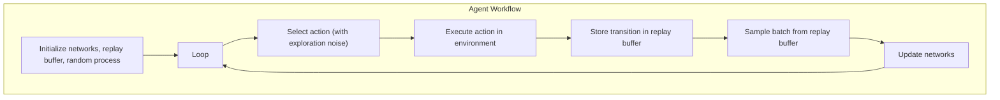

<!-- source: DeepWiki mcp.deepwiki.com · repo ShangtongZhang/DeepRL · page 2.4 Actor-Critic Methods · fetched 2026-10-30 -->

# Actor-Critic Methods

<details>
<summary>Relevant source files</summary>

The following files were used as context for generating this wiki page:

- [deep_rl/agent/DDPG_agent.py](deep_rl/agent/DDPG_agent.py)
- [deep_rl/agent/TD3_agent.py](deep_rl/agent/TD3_agent.py)

</details>


## Purpose

This document provides technical documentation on the actor-critic reinforcement learning methods implemented in the DeepRL framework. Actor-critic methods combine policy-based (actor) and value-based (critic) learning approaches to achieve more stable and efficient reinforcement learning in continuous action spaces. This page specifically covers the implementations of Deep Deterministic Policy Gradient (DDPG) and Twin Delayed Deep Deterministic Policy Gradient (TD3).

For information about policy gradient methods like A2C and PPO, see [Policy Gradient Methods](#2.3). For value-based methods like DQN and its variants, see [DQN Family](#2.2).

## Conceptual Overview

Actor-critic methods maintain two function approximators:
1. **Actor**: Determines which actions to take (policy function)
2. **Critic**: Evaluates those actions (value function)

This architecture enables learning in continuous action spaces while reducing the variance of policy gradient estimates.



Sources: [deep_rl/agent/DDPG_agent.py:79-101](), [deep_rl/agent/TD3_agent.py:79-106]()

## Deep Deterministic Policy Gradient (DDPG)

DDPG is an off-policy actor-critic algorithm that combines Deterministic Policy Gradient with deep neural networks, designed specifically for continuous action spaces.

### Key Components



Sources: [deep_rl/agent/DDPG_agent.py:13-25]()

### Implementation Details

The `DDPGAgent` is implemented with the following key architectural elements:

1. **Twin Networks**:
   - Primary network for action selection and value estimation
   - Target network for stable Q-learning targets
   
2. **Network Structure**:
   - Feature extractor (shared between actor and critic)
   - Actor network (outputs actions)
   - Critic network (evaluates state-action pairs)

3. **Exploration Strategy**:
   - Uses a random process (typically Ornstein-Uhlenbeck) to add noise to actions
   - Includes a warm-up period with purely random actions

4. **Learning Process**:



The learning process involves these steps:
1. Sample transitions from replay buffer
2. Compute target Q-values using target networks
3. Update critic by minimizing TD error
4. Update actor by maximizing expected Q-value 
5. Soft update target networks toward primary networks

Sources: [deep_rl/agent/DDPG_agent.py:72-101]()

### Code Walkthrough

The agent's main workflow:

1. **Initialization**:
   - Creates neural networks, target networks, replay buffer, and random process
   - Target network is initially identical to primary network

2. **Action Selection**:
   ```
   action = network(state) + exploration_noise
   ```

3. **Experience Collection**:
   - Executes actions, observes rewards and next states
   - Stores transitions in replay buffer

4. **Learning Update**:

   - **Critic Update**:
     ```
     q_next = target_network.critic(next_states, target_network.actor(next_states))
     target_q = rewards + discount * mask * q_next
     current_q = network.critic(states, actions)
     critic_loss = MSE(current_q, target_q)
     ```

   - **Actor Update**:
     ```
     policy_loss = -network.critic(states, network.actor(states)).mean()
     ```

   - **Target Network Update**:
     ```
     target_param = (1-τ) * target_param + τ * param
     ```

Sources: [deep_rl/agent/DDPG_agent.py:39-101]()

## Twin Delayed Deep Deterministic Policy Gradient (TD3)

TD3 is an enhancement of DDPG that addresses function approximation errors through three key modifications:

1. **Twin Critics**: Uses two Q-functions to reduce overestimation bias
2. **Delayed Policy Updates**: Updates the policy less frequently than the critics
3. **Target Policy Smoothing**: Adds noise to target actions to prevent overfitting

### Implementation Architecture



Sources: [deep_rl/agent/TD3_agent.py:13-25]()

### Key Differences from DDPG

| Feature | DDPG | TD3 |
|---------|------|-----|
| Critic Structure | Single Q-network | Twin Q-networks |
| Policy Updates | Every step | Delayed (typically every 2 steps) |
| Target Actions | Direct from target policy | With added clipped noise |
| Q-Target | Single Q-value | Minimum of twin Q-values |

Sources: [deep_rl/agent/DDPG_agent.py:79-101](), [deep_rl/agent/TD3_agent.py:79-106]()

### TD3 Learning Algorithm



Sources: [deep_rl/agent/TD3_agent.py:71-106]()

### Code Walkthrough

TD3's implementation follows a similar structure to DDPG with these key differences:

1. **Twin Critics**:
   ```
   q_1, q_2 = network.q(states, actions)
   ```

2. **Target Policy Smoothing**:
   ```
   noise = torch.randn_like(a_next).mul(config.td3_noise)
   noise = noise.clamp(-config.td3_noise_clip, config.td3_noise_clip)
   a_next = (a_next + noise).clamp(min_a, max_a)
   ```

3. **Clipped Double-Q Learning**:
   ```
   q_1, q_2 = target_network.q(next_states, a_next)
   target = rewards + discount * mask * torch.min(q_1, q_2)
   ```

4. **Delayed Policy Updates**:
   ```
   if self.total_steps % config.td3_delay:
       # Update actor and target networks
   ```

Sources: [deep_rl/agent/TD3_agent.py:79-106]()

## Implementation Workflow

The general workflow for both DDPG and TD3 agents follows this pattern:



Both agents inherit from `BaseAgent` and follow similar implementation patterns, differing primarily in their learning algorithms.

Sources: [deep_rl/agent/DDPG_agent.py:39-70](), [deep_rl/agent/TD3_agent.py:39-70]()

## Usage Considerations

1. **Hyperparameters**:
   - Learning rate for actor and critic
   - Target network update rate (`target_network_mix`)
   - Discount factor
   - Exploration noise parameters
   - For TD3: noise parameters and update delay

2. **When to Use**:
   - DDPG: Good baseline for continuous control tasks
   - TD3: When more stable learning is required, especially in complex environments

Both methods work well in continuous action spaces where DQN-like methods cannot be directly applied.

Sources: [deep_rl/agent/DDPG_agent.py:13-101](), [deep_rl/agent/TD3_agent.py:13-106]()

---

