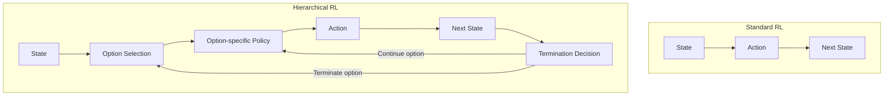
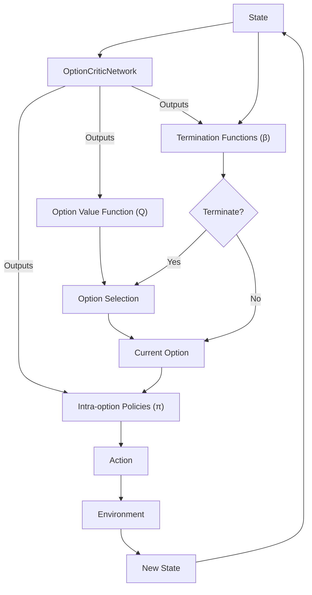
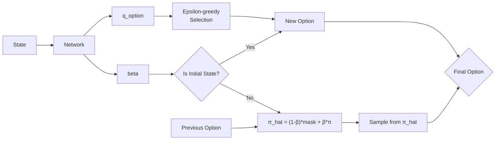
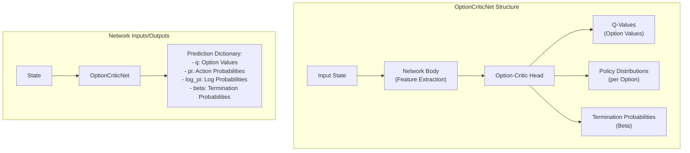

<!-- source: DeepWiki mcp.deepwiki.com · repo ShangtongZhang/DeepRL · page 2.5 Hierarchical Reinforcement Learning · fetched 2026-10-30 -->

# Hierarchical Reinforcement Learning

Relevant source files

The following files were used as context for generating this wiki page:

- [deep_rl/agent/A2C_agent.py](deep_rl/agent/A2C_agent.py)
- [deep_rl/agent/NStepDQN_agent.py](deep_rl/agent/NStepDQN_agent.py)
- [deep_rl/agent/OptionCritic_agent.py](deep_rl/agent/OptionCritic_agent.py)

This page documents the implementation of hierarchical reinforcement learning (HRL) methods in the DeepRL framework, focusing on the Option-Critic architecture. For information about standard policy gradient methods and actor-critic approaches, see [Policy Gradient Methods](#2.3) and [Actor-Critic Methods](#2.4).

## Introduction to Hierarchical RL

Hierarchical reinforcement learning introduces temporal abstraction into the decision-making process by enabling agents to reason at multiple time scales. Rather than selecting primitive actions at each timestep, HRL agents can choose and execute higher-level skills or "options" that may persist for multiple timesteps.

Sources: [deep_rl/agent/OptionCritic_agent.py:12-119]()

## Option-Critic Architecture

The primary hierarchical RL algorithm implemented in this framework is the Option-Critic architecture. This approach integrates options into the actor-critic framework, enabling end-to-end learning of both option policies and termination conditions.

### Key Components

The Option-Critic agent consists of three main components:

1. **Option Value Function (Critic)**: Estimates the value of each option in different states
2. **Intra-option Policies (Actor)**: Determines the action to take when following a specific option
3. **Option Termination Functions (Beta)**: Determines the probability of terminating the current option

Sources: [deep_rl/agent/OptionCritic_agent.py:29-49](), [deep_rl/agent/OptionCritic_agent.py:51-85]()

## Implementation Details

The `OptionCriticAgent` class implements the Option-Critic architecture in the DeepRL framework. It inherits from `BaseAgent` and maintains:

- A neural network that outputs option values, intra-option policies, and termination probabilities
- A target network for stable learning
- State tracking across multiple workers for parallel execution

### Option Selection Process

The agent selects options using a combination of:
- An epsilon-greedy strategy for exploration
- A termination function (beta) that determines when to switch options

Sources: [deep_rl/agent/OptionCritic_agent.py:29-49]()

### Training Process

The training process involves several loss components:

1. **Q-value Loss**: Minimizes the difference between predicted and target option values
2. **Policy Loss**: Updates the intra-option policy to maximize advantage
3. **Beta Loss**: Updates the termination function based on the advantage of terminating versus continuing

The agent collects experience over multiple rollout steps before performing batch updates to all components simultaneously.

### Code Structure

The `OptionCriticAgent` class is organized into the following key methods:

- `__init__`: Initializes networks, optimizers, and state tracking
- `sample_option`: Implements the option selection logic with epsilon exploration
- `step`: Collects experience and performs network updates

During each step, the agent:
1. Samples options based on the current policy and termination conditions
2. Executes actions according to the intra-option policy
3. Collects experience data in a storage buffer
4. Computes advantages and returns for each component
5. Updates the network parameters using the combined loss

Sources: [deep_rl/agent/OptionCritic_agent.py:51-118]()

## Network Architecture Integration

The Option-Critic architecture requires a specialized network that outputs multiple components. This network integrates with the modular network system described in [Network Architecture System](#3).

Sources: [deep_rl/agent/OptionCritic_agent.py:56-69]()

## Loss Computation

The Option-Critic agent computes three distinct loss components:

| Loss Component | Purpose | Computation |
|----------------|---------|-------------|
| Q-value Loss | Learn option values | `0.5 * (q.gather(1, option) - ret).pow(2).mean()` |
| Policy Loss | Improve intra-option policies | `-(log_pi.gather(1, action) * advantage) - entropy_weight * entropy` |
| Beta Loss | Learn termination conditions | `beta.gather(1, prev_option) * beta_advantage * (1 - init_state)` |

The total loss is the sum of these components, and all network parameters are updated together.

Sources: [deep_rl/agent/OptionCritic_agent.py:109-118]()

## Usage Example

To use the Option-Critic agent, you need to configure:
1. A network function that returns an appropriate Option-Critic network
2. Task and optimizer functions
3. Hyperparameters such as rollout length and termination regularization

The agent supports parallel execution across multiple workers for efficient training.

## Comparison to Standard Agents

Compared to standard agents like A2C or N-Step DQN, the Option-Critic agent:

1. Maintains option-specific state (previous options, initial state flags)
2. Uses a more complex option selection mechanism that considers termination probabilities
3. Computes additional loss terms for option termination learning
4. Supports temporal abstraction through extended option execution

This hierarchical structure enables the agent to learn useful skills and operate at multiple time scales, potentially improving exploration and transfer learning capabilities.

Sources: [deep_rl/agent/OptionCritic_agent.py:12-119](), [deep_rl/agent/A2C_agent.py:12-64](), [deep_rl/agent/NStepDQN_agent.py:13-67]()

---

