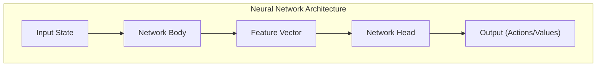
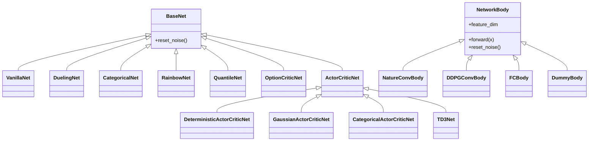
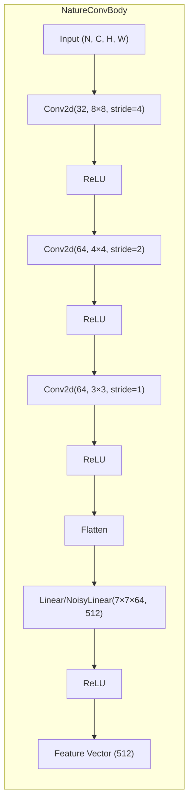
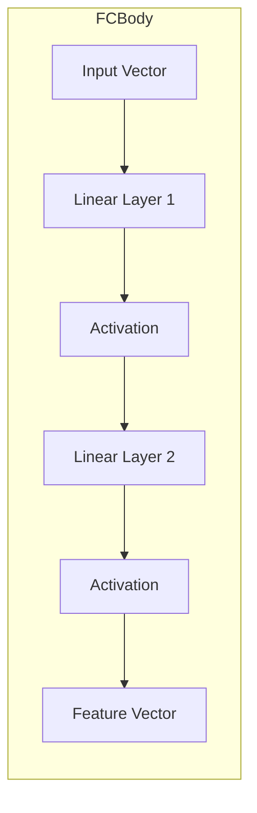
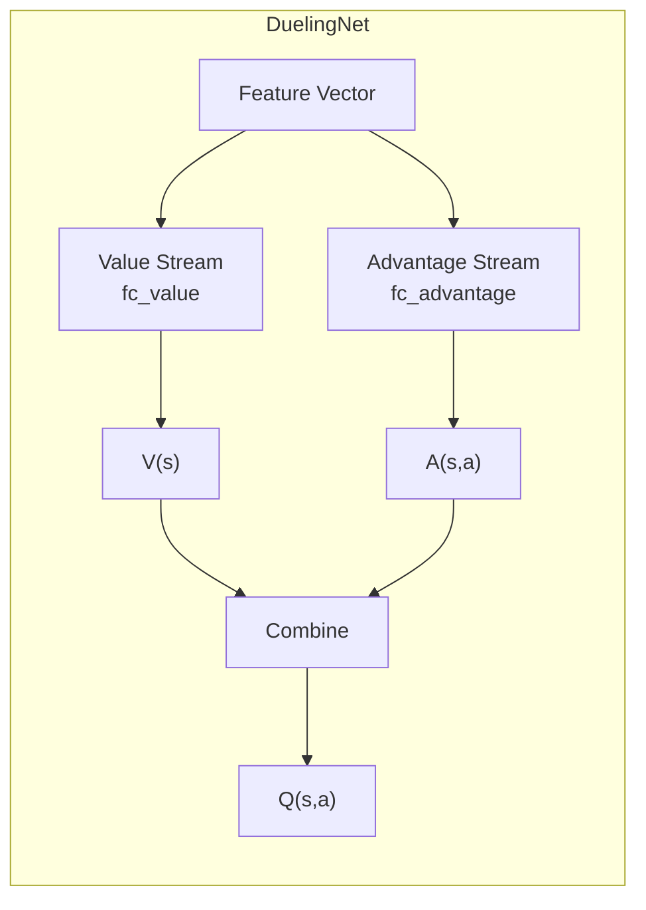
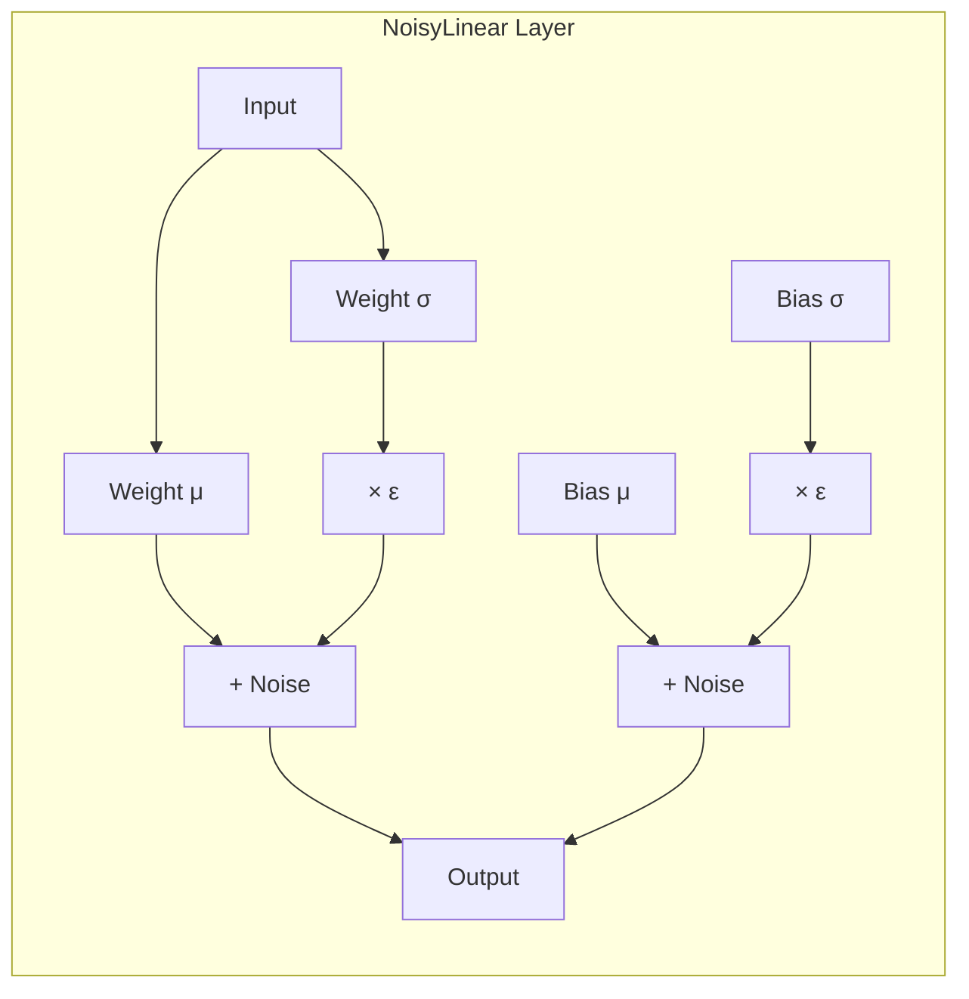
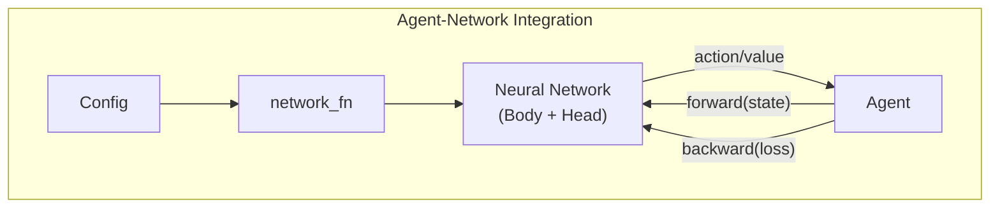
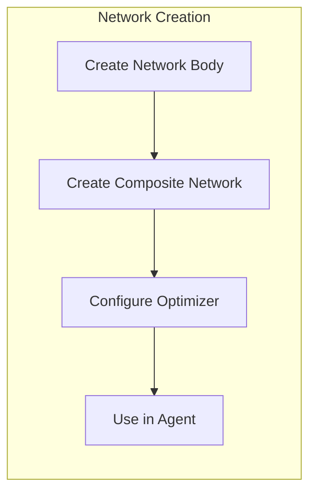

<!-- source: DeepWiki mcp.deepwiki.com · repo ShangtongZhang/DeepRL · page 3 Neural Networks · fetched 2026-10-30 -->

# Neural Networks

<details>
<summary>Relevant source files</summary>

The following files were used as context for generating this wiki page:

- [deep_rl/agent/PPO_agent.py](deep_rl/agent/PPO_agent.py)
- [deep_rl/component/__init__.py](deep_rl/component/__init__.py)
- [deep_rl/network/network_bodies.py](deep_rl/network/network_bodies.py)
- [deep_rl/network/network_heads.py](deep_rl/network/network_heads.py)
- [deep_rl/network/network_utils.py](deep_rl/network/network_utils.py)
- [deep_rl/utils/normalizer.py](deep_rl/utils/normalizer.py)

</details>


This document details the neural network architecture within the DeepRL framework. It covers the modular design pattern used for network construction, available network bodies and heads, and how they integrate with reinforcement learning algorithms. For information about specific agents that use these networks, see [Agents](#2).

## 1. Neural Network Design Philosophy

The DeepRL framework implements a modular neural network architecture that separates **feature extraction** (bodies) from **action/value prediction** (heads). This design pattern allows for flexible composition of networks suited to different reinforcement learning algorithms and environment types.



Sources: [deep_rl/network/network_bodies.py](), [deep_rl/network/network_heads.py]()

## 2. Network Component Hierarchy

The neural network system follows a class hierarchy with specialized implementations for different algorithms:



Sources: [deep_rl/network/network_utils.py:15-20](), [deep_rl/network/network_heads.py](), [deep_rl/network/network_bodies.py]()

## 3. Network Bodies

Network bodies handle feature extraction from input states. They convert raw input (like images or state vectors) into feature representations that can be used by network heads.

| Network Body | Purpose | Feature Dimension | Typical Use Case |
|--------------|---------|-------------------|------------------|
| `NatureConvBody` | CNN from Nature DQN paper | 512 | Image-based environments (Atari) |
| `DDPGConvBody` | Lightweight CNN | 39 * 39 * 32 | Image-based control tasks |
| `FCBody` | Fully-connected layers | Configurable | Vector-based states |
| `DummyBody` | Identity mapping | Same as input | When no feature extraction is needed |

### 3.1 NatureConvBody

The `NatureConvBody` implements the convolutional architecture from the DQN Nature paper, consisting of three convolutional layers followed by a fully-connected layer:



Sources: [deep_rl/network/network_bodies.py:10-33]()

### 3.2 FCBody

The `FCBody` is a configurable fully-connected network that can process vector inputs:



Sources: [deep_rl/network/network_bodies.py:50-73]()

## 4. Network Heads

Network heads take features from network bodies and produce algorithm-specific outputs such as Q-values, value estimates, or policy distributions.

### 4.1 Value-Based Heads

| Network Head | Purpose | Output | Used In |
|--------------|---------|--------|---------|
| `VanillaNet` | Basic Q-network | Q-values | DQN |
| `DuelingNet` | Separate value and advantage streams | Q-values | Dueling DQN |
| `CategoricalNet` | Categorical value distribution | Value distribution | C51 |
| `RainbowNet` | Combines dueling and distributional | Value distribution | Rainbow DQN |
| `QuantileNet` | Quantile regression | Quantile values | QR-DQN |

### 4.2 Policy-Based Heads

| Network Head | Purpose | Output | Used In |
|--------------|---------|--------|---------|
| `GaussianActorCriticNet` | Stochastic continuous policies | Mean action, value | PPO, A2C for continuous actions |
| `CategoricalActorCriticNet` | Discrete action policies | Action probabilities, value | PPO, A2C for discrete actions |
| `DeterministicActorCriticNet` | Deterministic policies | Action, Q-value | DDPG |
| `TD3Net` | Twin delayed DDPG | Action, twin Q-values | TD3 |
| `OptionCriticNet` | Hierarchical RL | Option values, termination, policy | Option-Critic |

### 4.3 Example: DuelingNet Architecture

The `DuelingNet` implements the dueling architecture which separates state value and action advantage estimation:



Sources: [deep_rl/network/network_heads.py:24-37]()

## 5. Specialized Components

### 5.1 NoisyLinear

The `NoisyLinear` layer replaces standard fully-connected layers to introduce parametric noise for exploration:



Sources: [deep_rl/network/network_utils.py:31-83]()

### 5.2 Layer Initialization

The `layer_init` function initializes network layers with orthogonal weights, which is important for stable training of policy gradient methods:

```python
def layer_init(layer, w_scale=1.0):
    nn.init.orthogonal_(layer.weight.data)
    layer.weight.data.mul_(w_scale)
    nn.init.constant_(layer.bias.data, 0)
    return layer
```

Sources: [deep_rl/network/network_utils.py:23-27]()

## 6. Integration with Agents

Neural networks serve as the function approximators that power agents' decision-making capabilities. Here's how they're typically integrated:



Sources: [deep_rl/agent/PPO_agent.py:12-25]()

### 6.1 PPO Example

In the PPO agent implementation, the network is used to:
1. Generate actions during rollouts 
2. Estimate state values for advantages computation
3. Calculate policy probabilities for the PPO loss

```python
# In PPO Agent's step method
prediction = self.network(states)  # Get actions and values
# Later during optimization
prediction = self.network(entry.state, entry.action)  # Get log probabilities and values
```

Sources: [deep_rl/agent/PPO_agent.py:34-35](), [deep_rl/agent/PPO_agent.py:77-78]()

## 7. Normalizers

State and reward normalization is often used to improve training stability. The framework includes several normalizers:

| Normalizer | Purpose |
|------------|---------|
| `MeanStdNormalizer` | Normalizes using running mean and standard deviation |
| `RescaleNormalizer` | Simple scaling by a coefficient |
| `ImageNormalizer` | Scales pixel values to [0,1] |
| `SignNormalizer` | Takes the sign of input values |

Sources: [deep_rl/utils/normalizer.py]()

## 8. Network Creation Flow

The typical flow for creating a neural network in the DeepRL framework:



The network creation is typically handled through the `network_fn` in the configuration, which creates the appropriate body and head combination for the specific algorithm.

Sources: [deep_rl/agent/PPO_agent.py:17]()

---

