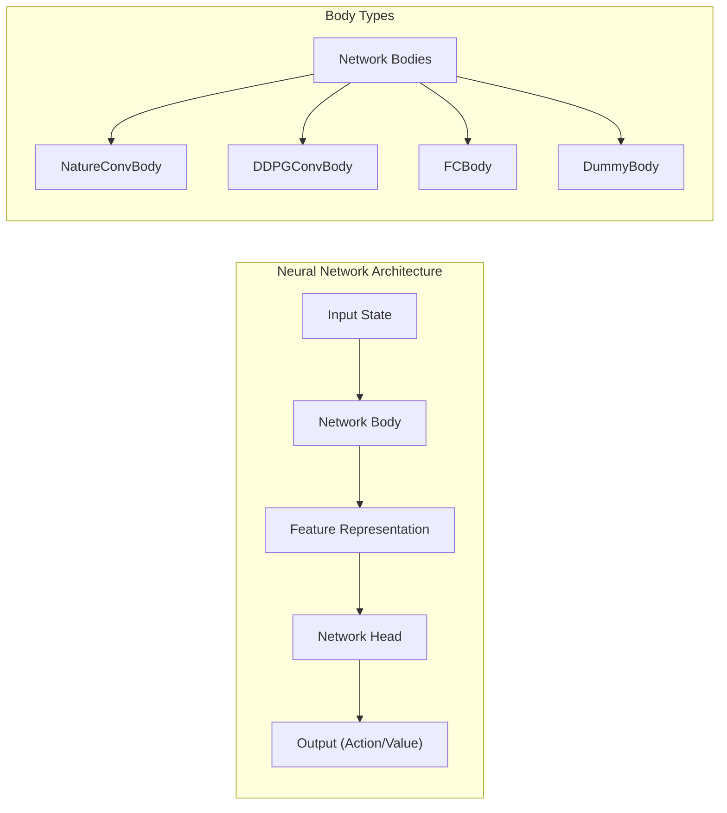
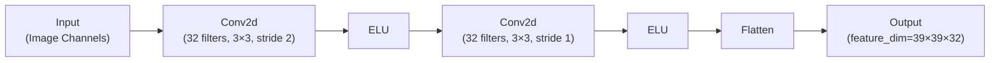
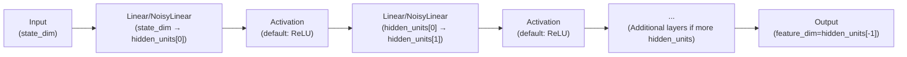
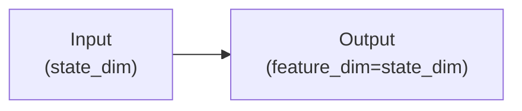
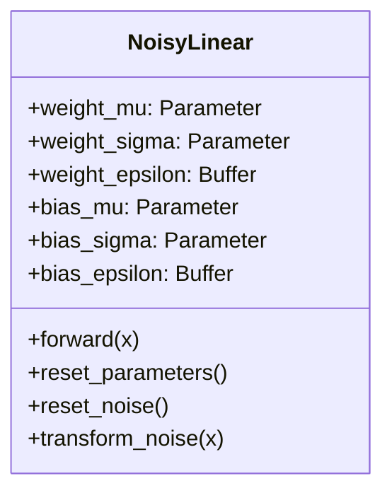
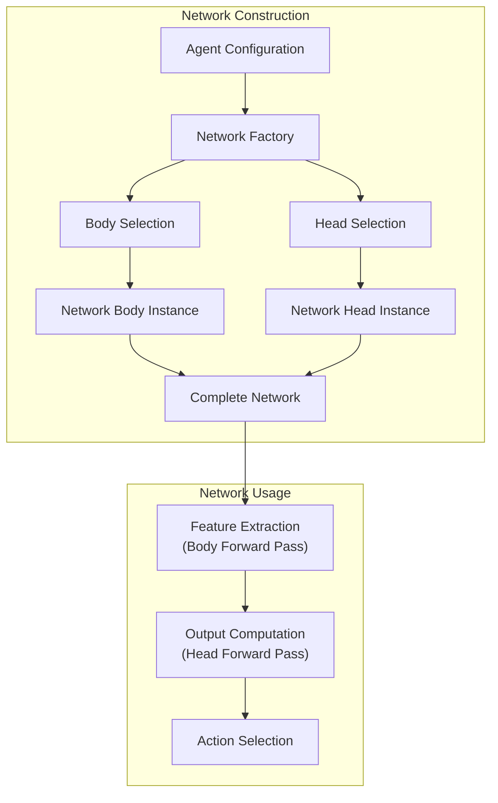
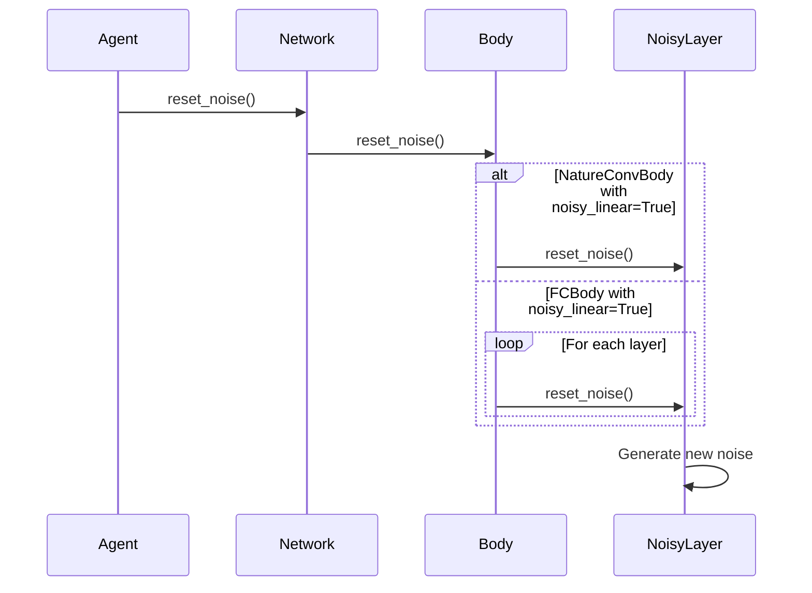
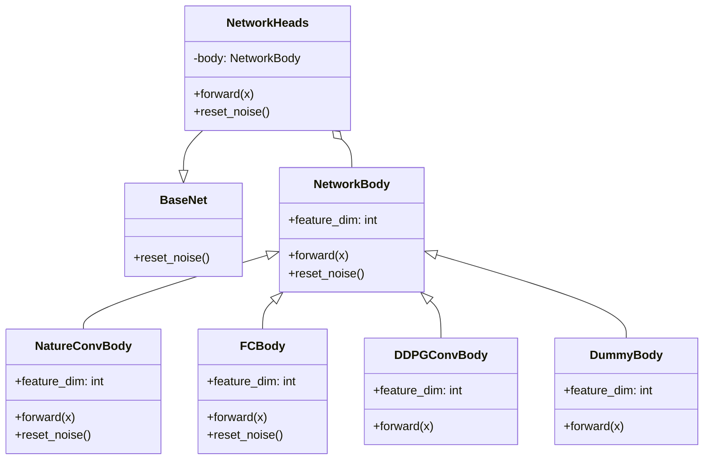

<!-- source: DeepWiki mcp.deepwiki.com · repo ShangtongZhang/DeepRL · page 3.1 Network Bodies · fetched 2026-10-30 -->

# Network Bodies

<details>
<summary>Relevant source files</summary>

The following files were used as context for generating this wiki page:

- [deep_rl/component/__init__.py](deep_rl/component/__init__.py)
- [deep_rl/network/network_bodies.py](deep_rl/network/network_bodies.py)
- [deep_rl/network/network_utils.py](deep_rl/network/network_utils.py)
- [deep_rl/utils/normalizer.py](deep_rl/utils/normalizer.py)

</details>


## Purpose and Scope

Network Bodies are fundamental components in the DeepRL framework that perform feature extraction from raw input states. They process environment observations and transform them into feature representations that can be used by Network Heads (see [Network Heads](#3.2)) for action selection and value estimation.

This page documents the different types of network bodies implemented in the DeepRL framework, their architectures, and how they function within the overall neural network system.

## Network Bodies in the System Architecture

Network Bodies are a key part of the modular neural network design pattern used throughout the DeepRL framework. They represent the initial layers of neural networks that process environment states.



Sources: [deep_rl/network/network_bodies.py:10-82]()

Network Bodies extract meaningful features from environment observations before passing them to the Network Heads, which are specialized for different reinforcement learning algorithms. This separation of concerns allows for flexible combinations of bodies and heads depending on the environment and algorithm requirements.

## Types of Network Bodies

The DeepRL framework implements four main types of network bodies, each designed for specific types of input and algorithms:

### NatureConvBody

A convolutional neural network architecture based on the one used in the DeepMind Nature paper on DQN. It's designed to process pixel-based inputs from environments like Atari games.

```mermaid
flowchart LR
    Input["Input\n(Image Channels)"] --> Conv1["Conv2d\n(32 filters, 8×8, stride 4)"]
    Conv1 --> ReLU1["ReLU"]
    ReLU1 --> Conv2["Conv2d\n(64 filters, 4×4, stride 2)"]
    Conv2 --> ReLU2["ReLU"]
    ReLU2 --> Conv3["Conv2d\n(64 filters, 3×3, stride 1)"]
    Conv3 --> ReLU3["ReLU"]
    ReLU3 --> Flatten["Flatten"]
    Flatten --> FC["Linear/NoisyLinear\n(7×7×64 → 512)"]
    FC --> ReLU4["ReLU"]
    ReLU4 --> Output["Output\n(feature_dim=512)"]
```



Sources: [deep_rl/network/network_bodies.py:10-33]()

### DDPGConvBody

A simpler convolutional network designed specifically for the DDPG (Deep Deterministic Policy Gradient) algorithm. It uses fewer layers and the ELU activation function.



Sources: [deep_rl/network/network_bodies.py:36-47]()

### FCBody

A fully-connected (dense) neural network body that processes vector inputs. It's highly configurable with customizable hidden units, activation functions, and optional noisy linear layers.



Sources: [deep_rl/network/network_bodies.py:50-73]()

### DummyBody

A pass-through body that doesn't modify the input state. Used when the raw state already contains the necessary features or when feature extraction is not needed.



Sources: [deep_rl/network/network_bodies.py:76-82]()

## Implementation Details

### Layer Initialization

All network bodies use the `layer_init` function for weight initialization, which applies orthogonal initialization to weights and sets biases to zero.

```python
def layer_init(layer, w_scale=1.0):
    nn.init.orthogonal_(layer.weight.data)
    layer.weight.data.mul_(w_scale)
    nn.init.constant_(layer.bias.data, 0)
    return layer
```

Sources: [deep_rl/network/network_utils.py:23-27]()

### Noisy Linear Layers

Both `NatureConvBody` and `FCBody` support noisy linear layers, which add parametric noise to weights and biases for better exploration. These are implemented through the `NoisyLinear` class:



Sources: [deep_rl/network/network_utils.py:31-83]()

### Feature Dimensions

Each network body exposes a `feature_dim` property that defines the output dimension of the body. This is used by network heads to create appropriate input layers.

| Body Type     | Default Feature Dimension                     | Configurable |
|---------------|----------------------------------------------|--------------|
| NatureConvBody | 512                                          | No           |
| DDPGConvBody  | 39 * 39 * 32 = 48,672                        | No           |
| FCBody        | Last element in hidden_units (default: 64)    | Yes          |
| DummyBody     | Same as input state dimension                 | No           |

Sources: [deep_rl/network/network_bodies.py:13-14](), [deep_rl/network/network_bodies.py:38-39](), [deep_rl/network/network_bodies.py:62](), [deep_rl/network/network_bodies.py:79]()

## Integration with Agents and Networks

Network Bodies are typically used as components within larger network architectures defined in network head classes. This design pattern allows for flexible combinations of feature extractors and task-specific output layers.



Sources: [deep_rl/network/network_bodies.py:10-82]()

## Reset Noise Functionality

Bodies that support noisy linear layers implement a `reset_noise` method that resets the noise parameters for exploration. This is typically called at the beginning of each episode or step.



Sources: [deep_rl/network/network_bodies.py:23-25](), [deep_rl/network/network_bodies.py:65-68](), [deep_rl/network/network_utils.py:73-83]()

## Design Pattern: Composition over Inheritance

The DeepRL framework follows the "composition over inheritance" design principle for neural networks. Network Bodies and Network Heads are composed together rather than using deep inheritance hierarchies. This promotes flexibility and reusability across different algorithms.



Sources: [deep_rl/network/network_bodies.py:10-82](), [deep_rl/network/network_utils.py:15-21]()

This modular design enables the framework to support a wide range of reinforcement learning algorithms while promoting code reuse and maintainability.

---

