<!-- source: DeepWiki mcp.deepwiki.com · repo ShangtongZhang/DeepRL · page 3.2 Network Heads · fetched 2026-10-30 -->

# Network Heads

Relevant source files

The following files were used as context for generating this wiki page:

- [deep_rl/agent/PPO_agent.py](deep_rl/agent/PPO_agent.py)
- [deep_rl/network/network_heads.py](deep_rl/network/network_heads.py)

Network heads are specialized neural network components that transform features extracted by [Network Bodies](#3.1) into action values, state values, or policy distributions required by various reinforcement learning algorithms. They form the output layers of the neural networks used by agents and are tailored to the specific requirements of each algorithm.

Sources: [deep_rl/network/network_heads.py:1-294]()

## Network Head Architecture

Network heads in the DeepRL framework follow a modular design pattern. Each head receives output features from a network body and transforms them into algorithm-specific outputs such as Q-values, value estimates, or action probabilities.

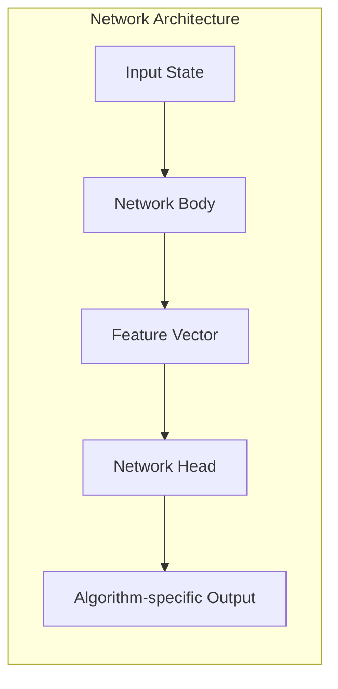

Sources: [deep_rl/network/network_heads.py:11-21]()

### Network Head Categories

The framework includes two main categories of network heads:

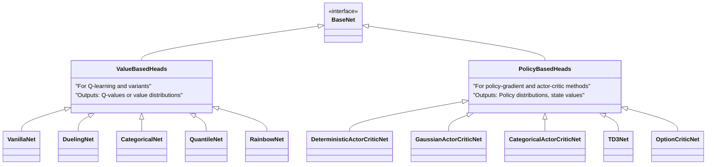

Sources: [deep_rl/network/network_heads.py:11-293]()

## Value-Based Network Heads

Value-based heads are used in Q-learning and its variants to approximate action-values or value distributions.

### VanillaNet

The simplest network head, used for standard DQN implementation. It maps features to Q-values with a single linear layer.

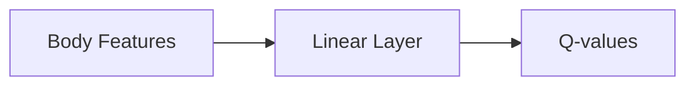

Implementation details:
- Single fully-connected layer from feature_dim to output_dim
- Returns a dictionary with 'q' key containing Q-values

Sources: [deep_rl/network/network_heads.py:11-21]()

### DuelingNet

Implements the dueling architecture which separates the state value and action advantage functions.

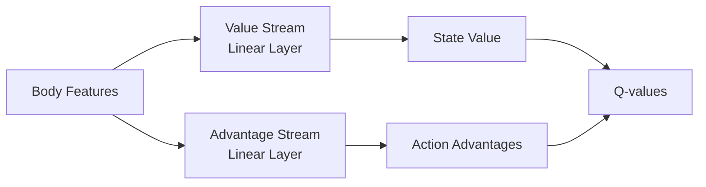

Implementation details:
- Two separate streams: state value (V) and action advantage (A)
- Combines them with the formula: Q = V + (A - mean(A))
- This approach helps stabilize learning

Sources: [deep_rl/network/network_heads.py:24-37]()

### CategoricalNet

Used for distributional RL (C51 algorithm), representing Q-values as probability distributions over fixed value ranges.

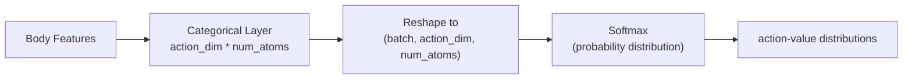

Implementation details:
- Outputs probability distribution over discrete value ranges
- Uses softmax to convert logits to probabilities
- Returns both probabilities and log probabilities

Sources: [deep_rl/network/network_heads.py:40-54]()

### RainbowNet

Combines dueling architecture with distributional RL and optionally noisy networks.

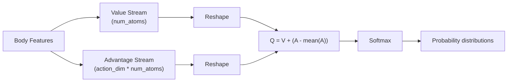

Implementation details:
- Combines dueling architecture with distributional approach
- Optionally uses NoisyLinear layers for exploration
- Includes a reset_noise() method for re-sampling noise

Sources: [deep_rl/network/network_heads.py:57-86]()

### QuantileNet

Implements Quantile Regression DQN (QR-DQN), representing value distributions using quantile regression.

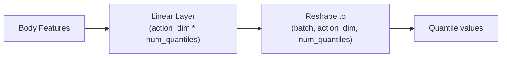

Implementation details:
- Outputs quantile values rather than probabilities
- Quantiles represent the distribution of returns

Sources: [deep_rl/network/network_heads.py:89-102]()

## Policy-Based and Actor-Critic Network Heads

Policy-based heads are used in policy gradient and actor-critic methods to represent policies and estimate state values.

### DeterministicActorCriticNet

Used for DDPG algorithm with deterministic policies for continuous action spaces.

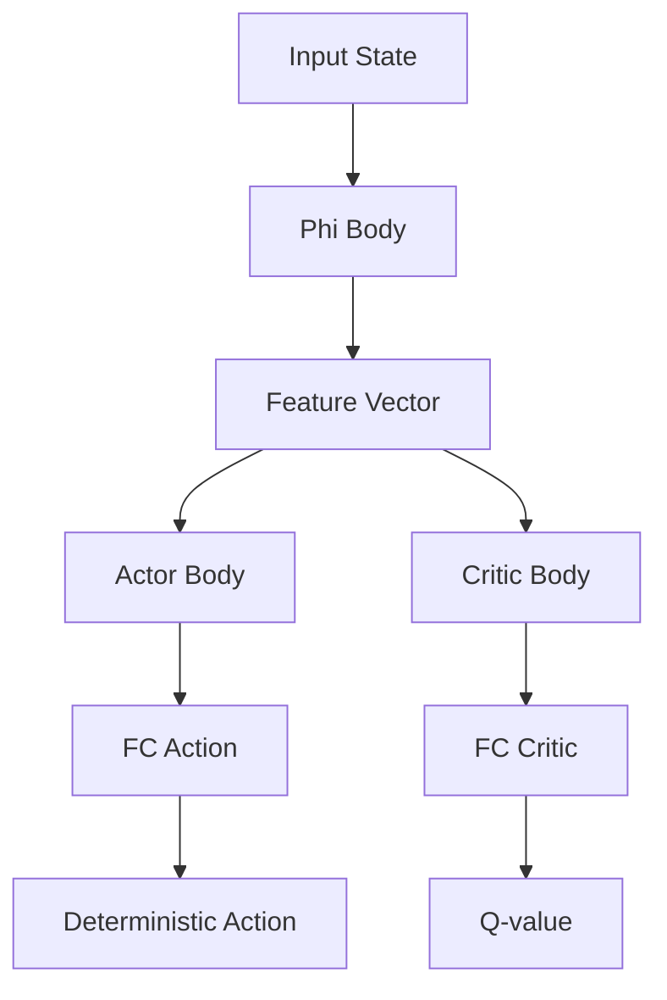

Implementation details:
- Separate bodies for shared feature extraction, actor, and critic
- Actor outputs deterministic actions (with tanh activation)
- Critic evaluates state-action pairs
- Maintains separate optimizers for actor and critic

Sources: [deep_rl/network/network_heads.py:130-171]()

### GaussianActorCriticNet

For stochastic policy gradient methods (like PPO, A2C) with continuous action spaces.

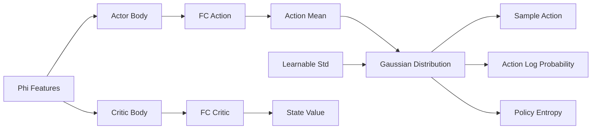

Implementation details:
- Outputs a Gaussian distribution over actions
- Learns both mean and standard deviation
- Provides action samples, log probabilities, and entropy
- Critic outputs state value estimates

Sources: [deep_rl/network/network_heads.py:173-214]()

### CategoricalActorCriticNet

For policy gradient methods with discrete action spaces.

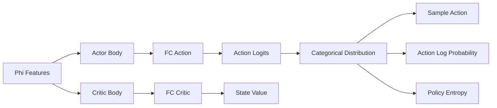

Implementation details:
- Uses a categorical distribution for discrete action spaces
- Provides action samples, log probabilities, and entropy
- Critic outputs state value estimates

Sources: [deep_rl/network/network_heads.py:217-255]()

### TD3Net

Implements Twin Delayed DDPG (TD3) with dual critics for more stable learning.

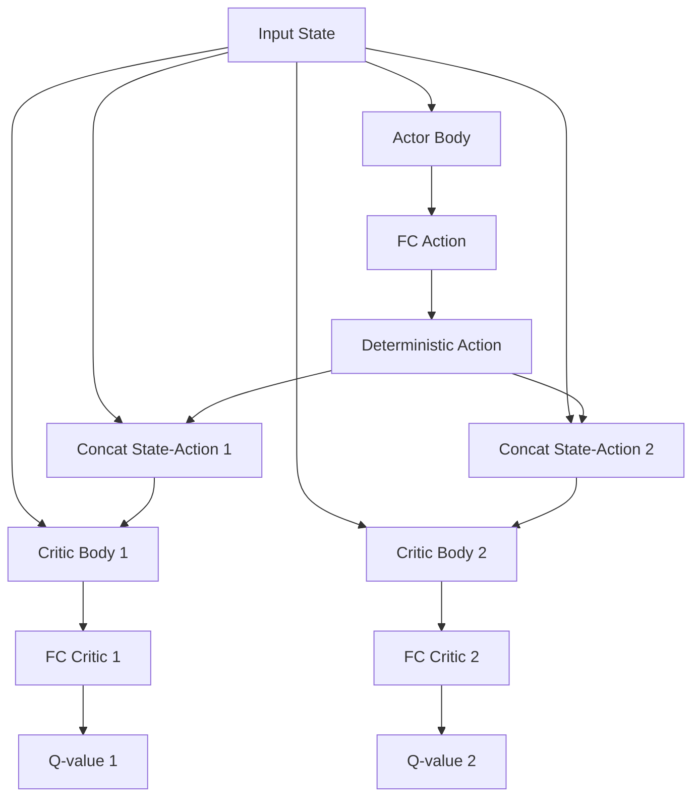

Implementation details:
- Similar to DeterministicActorCriticNet but with dual critics
- Uses the minimum of both critic values to reduce overestimation bias
- Maintains separate optimizers for actor and critics

Sources: [deep_rl/network/network_heads.py:258-293]()

## Specialized Network Heads

### OptionCriticNet

Used for hierarchical reinforcement learning with the Option-Critic architecture.

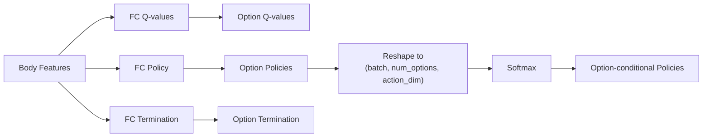

Implementation details:
- Maintains Q-values for different options
- Outputs policies conditional on the selected option
- Has termination probabilities (beta) for each option
- Enables temporally extended actions through options framework

Sources: [deep_rl/network/network_heads.py:105-127]()

## Integration with Agents

Network heads are integrated with agents through the configuration system. The agent uses the network head to process states and produce actions or value estimates.

Example of network head usage in the PPO agent:

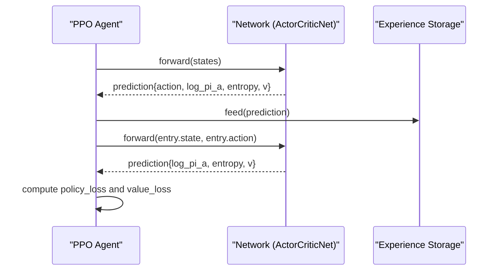

Implementation details:
- The agent creates the network through the configuration system
- During rollout, the network head is used to generate actions and value estimates
- During optimization, the network head is used to evaluate stored experiences
- Loss functions specific to the algorithm are computed using the network outputs

Sources: [deep_rl/agent/PPO_agent.py:33-99]()

## Common Interface Pattern

All network heads follow a common interface pattern:

1. They inherit from `nn.Module` and `BaseNet`
2. They take features from a body and transform them into algorithm-specific outputs
3. They implement a `forward()` method that returns a dictionary of outputs
4. They manage their own parameters and may have specialized optimization strategies

This modular design allows for easy extension and combination of different network architectures to implement various reinforcement learning algorithms.

Sources: [deep_rl/network/network_heads.py:11-293]()

---

