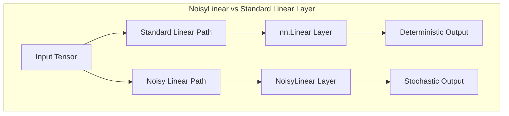
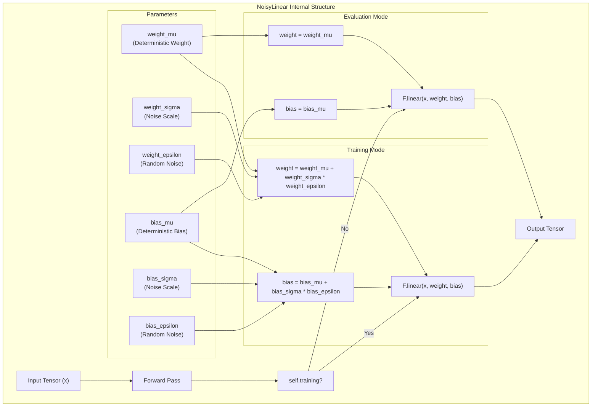
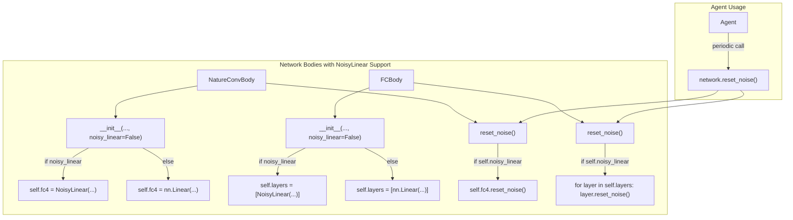

<!-- source: DeepWiki mcp.deepwiki.com · repo ShangtongZhang/DeepRL · page 3.3 Specialized Layers · fetched 2026-10-30 -->

# Specialized Layers

<details>
<summary>Relevant source files</summary>

The following files were used as context for generating this wiki page:

- [deep_rl/component/__init__.py](deep_rl/component/__init__.py)
- [deep_rl/network/network_bodies.py](deep_rl/network/network_bodies.py)
- [deep_rl/network/network_utils.py](deep_rl/network/network_utils.py)
- [deep_rl/utils/normalizer.py](deep_rl/utils/normalizer.py)

</details>


This document covers the specialized neural network layers used in the DeepRL framework. These are custom-designed components that go beyond standard PyTorch layers to implement specific reinforcement learning techniques that enhance exploration and learning capabilities.

For information about network architectures that use these specialized layers, see [Network Bodies](#3.1) and [Network Heads](#3.2).

## NoisyLinear Layer

The primary specialized layer in the DeepRL framework is the `NoisyLinear` layer, which implements the technique described in the paper "Noisy Networks for Exploration" (Fortunato et al., 2018). This layer is a fundamental component in algorithms like NoisyDQN and Rainbow DQN.



Sources: [deep_rl/network/network_utils.py:31-83]()

### Implementation Details

`NoisyLinear` extends the standard linear layer by adding parametric noise to the weights and biases. The implementation divides the weights and biases into deterministic (mu) and noise (sigma) components. During training, the actual weights used are the combination of these components.



Sources: [deep_rl/network/network_utils.py:31-83]()

### Key Methods and Functions

1. **Initialization** - Sets up the parameters with appropriate initialization:
   ```python
   # Initialization scales by input size
   mu_range = 1 / math.sqrt(self.weight_mu.size(1))
   self.weight_mu.data.uniform_(-mu_range, mu_range)
   self.weight_sigma.data.fill_(self.std_init / math.sqrt(self.weight_sigma.size(1)))
   ```

2. **Noise Reset** - Regenerates the random noise components:
   ```python
   def reset_noise(self):
       self.noise_in.normal_(std=Config.NOISY_LAYER_STD)
       self.noise_out_weight.normal_(std=Config.NOISY_LAYER_STD)
       self.noise_out_bias.normal_(std=Config.NOISY_LAYER_STD)
       
       self.weight_epsilon.copy_(self.transform_noise(self.noise_out_weight).ger(
           self.transform_noise(self.noise_in)))
       self.bias_epsilon.copy_(self.transform_noise(self.noise_out_bias))
   ```

3. **Noise Transformation** - Transforms Gaussian noise to factorized noise:
   ```python
   def transform_noise(self, x):
       return x.sign().mul(x.abs().sqrt())
   ```

Sources: [deep_rl/network/network_utils.py:31-83]()

## Integration with Network Bodies

The `NoisyLinear` layer is integrated into network bodies in the framework. This integration provides a mechanism for exploration through parameterized noise rather than using external exploration strategies like ε-greedy.



Sources: [deep_rl/network/network_bodies.py:10-69]()

### In NatureConvBody

The `NatureConvBody` can optionally use a `NoisyLinear` layer for its final fully connected layer:

```python
def __init__(self, in_channels=4, noisy_linear=False):
    # ...
    if noisy_linear:
        self.fc4 = NoisyLinear(7 * 7 * 64, self.feature_dim)
    else:
        self.fc4 = layer_init(nn.Linear(7 * 7 * 64, self.feature_dim))
```

Sources: [deep_rl/network/network_bodies.py:10-33]()

### In FCBody

The `FCBody` can use `NoisyLinear` layers for all of its fully connected layers:

```python
def __init__(self, state_dim, hidden_units=(64, 64), gate=F.relu, noisy_linear=False):
    # ...
    if noisy_linear:
        self.layers = nn.ModuleList(
            [NoisyLinear(dim_in, dim_out) for dim_in, dim_out in zip(dims[:-1], dims[1:])])
    else:
        self.layers = nn.ModuleList(
            [layer_init(nn.Linear(dim_in, dim_out)) for dim_in, dim_out in zip(dims[:-1], dims[1:])])
```

Sources: [deep_rl/network/network_bodies.py:50-73]()

## Usage in Reinforcement Learning

The `NoisyLinear` layer provides several benefits in reinforcement learning:

1. **Parameter-Based Exploration** - Instead of using action-space noise (like ε-greedy or Ornstein-Uhlenbeck process), the noise is directly in the network parameters
2. **Adaptive Exploration** - The noise scale parameters (sigma) are learned, allowing the agent to adapt its exploration
3. **State-Dependent Exploration** - The resulting exploration is state-dependent rather than uniform across the state space

### Typical Usage Pattern

1. Create a network body with noisy linear layers:
   ```python
   body = FCBody(state_dim, hidden_units=(64, 64), noisy_linear=True)
   ```

2. Periodically reset the noise during training:
   ```python
   # Before taking actions, reset noise to get new exploration patterns
   network.reset_noise()
   ```

3. During evaluation, the noise is automatically disabled (due to the `self.training` check in forward pass).

## Relationship with Other Components

This specialized layer interacts with several other components in the DeepRL framework:

| Component | Relationship |
|-----------|--------------|
| Network Bodies | Can optionally use NoisyLinear layers |
| DQN Variants | Rainbow and NoisyDQN use NoisyLinear for exploration |
| BaseNet | Defines the common interface (reset_noise method) |
| layer_init | Standard layers use layer_init; NoisyLinear has its own initialization |

Sources: [deep_rl/network/network_utils.py:15-27](), [deep_rl/network/network_bodies.py:10-73]()

## Future Extensions

The modular design of the specialized layers system allows for additional specialized layers to be added in the future. Potential extensions could include:

- Gated recurrent units with noise
- Attention mechanisms with exploration capabilities
- Layers with integrated curiosity or uncertainty estimation

The current implementation focuses on the `NoisyLinear` layer, which has proven effective for exploration in value-based methods.

---

