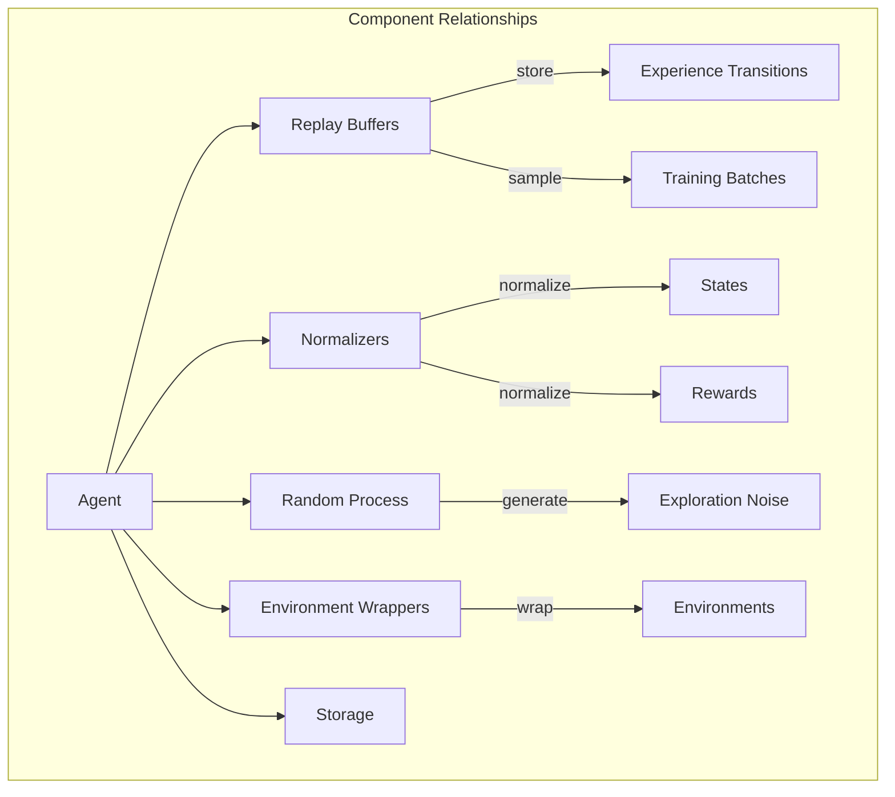
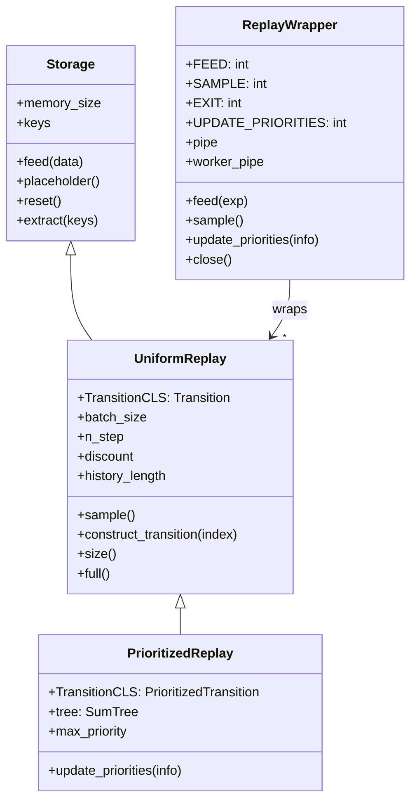
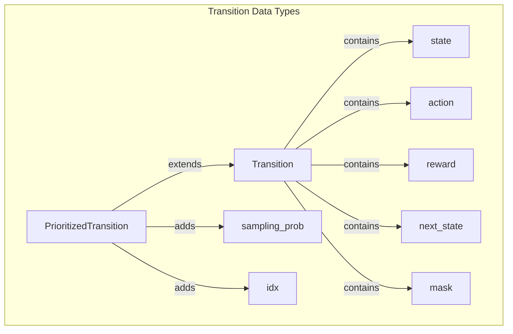

<!-- source: DeepWiki mcp.deepwiki.com · repo ShangtongZhang/DeepRL · page 4 Components · fetched 2026-10-30 -->

# Components

<details>
<summary>Relevant source files</summary>

The following files were used as context for generating this wiki page:

- [.gitignore](.gitignore)
- [deep_rl/component/replay.py](deep_rl/component/replay.py)

</details>


This page documents the core reusable components used throughout the DeepRL framework. Components are modular building blocks that agents use to interact with environments, store experiences, normalize data, and manage learning processes. For information about specific neural network architectures, see [Neural Networks](#3), and for details about agent implementations, see [Agents](#2).

## Component Architecture

The DeepRL framework uses a component-based design pattern where specialized components handle specific aspects of the reinforcement learning workflow. These components are combined by agents to implement various algorithms.



Sources: [deep_rl/component/replay.py:15-17]()

## Replay Buffers

Replay buffers store experience transitions and provide methods to sample from them for agent training. The framework implements various replay buffer strategies to support different learning algorithms.



Sources: [deep_rl/component/replay.py:20-278]()

### Storage Class

The `Storage` class is the base component for experience storage, providing a flexible container that can hold different types of data with arbitrary keys.

Key features:
- Manages a configurable list of data keys
- Provides methods for adding data, extracting batches, and resetting
- Used as the foundation for all replay buffer implementations

```
Storage
├── memory_size: maximum number of transitions to store
├── keys: list of attribute names to track
└── Methods:
    ├── feed(data): add new data to storage
    ├── placeholder(): initialize empty placeholders
    ├── reset(): clear all stored data
    └── extract(keys): extract specific data by keys
```

Sources: [deep_rl/component/replay.py:20-56]()

### Uniform Replay

The `UniformReplay` class extends `Storage` to provide uniform sampling of transitions. It supports n-step returns and frame stacking for handling sequential data.

Key features:
- Implements uniform random sampling from stored transitions
- Supports n-step returns for temporal difference learning
- Handles history length for frame stacking in observation space
- Maintains a circular buffer structure for efficient memory usage

Sources: [deep_rl/component/replay.py:57-150]()

### Prioritized Replay

The `PrioritizedReplay` class extends `UniformReplay` to implement prioritized experience replay, where transitions with higher TD errors are sampled more frequently.

Key features:
- Uses a sum tree data structure for efficient priority-based sampling
- Maintains sampling probabilities for importance sampling correction
- Provides methods to update priorities based on TD errors

Sources: [deep_rl/component/replay.py:152-197]()

### Replay Wrapper

The `ReplayWrapper` class wraps replay buffers in a separate process to enable asynchronous operation, improving performance by allowing the agent to continue training while samples are being prepared.

Key features:
- Runs replay buffer operations in a separate process
- Implements inter-process communication via pipes
- Maintains a cache of pre-sampled batches for efficiency
- Supports both synchronous and asynchronous operation modes

Sources: [deep_rl/component/replay.py:199-278]()

## Transition Data Structure

The framework defines specialized data structures for experience transitions:



Sources: [deep_rl/component/replay.py:15-17]()

The basic `Transition` namedtuple includes:
- `state`: The current state observation
- `action`: The action taken
- `reward`: The reward received
- `next_state`: The resulting next state
- `mask`: Typically indicates if the episode terminated (0) or continued (1)

The `PrioritizedTransition` extends this with:
- `sampling_prob`: The probability of sampling this transition
- `idx`: The index in the priority tree, for later priority updates

These structured data types ensure consistent handling of experiences throughout the training pipeline.

Sources: [deep_rl/component/replay.py:15-17]()

## Other Core Components

The DeepRL framework includes several other important component types that are covered in more detail in their respective wiki pages:

### Normalizers

Normalizers standardize state and reward data to improve learning stability. They track running statistics of the data and normalize new inputs based on these statistics. For more details, see [Normalizers](#4.3).

### Environment Wrappers

Environment wrappers modify the behavior of reinforcement learning environments to implement features like state preprocessing, reward scaling, and episode termination handling. For more details, see [Environment Wrappers](#4.2).

### Random Process

Random processes generate noise for exploration in continuous action spaces. This includes implementations of Ornstein-Uhlenbeck processes and Gaussian noise for algorithms like DDPG and TD3. These help agents balance exploration and exploitation during training.

## Component Usage Pattern

Components in the DeepRL framework follow a common usage pattern:

1. Components are instantiated during agent initialization
2. They maintain their own internal state throughout the agent's lifetime
3. Agents delegate specific functionality to appropriate components
4. Components can be configured via hyperparameters to adjust their behavior

This modular design allows for easy experimentation with different component implementations while keeping the agent code clean and focused on algorithm-specific logic.

---

