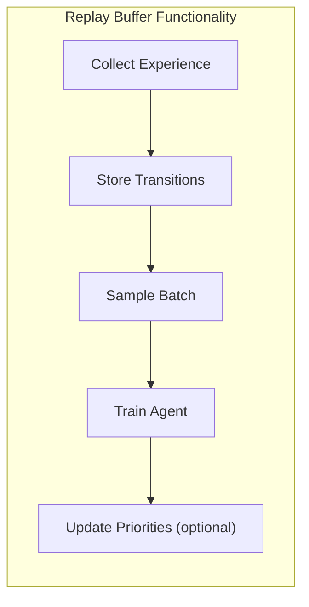
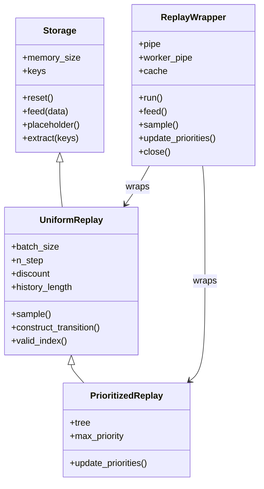
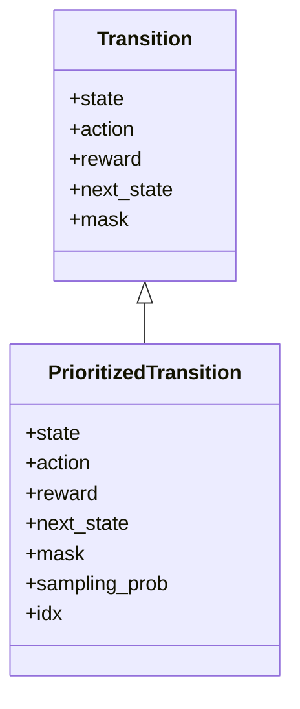
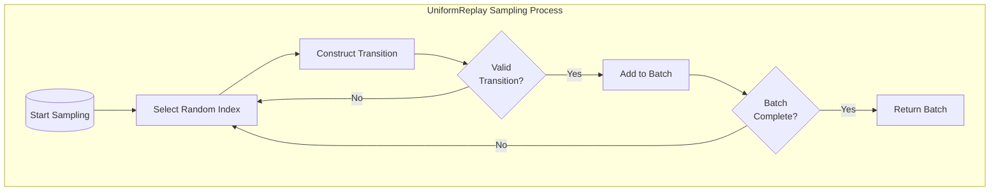
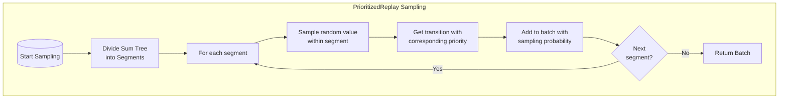
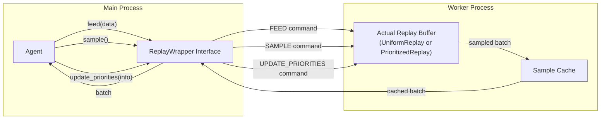
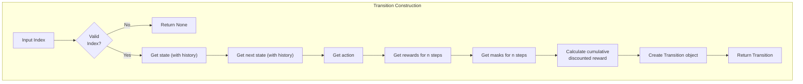

<!-- source: DeepWiki mcp.deepwiki.com · repo ShangtongZhang/DeepRL · page 4.1 Replay Buffers · fetched 2026-10-30 -->

# Replay Buffers

<details>
<summary>Relevant source files</summary>

The following files were used as context for generating this wiki page:

- [deep_rl/component/replay.py](deep_rl/component/replay.py)

</details>


## Purpose and Scope

This document covers the replay buffer implementations in the DeepRL framework. Replay buffers store transitions (state, action, reward, next state) experienced by reinforcement learning agents, allowing them to learn from past experiences. For information about how agents use these buffers during training, see [Agents](#2).

## Introduction to Replay Buffers

Replay buffers are a critical component in deep reinforcement learning that store and manage experience data. They help overcome several challenges in RL training:

1. Breaking temporal correlations between consecutive samples
2. Enabling more efficient data reuse through experience replay
3. Improving learning stability and sample efficiency

The DeepRL framework implements both uniform and prioritized experience replay with support for various features like n-step returns and frame stacking.



Sources: [deep_rl/component/replay.py:57-196]()

## Architecture Overview

The DeepRL framework implements a hierarchical design for replay buffers with several key components:



Sources: [deep_rl/component/replay.py:20-56](), [deep_rl/component/replay.py:57-149](), [deep_rl/component/replay.py:152-196](), [deep_rl/component/replay.py:199-278]()

## Data Structures

The framework defines specialized data structures to represent transitions:



Sources: [deep_rl/component/replay.py:15-17]()

## Replay Buffer Base Class: Storage

The `Storage` class provides the foundation for all replay buffer implementations:

| Method | Description |
|--------|-------------|
| `__init__(memory_size, keys=None)` | Initialize storage with specified memory size and optional keys |
| `feed(data)` | Add data to storage |
| `placeholder()` | Allocate placeholders for empty storage |
| `reset()` | Clear all stored data |
| `extract(keys)` | Extract and concatenate data by keys |

The `Storage` class manages a collection of arrays, one for each key in the `keys` list. It supports arbitrary data fields beyond the standard transition elements.

Sources: [deep_rl/component/replay.py:20-56]()

## Uniform Replay Buffer

The `UniformReplay` class extends `Storage` to implement a standard replay buffer with uniform sampling:



Key features of `UniformReplay`:

1. **N-step Returns**: Accumulates rewards over multiple steps with discounting
2. **Frame Stacking**: Supports stacking multiple frames as a single state (history_length)
3. **Efficient Sampling**: Validates transitions before inclusion in training batches

Sources: [deep_rl/component/replay.py:57-149]()

## Prioritized Replay Buffer

The `PrioritizedReplay` class extends `UniformReplay` to implement prioritized experience replay:



Key features of `PrioritizedReplay`:

1. **Sum Tree**: Uses a specialized tree structure for efficient sampling based on priorities
2. **Priority Updates**: Allows updating priorities based on TD errors
3. **Importance Sampling**: Provides sampling probabilities for importance sampling correction

Sources: [deep_rl/component/replay.py:152-196]()

## Replay Buffer Wrapper for Multiprocessing

The `ReplayWrapper` class enables running the replay buffer in a separate process, which can improve performance:



Key features of `ReplayWrapper`:

1. **Asynchronous Operation**: Runs in a separate process to avoid blocking the main training loop
2. **Sample Caching**: Pre-computes and caches samples to reduce sampling latency
3. **Interprocess Communication**: Uses pipes for efficient message passing between processes

Sources: [deep_rl/component/replay.py:199-278]()

## Transition Construction

Replay buffers handle the complex logic of constructing valid transitions, including:

1. **Boundary Checking**: Ensuring transitions don't span across episode boundaries
2. **N-step Return Calculation**: Computing discounted cumulative rewards across multiple steps
3. **Frame Stacking**: Assembling consecutive frames into a single state representation



Sources: [deep_rl/component/replay.py:112-140]()

## How to Use Replay Buffers

Replay buffers are typically instantiated by agents based on configuration settings. The basic usage pattern is:

1. **Initialization**: Create a replay buffer with appropriate parameters
2. **Data Collection**: Feed transitions to the buffer during environment interaction
3. **Training**: Sample batches of transitions for training the neural network
4. **Priority Updates**: For prioritized replay, update priorities based on TD errors

Example integration with an agent:

```python
# Create a replay buffer
replay = ReplayWrapper(PrioritizedReplay, 
                      {'memory_size': 10000, 
                       'batch_size': 32, 
                       'n_step': 3, 
                       'discount': 0.99, 
                       'history_length': 4})

# Feed transitions
replay.feed({'state': states, 'action': actions, 'reward': rewards, 
             'next_state': next_states, 'mask': masks})

# Sample a batch
batch = replay.sample()

# Update priorities (for prioritized replay)
priorities = calculate_td_errors(batch)
replay.update_priorities(zip(batch.idx, priorities))
```

Sources: [deep_rl/component/replay.py:57-196]()

## Performance Considerations

1. **Memory Usage**: Replay buffers can consume significant memory, especially with large `memory_size` or complex observations
2. **Sampling Efficiency**: Prioritized replay offers better sample efficiency at the cost of additional computation
3. **Multiprocessing**: Using `ReplayWrapper` with `async=True` can improve performance by running replay operations in parallel
4. **Caching**: The `ReplayWrapper` uses a caching mechanism to reduce latency, pre-computing samples while the agent is training

Sources: [deep_rl/component/replay.py:199-278]()

---

