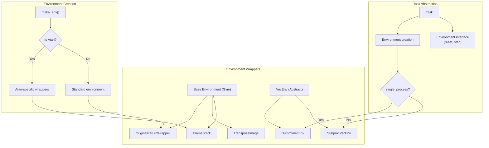
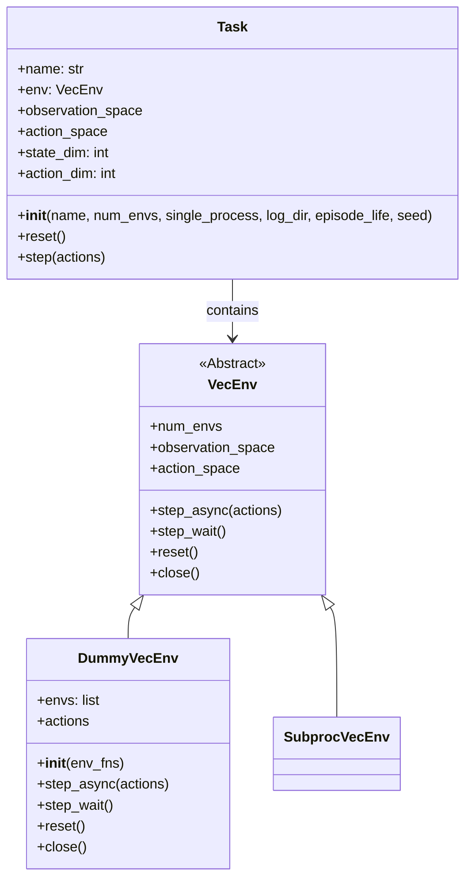
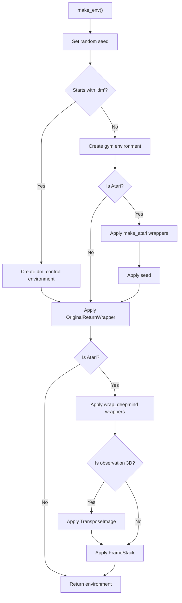
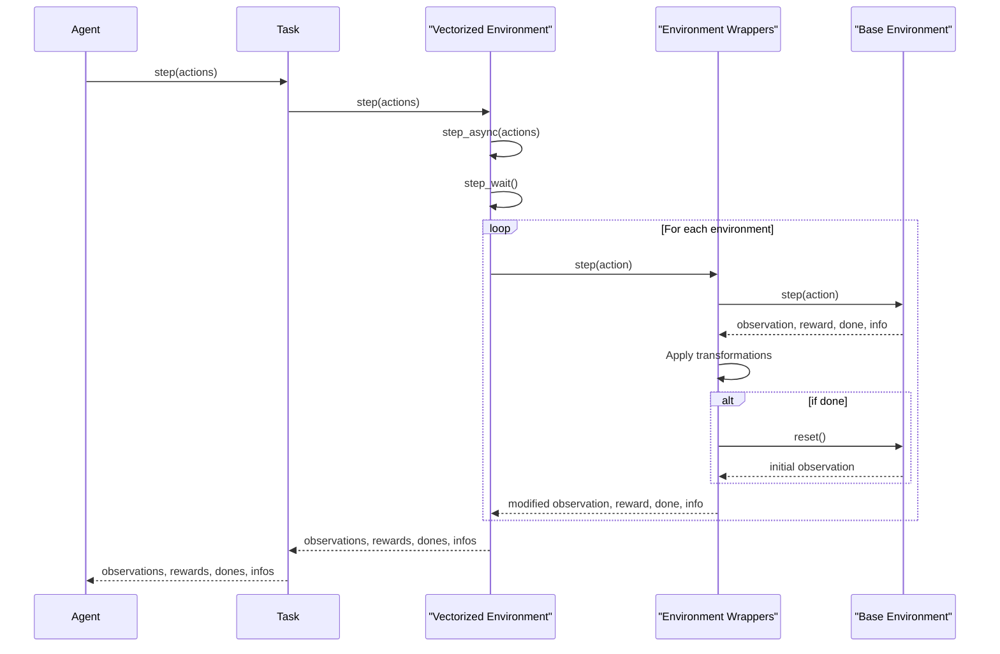
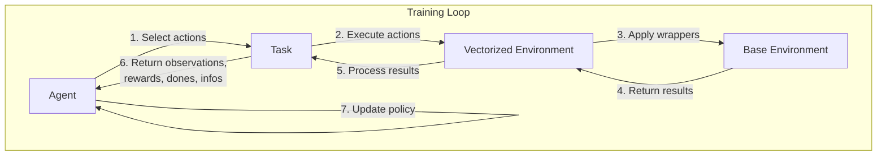

<!-- source: DeepWiki mcp.deepwiki.com · repo ShangtongZhang/DeepRL · page 4.2 Environment Wrappers · fetched 2026-10-30 -->

# Environment Wrappers

<details>
<summary>Relevant source files</summary>

The following files were used as context for generating this wiki page:

- [.gitignore](.gitignore)
- [deep_rl/component/envs.py](deep_rl/component/envs.py)
- [deep_rl/component/random_process.py](deep_rl/component/random_process.py)
- [deep_rl/utils/misc.py](deep_rl/utils/misc.py)
- [deep_rl/utils/plot.py](deep_rl/utils/plot.py)
- [deep_rl/utils/torch_utils.py](deep_rl/utils/torch_utils.py)

</details>


This page documents the environment wrappers in the DeepRL framework. Environment wrappers are middleware components that modify or enhance the behavior of reinforcement learning environments. They provide standardized interfaces, collect additional data, apply transformations to observations, or implement specialized features like frame stacking or vectorized environments.

For information about other components like replay buffers or normalizers, see [Replay Buffers](#4.1) and [Normalizers](#4.3) respectively.

## Environment Wrapper Architecture

The DeepRL framework implements several environment wrappers that follow the OpenAI Gym interface pattern. These wrappers are designed to be composable, allowing them to be stacked to achieve different combinations of functionality. At the highest level, the `Task` class provides a unified interface for agents to interact with environments.



Sources: [deep_rl/component/envs.py:27-190]()

## Task Class

The `Task` class serves as the main interface between agents and environments in the DeepRL framework. It encapsulates environment creation, vectorization, and standardizes the interaction API.

### Key Responsibilities:

1. Creates and configures environments with appropriate wrappers
2. Vectorizes environments for parallel execution
3. Provides a unified interface for agents to interact with environments
4. Handles action space and observation space information



Sources: [deep_rl/component/envs.py:153-190]()

### Task Usage Example

The `Task` class is instantiated with an environment name and configuration parameters. It creates the specified number of environments and allows for either single-process or multi-process execution.

```
task = Task('Hopper-v2', 
            num_envs=5,              # Number of parallel environments 
            single_process=False,    # Use multiprocessing
            log_dir='./log',         # Directory for logs
            episode_life=True,       # Reset on life loss (for Atari)
            seed=42)                 # Random seed

state = task.reset()                 # Reset environments
action = ...                         # Get action from agent
next_state, reward, done, info = task.step(action)  # Take step in environments
```

Sources: [deep_rl/component/envs.py:192-198]()

## Environment Creation

The `make_env` function is responsible for creating and configuring environments with appropriate wrappers.

### Environment Creation Process:

1. Set random seed for reproducibility
2. Create the base environment (gym.make or dm_control2gym.make)
3. Apply domain-specific wrappers (e.g., Atari-specific wrappers)
4. Apply general-purpose wrappers (e.g., OriginalReturnWrapper)
5. Return the wrapped environment



Sources: [deep_rl/component/envs.py:27-55]()

## Key Environment Wrappers

### OriginalReturnWrapper

The `OriginalReturnWrapper` tracks the total reward accumulated during an episode and adds it to the info dictionary when an episode is complete.

```python
# Key functionality:
# - Tracks total rewards during an episode
# - Adds 'episodic_return' to info dictionary on episode completion
```

Sources: [deep_rl/component/envs.py:58-74]()

### TransposeImage

The `TransposeImage` wrapper changes the order of dimensions in image observations. It's particularly useful for converting images from the format used by gym environments (H×W×C) to the format expected by PyTorch (C×H×W).

```python
# Key functionality:
# - Transposes image observation from (H, W, C) to (C, H, W)
# - Updates observation_space accordingly
```

Sources: [deep_rl/component/envs.py:77-88]()

### LazyFrames

The `LazyFrames` class provides memory-efficient storage for stacked frames. Instead of storing multiple copies of the same frame data in replay buffers, it uses a reference-based approach to save memory.

```python
# Key functionality:
# - Optimizes memory usage for frame stacking
# - Implemented as a wrapper around a list of frames
# - Only concatenates frames when converted to numpy array
```

Sources: [deep_rl/component/envs.py:92-114]()

### FrameStack

The `FrameStack` wrapper stacks consecutive frames together to provide temporal information to agents. This is particularly important for environments where the current frame alone doesn't provide velocity information.

```python
# Key functionality:
# - Stacks k consecutive frames together
# - Uses LazyFrames for memory efficiency
```

Sources: [deep_rl/component/envs.py:116-122]()

## Vectorized Environments

Vectorized environments allow running multiple instances of an environment in parallel, which can significantly improve data collection efficiency.

### DummyVecEnv

The `DummyVecEnv` runs multiple environments sequentially in a single process. It provides the same interface as parallel vectorized environments but without the overhead of inter-process communication.

```python
# Key functionality:
# - Runs multiple environments in a single process
# - Implements the VecEnv interface
# - Synchronous execution (no actual parallelism)
```

Sources: [deep_rl/component/envs.py:126-150]()

### SubprocVecEnv

The `SubprocVecEnv` (imported from OpenAI baselines) runs multiple environments in parallel using separate processes. This enables true parallelism for environment execution, which can significantly speed up data collection.

```python
# Key functionality:
# - Runs multiple environments in separate processes
# - Implements the VecEnv interface
# - True parallel execution
```

Sources: [deep_rl/component/envs.py:16]()

## Environment Wrapper Interaction Flow

The following diagram shows how data flows through the environment wrappers during agent-environment interaction:



Sources: [deep_rl/component/envs.py:127-150](), [deep_rl/component/envs.py:186-189]()

## Usage in the Training Pipeline

Environment wrappers play a critical role in the training pipeline, as they provide the interface between agents and environments. The following table summarizes how different wrapper types are used in the training process:

| Wrapper Type | Purpose | Used When |
|--------------|---------|-----------|
| OriginalReturnWrapper | Track episodic returns | Always applied |
| TransposeImage | Format images for PyTorch | For image-based Atari environments |
| FrameStack | Provide temporal information | For Atari environments |
| DummyVecEnv | Run multiple environments sequentially | When single_process=True |
| SubprocVecEnv | Run multiple environments in parallel | When single_process=False |

Sources: [deep_rl/component/envs.py:27-55](), [deep_rl/component/envs.py:153-190]()

## Integration with Training Loop

In the main training loop, agents interact with environments through the Task abstraction, which internally uses the environment wrappers. The agent calls `task.step(actions)` to take actions in the environment and obtain the next observations, rewards, and done signals.



Sources: [deep_rl/utils/misc.py:19-36](), [deep_rl/component/envs.py:153-190]()

---

