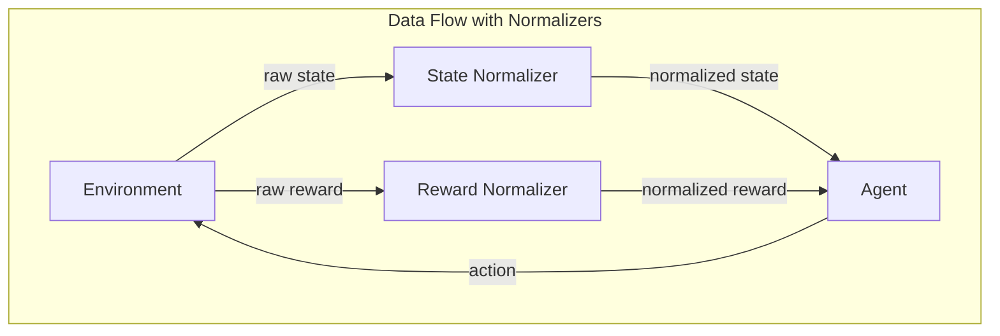
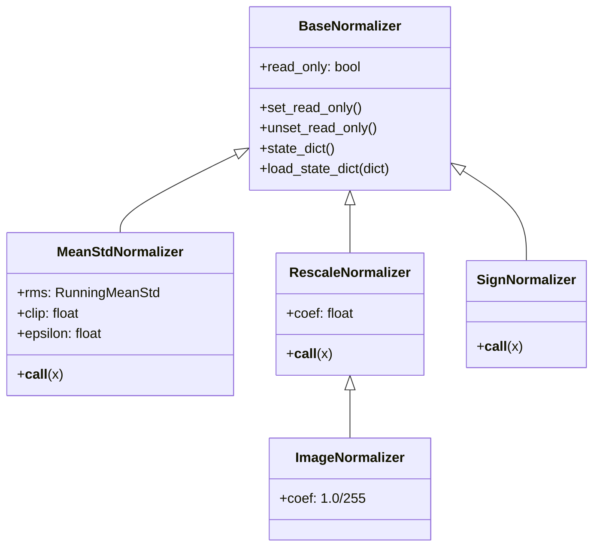
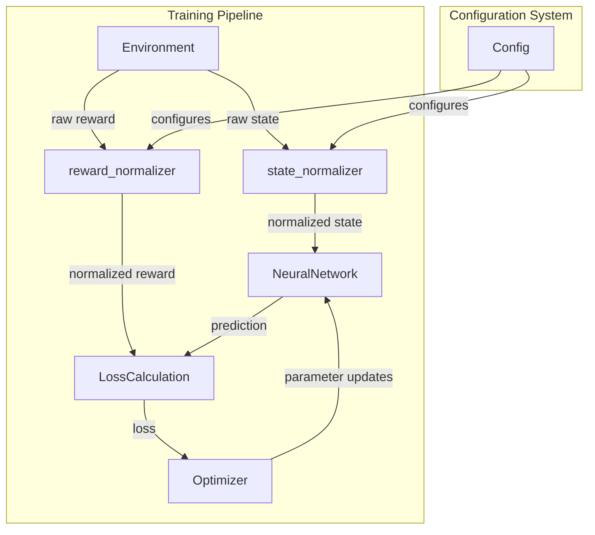

<!-- source: DeepWiki mcp.deepwiki.com · repo ShangtongZhang/DeepRL · page 4.3 Normalizers · fetched 2026-10-30 -->

# Normalizers

<details>
<summary>Relevant source files</summary>

The following files were used as context for generating this wiki page:

- [deep_rl/component/__init__.py](deep_rl/component/__init__.py)
- [deep_rl/network/network_bodies.py](deep_rl/network/network_bodies.py)
- [deep_rl/network/network_utils.py](deep_rl/network/network_utils.py)
- [deep_rl/utils/config.py](deep_rl/utils/config.py)
- [deep_rl/utils/normalizer.py](deep_rl/utils/normalizer.py)

</details>


Normalizers are essential components in the DeepRL framework that process state and reward signals from environments to ensure stable and efficient learning. This page documents the normalization system, its architecture, and how it's used in reinforcement learning algorithms.

## Purpose and Role

In reinforcement learning, input states and rewards can vary widely in scale and distribution across different environments. This variance can significantly impact neural network training stability and efficiency. Normalizers address this issue by transforming raw inputs into normalized values that are better suited for neural networks to process.

The DeepRL framework provides several normalization strategies that can be applied to:
- State inputs (observations from environments)
- Reward signals (feedback from environments)



Sources: [deep_rl/utils/normalizer.py](), [deep_rl/utils/config.py:41-42]()

## Normalizer Architecture

The framework implements a hierarchy of normalizers with different normalization strategies:



Sources: [deep_rl/utils/normalizer.py:11-71]()

### BaseNormalizer

`BaseNormalizer` is the abstract base class that defines the interface for all normalizers:

- `read_only` flag to prevent updates during evaluation
- Methods to toggle the read-only state
- State management for saving and loading normalizer state

Sources: [deep_rl/utils/normalizer.py:11-25]()

### MeanStdNormalizer

`MeanStdNormalizer` implements normalization based on running mean and standard deviation:

- Uses `RunningMeanStd` from OpenAI Baselines
- Updates mean and variance statistics during training
- Normalizes data as: (x - mean) / sqrt(variance + epsilon)
- Includes clipping to prevent extreme values
- Default clip range: [-10.0, 10.0]

Sources: [deep_rl/utils/normalizer.py:28-51]()

### RescaleNormalizer

`RescaleNormalizer` implements a simple scaling operation:

- Multiplies input by a constant coefficient
- Default coefficient: 1.0 (no scaling)
- Works with both NumPy arrays and PyTorch tensors

Sources: [deep_rl/utils/normalizer.py:53-61]()

### ImageNormalizer

`ImageNormalizer` is a specialized `RescaleNormalizer` for image data:

- Scales pixel values from [0, 255] to [0, 1] by multiplying by 1/255
- Commonly used for visual reinforcement learning tasks

Sources: [deep_rl/utils/normalizer.py:64-66]()

### SignNormalizer

`SignNormalizer` replaces values with their signs:

- Transforms inputs to -1, 0, or 1 based on sign
- Can be useful for environments with reward signals that only need direction

Sources: [deep_rl/utils/normalizer.py:69-71]()

## Configuration and Default Setup

The DeepRL framework uses `RescaleNormalizer` as the default normalizer for both states and rewards. This is configured in the `Config` class:

```python
self.state_normalizer = RescaleNormalizer()  # Default normalization for states
self.reward_normalizer = RescaleNormalizer() # Default normalization for rewards
```

This default behavior simply passes through values unchanged (with a coefficient of 1.0). Agents can override these defaults based on their specific requirements.

Sources: [deep_rl/utils/config.py:41-42]()

## Usage in the Training Pipeline

Normalizers integrate into the training pipeline as follows:



Sources: [deep_rl/utils/config.py:41-42](), [deep_rl/utils/normalizer.py]()

## Read-Only Mode for Evaluation

Normalizers support a read-only mode that is particularly important during evaluation:

- During training, statistics (like mean and variance) are updated
- During evaluation, normalizers should use fixed statistics without updates
- Methods `set_read_only()` and `unset_read_only()` toggle this behavior

This ensures consistent evaluation across different checkpoints when using normalizers that accumulate statistics (like `MeanStdNormalizer`).

Sources: [deep_rl/utils/normalizer.py:15-19]()

## Serialization Support

Normalizers include serialization support to save and load their state:

- `state_dict()` returns a dictionary with the normalizer's state
- `load_state_dict(saved)` restores the normalizer from a saved state

This is essential for:
- Resuming training from checkpoints
- Deploying trained agents while maintaining consistent normalization

Sources: [deep_rl/utils/normalizer.py:21-25](), [deep_rl/utils/normalizer.py:45-51]()

## Common Use Cases

| Normalizer Type | Typical Use Cases | Benefits |
|-----------------|-------------------|----------|
| RescaleNormalizer | General-purpose scaling, default option | Simple, no statistics tracking |
| MeanStdNormalizer | Environments with varying scales, control tasks | Adapts to input distribution |
| ImageNormalizer | Visual environments (Atari, vision-based robotics) | Standardizes pixel values |
| SignNormalizer | Environments where only direction matters | Reduces input complexity |

## Implementation Details

The normalizers are callable objects that transform their inputs when called, making them easy to use in the agent implementation:

```python
# Example usage in an agent
normalized_state = self.config.state_normalizer(state)
normalized_reward = self.config.reward_normalizer(reward)
```

For tensor operations, the normalizers check if inputs are PyTorch tensors and handle them appropriately.

Sources: [deep_rl/utils/normalizer.py:36-43](), [deep_rl/utils/normalizer.py:58-61]()

## Related Components

For information about other components in the DeepRL framework, see:
- [Replay Buffers](#4.1)
- [Environment Wrappers](#4.2)

---

