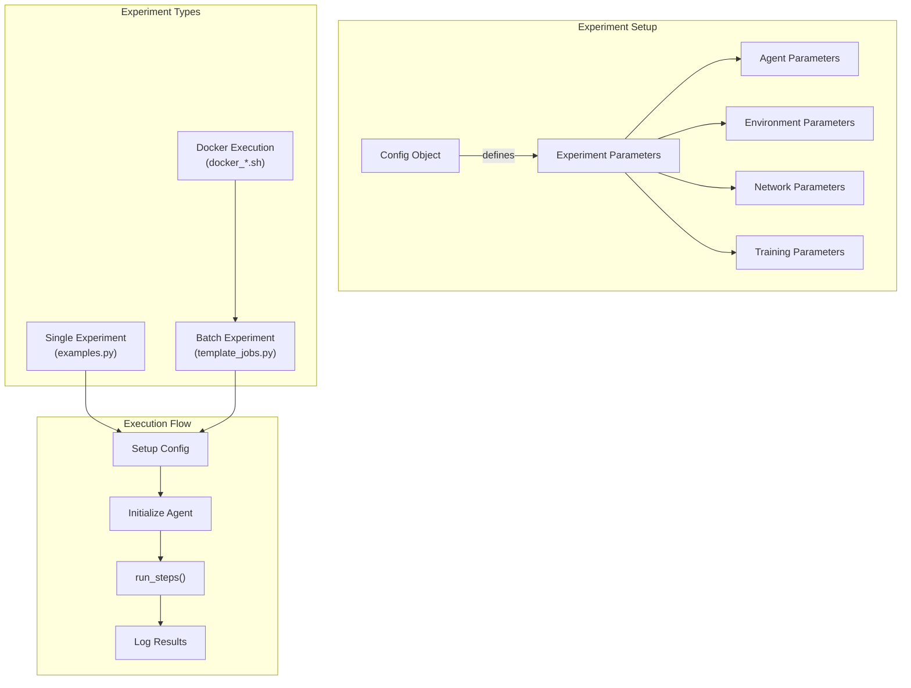
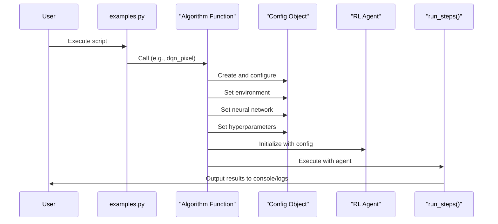
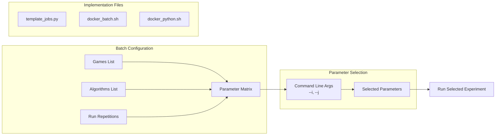
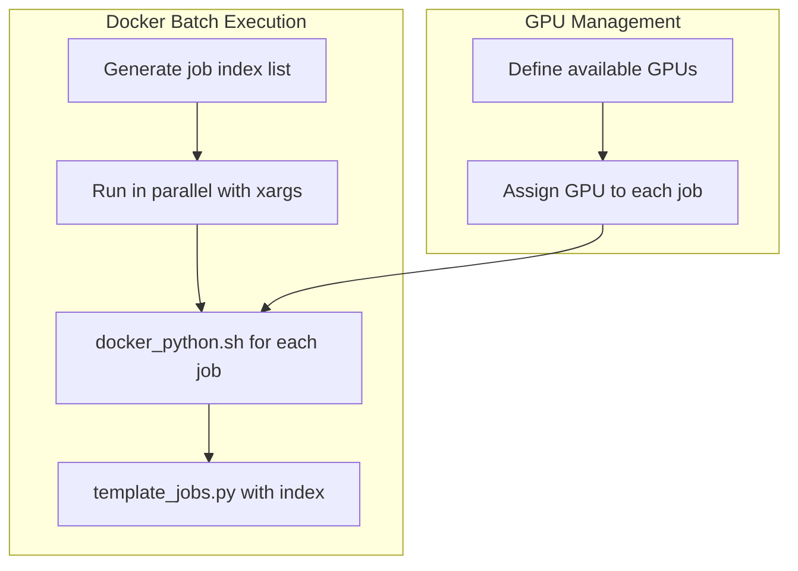
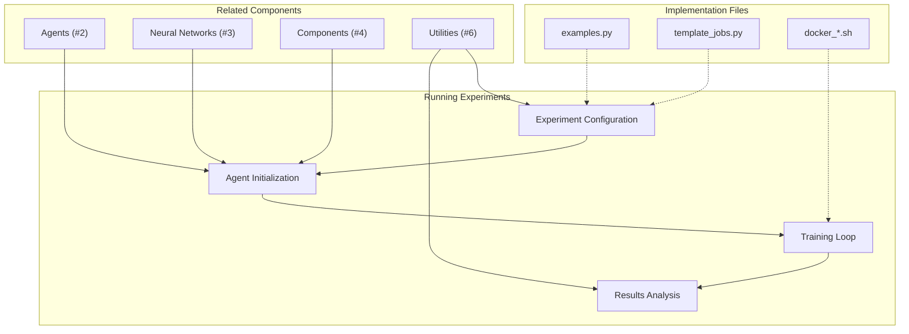

<!-- source: DeepWiki mcp.deepwiki.com · repo ShangtongZhang/DeepRL · page 5 Running Experiments · fetched 2026-10-30 -->

# Running Experiments

<details>
<summary>Relevant source files</summary>

The following files were used as context for generating this wiki page:

- [docker_batch.sh](docker_batch.sh)
- [examples.py](examples.py)
- [template_jobs.py](template_jobs.py)

</details>


This document explains how to run reinforcement learning experiments using the DeepRL framework. It covers configuring and executing single experiments, batch experiments, and using the Docker environment for reproducible results. For information about specific agents, see [Agents](#2), and for neural network architectures, see [Neural Networks](#3).

## Experiment Configuration and Execution Overview

The DeepRL framework provides a flexible system for running RL experiments. Experiments are configured using the `Config` class, which allows you to specify parameters for agents, environments, neural networks, and training procedures.



Sources: [examples.py:1-654](), [template_jobs.py:1-127]()

## Single Experiments

Single experiments are defined in `examples.py` and provide complete configurations for specific algorithm-environment combinations.

### Running a Single Experiment

To run a single experiment, you can uncomment the desired function call at the bottom of `examples.py`:

1. Select the environment by setting the `game` variable
2. Uncomment the desired algorithm function
3. Run `examples.py`



Sources: [examples.py:620-654]()

### Example Algorithm Configuration

Each algorithm function in `examples.py` follows a similar pattern:

1. Create a `Config` object
2. Set up task/environment with `config.task_fn`
3. Define network architecture with `config.network_fn`
4. Configure optimizer with `config.optimizer_fn`
5. Set hyperparameters for training
6. Call `run_steps()` with the appropriate agent

Here's an example from DQN configuration for pixel-based environments:

| Parameter | Purpose | Example Value |
|-----------|---------|---------------|
| task_fn | Function that creates environment | `lambda: Task(config.game)` |
| network_fn | Function that creates neural network | `lambda: VanillaNet(config.action_dim, NatureConvBody())` |
| optimizer_fn | Function that creates optimizer | `lambda params: torch.optim.RMSprop(params, lr=0.00025)` |
| batch_size | Size of training batches | 32 |
| discount | Discount factor | 0.99 |
| exploration_steps | Number of random actions at start | 50000 |
| max_steps | Total training steps | int(2e7) |

Sources: [examples.py:55-97]()

## Batch Experiments

For systematic evaluations across multiple algorithms and environments, the framework provides batch experiment functionality through `template_jobs.py`.

### Configuring Batch Experiments

Batch experiments are defined in `template_jobs.py`. Two primary batch functions are available:

1. `batch_atari()` - For Atari game environments
2. `batch_mujoco()` - For MuJoCo continuous control environments

These functions define:
- A list of games to evaluate
- A list of algorithms to use
- Optional parameters for each algorithm
- Run counts for statistical significance



Sources: [template_jobs.py:4-114]()

### Running Batch Experiments

To run a batch experiment:

1. Modify the game list and algorithm list in the appropriate batch function
2. Execute the script with the index parameter:
   ```bash
   python template_jobs.py --i [index]
   ```
   where `[index]` selects which experiment from the parameter matrix to run

For parallel execution, you can use the Docker batch script.

Sources: [template_jobs.py:117-127]()

## Docker Environment

The DeepRL framework includes Docker scripts to ensure experiment reproducibility across different systems.

### Docker Scripts

The repository includes several Docker scripts:

| Script | Purpose |
|--------|---------|
| docker_build.sh | Builds the Docker image with all dependencies |
| docker_shell.sh | Opens an interactive shell in the Docker container |
| docker_python.sh | Runs a Python script in the Docker container |
| docker_batch.sh | Runs multiple experiments in parallel using Docker |

### Running Parallel Experiments with Docker

The `docker_batch.sh` script automates running multiple experiments in parallel:



Sources: [docker_batch.sh:1-27]()

To run batch experiments with Docker:

1. Ensure Docker is installed and the image is built
2. Configure the GPU list in `docker_batch.sh`
3. Execute the script:
   ```bash
   bash docker_batch.sh
   ```

The script will run multiple experiments in parallel, assigning them to available GPUs.

Sources: [docker_batch.sh:11-17]()

## Experiment Configuration Details

The configuration system is central to running experiments. The `Config` class manages all parameters for an experiment.

### Key Configuration Parameters

| Parameter Category | Common Parameters | Purpose |
|-------------------|-------------------|---------|
| Environment | task_fn, eval_env | Define training and evaluation environments |
| Neural Network | network_fn | Define network architecture |
| Optimization | optimizer_fn, discount, gradient_clip | Control learning process |
| Exploration | random_action_prob, exploration_steps | Define exploration strategy |
| Training | max_steps, rollout_length, batch_size | Control training procedure |
| Evaluation | eval_interval, eval_episodes | Define evaluation schedule |

### Algorithm-Specific Configurations

Different algorithms require specific configuration parameters:

1. **DQN Family:**
   - target_network_update_freq
   - double_q
   - categorical_n_atoms (for C51)
   - num_quantiles (for QR-DQN)
   
2. **Policy Gradient Methods:**
   - entropy_weight
   - use_gae
   - gae_tau
   
3. **Actor-Critic Methods:**
   - target_network_mix
   - random_process_fn

Sources: [examples.py:11-617]()

## Monitoring and Analyzing Results

During experiment execution, the framework logs progress to both the console and TensorBoard.

### Logging System

Training progress is logged to:
1. Console output
2. TensorBoard event files in the `tf_log` directory
3. Checkpoint files in the `data` directory

### Directories

| Directory | Purpose |
|-----------|---------|
| log | Contains log files from training |
| tf_log | Contains TensorBoard event files |
| data | Contains saved model checkpoints |

Sources: [examples.py:621-622](), [template_jobs.py:118-119]()

### Visualizing Results

To visualize results, you can use TensorBoard:

```bash
tensorboard --logdir=tf_log
```

This will start a web server that displays training metrics over time.

## Common Experiment Tasks

### Setting Random Seeds

For reproducibility, the framework provides functions to set random seeds:

```python
random_seed()  # Sets seeds for Python, NumPy, and PyTorch
```

Sources: [examples.py:624](), [template_jobs.py:120]()

### Selecting Compute Device

You can select whether to use CPU or GPU:

```python
select_device(-1)  # Use CPU
select_device(0)   # Use GPU 0
```

Sources: [examples.py:625-627](), [template_jobs.py:125]()

### Creating Output Directories

Before running experiments, ensure necessary directories exist:

```python
mkdir('log')
mkdir('data')
mkdir('tf_log')
```

Sources: [examples.py:621-622](), [template_jobs.py:118-119]()

## Integration with Other Components

The experiment system integrates with other components of the DeepRL framework:



This diagram shows how the experiment system connects with other components of the framework, such as agents, neural networks, and utilities.

Sources: [examples.py:1-654](), [template_jobs.py:1-127]()

---

