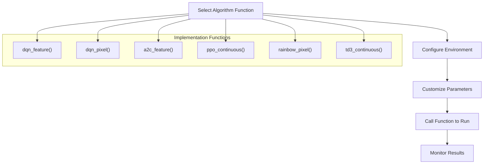
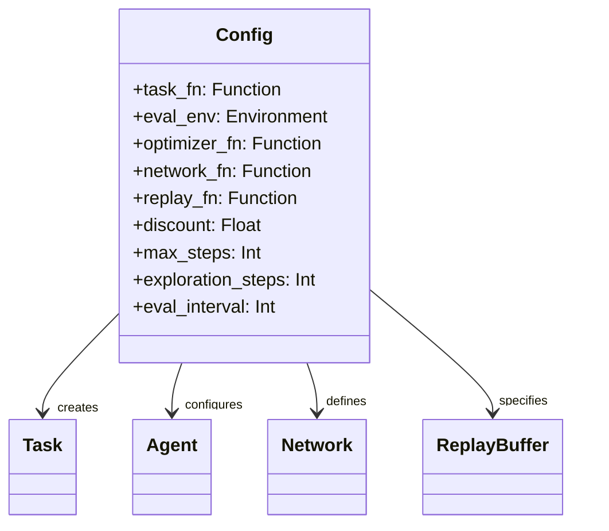
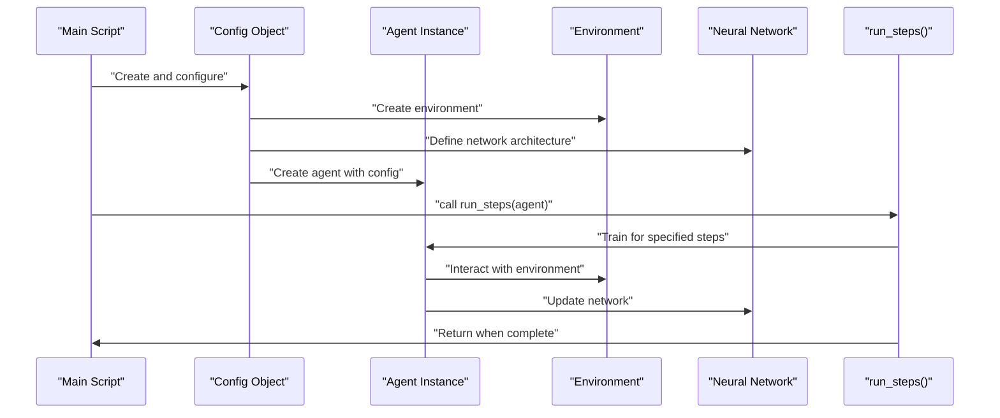
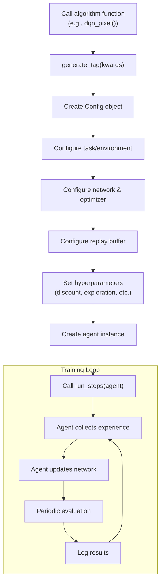

<!-- source: DeepWiki mcp.deepwiki.com · repo ShangtongZhang/DeepRL · page 5.1 Single Experiments · fetched 2026-10-30 -->

# Single Experiments

<details>
<summary>Relevant source files</summary>

The following files were used as context for generating this wiki page:

- [README.md](README.md)
- [examples.py](examples.py)

</details>


## Purpose and Scope

This document explains how to configure and run individual reinforcement learning experiments using the DeepRL framework. It covers setting up a single training run for a specific algorithm on a chosen environment. For information about running multiple experiments in parallel, see [Batch Experiments](#5.2). For details about using Docker containers for experiments, see [Docker Environment](#5.3).

## Overview of Single Experiments

In the DeepRL framework, a single experiment is defined by configuring and running one specific reinforcement learning algorithm on a particular environment. The framework provides numerous pre-configured experiment functions in the `examples.py` file, making it easy to run standard experiments with minimal code.



Sources: [examples.py:10-617]()

## Experiment Configuration

Single experiments in DeepRL are configured using a `Config` object that specifies all aspects of the experiment. Each algorithm function in `examples.py` creates and populates this configuration object with appropriate parameters.



Sources: [examples.py:17-51](), [examples.py:61-97]()

### Core Configuration Components

Every experiment configuration includes the following essential components:

| Component | Purpose | Example |
|-----------|---------|---------|
| `task_fn` | Creates the training environment | `lambda: Task(config.game)` |
| `eval_env` | Creates the evaluation environment | `config.task_fn()` |
| `network_fn` | Defines the neural network architecture | `lambda: VanillaNet(config.action_dim, FCBody(config.state_dim))` |
| `optimizer_fn` | Configures the optimizer | `lambda: torch.optim.RMSprop(params, 0.001)` |
| `max_steps` | Sets the total number of training steps | `int(1e5)` |

Sources: [examples.py:20-29]()

### Algorithm-Specific Configuration

Different algorithms require specific configuration parameters:

#### DQN Family

```python
# Required parameters for DQN variants
config.replay_fn = lambda: ReplayWrapper(config.replay_cls, replay_kwargs, config.async_replay)
config.discount = 0.99
config.target_network_update_freq = 200
config.exploration_steps = 1000
config.random_action_prob = LinearSchedule(1.0, 0.1, 1e4)
config.double_q = False
```

Sources: [examples.py:38-47]()

#### Actor-Critic Methods

```python
# Required parameters for actor-critic methods (e.g., DDPG, TD3)
config.replay_fn = lambda: UniformReplay(memory_size=int(1e6), batch_size=100)
config.discount = 0.99
config.random_process_fn = lambda: OrnsteinUhlenbeckProcess(size=(config.action_dim,), std=LinearSchedule(0.2))
config.warm_up = int(1e4)
config.target_network_mix = 5e-3
```

Sources: [examples.py:573-578]()

#### Policy Gradient Methods

```python
# Required parameters for policy gradient methods (e.g., PPO)
config.discount = 0.99
config.use_gae = True
config.gae_tau = 0.95
config.gradient_clip = 0.5
config.rollout_length = 2048
config.optimization_epochs = 10
config.mini_batch_size = 64
config.ppo_ratio_clip = 0.2
```

Sources: [examples.py:510-518]()

## Running Different Algorithms

The DeepRL framework provides functions for running many popular reinforcement learning algorithms. These functions are defined in `examples.py` and can be called directly.

### Available Algorithm Functions

| Category | Algorithm | Feature-based Function | Pixel-based Function | Continuous Control Function |
|----------|-----------|------------------------|----------------------|----------------------------|
| Value-based | DQN | `dqn_feature()` | `dqn_pixel()` | — |
| Value-based | Categorical DQN | `categorical_dqn_feature()` | `categorical_dqn_pixel()` | — |
| Value-based | QR-DQN | `quantile_regression_dqn_feature()` | `quantile_regression_dqn_pixel()` | — |
| Value-based | Rainbow | `rainbow_feature()` | `rainbow_pixel()` | — |
| Value-based | N-Step DQN | `n_step_dqn_feature()` | `n_step_dqn_pixel()` | — |
| Policy Gradient | A2C | `a2c_feature()` | `a2c_pixel()` | `a2c_continuous()` |
| Policy Gradient | PPO | — | `ppo_pixel()` | `ppo_continuous()` |
| Actor-Critic | DDPG | — | — | `ddpg_continuous()` |
| Actor-Critic | TD3 | — | — | `td3_continuous()` |
| Hierarchical | Option-Critic | `option_critic_feature()` | `option_critic_pixel()` | — |

Sources: [examples.py:10-617]()

### Experiment Setup Process



Sources: [examples.py:52](), [examples.py:97](), [examples.py:280]()

## Running a Single Experiment

To run a single experiment, you need to:

1. Select the appropriate algorithm function
2. Specify the environment/game
3. Optionally customize parameters
4. Call the function

### Basic Example

To run a basic DQN experiment on CartPole:

```python
from deep_rl import *

# Run DQN on CartPole with default settings
dqn_feature(game='CartPole-v0')
```

Sources: [examples.py:629-631]()

### Customizing Parameters

You can customize the experiment by passing additional parameters:

```python
# Run Rainbow DQN on Breakout with custom settings
rainbow_pixel(
    game='BreakoutNoFrameskip-v4',
    n_step=3,                      # Use 3-step returns
    replay_cls=PrioritizedReplay,  # Use prioritized experience replay  
    async_replay=False,            # Disable async replay
    noisy_linear=True              # Use noisy networks
)
```

Sources: [examples.py:649]()

### Common Environments

The framework is pre-configured to work with several standard environments:

| Type | Environment | Description |
|------|------------|-------------|
| Feature-based | CartPole-v0 | Simple pole balancing environment |
| Continuous | HalfCheetah-v2 | MuJoCo-based continuous control task |
| Continuous | Hopper-v2 | MuJoCo-based continuous control task |
| Pixel-based | BreakoutNoFrameskip-v4 | Atari game without frame skipping |

Sources: [examples.py:629](), [examples.py:638-639](), [examples.py:645]()

## Execution Flow

When you run a single experiment, the following internal flow occurs:



Sources: [examples.py:10-52](), [examples.py:55-97]()

## Monitoring Results

When running a single experiment, the framework automatically logs results to both the console and TensorBoard.

### Console Output

During training, the console displays:
- Episode number
- Episode reward
- Episode length
- Current step number
- Other algorithm-specific metrics

### TensorBoard Logging

All experiments log detailed metrics to TensorBoard, including:
- Episode rewards
- Episode lengths
- Loss values
- Network gradients
- Hyperparameter values

To view TensorBoard logs:
1. Ensure logs are saved to the `tf_log` directory
2. Run TensorBoard with `tensorboard --logdir tf_log`

Sources: [examples.py:621-622]()

## Example Use Cases

### Training a DQN Agent on Atari

```python
# Run DQN on Breakout
dqn_pixel(
    game='BreakoutNoFrameskip-v4',
    n_step=1,
    replay_cls=UniformReplay,
    async_replay=False
)
```

### Training a PPO Agent on MuJoCo

```python
# Run PPO on HalfCheetah
ppo_continuous(
    game='HalfCheetah-v2'
)
```

### Training an A2C Agent on CartPole

```python
# Run A2C on CartPole
a2c_feature(
    game='CartPole-v0'
)
```

Sources: [examples.py:646-653](), [examples.py:638-643]()

## Advanced Usage

### Custom Tag Generation

Each experiment automatically generates a tag for identifying the run in logs:

```python
generate_tag(kwargs)
```

You can add custom tags to better organize your experiments.

### Setting Random Seed

To ensure reproducibility, set a random seed before running experiments:

```python
random_seed()
```

### Device Selection

You can select whether to run on CPU or GPU:

```python
# Use CPU
select_device(-1)

# Use first GPU
select_device(0)
```

Sources: [examples.py:623-626]()

---

