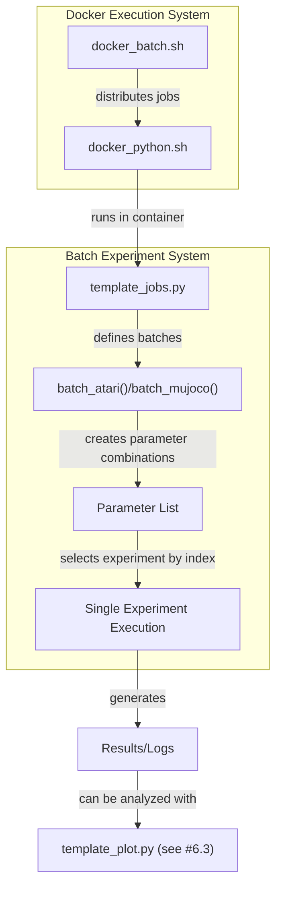
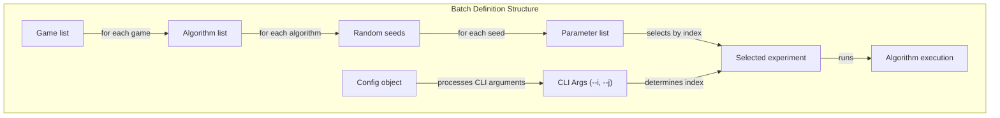
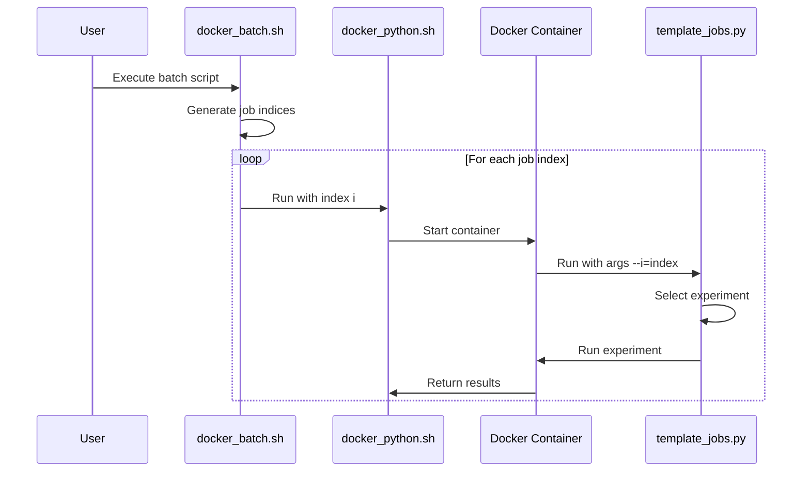
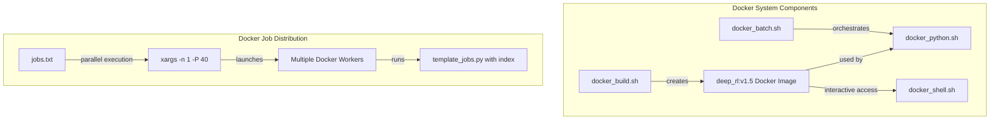

<!-- source: DeepWiki mcp.deepwiki.com · repo ShangtongZhang/DeepRL · page 5.2 Batch Experiments · fetched 2026-10-30 -->

# Batch Experiments

<details>
<summary>Relevant source files</summary>

The following files were used as context for generating this wiki page:

- [docker_batch.sh](docker_batch.sh)
- [docker_build.sh](docker_build.sh)
- [docker_python.sh](docker_python.sh)
- [docker_shell.sh](docker_shell.sh)
- [template_jobs.py](template_jobs.py)

</details>


## Purpose and Scope

This document describes the batch experiment system in the DeepRL framework, which enables researchers to run multiple reinforcement learning experiments across different environments, algorithms, and hyperparameters in parallel. Batch experiments are essential for comprehensive algorithm evaluations, hyperparameter sweeps, and reproducibility studies.

For information about running individual experiments with specific algorithms, see [Single Experiments](#5.1). For details on using the Docker environment that powers batch experiments, see [Docker Environment](#5.3).

## Overview

The batch experiment system in DeepRL provides a structured way to define collections of experiments and execute them efficiently, often across multiple GPUs. This approach is particularly valuable for:

1. Comparing algorithm performance across multiple environments
2. Running experiments with different random seeds for statistical significance
3. Conducting hyperparameter sweeps to optimize performance
4. Ensuring reproducibility through containerized execution



Sources: [template_jobs.py:1-126](), [docker_batch.sh:1-27](), [docker_python.sh:1-9]()

## Batch Experiment Definition

Batch experiments are defined in the `template_jobs.py` file through functions like `batch_atari()` and `batch_mujoco()`. These functions create parameter combinations by iterating through games, algorithms, random seeds, and other hyperparameters.



Sources: [template_jobs.py:4-49](), [template_jobs.py:52-114]()

### Key Components in Batch Definition

1. **Configuration**: Command-line arguments control which experiment from the batch is executed
2. **Environment Selection**: Lists of game environments (Atari or MuJoCo) to test
3. **Algorithm Selection**: Different RL algorithms to evaluate
4. **Parameterization**: Setting specific hyperparameters and run settings
5. **Indexing**: Using indices to select which experiment from the batch to run

## Execution Architecture

Batch experiments in DeepRL are typically executed using Docker containers, which ensures consistent environments and dependencies across runs. The execution is managed by shell scripts that distribute jobs across GPUs.



Sources: [docker_batch.sh:1-27](), [docker_python.sh:1-9](), [template_jobs.py:116-126]()

## Example Batch Definitions

The framework includes two primary batch experiment types:

### Atari Experiments

The `batch_atari()` function defines experiments across Atari games with various deep RL algorithms:

| Component | Description |
|-----------|-------------|
| Environments | Atari games (BreakoutNoFrameskip-v4, etc.) |
| Algorithms | DQN, Quantile Regression DQN, Categorical DQN, Rainbow, A2C, etc. |
| Parameters | Game, algorithm, run index (random seed) |

Sources: [template_jobs.py:4-49]()

### MuJoCo Experiments

The `batch_mujoco()` function defines experiments for continuous control tasks:

| Component | Description |
|-----------|-------------|
| Environments | MuJoCo environments (HalfCheetah-v2, Walker2d-v2, etc.) |
| Algorithms | PPO, DDPG, TD3 (algorithm selection varies by environment) |
| Parameters | Game, algorithm, run index (with 5 seeds per combination) |

Sources: [template_jobs.py:52-114]()

## Docker Integration

The batch experiment system leverages Docker for isolated and reproducible execution environments. This integration ensures consistent dependencies and enables distributed execution across multiple GPUs.



Sources: [docker_batch.sh:1-27](), [docker_python.sh:1-9](), [docker_shell.sh:1-10](), [docker_build.sh:1-3]()

### Docker Execution Scripts

1. **docker_batch.sh**: Orchestrates multiple experiments, running them in parallel
2. **docker_python.sh**: Runs a specific Python script within the Docker container
3. **docker_shell.sh**: Provides interactive shell access to the Docker environment
4. **docker_build.sh**: Builds the Docker image with all dependencies

## Using the Batch Experiment System

### Creating a Custom Batch Experiment

To create a custom batch experiment:

1. Define a new function in `template_jobs.py` following the pattern of `batch_atari()` or `batch_mujoco()`
2. Specify the environments, algorithms, and parameters to test
3. Build a parameter list of experiment configurations
4. Use command-line arguments to select which experiment to run

### Running Batch Experiments

You can run batch experiments in two ways:

#### Option 1: Sequential Execution

Run a specific experiment from the batch:

```bash
python template_jobs.py --i=3  # Run the 4th experiment in the batch
```

#### Option 2: Parallel Execution via Docker

Run multiple experiments in parallel using Docker:

```bash
bash docker_batch.sh  # Distributes jobs across GPUs
```

The `docker_batch.sh` script creates multiple jobs and executes them in parallel using `xargs`, with each job running in its own Docker container.

Sources: [docker_batch.sh:11-17]()

## Parameter Selection Patterns

The batch experiment system supports several parameter selection patterns:

1. **Grid Search**: Testing all combinations of algorithms and environments
   ```python
   for game in games:
       for algo in algos:
           for r in range(5):  # 5 random seeds
               params.append([algo, dict(game=game, run=r)])
   ```

2. **Algorithm-Specific Selection**: Different algorithms for different environments
   ```python
   if 'Humanoid' in game:
       algos = [ppo_continuous]  # Only PPO for Humanoid
   else:
       algos = [ppo_continuous, ddpg_continuous, td3_continuous]
   ```

3. **Hyperparameter Sweeps**: Testing various hyperparameter combinations
   ```python
   # Example (commented out in the code)
   for n_step in [1, 2, 3]:
       for double_q in [True, False]:
           params.extend([...])
   ```

Sources: [template_jobs.py:28-46](), [template_jobs.py:100-109]()

## Best Practices

When working with batch experiments in the DeepRL framework:

1. **Seed Management**: Always use different random seeds for statistical significance
2. **Resource Allocation**: Be mindful of GPU memory when distributing jobs
3. **Job Indexing**: Use the `--i` parameter to uniquely identify each experiment
4. **Output Organization**: Each experiment generates its own log files and tensorboard data
5. **Docker Usage**: Use Docker containers for reproducibility across different systems

## Conclusion

The batch experiment system in DeepRL provides a powerful framework for running comprehensive evaluations of reinforcement learning algorithms. By combining structured experiment definitions with Docker-based execution, it enables reproducible research at scale.

---

