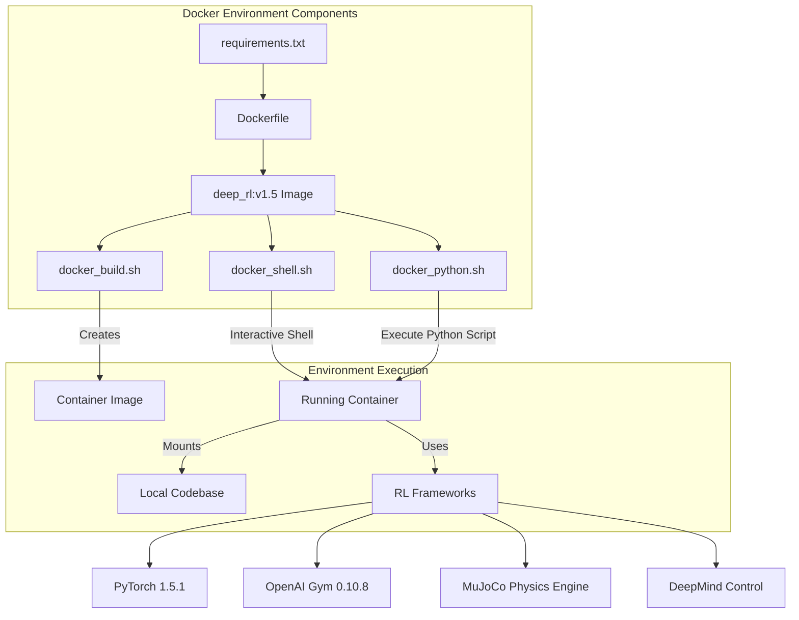
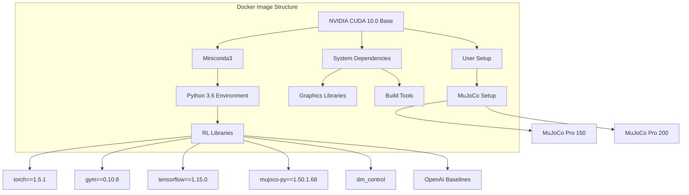
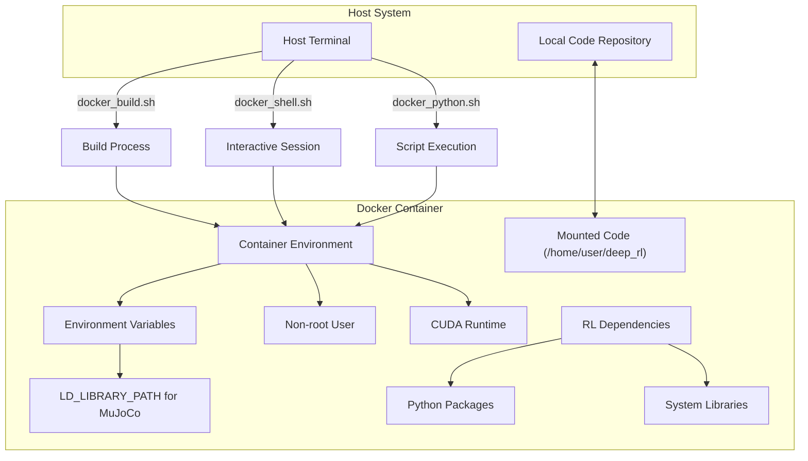

<!-- source: DeepWiki mcp.deepwiki.com · repo ShangtongZhang/DeepRL · page 5.3 Docker Environment · fetched 2026-10-30 -->

# Docker Environment

<details>
<summary>Relevant source files</summary>

The following files were used as context for generating this wiki page:

- [Dockerfile](Dockerfile)
- [docker_build.sh](docker_build.sh)
- [docker_python.sh](docker_python.sh)
- [docker_shell.sh](docker_shell.sh)
- [requirements.txt](requirements.txt)

</details>


This document explains how to use the Docker environment provided in the DeepRL framework for reproducible experiments. The Docker environment ensures consistent execution conditions across different machines and simplifies dependency management.

For information about running individual experiments, see [Single Experiments](#5.1). For information about running batch experiments, see [Batch Experiments](#5.2).

## 1. Docker Environment Overview

The DeepRL framework provides a Docker-based environment that encapsulates all necessary dependencies and libraries for reinforcement learning experiments, ensuring reproducibility and simplifying setup.



Sources: [Dockerfile](), [docker_build.sh](), [docker_shell.sh](), [docker_python.sh](), [requirements.txt]()

## 2. Docker Image Structure

The DeepRL Docker image is built on NVIDIA CUDA 10.0 and includes all the necessary dependencies for reinforcement learning research.



Sources: [Dockerfile:1-50](), [requirements.txt]()

## 3. Building the Docker Image

The Docker image needs to be built before using it for experiments. The repository provides a convenient script for this purpose.

### 3.1 Prerequisites

Before building the Docker image, ensure you have:

1. Docker installed on your system
2. NVIDIA Docker (for GPU support)
3. A valid MuJoCo license file (`mjkey.txt`) if you plan to use MuJoCo environments

### 3.2 Build Process

To build the Docker image, use the provided `docker_build.sh` script:

```bash
./docker_build.sh
```

This script will:
1. Build the Docker image using the current user's UID
2. Tag the image as `deep_rl:v1.5`

Note that the build process requires a MuJoCo license file (`mjkey.txt`) to be present in the root directory of the repository. If you don't have a license, you'll need to modify the Dockerfile to comment out line 35.

Sources: [docker_build.sh](), [Dockerfile:33-35]()

## 4. Using the Docker Environment

The repository provides two main scripts for interacting with the Docker environment.

### 4.1 Interactive Shell

To open an interactive shell in the Docker container:

```bash
./docker_shell.sh
```

This opens a bash shell inside the container with the repository mounted at `/home/user/deep_rl`. Any changes made to the code inside the container will be reflected in your local repository.

Sources: [docker_shell.sh]()

### 4.2 Running Python Scripts

To run Python scripts in the Docker container:

```bash
./docker_python.sh [GPU_ID] [PYTHON_SCRIPT]
```

Parameters:
- `GPU_ID`: The ID of the GPU to use (relevant when multiple GPUs are available)
- `PYTHON_SCRIPT`: The Python script to execute

Example:
```bash
./docker_python.sh 0 examples.py
```

This command runs `examples.py` using GPU 0. The script will have access to all the dependencies installed in the Docker container.

Sources: [docker_python.sh]()

## 5. Docker Environment Architecture

The DeepRL Docker environment is designed to provide a consistent execution environment with all dependencies pre-installed for reproducible experiments.



Sources: [Dockerfile](), [docker_build.sh](), [docker_shell.sh](), [docker_python.sh]()

## 6. Key Dependencies

The Docker environment includes the following key dependencies:

| Category | Component | Version | Purpose |
|----------|-----------|---------|---------|
| Deep Learning | PyTorch | 1.5.1 | Main deep learning framework |
| | TensorFlow | 1.15.0 | Used for TensorBoard logging |
| | TorchVision | - | PyTorch computer vision utilities |
| RL Environments | Gym | 0.10.8 | Standard RL environment interface |
| | Atari-py | 0.1.7 | Atari game environments |
| | Roboschool | 1.0.49 | Physics-based robotics environments |
| | MuJoCo | 1.50/2.00 | Physics engine for robotics simulation |
| | dm_control | - | DeepMind Control Suite |
| Utilities | OpenCV | 4.0.0.21 | Computer vision operations |
| | tqdm | 4.31.1 | Progress bars |
| | pandas | 0.24.1 | Data analysis |
| | seaborn | 0.9.0 | Statistical data visualization |

Sources: [requirements.txt](), [Dockerfile:25-48]()

## 7. Customizing the Docker Environment

You may need to customize the Docker environment for specific requirements. Here are common customization points:

### 7.1 Adding Python Packages

To add Python packages, modify the `requirements.txt` file and rebuild the Docker image. Alternatively, you can install packages directly in the container using pip, but these changes will be lost when the container is removed.

### 7.2 Modifying System Dependencies

To add system dependencies, modify the `apt install` command in the Dockerfile (line 3-11) and rebuild the Docker image.

### 7.3 Updating MuJoCo

The Docker environment includes both MuJoCo 1.50 and 2.00. If you need a different version, modify the relevant sections in the Dockerfile (lines 25-38).

Sources: [Dockerfile:3-11](), [Dockerfile:25-38](), [requirements.txt]()

## 8. Troubleshooting

### 8.1 NVIDIA Docker Issues

If you encounter issues with GPU support, ensure that:
- You have NVIDIA drivers installed on your host system
- NVIDIA Docker is installed (`nvidia-docker` or `nvidia-container-toolkit`)
- The script automatically detects NVIDIA Docker (see lines 3-7 in docker scripts)

### 8.2 MuJoCo License Issues

If MuJoCo environments fail to load, check that:
- You have placed a valid `mjkey.txt` file in the repository root
- The license file is properly mounted in the container
- The environment variables for MuJoCo are correctly set (see lines 37-38 in Dockerfile)

Sources: [docker_python.sh:3-7](), [docker_shell.sh:3-7](), [Dockerfile:33-38]()

## 9. Integration with Batch Experiments

The Docker environment integrates seamlessly with the batch experiment system. For running batch experiments within Docker, refer to the [Batch Experiments](#5.2) page.

The Docker environment enables consistent execution of experiments across different machines and simplifies the setup process, making it ideal for reproducible research in reinforcement learning.

---

