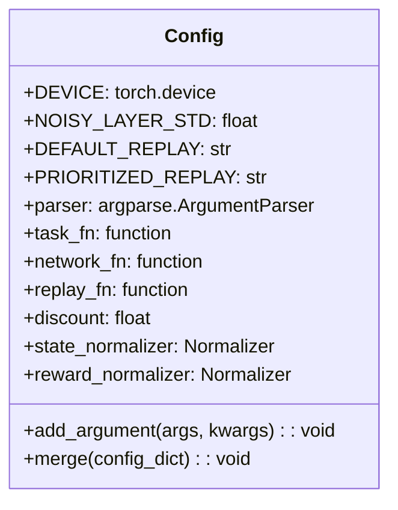
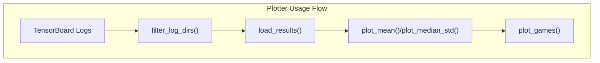
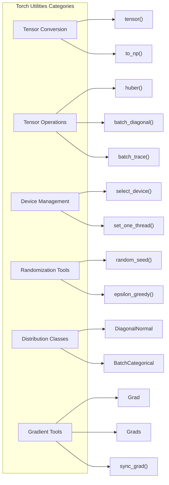
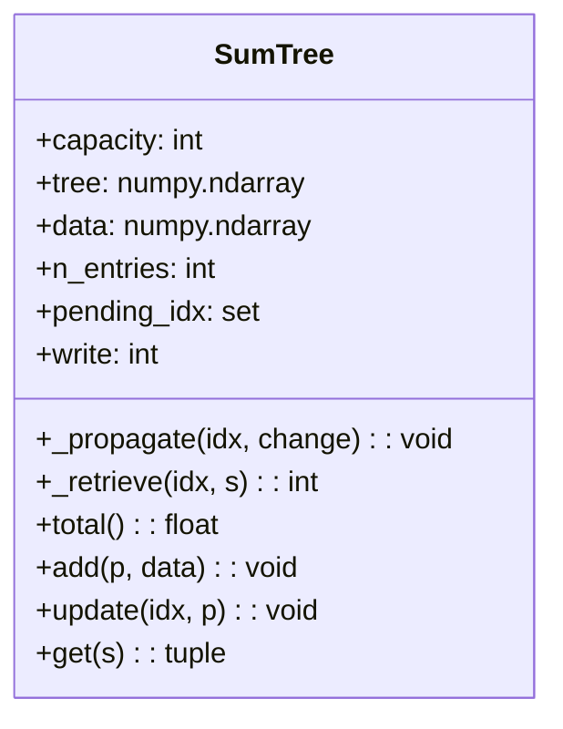

<!-- source: DeepWiki mcp.deepwiki.com · repo ShangtongZhang/DeepRL · page 6 Utilities · fetched 2026-10-30 -->

# Utilities

<details>
<summary>Relevant source files</summary>

The following files were used as context for generating this wiki page:

- [deep_rl/agent/__init__.py](deep_rl/agent/__init__.py)
- [deep_rl/component/envs.py](deep_rl/component/envs.py)
- [deep_rl/component/random_process.py](deep_rl/component/random_process.py)
- [deep_rl/utils/__init__.py](deep_rl/utils/__init__.py)
- [deep_rl/utils/config.py](deep_rl/utils/config.py)
- [deep_rl/utils/logger.py](deep_rl/utils/logger.py)
- [deep_rl/utils/misc.py](deep_rl/utils/misc.py)
- [deep_rl/utils/plot.py](deep_rl/utils/plot.py)
- [deep_rl/utils/sum_tree.py](deep_rl/utils/sum_tree.py)
- [deep_rl/utils/torch_utils.py](deep_rl/utils/torch_utils.py)

</details>


The Utilities module in the DeepRL framework provides essential support functions, classes, and infrastructure components that are used throughout the codebase. This page documents these utilities and explains their role in the overall system architecture. For information about specific component systems like replay buffers or normalizers, see [Components](#4).

## Overview of Utility Subsystems

The utilities in DeepRL are organized into several categories, each serving a specific purpose in the framework:

```mermaid
graph TD
    subgraph "DeepRL Utilities"
        Config["Configuration System"]
        Logger["Logging System"]
        Plot["Plotting & Visualization"]
        TorchUtils["Torch Utilities"]
        Misc["Miscellaneous Helpers"]
        SumTree["Sum Tree Data Structure"]
    end

    Config --> Agent["Agent Components"]
    Config --> Network["Neural Networks"]
    Config --> Task["Environment/Tasks"]
    
    Logger --> TBoard["TensorBoard Integration"]
    Logger --> ConsoleLog["Console Logging"]
    
    Plot --> Results["Results Analysis"]
    
    TorchUtils --> TensorOps["Tensor Operations"]
    TorchUtils --> DistClasses["Distribution Classes"]
    TorchUtils --> GradHelpers["Gradient Utilities"]
    
    Misc --> ExperimentRun["Experiment Runner"]
    Misc --> DirManagement["Directory Management"]
    Misc --> TagGen["Experiment Tag Generation"]
    Misc --> HyperParams["Hyperparameter Management"]
    
    SumTree --> PER["Prioritized Experience Replay"]
```



Sources: [deep_rl/utils/__init__.py:1-9](), [deep_rl/utils/config.py:11-89](), [deep_rl/utils/logger.py:17-73](), [deep_rl/utils/plot.py:12-196](), [deep_rl/utils/torch_utils.py:12-103](), [deep_rl/utils/misc.py:19-126](), [deep_rl/utils/sum_tree.py:6-67]()

## Configuration System

The Configuration System is central to the DeepRL framework, providing a flexible way to define and manage experimental parameters, hyperparameters, and algorithm settings.



The `Config` class handles:

1. **Default parameters** - Provides sensible defaults for all algorithm settings
2. **Command-line arguments** - Uses Python's argparse to handle CLI parameters
3. **Environment configuration** - Stores environment dimensions and task information
4. **Normalization settings** - Configures state and reward normalizers
5. **Logging parameters** - Controls logging frequency and verbosity

Key usage patterns include:

- Creating a configuration with default values
- Adding custom arguments with `add_argument`
- Merging configuration dictionaries with `merge`
- Setting up environment-specific configurations with the `eval_env` property

Sources: [deep_rl/utils/config.py:11-89]()

## Logging System

The logging system provides mechanisms for tracking experimental progress, metrics, and debugging information through both console output and TensorBoard.

```mermaid
classDiagram
    class Logger {
        +log_level: int
        +writer: SummaryWriter
        +all_steps: dict
        +log_dir: str
        +lazy_init_writer(): void
        +to_numpy(v): numpy.ndarray
        +get_step(tag): int
        +add_scalar(tag, value, step, log_level): void
        +add_histogram(tag, values, step, log_level): void
        +info(message): void
        +debug(message): void
        +warning(message): void
    }
    
    function get_logger {
        +tag: str
        +log_level: int
        +returns: Logger
    }
    
    get_logger --> Logger: creates
    Logger --> SummaryWriter: uses
```

The logging system features:

1. **TensorBoard Integration** - Records metrics for visualization 
2. **Console Logging** - Provides real-time feedback during training
3. **Customizable Verbosity** - Controls logging detail level
4. **Automatic Step Counting** - Tracks progress for each logged metric

Example usage patterns:

- Creating a logger with `get_logger('experiment_name')`
- Logging scalar metrics with `logger.add_scalar('loss', loss_value)`
- Logging distributions with `logger.add_histogram('weights', model_weights)`
- Writing console messages with `logger.info('Training complete')`

Sources: [deep_rl/utils/logger.py:17-73]()

## Plotting and Visualization

The plotting utilities provide tools for analyzing and visualizing experimental results, primarily from TensorBoard logs.



The `Plotter` class provides:

1. **Log Filtering** - Find relevant experiment logs with pattern matching
2. **Data Loading** - Load and process TensorBoard log data
3. **Statistical Processing** - Compute means, medians, and error bounds
4. **Multi-Experiment Comparison** - Compare results across different experiments
5. **Top-K Selection** - Select best-performing runs based on metrics

Main methods and functionality:

| Method | Purpose |
|--------|---------|
| `filter_log_dirs()` | Find directories matching a pattern |
| `load_log_dirs()` | Load data from TensorBoard event files |
| `load_results()` | Process data with various transformations |
| `plot_mean()` | Plot mean with standard error bands |
| `plot_median_std()` | Plot median with std deviation bands |
| `plot_games()` | Compare performance across multiple games |
| `select_best_parameters()` | Identify best hyperparameters |

Sources: [deep_rl/utils/plot.py:12-196]()

## Torch Utilities

The Torch Utilities module provides helper functions and classes for PyTorch operations commonly used in reinforcement learning.



Key functionality includes:

1. **Tensor Conversion** - Functions to convert between numpy arrays and PyTorch tensors
2. **Device Management** - Functions to select and manage computation devices (CPU/GPU)
3. **Probability Distributions** - Custom distribution classes for policy gradients
4. **Gradient Management** - Classes for gradient manipulation in complex algorithms
5. **Exploration Functions** - Helpers for exploration strategies like epsilon-greedy

Important functions and classes:

- `tensor()` - Convert various types to PyTorch tensors on the configured device
- `to_np()` - Convert PyTorch tensors to numpy arrays
- `select_device()` - Set the global device for computation
- `epsilon_greedy()` - Epsilon-greedy action selection
- `DiagonalNormal` - Gaussian distribution for continuous actions
- `BatchCategorical` - Categorical distribution for discrete actions
- `Grad/Grads` - Classes for gradient accumulation and manipulation

Sources: [deep_rl/utils/torch_utils.py:12-210]()

## Miscellaneous Utilities

The miscellaneous utilities provide support functions for running experiments, managing directories, generating tags, and more.

```mermaid
graph TD
    subgraph "Experiment Running"
        run_steps["run_steps(agent)"] --> save["agent.save()"]
        run_steps --> log["agent.logger.info()"]
        run_steps --> eval["agent.eval_episodes()"]
        run_steps --> step["agent.step()"]
    end
    
    subgraph "Helper Functions"
        get_time_str["get_time_str()"]
        get_default_log_dir["get_default_log_dir()"]
        mkdir["mkdir(path)"]
        close_obj["close_obj(obj)"]
        random_sample["random_sample(indices, batch_size)"]
        generate_tag["generate_tag(params)"]
    end
    
    subgraph "Hyperparameter Management"
        HyperParameter["HyperParameter"]
        HyperParameters["HyperParameters"]
        HyperParameters --> HyperParameter: contains
    end
```

Key functions and classes:

1. **Experiment Runner** - The `run_steps()` function handles the main training loop
2. **Directory Management** - Functions like `mkdir()` for file system operations
3. **Time Utilities** - Functions like `get_time_str()` for timestamps
4. **Tag Generation** - `generate_tag()` creates unique experiment identifiers
5. **Hyperparameter Management** - `HyperParameters` class for parameter sweeps

The `run_steps()` function is particularly important as it:
- Manages saving agent checkpoints at intervals
- Handles logging and evaluation timing
- Controls the main training loop
- Manages task switching for multi-task learning

Sources: [deep_rl/utils/misc.py:19-126]()

## Sum Tree Data Structure

The `SumTree` class implements a binary tree data structure where each parent node's value is the sum of its children. This is primarily used for prioritized experience replay in RL algorithms.



The SumTree data structure:

1. **Efficient Sampling** - Enables O(log n) sampling based on priorities
2. **Priority Updates** - Allows efficient updates to priorities
3. **Memory Management** - Handles circular buffer semantics when capacity is reached

Main operations:

- `add(priority, data)` - Adds new data with given priority
- `update(idx, priority)` - Updates the priority of existing data
- `get(value)` - Samples data based on priority values

This data structure is crucial for implementing prioritized experience replay, which is used in algorithms like prioritized DQN.

Sources: [deep_rl/utils/sum_tree.py:6-67]()

## Relation to Other Components

The utility modules support the main components of the DeepRL framework as shown in the diagram below:

```mermaid
flowchart TB
    subgraph "Utilities"
        Config["Config System"]
        Logger["Logging System"]
        Torch["Torch Utilities"]
        Misc["Misc Utilities"]
        Plot["Plotting"]
        SumTree["Sum Tree"]
    end
    
    subgraph "Agents"
        DQN["DQN Family"]
        AC["Actor-Critic Agents"]
        PPO["PPO Agent"]
        TD3["TD3 Agent"]
    end
    
    subgraph "Components"
        Networks["Neural Networks"]
        Replay["Replay Buffers"]
        Task["Task/Environment"]
        Normalizer["Normalizers"]
    end
    
    Config --> Agents: "configures"
    Config --> Components: "configures"
    
    Logger --> Agents: "tracks metrics"
    
    Torch --> Networks: "supports tensor ops"
    Torch --> Agents: "provides distributions"
    
    Misc --> Agents: "runs training loop"
    
    Plot --> Logger: "visualizes logs"
    
    SumTree --> Replay: "supports prioritized replay"
```

Sources: [deep_rl/utils/__init__.py:1-9](), [deep_rl/agent/__init__.py:1-10]()

## Configuration Usage Examples

The following table demonstrates common configuration patterns used in the DeepRL framework:

| Configuration Task | Example Code |
|-------------------|--------------|
| Creating basic config | `config = Config()` |
| Setting up network | `config.network_fn = lambda: FCNet(...)` |
| Setting optimizer | `config.optimizer_fn = lambda params: torch.optim.Adam(params, lr=0.001)` |
| Setting environment | `config.task_fn = lambda: Task('CartPole-v0')` |
| Adding CLI arguments | `config.add_argument('--hidden_units', type=int, default=64)` |
| Setting normalizers | `config.state_normalizer = ImageNormalizer()` |
| Merging configs | `config.merge({'learning_rate': 0.01, 'batch_size': 32})` |

Sources: [deep_rl/utils/config.py:11-89]()

---

