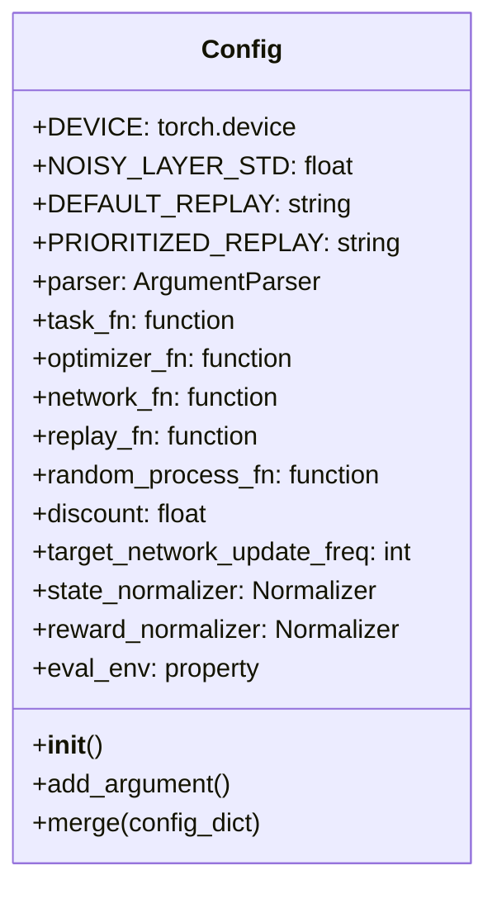
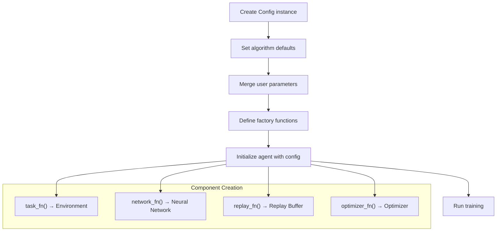
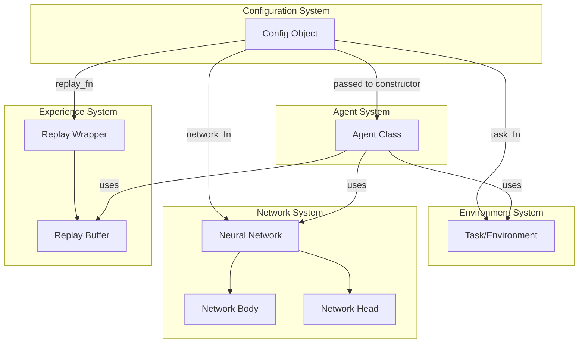

<!-- source: DeepWiki mcp.deepwiki.com · repo ShangtongZhang/DeepRL · page 6.1 Configuration System · fetched 2026-10-30 -->

# Configuration System

<details>
<summary>Relevant source files</summary>

The following files were used as context for generating this wiki page:

- [deep_rl/utils/config.py](deep_rl/utils/config.py)
- [examples.py](examples.py)

</details>


The Configuration System in the DeepRL framework serves as the central mechanism for managing hyperparameters and settings for reinforcement learning experiments. It provides a flexible and consistent interface for defining, customizing, and tracking configuration parameters across different algorithms and environments.

## Purpose and Scope

This document explains the configuration system architecture, its implementation, and how it's used throughout the DeepRL framework. The configuration system is responsible for:

- Centralizing experiment parameters in a single object
- Providing default values for algorithm-specific settings
- Enabling easy customization of parameters
- Integrating with command-line arguments
- Maintaining environment information
- Creating required components through factory functions

## Core Architecture

### Config Class

The central component of the configuration system is the `Config` class defined in [deep_rl/utils/config.py:11-89]().



The `Config` class contains various attributes that fall into several categories:

| Category | Example Attributes | Purpose |
|----------|-------------------|---------|
| Component Factories | `task_fn`, `network_fn`, `replay_fn` | Functions that create core components |
| Optimization | `optimizer_fn`, `actor_optimizer_fn` | Functions that create optimizers |
| Algorithm Parameters | `discount`, `target_network_update_freq` | Core RL algorithm settings |
| Training Control | `max_steps`, `exploration_steps` | Parameters controlling training process |
| Data Processing | `state_normalizer`, `reward_normalizer` | Objects for data normalization |
| Logging & Evaluation | `log_interval`, `eval_interval` | Settings for logging and evaluation |

Sources: [deep_rl/utils/config.py:11-89]()

### Configuration Flow

The typical flow for using the configuration system is:



1. A configuration function creates a new `Config` instance
2. Algorithm-specific defaults are set
3. User-provided parameters are merged via `config.merge(kwargs)`
4. Component factory functions are defined as lambda functions
5. The config is passed to the agent constructor
6. During training, factory functions create components as needed

Sources: [examples.py:11-52](), [examples.py:231-280](), [examples.py:496-522]()

## Key Features

### Parameter Management

The `Config` class initializes a large number of parameters with sensible defaults:

```python
def __init__(self):
    self.parser = argparse.ArgumentParser()
    self.task_fn = None
    self.optimizer_fn = None
    self.network_fn = None
    self.replay_fn = None
    self.discount = None
    # Many more parameters...
    self.state_normalizer = RescaleNormalizer()
    self.reward_normalizer = RescaleNormalizer()
```

These parameters cover various aspects of reinforcement learning algorithms, from core components to algorithm-specific settings.

Sources: [deep_rl/utils/config.py:17-68]()

### Parameter Merging

The `merge` method allows overriding default values with user-provided parameters:

```python
def merge(self, config_dict=None):
    if config_dict is None:
        args = self.parser.parse_args()
        config_dict = args.__dict__
    for key in config_dict.keys():
        setattr(self, key, config_dict[key])
```

This enables customization of configurations without modifying the source code.

Sources: [deep_rl/utils/config.py:84-89]()

### Environment Integration

The `eval_env` property and setter handle the extraction of environment dimensions:

```python
@eval_env.setter
def eval_env(self, env):
    self.__eval_env = env
    self.state_dim = env.state_dim
    self.action_dim = env.action_dim
    self.task_name = env.name
```

This ensures environment information is automatically available to network constructors and other components.

Sources: [deep_rl/utils/config.py:70-79]()

### Command-Line Integration

The `Config` class integrates with Python's `argparse` module, allowing parameters to be specified via command-line arguments:

```python
def add_argument(self, *args, **kwargs):
    self.parser.add_argument(*args, **kwargs)
```

This facilitates experiment automation and batch processing.

Sources: [deep_rl/utils/config.py:81-82]()

## Configuration Examples

### DQN Configuration

This example shows how a DQN agent is configured:

```python
def dqn_feature(**kwargs):
    kwargs.setdefault('log_level', 0)
    kwargs.setdefault('n_step', 1)
    kwargs.setdefault('replay_cls', UniformReplay)
    config = Config()
    config.merge(kwargs)

    config.task_fn = lambda: Task(config.game)
    config.eval_env = config.task_fn()
    config.optimizer_fn = lambda params: torch.optim.RMSprop(params, 0.001)
    config.network_fn = lambda: VanillaNet(config.action_dim, FCBody(config.state_dim))
    
    config.discount = 0.99
    config.target_network_update_freq = 200
    config.exploration_steps = 1000
    config.double_q = False
    
    # More configuration...
    
    run_steps(DQNAgent(config))
```

Sources: [examples.py:11-52]()

### PPO Configuration

Here's how a PPO agent for continuous action spaces is configured:

```python
def ppo_continuous(**kwargs):
    config = Config()
    config.merge(kwargs)

    config.task_fn = lambda: Task(config.game)
    config.eval_env = config.task_fn()

    config.network_fn = lambda: GaussianActorCriticNet(
        config.state_dim, config.action_dim, 
        actor_body=FCBody(config.state_dim, gate=torch.tanh),
        critic_body=FCBody(config.state_dim, gate=torch.tanh))
    
    config.discount = 0.99
    config.use_gae = True
    config.gae_tau = 0.95
    config.gradient_clip = 0.5
    config.rollout_length = 2048
    config.optimization_epochs = 10
    config.mini_batch_size = 64
    config.ppo_ratio_clip = 0.2
    
    # More configuration...
    
    run_steps(PPOAgent(config))
```

Sources: [examples.py:496-522]()

## System Integration

The Configuration System integrates with other core systems in the DeepRL framework:



The configuration object serves as the central point connecting all these systems, providing each component with the parameters it needs.

Sources: [examples.py:11-52](), [examples.py:231-280](), [examples.py:496-522]()

## Best Practices

### Creating New Configurations

When defining configurations for new algorithms:

1. Create a new function that accepts `**kwargs` for user customization
2. Set defaults for commonly overridden parameters using `kwargs.setdefault()`
3. Create a `Config` instance and merge the kwargs
4. Define all necessary factory functions as lambda expressions
5. Set algorithm-specific parameters
6. Pass the config to the appropriate agent constructor

### Factory Function Design

Factory functions in the configuration system follow these patterns:

- Task factory: `lambda: Task(config.game)`
- Network factory: `lambda: NetworkClass(config.action_dim, BodyClass(config.state_dim))`
- Optimizer factory: `lambda params: OptimizerClass(params, learning_rate)`
- Replay buffer factory: `lambda: ReplayClass(memory_size, batch_size)`

This lambda-based approach allows components to be created on-demand with access to the latest configuration values.

## Conclusion

The Configuration System in DeepRL is a centralized mechanism for managing experiment parameters that:

1. Provides a clean interface for defining reinforcement learning experiments
2. Enables easy customization through parameter overrides
3. Integrates with command-line argument parsing
4. Connects and configures all major components of the framework
5. Maintains consistency across different algorithms

Understanding this system is essential for effectively using and extending the DeepRL framework.

---

