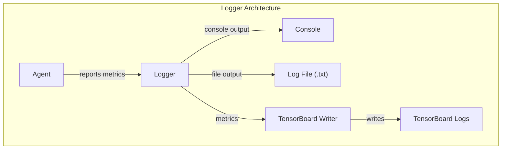
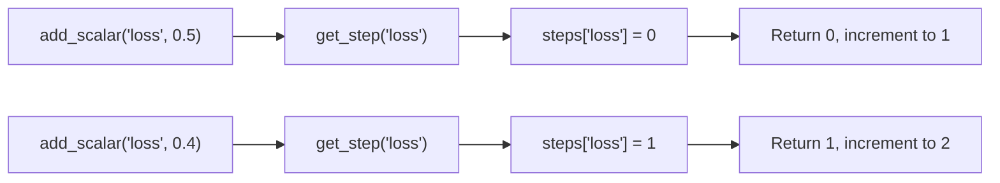
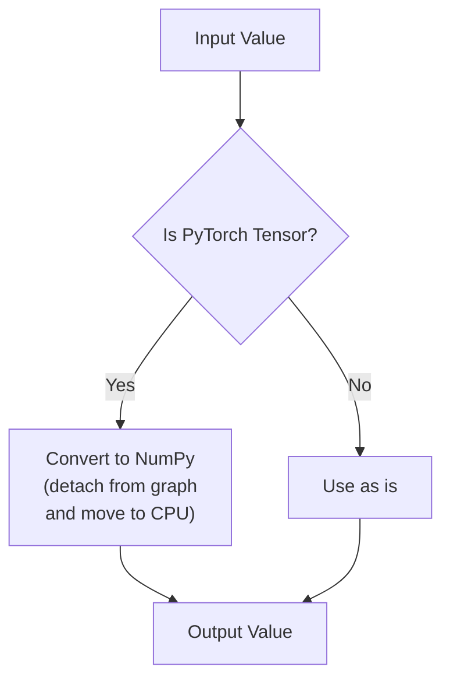
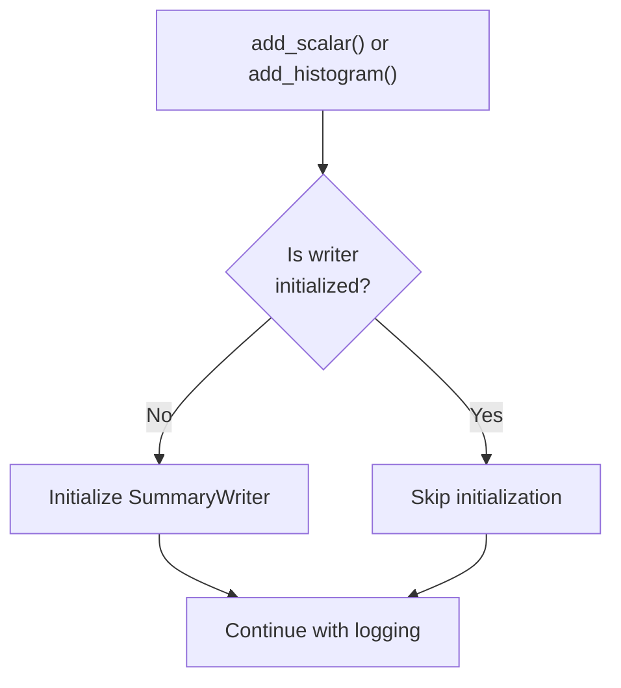
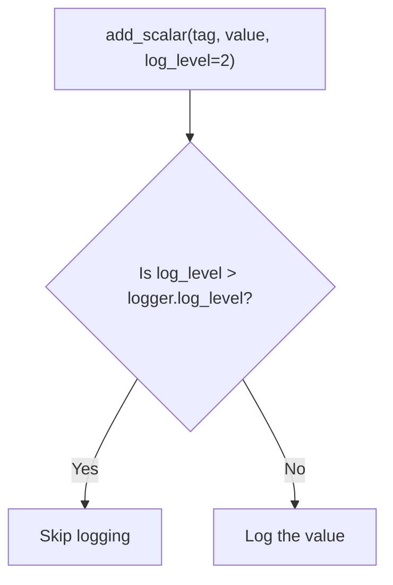
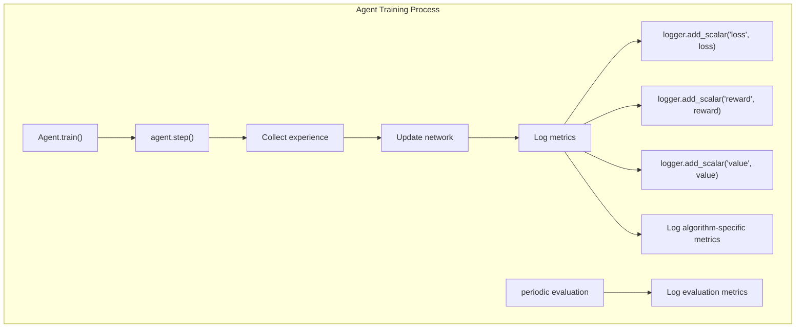
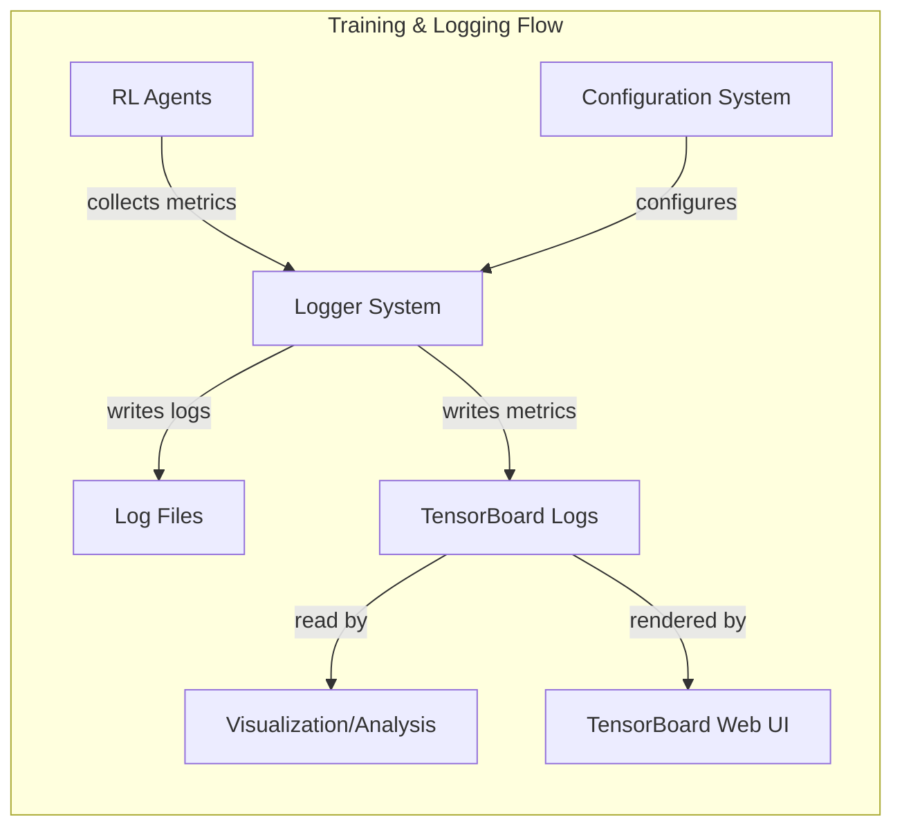

<!-- source: DeepWiki mcp.deepwiki.com · repo ShangtongZhang/DeepRL · page 6.2 Logging · fetched 2026-10-30 -->

# Logging

<details>
<summary>Relevant source files</summary>

The following files were used as context for generating this wiki page:

- [deep_rl/agent/__init__.py](deep_rl/agent/__init__.py)
- [deep_rl/utils/__init__.py](deep_rl/utils/__init__.py)
- [deep_rl/utils/logger.py](deep_rl/utils/logger.py)
- [deep_rl/utils/sum_tree.py](deep_rl/utils/sum_tree.py)

</details>


## Introduction

The logging system in the DeepRL framework provides a structured way to track, store, and visualize experimental metrics during reinforcement learning training. It combines traditional file-based logging with TensorBoard integration for advanced visualization and analysis. This page documents the logging architecture, API, and common usage patterns. For information about plotting and visualizing the logged data, see [Plotting and Visualization](#6.3).

Sources: [deep_rl/utils/logger.py:1-74]()

## Logging Architecture

The DeepRL framework implements a two-tier logging system:



The logging system is built around the `Logger` class that wraps Python's standard logging module and extends it with TensorBoard integration. This allows for both human-readable logs and machine-parsable metrics for visualization.

Sources: [deep_rl/utils/logger.py:28-74]()

### Core Components

```mermaid
classDiagram
    class Logger {
        -log_level: int
        -writer: SummaryWriter
        -vanilla_logger: logging.Logger
        -all_steps: dict
        -log_dir: string
        +lazy_init_writer()
        +to_numpy(v)
        +get_step(tag)
        +add_scalar(tag, value, step, log_level)
        +add_histogram(tag, values, step, log_level)
        +info(message)
        +debug(message)
        +warning(message)
    }

    class get_logger {
        <<function>>
        +tag: string
        +log_level: int
        returns Logger
    }

    get_logger --> Logger : creates
    Logger --> "SummaryWriter" : uses
```

The logging system consists of:

1. **Logger Class**: Encapsulates both text logging and TensorBoard metric tracking
2. **get_logger Function**: Factory function that creates and configures a Logger instance
3. **TensorBoard Writer**: Initialized lazily for efficient resource usage

Sources: [deep_rl/utils/logger.py:17-25](), [deep_rl/utils/logger.py:28-74]()

## Logger Initialization

The `get_logger` function creates a new Logger instance with the following parameters:

```python
def get_logger(tag='default', log_level=0):
    # Creates a Logger with both file and TensorBoard output
```

- **tag**: Identifier for the experiment, used in file naming
- **log_level**: Controls which messages get logged (higher numbers filter more messages)

The function configures:
1. A console logger (from Python's logging module)
2. A file handler writing to `./log/{tag}-{timestamp}.txt`
3. A TensorBoard writer targeting `./tf_log/logger-{tag}-{timestamp}`

Sources: [deep_rl/utils/logger.py:17-25]()

## Logging API

The Logger class provides several methods for logging different types of information:

### Text Logging Methods

These methods are directly inherited from Python's standard logging module:

| Method | Purpose | Example |
|--------|---------|---------|
| `info()` | Log informational messages | `logger.info("Episode completed")` |
| `debug()` | Log detailed debugging information | `logger.debug("Action selected: 2")` |
| `warning()` | Log warning messages | `logger.warning("Buffer almost full")` |

### Metric Logging Methods

These methods log numerical data to TensorBoard:

| Method | Purpose | Parameters |
|--------|---------|------------|
| `add_scalar()` | Log a single scalar value | tag, value, step (optional), log_level (optional) |
| `add_histogram()` | Log a distribution of values | tag, values, step (optional), log_level (optional) |

Sources: [deep_rl/utils/logger.py:55-73]()

## Step Management

The Logger automatically manages step counting for each metric tag:



This automatic step management simplifies metric tracking by maintaining separate counters for different metrics, allowing agents to simply call `add_scalar()` without manually tracking steps.

Sources: [deep_rl/utils/logger.py:48-53]()

## Tensor Handling

The logger automatically converts PyTorch tensors to NumPy arrays for logging:



This conversion is handled by the `to_numpy()` method, which:
1. Detaches tensors from the computation graph
2. Moves them to CPU memory if needed
3. Converts them to NumPy arrays

Sources: [deep_rl/utils/logger.py:43-46]()

## Lazy Initialization

The TensorBoard writer is lazily initialized to save resources when not needed:



The lazy initialization ensures that TensorBoard resources are only allocated when metrics are actually being logged.

Sources: [deep_rl/utils/logger.py:39-41]()

## Log Level Filtering

The logger supports filtering metrics based on log levels:



This filtering mechanism allows for different levels of logging detail, which can be useful for:
- Detailed debugging (high log level)
- Production runs (low log level)
- Performance optimization (skipping expensive metrics)

Sources: [deep_rl/utils/logger.py:56-58]()

## Usage in Agents

Agents in the DeepRL framework use the logger to track various metrics throughout training:



Common metrics logged by agents include:
- Loss values from network updates
- Rewards received from the environment
- State values estimated by value networks
- Algorithm-specific metrics (e.g., exploration parameters)

Sources: [deep_rl/utils/logger.py:28-74](), [deep_rl/utils/__init__.py:4]()

## Example Usage

Here's how a logger might be used in an agent implementation:

```python
# Initialize logger
logger = get_logger(tag='dqn_cartpole', log_level=0)

# Log text information
logger.info('Starting training with epsilon=0.1')

# Log scalar metrics during training
for episode in range(1000):
    # Run episode
    # ...
    
    # Log episode metrics
    logger.add_scalar('episode_reward', episode_reward)
    logger.add_scalar('loss', loss_value)
    
    # Log network weights periodically
    if episode % 100 == 0:
        logger.add_histogram('q_network_weights', q_network.parameters())
```

Sources: [deep_rl/utils/logger.py:28-74]()

## Relation to Other Components

The logging system serves as a critical bridge between the training process and result analysis:



The logger interacts with:
- **Agents**: Provide metrics during training
- **Configuration System**: Sets logging parameters
- **Visualization Tools**: Consume logged metrics for analysis

Sources: [deep_rl/utils/__init__.py:1-8]()

---

