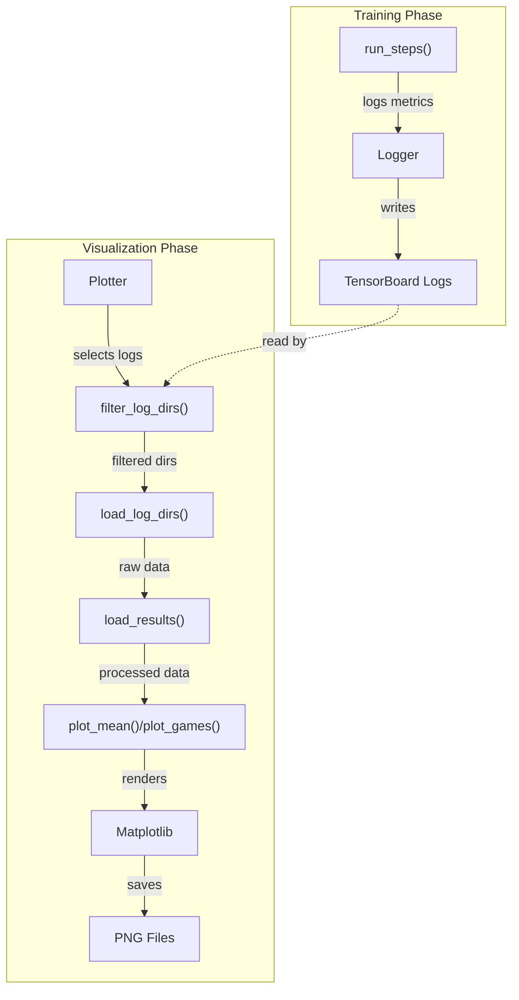
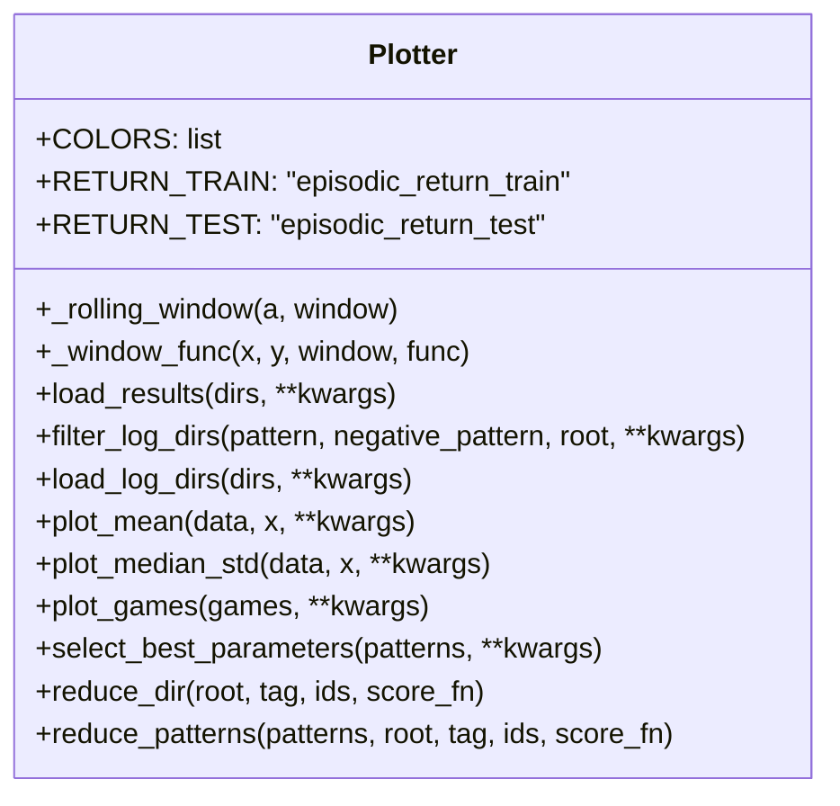
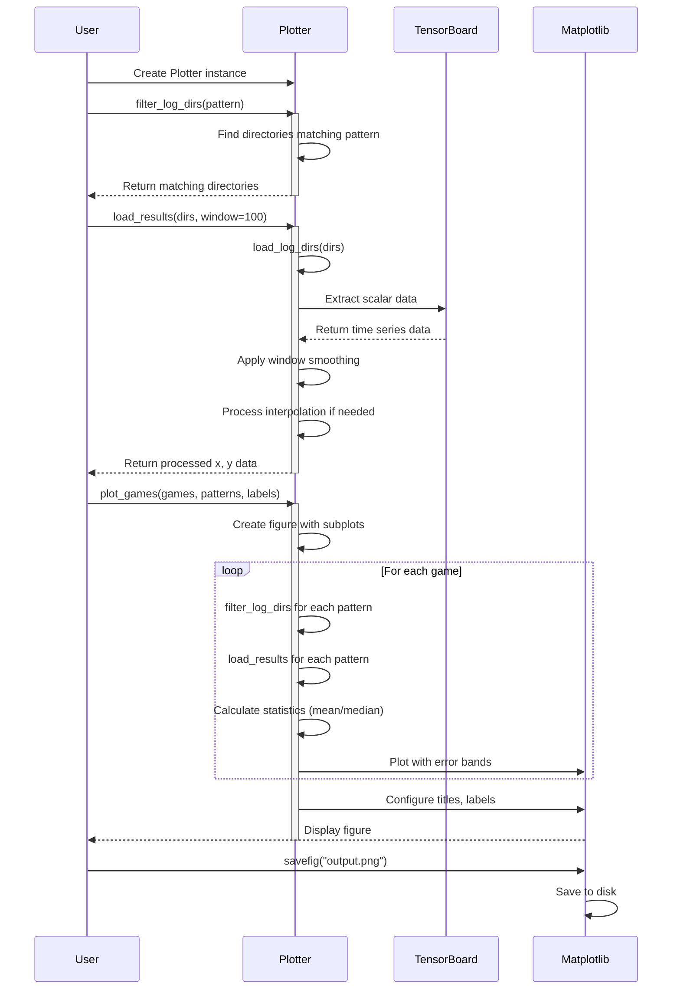

<!-- source: DeepWiki mcp.deepwiki.com · repo ShangtongZhang/DeepRL · page 6.3 Plotting and Visualization · fetched 2026-10-30 -->

# Plotting and Visualization

<details>
<summary>Relevant source files</summary>

The following files were used as context for generating this wiki page:

- [deep_rl/component/envs.py](deep_rl/component/envs.py)
- [deep_rl/component/random_process.py](deep_rl/component/random_process.py)
- [deep_rl/utils/misc.py](deep_rl/utils/misc.py)
- [deep_rl/utils/plot.py](deep_rl/utils/plot.py)
- [deep_rl/utils/torch_utils.py](deep_rl/utils/torch_utils.py)
- [images/Breakout.png](images/Breakout.png)
- [images/PPO.png](images/PPO.png)
- [images/mujoco_eval.png](images/mujoco_eval.png)
- [template_plot.py](template_plot.py)

</details>


This section documents the plotting and visualization tools in the DeepRL framework. These utilities enable researchers to analyze experiment results, compare algorithm performance across different environments, and create publication-quality plots. The framework leverages TensorBoard for logging during training and provides specialized tools to process and visualize this data.

For information about logging mechanisms, see [Logging](#6.2).

## Integration with Training Pipeline

The visualization system integrates with the training pipeline through TensorBoard logs. During training, metrics are logged, which can later be processed and visualized using the plotting utilities.

**Plotting System Data Flow**



Sources: [deep_rl/utils/plot.py:1-221](), [deep_rl/utils/misc.py:19-35]()

## Core Components

### Plotter Class

The `Plotter` class in `deep_rl/utils/plot.py` serves as the central component for creating visualizations from experimental data. It provides methods for loading TensorBoard logs, processing the data, and generating various types of plots.

**Key Components of the Plotter Class**



Sources: [deep_rl/utils/plot.py:12-22](), [deep_rl/utils/plot.py:107-123](), [deep_rl/utils/plot.py:124-132](), [deep_rl/utils/plot.py:134-165]()

## Data Loading and Processing

### Loading Data from TensorBoard Logs

The Plotter class provides several methods for loading and filtering experimental data:

| Method | Description |
|--------|-------------|
| `filter_log_dirs(pattern, negative_pattern=' ', root='./log', **kwargs)` | Filters directories based on regex patterns |
| `load_log_dirs(dirs, **kwargs)` | Loads TensorBoard event data from specified directories |
| `load_results(dirs, **kwargs)` | Higher-level method that handles filtering, loading, and processing |

Sources: [deep_rl/utils/plot.py:68-83](), [deep_rl/utils/plot.py:85-106](), [deep_rl/utils/plot.py:33-66]()

### Data Processing Options

The `load_results` method offers several processing options:

| Option | Description |
|--------|-------------|
| `window` | Apply moving average for smoother curves |
| `interpolation` | Resample data to a common x-axis for easier comparison |
| `top_k` | Select the top-k runs based on a performance measure |
| `right_align` | Align runs by their end points |

Sources: [deep_rl/utils/plot.py:23-31](), [deep_rl/utils/plot.py:33-66]()

## Visualization Methods

### Statistical Visualizations

The Plotter class provides methods for creating statistical visualizations:

| Method | Description |
|--------|-------------|
| `plot_mean(data, x=None, **kwargs)` | Plots the mean with error bars (standard error or deviation) |
| `plot_median_std(data, x=None, **kwargs)` | Plots the median with standard deviation bands |

Sources: [deep_rl/utils/plot.py:108-123](), [deep_rl/utils/plot.py:124-132]()

### Multi-Environment Visualizations

The `plot_games` method creates a grid of plots showing algorithm performance across multiple environments:

```python
def plot_games(self, games, **kwargs):
    # Creates a subplot for each game
    # For each game and algorithm pattern, plots the performance
    # Allows aggregation methods: 'mean', 'mean_std', 'median'
```

Sources: [deep_rl/utils/plot.py:134-165]()

## Hyperparameter Selection Utilities

The Plotter class also provides methods for selecting optimal hyperparameters:

| Method | Description |
|--------|-------------|
| `select_best_parameters(patterns, **kwargs)` | Selects best hyperparameters based on a score function |
| `reduce_dir(root, tag, ids, score_fn)` | Reduces directories to find best hyperparameter setup |
| `reduce_patterns(patterns, root, tag, ids, score_fn)` | Reduces patterns to find best hyperparameter setup |

Sources: [deep_rl/utils/plot.py:166-174](), [deep_rl/utils/plot.py:177-196](), [deep_rl/utils/plot.py:199-219]()

## Example Usage Workflow

**Detailed Visualization Workflow**



Sources: [template_plot.py:8-44](), [template_plot.py:46-82](), [template_plot.py:84-127]()

## Common Usage Examples

### Comparing Algorithms on Atari Games

```python
plotter = Plotter()
games = ['BreakoutNoFrameskip-v4']
patterns = ['remark_a2c', 'remark_categorical', 'remark_dqn', 
            'remark_n_step_dqn', 'remark_option_critic',
            'remark_quantile', 'remark_ppo']
labels = ['A2C', 'C51', 'DQN', 'N-Step DQN', 'OC', 'QR-DQN', 'PPO']

plotter.plot_games(games=games,
                   patterns=patterns,
                   agg='mean',
                   downsample=100,
                   labels=labels,
                   tag=plotter.RETURN_TRAIN,
                   root='./data/benchmark/atari',
                   window=100)
plt.savefig('images/Breakout.png')
```

Sources: [template_plot.py:84-127]()

### Comparing DDPG and TD3 on MuJoCo Environments

```python
plotter = Plotter()
games = ['HalfCheetah-v2', 'Walker2d-v2', 'Hopper-v2', 
         'Swimmer-v2', 'Reacher-v2', 'Ant-v2']
patterns = ['remark_ddpg', 'remark_td3']
labels = ['DDPG', 'TD3']

plotter.plot_games(games=games,
                   patterns=patterns,
                   agg='mean',
                   labels=labels,
                   tag=plotter.RETURN_TEST,
                   root='./data/benchmark/mujoco',
                   window=0)
plt.savefig('images/mujoco_eval.png')
```

Sources: [template_plot.py:46-82]()

### Visualizing PPO Performance

```python
plotter = Plotter()
games = ['HalfCheetah-v2', 'Walker2d-v2', 'Hopper-v2', 'Swimmer-v2',
         'Reacher-v2', 'Ant-v2', 'Humanoid-v2', 'HumanoidStandup-v2']
patterns = ['remark_ppo']
labels = ['PPO']

plotter.plot_games(games=games,
                   patterns=patterns,
                   agg='mean',
                   labels=labels,
                   tag=plotter.RETURN_TRAIN,
                   root='./data/benchmark/mujoco',
                   window=10)
plt.savefig('images/PPO.png')
```

Sources: [template_plot.py:8-44]()

## Integrating with the Training Loop

The visualization system integrates with the training loop through the metrics logged during training. During training, the `run_steps` function periodically evaluates the agent and logs results to TensorBoard:

```python
def run_steps(agent):
    config = agent.config
    while True:
        if config.eval_interval and not agent.total_steps % config.eval_interval:
            agent.eval_episodes()  # This logs metrics to TensorBoard
        # ... other training logic ...
```

These metrics are later processed by the Plotter class to create visualizations of agent performance.

Sources: [deep_rl/utils/misc.py:19-35](), [deep_rl/component/envs.py:57-74]()

## Example Output Visualizations

Here are examples of plots generated by the visualization system:

1. **Comparison of Various Algorithms on Atari Breakout**:
   This plot compares the learning curves of different reinforcement learning algorithms on the Breakout Atari game.

2. **PPO Performance Across MuJoCo Environments**:
   This figure shows how PPO performs across different MuJoCo control environments.

Sources: [images/Breakout.png](), [images/PPO.png]()

## Advanced Features

### Experiment Selection Patterns

The plotting system uses regular expressions to select experiment directories for analysis:

```python
# Example pattern to match all PPO experiments on a specific environment
pattern = '.*HalfCheetah-v2.*ppo.*'
log_dirs = plotter.filter_log_dirs(pattern, root='./log')
```

This allows for flexible filtering of experiments based on algorithm, environment, or custom tags.

Sources: [deep_rl/utils/plot.py:68-83]()

### Data Aggregation Methods

The system supports different methods for aggregating multiple runs:

| Method | Description |
|--------|-------------|
| `mean` | Calculates mean with standard error |
| `mean_std` | Calculates mean with standard deviation |
| `median` | Calculates median with standard deviation |

This allows researchers to choose the most appropriate statistical representation for their experiments.

Sources: [deep_rl/utils/plot.py:134-165]()

## Conclusion

The plotting and visualization system in the DeepRL framework provides powerful tools for analyzing experimental results. By leveraging TensorBoard logs and providing flexible data processing and visualization methods, it enables researchers to create comprehensive and publication-quality visualizations of reinforcement learning experiments.