# Page: Overview

# Overview

<details>
<summary>Relevant source files</summary>

The following files were used as context for generating this wiki page:

- [README.md](README.md)

</details>


This document provides an overview of the DeepRL repository, a modularized implementation of popular deep reinforcement learning algorithms in PyTorch. It introduces the purpose, architecture, and key features of the framework. For detailed information about specific components, please refer to their respective wiki pages.

## Purpose and Scope

DeepRL is a framework designed to facilitate research and experimentation with reinforcement learning algorithms. It provides:

- Modularized implementation of popular deep RL algorithms in PyTorch
- Easy switching between toy tasks and challenging games
- A consistent interface for implementing and testing new algorithms
- Tools for running experiments, collecting results, and visualizing performance

The framework supports a wide range of algorithms from value-based methods like DQN to policy-based methods like PPO, as well as actor-critic approaches and hierarchical reinforcement learning.

## Key Features

DeepRL implements numerous state-of-the-art reinforcement learning algorithms:

| Algorithm Family | Implementations |
|-----------------|-----------------|
| DQN Family | DQN, Double DQN, Dueling DQN, Prioritized DQN |
| Distributional RL | Categorical DQN (C51), Quantile Regression DQN (QR-DQN) |
| Policy Gradient | A2C (Continuous/Discrete) |
| N-Step Methods | N-Step DQN |
| Actor-Critic | DDPG, PPO, TD3 |
| Hierarchical RL | Option-Critic Architecture (OC) |

Additional features include:
- Asynchronous actors for data generation
- Asynchronous replay buffers for efficient GPU data transfer
- Comprehensive logging and visualization tools
- Docker support for reproducible experiments

Sources: [README.md:5-20]()

## System Architecture

The overall architecture of DeepRL follows a modular design pattern that separates different concerns into specialized components.

**High-Level System Architecture**

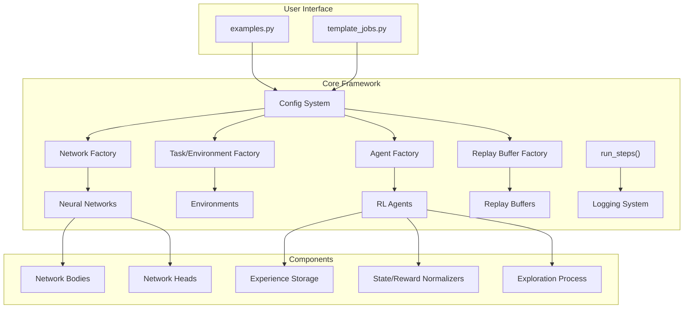

The system is centered around a configuration system that creates the necessary components through factory methods. Users interact with the system primarily through example scripts or batch jobs. Components are highly modularized to promote code reuse and flexibility.

Sources: [README.md]()

## Agent Hierarchy

DeepRL implements a variety of reinforcement learning agents, organized in a hierarchical structure with common functionality abstracted into base classes.

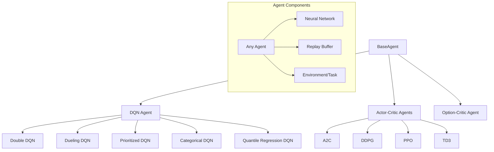

All agents inherit from a base agent class, with specialized implementations for different algorithms. The DQN family focuses on estimating action values, while actor-critic methods balance policy learning with value estimation. Each agent uses neural networks for function approximation and interacts with environments to collect experiences.

Sources: [README.md:8-18]()

## Training Process

The training process in DeepRL follows a standard reinforcement learning loop, with variations depending on the specific algorithm being used.

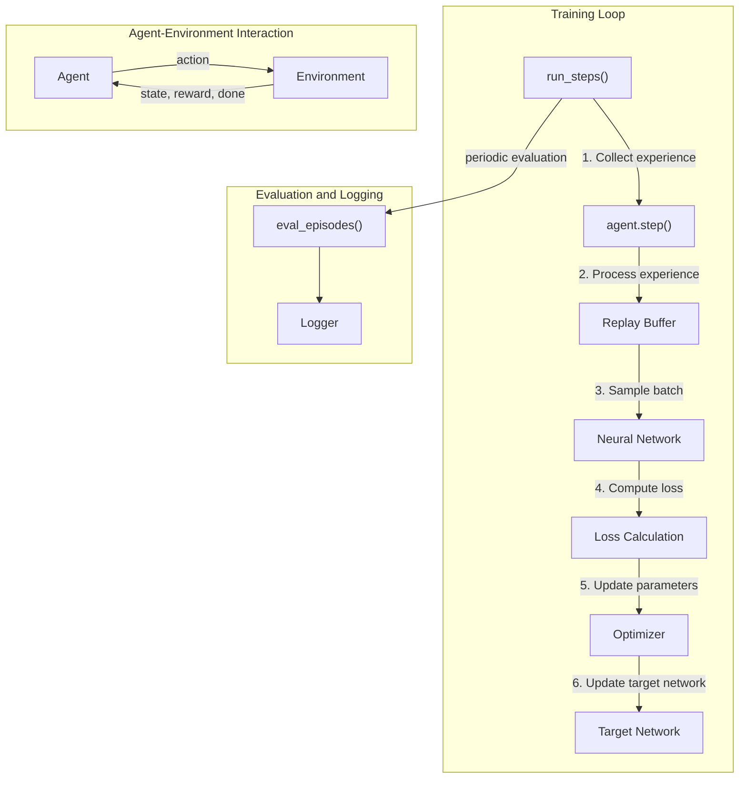

During training, agents interact with environments to collect experiences, which are stored in replay buffers. The agent periodically samples from these buffers to update its neural networks. For some algorithms like DQN, data collection and network updates can happen asynchronously for improved performance.

## Performance

Using modern hardware (e.g., 1 RTX 2080 Ti and 3 threads), the DQN agent in DeepRL can run for 10M steps (40M frames, 2.5M gradient updates) for Atari games like Breakout within 6 hours. The framework provides visualization tools to monitor and compare the performance of different algorithms.

Sources: [README.md:20-21](), [README.md:43-57]()

## Usage

The framework is designed to be easy to use, with examples provided for all implemented algorithms. Users can run predefined experiments or create their own by configuring the appropriate components.

```python
# Example usage pattern (conceptual)
config = Config()
config.task_fn = lambda: Task(...)
config.network_fn = lambda: Network(...)
config.replay_fn = lambda: Replay(...)
config.agent_fn = lambda: Agent(config)
agent = config.agent_fn()
runner = Runner(agent, config)
runner.run()
```

For more detailed examples and usage instructions, see [Example Usage](#1.3).

Sources: [README.md:27-30]()

## Dependencies

DeepRL requires PyTorch v1.5.1 and several other packages. A Docker environment is provided to ensure reproducibility across different systems. For detailed setup instructions, see [Getting Started](#1.2).

Sources: [README.md:24-25]()

## References and Citations

The repository implements algorithms from various published papers in the field of reinforcement learning. A comprehensive list of references is provided in the README.

Sources: [README.md:60-79]()

## Additional Research

The repository also contains implementations of novel algorithms from the author's research papers, located in separate branches. These implementations serve as good examples of how to use the codebase for research purposes.

Sources: [README.md:81-96]()

---

# Page: Architecture

# Architecture

<details>
<summary>Relevant source files</summary>

The following files were used as context for generating this wiki page:

- [README.md](README.md)
- [examples.py](examples.py)

</details>


## Purpose and Scope

This document explains the overall architecture of the DeepRL framework, detailing how its various components interact to implement and run deep reinforcement learning algorithms. It covers the system's core structures, component relationships, and execution flow. For practical setup information, see [Getting Started](#1.2), and for example usage, see [Example Usage](#1.3).

## High-Level Architecture

The DeepRL framework follows a modular design pattern that separates core functionality into distinct components with standardized interfaces. This architecture enables easy implementation of new algorithms and environments while reusing existing infrastructure.

### Core Architecture Diagram

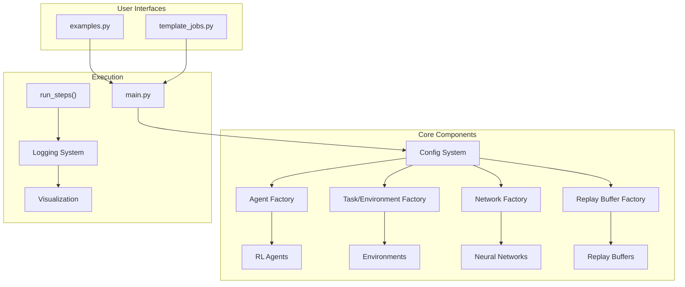

Sources: [examples.py:1-654](), [README.md:1-97]()

### Key Design Principles

1. **Factory Pattern**: Components are created through factory functions, allowing for easy configuration and instantiation.
2. **Composition over Inheritance**: Network architectures use composition (bodies + heads) rather than deep inheritance hierarchies.
3. **Configuration-Driven**: A unified configuration system controls all aspects of the algorithms and their execution.
4. **Modular Components**: Distinct components (agents, environments, networks, replay buffers) with standardized interfaces.
5. **Asynchronous Processing**: Parallel data collection and network updates for improved performance.

## Agent System Architecture

Agents are the core algorithmic components that implement reinforcement learning algorithms. Each agent follows a standard interface but implements algorithm-specific logic.

### Agent Hierarchy

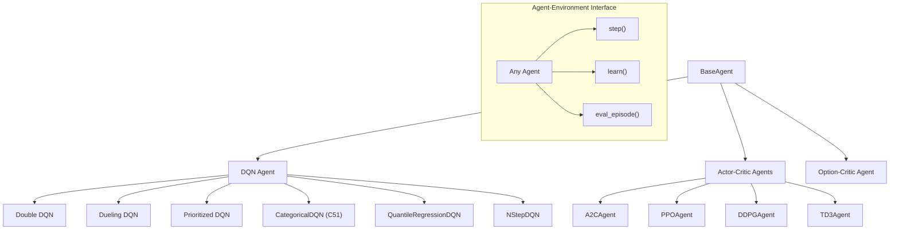

Sources: [examples.py:10-617]()

### Agent Component Relationships

Each agent typically consists of:
1. A neural network (value function, policy, or both)
2. An experience replay buffer (for off-policy algorithms)
3. An optimizer 
4. State/reward normalizers
5. Exploration mechanisms

## Network Architecture

The network architecture follows a modular design that separates feature extraction (bodies) from action/value prediction (heads). This enables easy combination of different feature extractors with different prediction algorithms.

### Network Component Structure

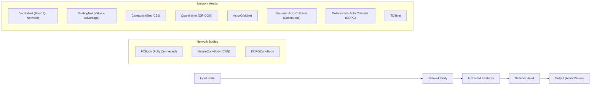

Sources: [examples.py:20-26](), [examples.py:66-70](), [examples.py:109-110](), [examples.py:172-174](), [examples.py:204-205](), [examples.py:300-305](), [examples.py:350-351](), [examples.py:394-396](), [examples.py:566-571](), [examples.py:595-601]()

### Network Usage in Algorithms

| Algorithm | Network Type | Body | Head |
|-----------|--------------|------|------|
| DQN | VanillaNet | FCBody/NatureConvBody | Q-value output |
| Dueling DQN | DuelingNet | FCBody/NatureConvBody | Value + Advantage |
| C51 | CategoricalNet | FCBody/NatureConvBody | Categorical distribution |
| QR-DQN | QuantileNet | FCBody/NatureConvBody | Quantile values |
| A2C | ActorCriticNet | FCBody/NatureConvBody | Policy + Value |
| PPO | GaussianActorCriticNet | FCBody | Gaussian policy + Value |
| DDPG | DeterministicActorCriticNet | FCBody | Deterministic policy + Q-value |
| TD3 | TD3Net | FCBody | Policy + Dual Q-networks |

## Training Pipeline and Data Flow

The training pipeline orchestrates how data flows through the system, from environment interaction to network updates.

### Training Flow Diagram

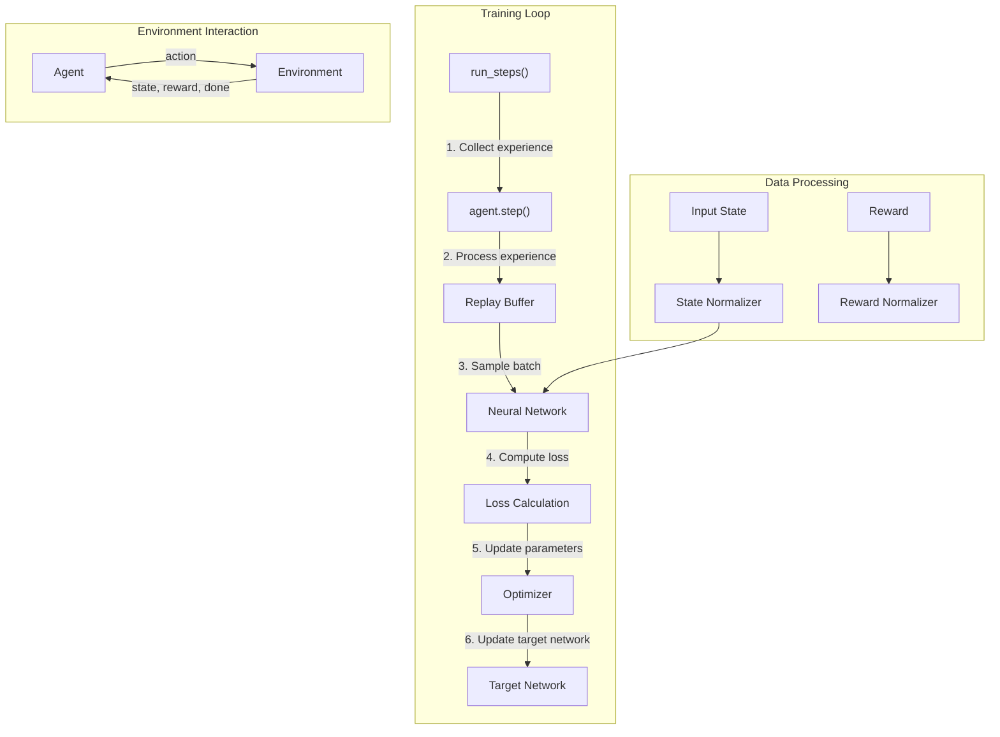

Sources: [examples.py:52](), [examples.py:97](), [examples.py:127](), [examples.py:193](), [examples.py:227](), [examples.py:280](), [examples.py:336](), [examples.py:358](), [examples.py:446](), [examples.py:468](), [examples.py:492](), [examples.py:522](), [examples.py:550](), [examples.py:579](), [examples.py:617]()

## Configuration System

The configuration system is central to the framework's flexibility. It manages all parameters needed to instantiate and run the algorithms.

### Configuration Components

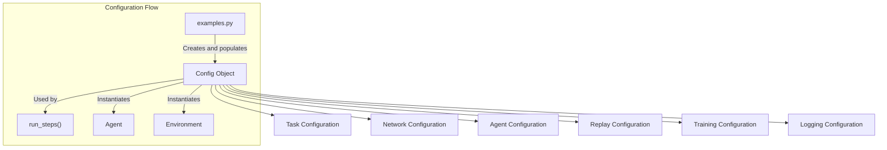

Sources: [examples.py:13-51](), [examples.py:57-97](), [examples.py:103-127](), [examples.py:132-160](), [examples.py:166-193](), [examples.py:198-227](), [examples.py:232-280](), [examples.py:283-336](), [examples.py:341-358](), [examples.py:362-381](), [examples.py:385-404](), [examples.py:409-424](), [examples.py:428-446](), [examples.py:450-468](), [examples.py:472-492](), [examples.py:497-522](), [examples.py:526-550](), [examples.py:554-579](), [examples.py:583-617]()

Example configuration parameters from the DQN implementation:
- Task configuration: `config.task_fn`, `config.eval_env`
- Network configuration: `config.network_fn`, `config.optimizer_fn`
- Replay configuration: `config.replay_fn`, `config.batch_size`, `config.history_length`
- Agent-specific parameters: `config.discount`, `config.target_network_update_freq`, `config.double_q`
- Training parameters: `config.max_steps`, `config.exploration_steps`, `config.eval_interval`
- Normalizers: `config.state_normalizer`, `config.reward_normalizer`

## Execution Flow

The typical execution flow in the DeepRL framework follows this pattern:

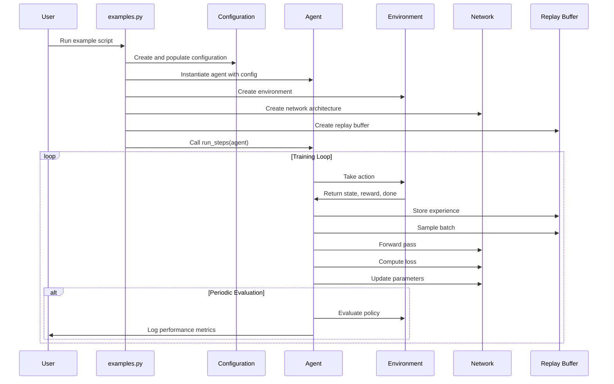

Sources: [examples.py:620-654]()

## Component Interaction Examples

Below are some examples showing how components interact in specific algorithms:

### DQN Component Interaction
1. The agent selects actions using an ε-greedy policy based on Q-values from the network
2. Experiences are stored in a replay buffer
3. Batches are sampled from the buffer for training
4. The network is updated to minimize TD error
5. Target network is periodically updated to stabilize learning

### A2C Component Interaction
1. Multiple parallel environments collect trajectories
2. The policy network outputs action probabilities
3. The value network estimates state values
4. Advantage estimates are computed using GAE (Generalized Advantage Estimation)
5. Both networks are updated to maximize policy performance

### PPO Component Interaction
1. Trajectories are collected using the current policy
2. Advantage estimates are computed
3. The policy is updated while constraining the policy change (via clipping or KL divergence)
4. The value function is updated to improve predictions
5. The process repeats with the updated policy

## Conclusion

The DeepRL framework provides a modular, flexible architecture for implementing and experimenting with deep reinforcement learning algorithms. Its design principles of separation of concerns, standard interfaces, and configuration-driven execution allow for easy extension and modification. The framework successfully abstracts the common components of reinforcement learning algorithms while allowing algorithm-specific optimizations and variations.

---

# Page: Getting Started

# Getting Started

<details>
<summary>Relevant source files</summary>

The following files were used as context for generating this wiki page:

- [Dockerfile](Dockerfile)
- [README.md](README.md)
- [docker_build.sh](docker_build.sh)
- [docker_python.sh](docker_python.sh)
- [docker_shell.sh](docker_shell.sh)
- [requirements.txt](requirements.txt)

</details>


This guide walks you through the process of installing and configuring the DeepRL framework, a modularized implementation of popular deep reinforcement learning algorithms in PyTorch. For information on how to use the framework after installation, see [Example Usage](#1.3).

## Prerequisites

Before installing the DeepRL framework, ensure you have:

- Git installed for cloning the repository
- Docker installed (for the recommended Docker-based setup)
- NVIDIA GPU with compatible drivers (for optimal performance)
- Basic understanding of reinforcement learning concepts

## Installation Options

There are two primary methods to install and set up the DeepRL framework:

1. **Docker-based Setup** (Recommended): Provides a reproducible environment with all dependencies pre-configured
2. **Direct Installation**: Manual installation of all dependencies on your local system

The Docker approach is strongly recommended as it ensures consistent environment setup, avoiding compatibility issues that often arise with direct installation.

## Docker-based Setup (Recommended)

### Docker Workflow Overview

The following diagram illustrates the Docker setup and usage workflow:

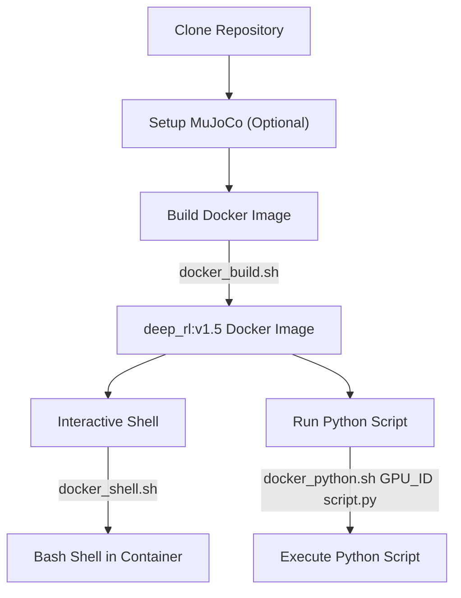

Sources: [Dockerfile](), [docker_build.sh](), [docker_shell.sh](), [docker_python.sh]()

### Step-by-Step Docker Setup

1. **Clone the repository**:
   ```bash
   git clone https://github.com/ShangtongZhang/DeepRL.git
   cd DeepRL
   ```

2. **MuJoCo setup** (optional, for MuJoCo environments):
   - Obtain a MuJoCo license key (`mjkey.txt`)
   - Place it in the repository root directory
   - If you don't need MuJoCo, edit the Dockerfile and comment out line 35:
     ```bash
     # COPY ./mjkey.txt .mujoco/mjkey.txt
     ```

3. **Build the Docker image**:
   ```bash
   ./docker_build.sh
   ```
   This script creates a Docker image named `deep_rl:v1.5` containing all dependencies listed in `requirements.txt`.

4. **Use the Docker environment**:
   - For interactive development:
     ```bash
     ./docker_shell.sh
     ```
   - To run a specific script with GPU ID 0:
     ```bash
     ./docker_python.sh 0 examples.py
     ```
     The first parameter (`0`) specifies which GPU to use, and the second parameter is the Python script to execute.

Sources: [docker_build.sh](), [docker_shell.sh](), [docker_python.sh]()

### Docker Image Components

The Docker image contains all the necessary dependencies for running the DeepRL framework:

| Component | Version | Purpose |
|-----------|---------|---------|
| CUDA | 10.0 | GPU acceleration |
| Python | 3.6 | Programming language |
| PyTorch | 1.5.1 | Deep learning framework |
| OpenAI Gym | 0.10.8 | RL environments |
| TensorFlow | 1.15.0 | TensorBoard logging |
| MuJoCo | 150/200 | Physics engine (optional) |
| Atari-py | 0.1.7 | Atari environments |
| OpenCV | 4.0.0.21 | Image processing |

Sources: [Dockerfile:1-49](), [requirements.txt:1-14]()

## Direct Installation

If you prefer to install dependencies directly on your system:

1. **Clone the repository**:
   ```bash
   git clone https://github.com/ShangtongZhang/DeepRL.git
   cd DeepRL
   ```

2. **Install Python 3.6** (recommended version)

3. **Install PyTorch 1.5.1** following the official PyTorch installation instructions

4. **Install required packages**:
   ```bash
   pip install -r requirements.txt
   ```

5. **For MuJoCo environments** (optional):
   - Download MuJoCo binaries from the official website
   - Extract to `~/.mujoco/mjpro150` and `~/.mujoco/mujoco200_linux`
   - Add license key to `~/.mujoco/mjkey.txt`
   - Set environment variables:
     ```bash
     export LD_LIBRARY_PATH=$LD_LIBRARY_PATH:~/.mujoco/mjpro150/bin:~/.mujoco/mujoco200_linux/bin
     ```

6. **Install additional dependencies**:
   ```bash
   pip install glfw Cython imageio lockfile
   pip install mujoco-py==1.50.1.68
   pip install git+git://github.com/deepmind/dm_control.git@103834
   pip install git+https://github.com/ShangtongZhang/dm_control2gym.git@scalar_fix
   pip install git+git://github.com/openai/baselines.git@8e56dd#egg=baselines
   ```

Sources: [requirements.txt:1-14](), [Dockerfile:40-47]()

## Framework Components and Structure

After installation, you'll have access to the DeepRL framework with its modular architecture:

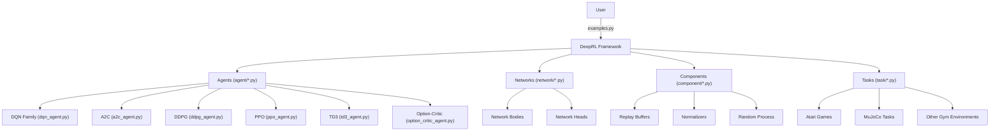

Sources: [README.md:5-21]()

## Supported Algorithms

The DeepRL framework implements numerous popular reinforcement learning algorithms:

| Algorithm Family | Implementations |
|------------------|-----------------|
| DQN Family | DQN, Double DQN, Dueling DQN, Prioritized DQN |
| Distributional RL | Categorical DQN (C51), Quantile Regression DQN (QR-DQN) |
| Advanced DQN | Rainbow DQN, N-Step DQN |
| Policy Gradient | A2C (Continuous/Discrete) |
| Actor-Critic | DDPG, PPO, TD3 |
| Hierarchical RL | Option-Critic Architecture |

Sources: [README.md:8-18]()

## Verifying Your Installation

To verify that your installation is working correctly:

1. **Run a simple example**:
   ```bash
   # If using Docker
   ./docker_python.sh 0 examples.py
   
   # If direct installation
   python examples.py
   ```

2. **Check for successful execution**: The script should start training an agent and display progress information.

## Data Flow and Execution Model

The following diagram illustrates how the execution model works after installation:

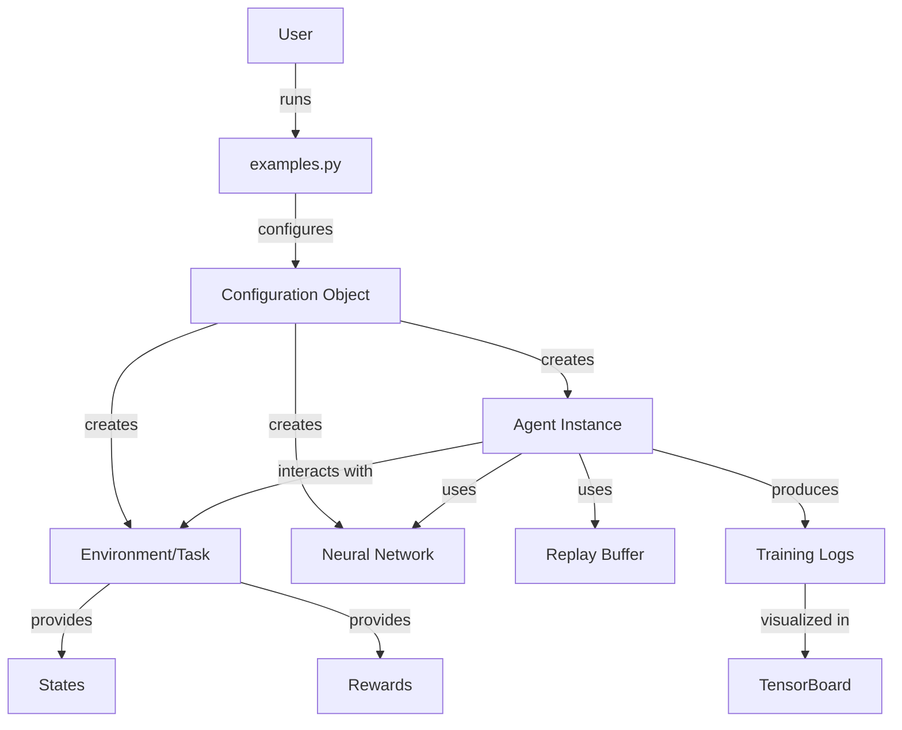

Sources: [README.md:20-21](), [README.md:27-31]()

## Next Steps

After successfully installing the DeepRL framework, you can:

1. Explore example implementations in [Example Usage](#1.3)
2. Learn about the architecture of different agents in [Agents](#2)
3. Discover how to run experiments in [Running Experiments](#5)

## Troubleshooting Common Issues

- **GPU-related errors**: Ensure your NVIDIA drivers are compatible with CUDA 10.0
- **MuJoCo license errors**: Verify your license key is valid and correctly placed
- **Package dependency conflicts**: The Docker approach helps avoid these issues
- **Memory errors**: Some environments and algorithms require significant RAM and GPU memory

Sources: [Dockerfile:1-49](), [requirements.txt:1-14]()

---

# Page: Example Usage

# Example Usage

<details>
<summary>Relevant source files</summary>

The following files were used as context for generating this wiki page:

- [README.md](README.md)
- [examples.py](examples.py)

</details>


## Purpose and Scope

This document demonstrates how to use the DeepRL framework through practical examples for different reinforcement learning algorithms and environments. It covers basic usage patterns, specific algorithm configurations, and execution instructions. For installation instructions, see [Getting Started](#1.2). For detailed documentation of specific agents, see [Agents](#2).

## Basic Usage Pattern

The DeepRL framework follows a consistent pattern for running experiments:

1. Create a configuration object
2. Set environment/task parameters
3. Configure the neural network architecture
4. Configure algorithm-specific parameters
5. Create the agent and run training

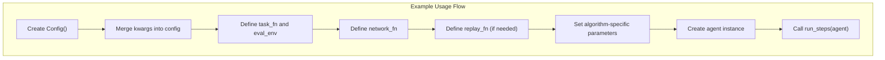

Sources: [examples.py:11-52]()

## Environment Types

The framework organizes examples based on environment type and input representation:

### Feature-based Environments

These environments provide direct feature vectors as state representations (e.g., CartPole).

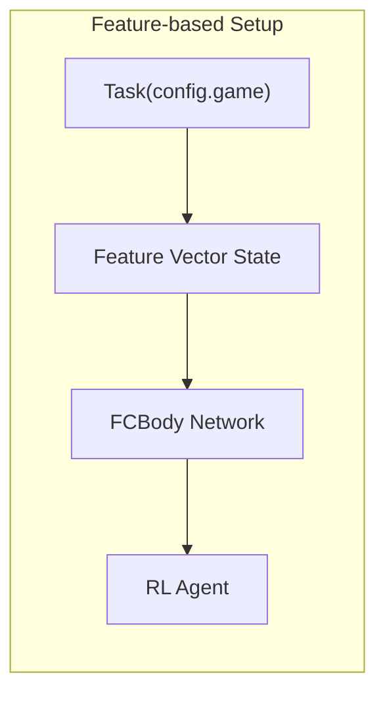

Sources: [examples.py:11-52](), [examples.py:101-127](), [examples.py:164-193]()

### Pixel-based Environments

These environments use image-based observations (e.g., Atari games).

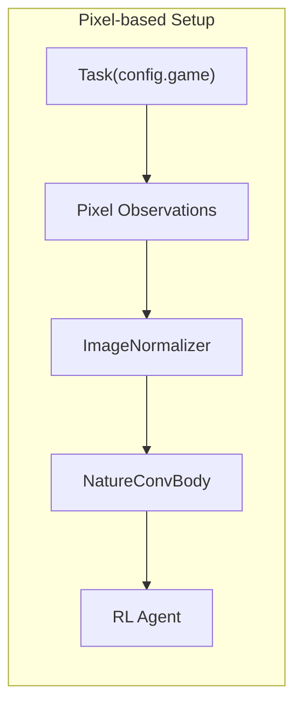

Sources: [examples.py:55-97](), [examples.py:130-160](), [examples.py:196-227]()

### Continuous Action Environments

These environments have continuous action spaces (e.g., MuJoCo).

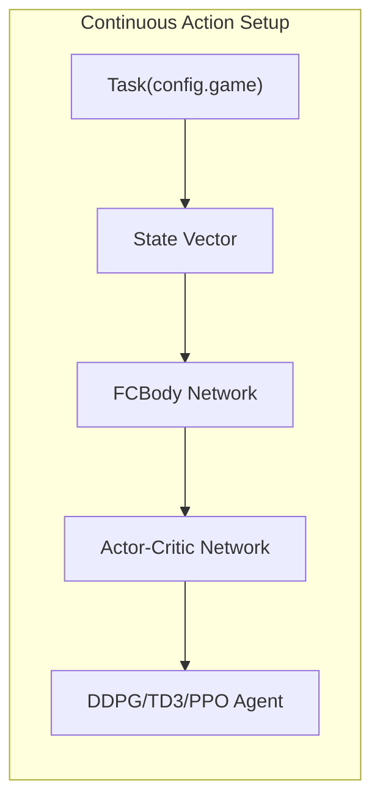

Sources: [examples.py:384-404](), [examples.py:496-522](), [examples.py:554-579](), [examples.py:583-617]()

## Running Specific Algorithms

### DQN and Variants

DQN is implemented with multiple variants including Double DQN, Dueling DQN, and N-Step DQN:

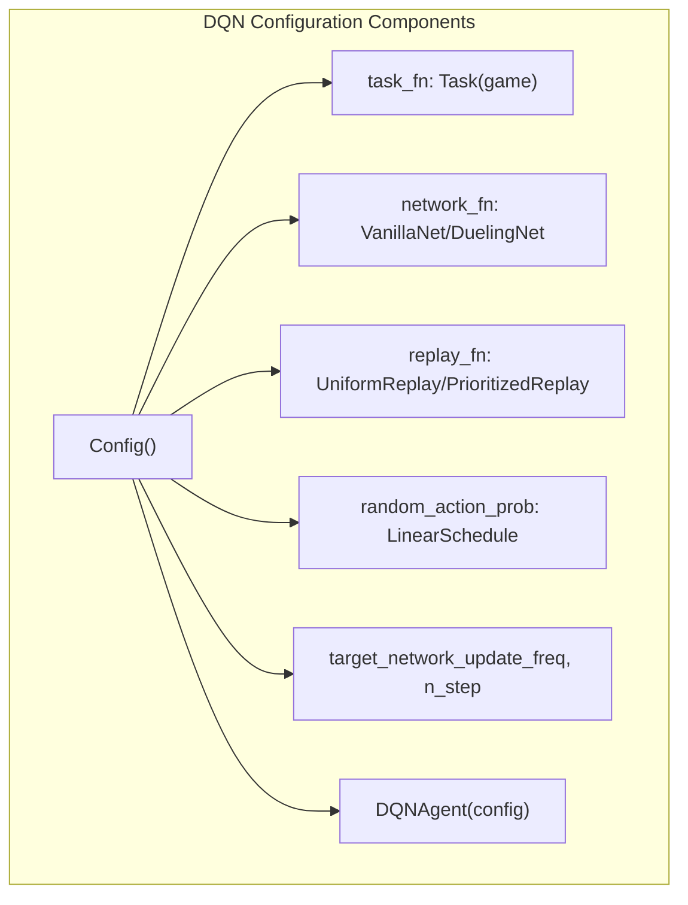

Key configuration parameters:
- `network_fn`: Network architecture (VanillaNet or DuelingNet)
- `replay_cls`: Replay buffer type (UniformReplay or PrioritizedReplay)
- `double_q`: Enable/disable double Q-learning
- `n_step`: Number of steps for multi-step bootstrap targets

Example usage:

```
# Basic DQN with feature input
dqn_feature(game='CartPole-v0')

# DQN with pixel input (Atari)
dqn_pixel(game='BreakoutNoFrameskip-v4')

# Options for variants
dqn_feature(game='CartPole-v0', double_q=True)  # Double DQN
dqn_feature(game='CartPole-v0', n_step=3)  # N-Step DQN
```

Sources: [examples.py:11-52](), [examples.py:55-97](), [examples.py:407-446]()

### Distributional RL Methods

C51, QR-DQN, and Rainbow implement distributional approaches to RL:

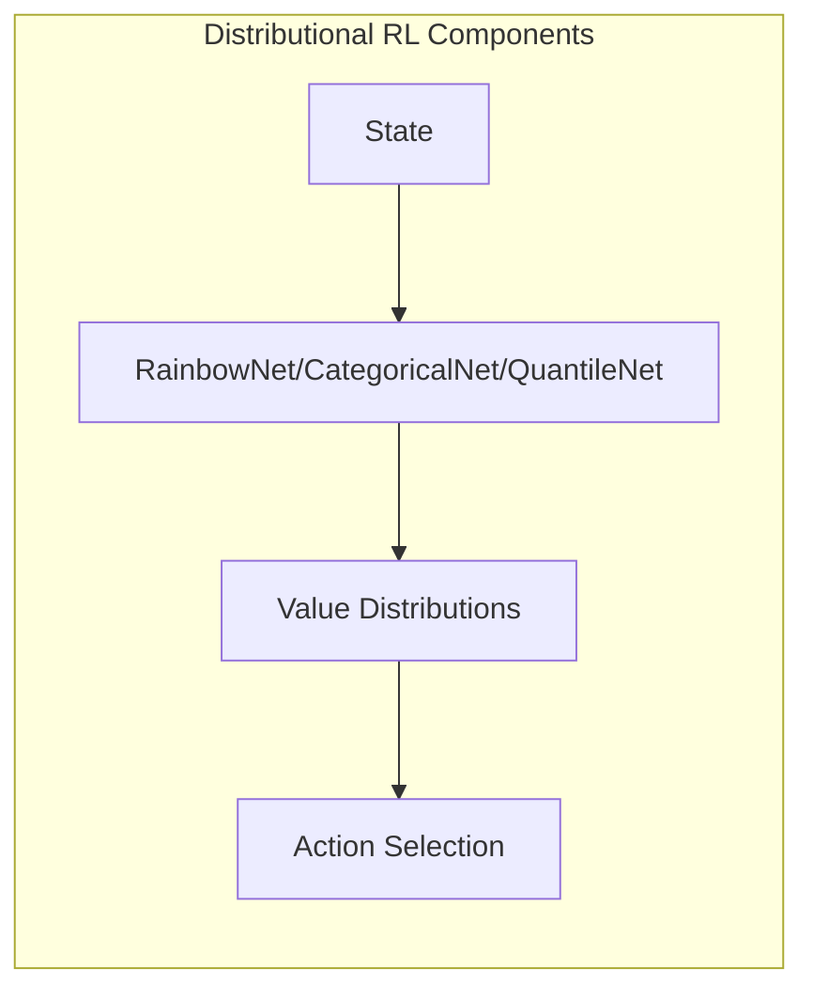

Key configuration parameters:
- `categorical_v_min/v_max`: Value bounds for C51
- `categorical_n_atoms`: Number of atoms for discretizing distribution
- `num_quantiles`: Number of quantiles for QR-DQN
- `noisy_linear`: Enable/disable NoisyNet for Rainbow

Example usage:

```
# Categorical DQN (C51)
categorical_dqn_pixel(game='BreakoutNoFrameskip-v4')

# Quantile Regression DQN
quantile_regression_dqn_pixel(game='BreakoutNoFrameskip-v4')

# Rainbow DQN
rainbow_pixel(game='BreakoutNoFrameskip-v4')
```

Sources: [examples.py:101-127](), [examples.py:130-160](), [examples.py:164-193](), [examples.py:196-227](), [examples.py:231-336]()

### Policy Gradient and Actor-Critic Methods

A2C and PPO implement policy gradient methods:

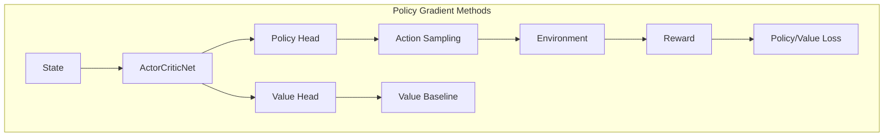

Key configuration parameters:
- `num_workers`: Number of parallel environments
- `entropy_weight`: Weight for entropy regularization
- `use_gae`: Enable/disable Generalized Advantage Estimation
- `gae_tau`: GAE parameter for bias-variance tradeoff
- `optimization_epochs`, `mini_batch_size`, `ppo_ratio_clip`: PPO-specific parameters

Example usage:

```
# A2C with feature input
a2c_feature(game='CartPole-v0')

# A2C with pixel input
a2c_pixel(game='BreakoutNoFrameskip-v4')

# A2C for continuous action spaces
a2c_continuous(game='HalfCheetah-v2')

# PPO for continuous action spaces
ppo_continuous(game='HalfCheetah-v2')
```

Sources: [examples.py:340-404](), [examples.py:496-550]()

### Deterministic Policy Gradient Methods

DDPG and TD3 implement deterministic policy gradients for continuous control:

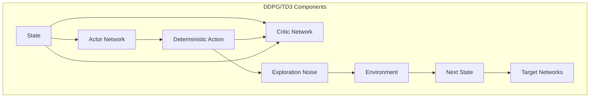

Key configuration parameters:
- `random_process_fn`: Exploration noise process (OU or Gaussian)
- `target_network_mix`: Soft update parameter
- `td3_noise`, `td3_noise_clip`, `td3_delay`: TD3-specific parameters

Example usage:

```
# DDPG for continuous control
ddpg_continuous(game='HalfCheetah-v2')

# TD3 for continuous control
td3_continuous(game='HalfCheetah-v2')
```

Sources: [examples.py:554-617]()

### Hierarchical Reinforcement Learning

Option-Critic implements hierarchical RL with options:

```mermaid
flowchart TD
    subgraph "Option-Critic Architecture"
        state["State"] --> optionValue["Option-Value Function"]
        state --> policyOver["Policy over Options"]
        state --> intraOption["Intra-Option Policies"]
        state --> termination["Termination Functions"]
        policyOver --> selectedOption["Selected Option"]
        selectedOption --> intraOption
        intraOption --> action["Action"]
        termination --> switch["Option Switch Decision"]
    end
```

Key configuration parameters:
- `num_options`: Number of options
- `termination_regularizer`: Regularization for option termination
- `entropy_weight`: Weight for entropy regularization

Example usage:

```
# Option-Critic with feature input
option_critic_feature(game='CartPole-v0')

# Option-Critic with pixel input
option_critic_pixel(game='BreakoutNoFrameskip-v4')
```

Sources: [examples.py:450-492]()

## Common Configuration Components

The configuration system uses a consistent pattern for setting up components:

```mermaid
graph TD
    subgraph "Configuration Components"
        config["Config()"] --> task["task_fn: Task creation"]
        config --> eval["eval_env: Evaluation environment"]
        config --> network["network_fn: Network architecture"]
        config --> optim["optimizer_fn: Optimizer configuration"]
        config --> storage["replay_fn/memory: Experience storage"]
        config --> normalize["Normalizers: State/Reward"]
        config --> hyperparams["Hyperparameters: discount, steps, etc."]
    end
```

Common configuration parameters:

| Parameter | Description | Example Value |
|-----------|-------------|---------------|
| `task_fn` | Function to create environment | `lambda: Task(config.game)` |
| `eval_env` | Environment for evaluation | `config.task_fn()` |
| `network_fn` | Function to create neural network | `lambda: VanillaNet(...)` |
| `optimizer_fn` | Function to create optimizer | `lambda params: torch.optim.Adam(params, lr=1e-3)` |
| `discount` | Discount factor | `0.99` |
| `batch_size` | Batch size for updates | `32` |
| `state_normalizer` | Normalizer for state observations | `ImageNormalizer()` |
| `max_steps` | Maximum training steps | `int(2e7)` |

Sources: [examples.py:11-52](), [examples.py:101-127](), [examples.py:231-280]()

## Running Examples

To run any of the example functions, you can modify the code in [examples.py:620-653]() and execute the script:

```bash
python examples.py
```

The script creates necessary directories, sets random seeds, selects the device (CPU/GPU), and runs the specified algorithm with the chosen game.

Example usage in [examples.py]():

```python
if __name__ == '__main__':
    mkdir('log')
    mkdir('tf_log')
    set_one_thread()
    random_seed()
    select_device(-1)  # -1 is CPU, a positive integer is the index of GPU
    
    # Select game and algorithm to run
    game = 'BreakoutNoFrameskip-v4'
    dqn_pixel(game=game, n_step=1, replay_cls=UniformReplay, async_replay=False)
    
    # Uncomment to run other algorithms
    # quantile_regression_dqn_pixel(game=game)
    # categorical_dqn_pixel(game=game)
    # rainbow_pixel(game=game, async_replay=False)
    # a2c_pixel(game=game)
    # n_step_dqn_pixel(game=game)
    # option_critic_pixel(game=game)
    # ppo_pixel(game=game)
    
    # For continuous control environments
    # game = 'HalfCheetah-v2'
    # a2c_continuous(game=game)
    # ppo_continuous(game=game)
    # ddpg_continuous(game=game)
    # td3_continuous(game=game)
```

To customize the examples, you can modify parameters by passing them as keyword arguments:

```python
# Modify hyperparameters
dqn_pixel(game='BreakoutNoFrameskip-v4', 
          n_step=3,  # Use 3-step returns
          replay_cls=PrioritizedReplay,  # Use prioritized replay
          async_replay=True)  # Use asynchronous replay
```

Sources: [examples.py:620-653]()

---

# Page: Agents

# Agents

<details>
<summary>Relevant source files</summary>

The following files were used as context for generating this wiki page:

- [README.md](README.md)
- [deep_rl/agent/BaseAgent.py](deep_rl/agent/BaseAgent.py)

</details>


This document provides an overview of the agent implementations in the DeepRL framework. Agents are the core components that implement reinforcement learning algorithms, interact with environments, and learn optimal policies. For details about specific agent families, see [DQN Family](#2.2), [Policy Gradient Methods](#2.3), and [Actor-Critic Methods](#2.4).

## Agent Architecture Overview

Agents in the DeepRL framework share a common architecture while implementing algorithm-specific learning mechanisms. Each agent interacts with environments, manages neural networks, and stores experiences.

```mermaid
flowchart TD
    subgraph "Agent Components"
        BaseAgent["BaseAgent"] --> Config["Configuration"]
        BaseAgent --> Networks["Neural Networks"]
        BaseAgent --> EnvInteraction["Environment Interaction"]
        BaseAgent --> ExpStorage["Experience Storage"]
        
        Networks --> NetworkBodies["Network Bodies"]
        Networks --> NetworkHeads["Network Heads"]
        ExpStorage --> ReplayBuffer["Replay Buffer"]
        EnvInteraction --> Task["Task/Environment"]
        EnvInteraction --> Normalizers["State/Reward Normalizers"]
    end
    
    subgraph "Agent Operations"
        Operations["Agent Operations"] --> Eval["eval_episode()/eval_episodes()"]
        Operations --> Training["step()"]
        Operations --> ModelIO["save()/load()"]
        Operations --> Logging["record_online_return()"]
    end
    
    Config --> HyperParams["Hyperparameters"]
    BaseAgent --> Operations
```

Sources: [deep_rl/agent/BaseAgent.py:15-106](). [README.md:8-18]().

## Agent Hierarchy

The DeepRL framework implements a variety of reinforcement learning algorithms through specialized agent classes that inherit from the BaseAgent class.

```mermaid
graph TD
    BaseAgent["BaseAgent"] --> DQNFamily["DQN Family"]
    BaseAgent --> PolicyGradients["Policy Gradient Methods"]
    BaseAgent --> ActorCritic["Actor-Critic Methods"]
    BaseAgent --> Hierarchical["Hierarchical RL"]
    
    DQNFamily --> DQN["DQN Agent"]
    DQN --> DoubleDQN["Double DQN"]
    DQN --> DuelingDQN["Dueling DQN"]
    DQN --> PrioritizedDQN["Prioritized DQN"]
    DQN --> C51["Categorical DQN (C51)"]
    DQN --> QRDQN["Quantile Regression DQN"]
    DQN --> NStepDQN["N-Step DQN"]
    DQN --> Rainbow["Rainbow DQN"]
    
    PolicyGradients --> A2C["A2C (Discrete/Continuous)"]
    PolicyGradients --> PPO["PPO"]
    
    ActorCritic --> DDPG["DDPG"]
    ActorCritic --> TD3["TD3"]
    
    Hierarchical --> OptionCritic["Option-Critic"]
```

Sources: [README.md:8-18]().

## Common Agent Functionality

All agents inherit from the `BaseAgent` class, which provides common functionality:

| Method | Purpose |
|--------|---------|
| `__init__(config)` | Initializes agent with configuration |
| `save(filename)` | Saves agent model and normalizer states |
| `load(filename)` | Loads agent model and normalizer states |
| `eval_step(state)` | Performs a single evaluation step |
| `eval_episode()` | Runs a full evaluation episode |
| `eval_episodes()` | Runs multiple evaluation episodes and logs results |
| `record_online_return(info)` | Records and logs training returns |
| `switch_task()` | Switches to a new task if using curriculum learning |
| `record_episode(dir, env)` | Records video frames of an episode |

The `BaseAgent` provides the foundation for all agents with common utilities for evaluation, logging, and model management. Each specific agent implementation extends this class with algorithm-specific learning methods.

Sources: [deep_rl/agent/BaseAgent.py:15-106]().

## Asynchronous Actors

For efficient data collection, the DeepRL framework uses asynchronous actors that run in separate processes.

```mermaid
flowchart TD
    subgraph "Asynchronous Architecture"
        BaseActor["BaseActor"] --> Pipe["Multiprocessing Pipe"]
        Pipe --> MainProcess["Main Process"]
        Pipe --> ActorProcess["Actor Process"]
        
        ActorProcess --> TaskExecution["Task Execution"]
        ActorProcess --> TransitionCollection["Transition Collection"]
        ActorProcess --> Cache["Experience Cache"]
        
        MainProcess --> AgentUpdate["Agent Update"]
        MainProcess --> NetworkUpdate["Network Update"]
        
        Cache --> ExpFlow["Experience Flow"]
        ExpFlow --> AgentUpdate
        NetworkUpdate --> NetworkFlow["Network Flow"]
        NetworkFlow --> ActorProcess
    end
```

The `BaseActor` class provides:
- Asynchronous data collection through multiprocessing
- Communication between the agent and actors via pipes
- Caching of transitions to improve efficiency
- Option to run synchronously for debugging and small-scale experiments

Sources: [deep_rl/agent/BaseAgent.py:108-183]().

## Agent Implementations

The DeepRL framework implements a variety of reinforcement learning algorithms:

| Agent Family | Algorithms | Key Features |
|--------------|------------|--------------|
| DQN Family | DQN, Double DQN, Dueling DQN, Prioritized DQN, C51, QR-DQN, Rainbow, N-Step DQN | Value-based methods for discrete action spaces |
| Policy Gradient | A2C (Discrete/Continuous) | Advantage Actor-Critic methods with synchronous updates |
| PPO | PPO | Policy optimization with clipped objective function |
| Deterministic Policy | DDPG, TD3 | Deterministic policy optimization for continuous action spaces |
| Hierarchical RL | Option-Critic | Temporal abstraction using options framework |

The library features asynchronous data generation and processing for efficient training. The DQN agent and its variants have asynchronous actors for data generation and asynchronous replay buffers for transferring data to GPU, allowing for faster training on modern hardware.

Sources: [README.md:8-21]().

## Agent Usage Pattern

Agents in DeepRL follow a common usage pattern:

1. Create agent instance with configured hyperparameters
2. Interact with environments to collect experiences
3. Learn from collected experiences
4. Evaluate learned policies periodically
5. Save/load model checkpoints as needed

For specific configuration and usage examples, see [Example Usage](#1.3) and the implementation details of individual agent families.

Sources: [deep_rl/agent/BaseAgent.py:15-106]().

## Algorithm Research Extensions

The framework has been extended to implement many research algorithms beyond the standard implementations, including:

- Off-PAC-KL: Softmax Off-Policy Actor Critic
- TruncatedETD: Truncated Emphatic Temporal Difference methods
- DifferentialGQ: Average-reward off-policy evaluation
- MVPI: Mean-Variance Policy Iteration for risk-averse RL
- Bi-Res-DDPG: Deep Residual Reinforcement Learning
- ACE: Actor Ensemble Algorithm

These research extensions demonstrate the flexibility of the agent architecture in the DeepRL framework.

Sources: [README.md:80-96]().

---

# Page: Base Agent

# Base Agent

<details>
<summary>Relevant source files</summary>

The following files were used as context for generating this wiki page:

- [deep_rl/agent/BaseAgent.py](deep_rl/agent/BaseAgent.py)

</details>


## Purpose and Overview

The Base Agent module provides the foundational architecture for all reinforcement learning agents in the DeepRL framework. It defines common interfaces and functionality that specific agent implementations (like DQN, PPO, DDPG) inherit and extend. The module consists of two main classes: `BaseAgent` and `BaseActor`.

This page focuses on the base agent design and core functionality. For information about specific agent implementations, see:
- [DQN Family](#2.2)
- [Policy Gradient Methods](#2.3)
- [Actor-Critic Methods](#2.4)
- [Hierarchical Reinforcement Learning](#2.5)

## Architecture Overview

The base agent architecture defines the common structure and interfaces that all agents in the framework must implement. It handles the agent-environment interaction loop, evaluation procedures, logging, and state management.

```mermaid
classDiagram
    class "BaseAgent" {
        +config
        +logger
        +task_ind
        +close()
        +save(filename)
        +load(filename)
        +eval_step(state)*
        +eval_episode()
        +eval_episodes()
        +record_online_return(info)
        +switch_task()
        +record_episode(dir, env)
        +record_step(state)*
        +record_obs(env, dir, steps)
    }
    
    class "ConcreteAgents" {
        +network
        +step(state, action, reward, next_state, done)
        +eval_step(state)
        +record_step(state)
    }
    
    BaseAgent <|-- "ConcreteAgents"
    
    note for BaseAgent "Abstract base class with common functionality"
    note for "ConcreteAgents" "DQN, PPO, A2C, DDPG, etc."
```

Sources: [deep_rl/agent/BaseAgent.py:15-106]()

## BaseAgent Class

The `BaseAgent` class serves as an abstract base class for all RL agent implementations. It provides core functionality while requiring specific implementations to define their unique learning and decision-making processes.

### Initialization and Core Methods

The `BaseAgent` initializes with a configuration object that contains all necessary parameters and setups. The key methods include:

```mermaid
flowchart TB
    subgraph "BaseAgent Core Methods"
        init["__init__(config)"] --> |"Sets up"| logger["Logger"]
        
        save["save(filename)"] --> |"Stores"| model["Model State"]
        save --> |"Stores"| stats["Normalizer Stats"]
        
        load["load(filename)"] --> |"Loads"| model
        load --> |"Loads"| stats
        
        close["close()"] --> |"Releases"| resources["Resources"]
    end
    
    subgraph "Abstract Methods"
        eval_step["eval_step(state)*"]
        record_step["record_step(state)*"]
    end
    
    init -.-> eval_step
    init -.-> record_step
```

Sources: [deep_rl/agent/BaseAgent.py:16-33]()

### Evaluation System

The evaluation system enables assessment of agent performance during training. It provides methods to run evaluation episodes and collect performance statistics.

```mermaid
flowchart TB
    subgraph "Evaluation Flow"
        eval_episodes["eval_episodes()"] --> |"Runs multiple"| eval_episode["eval_episode()"]
        eval_episode --> |"Repeatedly calls"| eval_step["eval_step(state)*"]
        eval_step --> |"Gets"| action["Action"]
        eval_episode --> |"Interacts with"| eval_env["Evaluation Environment"]
        eval_episodes --> |"Calculates"| stats["Performance Statistics"]
        stats --> |"Logs"| logger["Logger"]
    end
```

Sources: [deep_rl/agent/BaseAgent.py:35-60]()

### Key BaseAgent Methods

| Method | Purpose | Implementation |
|--------|---------|----------------|
| `__init__(config)` | Initialize agent with configuration | [BaseAgent.py:16-19]() |
| `save(filename)` | Save agent model and statistics | [BaseAgent.py:24-27]() |
| `load(filename)` | Load agent model and statistics | [BaseAgent.py:29-33]() |
| `eval_step(state)` | Abstract method to choose actions during evaluation | [BaseAgent.py:35-36]() |
| `eval_episode()` | Run a single evaluation episode | [BaseAgent.py:38-47]() |
| `eval_episodes()` | Run multiple evaluation episodes and log results | [BaseAgent.py:49-60]() |
| `record_online_return(info)` | Log episode returns during training | [BaseAgent.py:62-72]() |
| `switch_task()` | Switch between different tasks/environments | [BaseAgent.py:74-83]() |
| `record_episode(dir, env)` | Record episodes for visualization | [BaseAgent.py:85-96]() |

Sources: [deep_rl/agent/BaseAgent.py:15-106]()

## BaseActor Class

The `BaseActor` class implements a process-based actor for asynchronous agent implementations, enabling parallel interaction with environments. It can operate in both synchronous and asynchronous modes.

```mermaid
classDiagram
    class "BaseActor" {
        +STEP : int
        +RESET : int
        +EXIT : int
        +SPECS : int
        +NETWORK : int
        +CACHE : int
        +__init__(config)
        +run()
        +_sample()
        +_transition()*
        +_set_up()*
        +step()
        +close()
        +set_network(net)
    }
    
    class "Pipe Communication" {
        +__pipe
        +__worker_pipe
    }
    
    BaseActor --> "Pipe Communication" : uses
    
    note for BaseActor "Extends mp.Process for parallel execution"
    note for "Pipe Communication" "Communication channel between processes"
```

Sources: [deep_rl/agent/BaseAgent.py:108-183]()

### Synchronous vs Asynchronous Mode

The `BaseActor` can operate in two modes:

```mermaid
flowchart LR
    subgraph "Execution Modes"
        direction TB
        sync["Synchronous Mode"]
        async["Asynchronous Mode"]
        
        sync --> |"Direct"| execution["Direct Function Calls"]
        async --> |"Parallel"| process["Separate Process"]
        process --> |"Communication via"| pipe["Multiprocessing Pipe"]
    end
    
    config["config.async_actor"] -->|"False"| sync
    config -->|"True"| async
```

Sources: [deep_rl/agent/BaseAgent.py:127-132]()

### Actor Communication Protocol

When running in asynchronous mode, the actor uses a communication protocol through pipes:

```mermaid
sequenceDiagram
    participant A as "Agent"
    participant BA as "BaseActor"
    participant E as "Environment"
    
    A->>BA: set_network(net)
    A->>BA: step()
    activate BA
    BA->>E: Interact with environment
    E-->>BA: Return transitions
    BA-->>A: Return samples
    deactivate BA
    A->>BA: close()
```

Sources: [deep_rl/agent/BaseAgent.py:142-182]()

## Integration with Framework Components

The BaseAgent integrates with several other components in the DeepRL framework:

```mermaid
flowchart TB
    subgraph "Framework Integration"
        BaseAgent --> |"Uses"| Logger["Logger System"]
        BaseAgent --> |"Interacts with"| Environment["Environment/Task"]
        BaseAgent --> |"Manages"| Network["Neural Network"]
        BaseAgent --> |"Uses"| Normalizer["State Normalizer"]
        BaseAgent --> |"Created by"| AgentFactory["Agent Factory"]
    end
    
    subgraph "BaseAgent Abstract Methods"
        eval_step["eval_step(state)"]
        record_step["record_step(state)"]
    end
    
    ConcreteAgent["Concrete Agent Implementations"] -->|"Implement"| eval_step
    ConcreteAgent -->|"Implement"| record_step
    AgentFactory -->|"Creates"| ConcreteAgent
```

Sources: [deep_rl/agent/BaseAgent.py:15-106]()

## Implementation Details

### Abstract Methods

The `BaseAgent` declares several abstract methods that must be implemented by concrete agents:

1. `eval_step(state)`: Determines the action to take during evaluation based on the current state.
2. `record_step(state)`: Similar to `eval_step`, but used during episode recording.

These methods define the core decision-making process of an agent and vary based on the specific algorithm.

Sources: [deep_rl/agent/BaseAgent.py:35-36](), [deep_rl/agent/BaseAgent.py:98-99]()

### Task Switching

The `BaseAgent` supports switching between different tasks during training, enabling curriculum learning or multi-task learning scenarios:

```mermaid
flowchart LR
    subgraph "Task Switching"
        check["Check step count"]
        check -->|"Exceeds threshold"| switch["Switch to next task"]
        switch -->|"Reset"| state["Reset state"]
        state -->|"Normalize"| norm["Normalize state"]
        
        check -->|"Not exceeded"| continue["Continue current task"]
    end
```

Sources: [deep_rl/agent/BaseAgent.py:74-83]()

## Conclusion

The `BaseAgent` and `BaseActor` classes form the foundation of the DeepRL framework's agent architecture. They provide a common structure and interfaces that enable the implementation of diverse reinforcement learning algorithms while sharing core functionality for evaluation, logging, and environment interaction.

Concrete agent implementations extend these base classes to implement specific algorithms such as DQN, PPO, DDPG, and others, each with its unique learning and decision-making mechanisms.

---

# Page: DQN Family

# DQN Family

<details>
<summary>Relevant source files</summary>

The following files were used as context for generating this wiki page:

- [deep_rl/agent/CategoricalDQN_agent.py](deep_rl/agent/CategoricalDQN_agent.py)
- [deep_rl/agent/DQN_agent.py](deep_rl/agent/DQN_agent.py)
- [deep_rl/agent/QuantileRegressionDQN_agent.py](deep_rl/agent/QuantileRegressionDQN_agent.py)

</details>


The DQN Family section documents the implementation of Deep Q-Network (DQN) and its variants in the DeepRL framework. This page covers the base DQN algorithm and its extensions, including Double DQN, Dueling DQN, Categorical DQN (C51), and Quantile Regression DQN (QR-DQN). For information about policy gradient and actor-critic methods, see [Policy Gradient Methods](#2.3) and [Actor-Critic Methods](#2.4).

## Architecture Overview

DQN is a value-based reinforcement learning method that uses deep neural networks to approximate the action-value function (Q-function). The DeepRL implementation follows a modular design with separate components for experience collection, replay buffer management, and network updates.

```mermaid
flowchart TD
    subgraph "DQN Family Hierarchy"
        BaseAgent["BaseAgent"] --> DQNAgent["DQNAgent"]
        DQNAgent --> DoubleDQN["Double DQN (via config.double_q)"]
        DQNAgent --> DuelingDQN["Dueling DQN (via network architecture)"]
        DQNAgent --> NStepDQN["N-Step DQN (via config.n_step)"]
        DQNAgent --> PrioritizedDQN["Prioritized DQN (via replay buffer)"]
        DQNAgent --> CategoricalDQN["CategoricalDQNAgent (C51)"]
        DQNAgent --> QuantileRegressionDQN["QuantileRegressionDQNAgent"]
        CategoricalDQN --> RainbowDQN["Rainbow DQN"]
        
        subgraph "Key Components"
            DQNAgent --- DQNActor["DQNActor"]
            DQNAgent --- ReplayBuffer["Replay Buffer"]
            DQNAgent --- Network["Q-Network"]
            DQNAgent --- TargetNetwork["Target Network"]
        end
    end
```

Sources: 
- [deep_rl/agent/DQN_agent.py:48-138]()
- [deep_rl/agent/CategoricalDQN_agent.py:27-89]()
- [deep_rl/agent/QuantileRegressionDQN_agent.py:23-77]()

## Base DQN Implementation

The DQN implementation consists of two main classes:
1. `DQNActor`: Handles environment interaction and experience collection
2. `DQNAgent`: Manages the training process, including network updates and target network synchronization

### DQNActor

The `DQNActor` class is responsible for:
- Selecting actions using ε-greedy exploration
- Interacting with the environment
- Collecting transitions (state, action, reward, next_state, done)

```mermaid
flowchart LR
    subgraph "DQNActor"
        state["State"] --> stateNorm["state_normalizer"]
        stateNorm --> network["network(state)"]
        network --> q_values["q_values"]
        q_values --> epsilon_greedy["epsilon_greedy()"]
        epsilon_greedy --> action["Action"]
        action --> env["Environment step()"]
        env --> transition["Transition\n[state, action, reward, next_state, done, info]"]
    end
```

Sources:
- [deep_rl/agent/DQN_agent.py:14-45]()

### DQNAgent

The `DQNAgent` implements the core DQN algorithm:
- Initializes the Q-network and target network
- Collects experiences through the actor
- Samples batches from the replay buffer
- Computes TD errors and updates the network
- Periodically updates the target network

```mermaid
flowchart TD
    subgraph "DQNAgent Training Process"
        step["step()"] --> transition["Get transitions from actor"]
        transition --> replay["Store in replay buffer"]
        replay --> sample["Sample batch from replay"]
        sample --> computeLoss["compute_loss()"]
        computeLoss --> update["Update network parameters"]
        update --> updateTarget["Update target network\n(every target_network_update_freq steps)"]
    end
```

Sources:
- [deep_rl/agent/DQN_agent.py:48-138]()

### Key Methods

1. **`compute_loss`**: Implements the TD learning loss for DQN
   ```
   Q-target = reward + discount * max(Q-next)
   Loss = (Q-target - Q(state, action))^2
   ```

2. **`step`**: Main training loop that:
   - Collects transitions from the environment
   - Feeds transitions to the replay buffer
   - Samples batches and updates the network
   - Periodically synchronizes the target network

Sources:
- [deep_rl/agent/DQN_agent.py:81-99]()
- [deep_rl/agent/DQN_agent.py:101-138]()

## DQN Variants

### Double DQN

Double DQN addresses the overestimation bias in vanilla DQN by decoupling action selection and evaluation:
- The online network selects the best action
- The target network evaluates the selected action

In the implementation, this is enabled by setting `config.double_q = True`:

```python
if self.config.double_q:
    best_actions = torch.argmax(self.network(next_states)['q'], dim=-1)
    q_next = q_next.gather(1, best_actions.unsqueeze(-1)).squeeze(1)
else:
    q_next = q_next.max(1)[0]
```

Sources:
- [deep_rl/agent/DQN_agent.py:87-91]()

### N-Step DQN

N-step DQN uses multi-step returns to accelerate learning by incorporating rewards from multiple timesteps:
- Configured via `config.n_step`
- Modifies the target calculation: `q_target = rewards + discount^n_step * q_next * masks`

Sources:
- [deep_rl/agent/DQN_agent.py:94]()

### Prioritized Experience Replay

Prioritized Experience Replay samples transitions based on their TD error magnitude:
- Implemented by using a `PrioritizedReplayBuffer` instead of a regular replay buffer
- Uses importance sampling weights to correct the optimization bias

```python
if isinstance(transitions, PrioritizedTransition):
    priorities = loss.abs().add(config.replay_eps).pow(config.replay_alpha)
    idxs = tensor(transitions.idx).long()
    self.replay.update_priorities(zip(to_np(idxs), to_np(priorities)))
    sampling_probs = tensor(transitions.sampling_prob)
    weights = sampling_probs.mul(sampling_probs.size(0)).add(1e-6).pow(-config.replay_beta())
    weights = weights / weights.max()
    loss = loss.mul(weights)
```

Sources:
- [deep_rl/agent/DQN_agent.py:120-127]()

## Distributional DQN Implementations

The framework implements two main distributional DQN variants: Categorical DQN (C51) and Quantile Regression DQN (QR-DQN).

### Categorical DQN (C51)

Categorical DQN models the Q-value distribution using a discrete probability distribution:

```mermaid
flowchart LR
    subgraph "CategoricalDQNAgent"
        state["State"] --> network["Network"]
        network --> distribution["Probability Distribution\nover Value Atoms"]
        distribution --> q_values["Expected Q-value\n(prob * atoms).sum(-1)"]
        distribution --> KL["KL Divergence Loss"]
    end
```

Key implementation details:
- Distributes Q-values across `categorical_n_atoms` atoms between `categorical_v_min` and `categorical_v_max`
- Computes expected Q-values as the expectation of the probability distribution
- Uses KL divergence for the distributional TD learning

Sources:
- [deep_rl/agent/CategoricalDQN_agent.py:27-89]()

### Quantile Regression DQN (QR-DQN)

Quantile Regression DQN approximates the Q-value distribution using quantile regression:

```mermaid
flowchart LR
    subgraph "QuantileRegressionDQNAgent"
        state["State"] --> network["Network"]
        network --> quantiles["Quantile Estimates"]
        quantiles --> q_values["Expected Q-value\nquantile.mean(-1)"]
        quantiles --> huberLoss["Quantile Huber Loss"]
    end
```

Key implementation details:
- Directly estimates quantiles of the return distribution
- Uses the Huber loss with asymmetric weights for quantile regression
- Computes expected Q-values as the mean of the quantile estimates

Sources:
- [deep_rl/agent/QuantileRegressionDQN_agent.py:23-77]()

## Training Pipeline

The complete DQN training pipeline involves interaction between multiple components:

```mermaid
flowchart TD
    subgraph "DQN Training Pipeline"
        start["Initialize DQNAgent"] --> actor["DQNActor collects experience"]
        actor --> buffer["Experience stored in replay buffer"]
        buffer --> sample["Sample batch from buffer"]
        sample --> computeQ["Compute Q-values from network"]
        computeQ --> targetQ["Compute target Q-values\nfrom target network"]
        targetQ --> loss["Compute TD error/loss"]
        loss --> update["Update network parameters"]
        update --> syncTarget["Synchronize target network\n(periodically)"]
        syncTarget --> actor
    end
```

Key steps in each training iteration:
1. Collect experience through `DQNActor`
2. Store transitions in the replay buffer
3. Sample a batch of transitions
4. Compute the TD target using the target network
5. Update the Q-network to minimize the TD error
6. Periodically update the target network

Sources:
- [deep_rl/agent/DQN_agent.py:101-138]()

## Configuration Options

The behavior of DQN agents can be customized through various configuration parameters:

| Parameter | Description | Default |
|-----------|-------------|---------|
| `double_q` | Use Double DQN algorithm | False |
| `noisy_linear` | Use NoisyNet exploration | False |
| `exploration_steps` | Initial exploration phase steps | 1000 |
| `n_step` | Steps for N-step returns | 1 |
| `target_network_update_freq` | Target network update frequency | 200 |
| `gradient_clip` | Gradient clipping threshold | 10 |
| `categorical_v_min` | Minimum value for C51 | -10 |
| `categorical_v_max` | Maximum value for C51 | 10 |
| `categorical_n_atoms` | Number of atoms for C51 | 51 |
| `num_quantiles` | Number of quantiles for QR-DQN | 200 |

Sources:
- [deep_rl/agent/DQN_agent.py:87-94]()
- [deep_rl/agent/CategoricalDQN_agent.py:32-33]()
- [deep_rl/agent/QuantileRegressionDQN_agent.py:43-45]()

## Integration with Framework

The DQN family agents integrate with the broader DeepRL framework through:

1. **Inheritance from BaseAgent**: All DQN variants extend the `BaseAgent` class
2. **Factory Pattern**: Agents are created through the `AgentFactory` component
3. **Configurable Components**: Neural networks, replay buffers, and optimizers are provided through the config system
4. **Standardized Interface**: Common interface for training and evaluation steps

Sources:
- [deep_rl/agent/DQN_agent.py:48-50]()
- [deep_rl/agent/CategoricalDQN_agent.py:27-29]()
- [deep_rl/agent/QuantileRegressionDQN_agent.py:23-25]()

---

# Page: Policy Gradient Methods

# Policy Gradient Methods

<details>
<summary>Relevant source files</summary>

The following files were used as context for generating this wiki page:

- [deep_rl/agent/A2C_agent.py](deep_rl/agent/A2C_agent.py)
- [deep_rl/agent/NStepDQN_agent.py](deep_rl/agent/NStepDQN_agent.py)
- [deep_rl/agent/OptionCritic_agent.py](deep_rl/agent/OptionCritic_agent.py)

</details>


This page documents the implementation of policy gradient methods in the DeepRL framework. The focus is on algorithms that directly optimize the policy through gradient ascent on the expected return, including Advantage Actor-Critic (A2C) and Proximal Policy Optimization (PPO). For information about actor-critic methods with deterministic policies like DDPG and TD3, see [Actor-Critic Methods](#2.4).

## Policy Gradient Fundamentals

Policy gradient methods learn a parameterized policy that directly maps states to action probabilities. Unlike value-based methods that learn a value function and derive a policy from it, policy gradient methods optimize the policy parameters directly to maximize expected returns.

```mermaid
flowchart LR
    subgraph "Policy Gradient Pipeline"
        direction LR
        State["State"] --> PolicyNetwork["Policy Network"]
        PolicyNetwork --> ActionDistribution["Action Distribution"]
        ActionDistribution --> Action["Action"]
        Action --> Environment["Environment"]
        Environment --> Reward["Reward"]
        Reward --> Advantage["Advantage Estimation"]
        State --> ValueNetwork["Value Network"]
        ValueNetwork --> ValueEstimate["Value Estimate"]
        ValueEstimate --> Advantage
        Advantage --> PolicyUpdate["Policy Update"]
        PolicyUpdate --> PolicyNetwork
    end
```

Sources: [deep_rl/agent/A2C_agent.py]()

### Core Concepts

1. **Direct Policy Parameterization**: Using neural networks to directly output action probabilities
2. **Policy Gradient Theorem**: Provides the mathematical foundation for updating policy parameters
3. **Variance Reduction**: Methods like using advantage functions and baselines to reduce variance
4. **Entropy Regularization**: Encouraging exploration by adding an entropy bonus

## Advantage Actor-Critic (A2C)

A2C is a synchronous variant of the Actor-Critic architecture that uses multiple parallel workers to collect experiences. It maintains both a policy network (actor) and a value network (critic), often sharing parameters.

```mermaid
flowchart TD
    subgraph "A2C Architecture"
        direction TD
        States["States"] --> Network["Network"]
        Network --> PolicyHead["Policy Head"]
        Network --> ValueHead["Value Head"]
        PolicyHead --> LogProbs["Log Probabilities"]
        PolicyHead --> EntropyLoss["Entropy Loss"]
        ValueHead --> ValuePrediction["Value Prediction"]
        LogProbs --> PolicyLoss["Policy Loss"]
        Storage["Experience Storage"] --> TDError["TD Error"]
        TDError --> Advantage["Advantage"]
        Advantage --> PolicyLoss
        ValuePrediction --> ValueLoss["Value Loss"]
        PolicyLoss --> CombinedLoss["Combined Loss"]
        ValueLoss --> CombinedLoss
        EntropyLoss --> CombinedLoss
        CombinedLoss --> Optimizer["Optimizer"]
    end
```

Sources: [deep_rl/agent/A2C_agent.py:12-65]()

### A2C Implementation

The A2C agent maintains the following components:

- **Network**: A neural network that outputs both policy and value predictions
- **Optimizer**: Updates network parameters based on computed gradients
- **Storage**: Temporarily stores experiences during rollouts

The main training loop follows this process:

1. Collect experiences for a fixed number of steps (rollout length)
2. Compute advantages and returns for each timestep
3. Calculate policy, value, and entropy losses
4. Update network parameters through backpropagation

The implementation supports both standard returns and Generalized Advantage Estimation (GAE).

```mermaid
sequenceDiagram
    participant Agent as "A2CAgent"
    participant Network as "ActorCriticNetwork"
    participant Storage as "Storage"
    participant Environment as "Task/Environment"
    
    Agent->>Environment: reset()
    Environment->>Agent: initial states
    
    loop For rollout_length steps
        Agent->>Network: forward(states)
        Network->>Agent: predictions {action, v, log_pi_a, entropy}
        Agent->>Environment: step(actions)
        Environment->>Agent: next_states, rewards, terminals, info
        Agent->>Storage: store experiences
    end
    
    Agent->>Network: forward(final_states)
    Network->>Agent: final predictions
    
    loop Backwards through time-steps
        Agent->>Agent: compute returns and advantages
    end
    
    Agent->>Agent: compute losses (policy, value, entropy)
    Agent->>Network: backpropagation
    Agent->>Agent: optimizer.step()
```

Sources: [deep_rl/agent/A2C_agent.py:22-64]()

### Key Components in A2C

1. **Storage Mechanism**:
   The `Storage` component handles experience collection and advantage computation:
   ```python
   storage = Storage(config.rollout_length)
   # During rollout
   storage.feed(prediction)
   storage.feed({'reward': tensor(rewards), 'mask': tensor(1 - terminals)})
   # For advantage computation
   advantages = tensor(np.zeros((config.num_workers, 1)))
   returns = prediction['v'].detach()
   ```

2. **Advantage Calculation**:
   A2C supports both standard returns and GAE:
   ```python
   if not config.use_gae:
       advantages = returns - storage.v[i].detach()
   else:
       td_error = storage.reward[i] + config.discount * storage.mask[i] * storage.v[i + 1] - storage.v[i]
       advantages = advantages * config.gae_tau * config.discount * storage.mask[i] + td_error
   ```

3. **Loss Computation**:
   Policy, value, and entropy losses are combined:
   ```python
   policy_loss = -(entries.log_pi_a * entries.advantage).mean()
   value_loss = 0.5 * (entries.ret - entries.v).pow(2).mean()
   entropy_loss = entries.entropy.mean()
   ```

Sources: [deep_rl/agent/A2C_agent.py:43-62]()

### Configuration Options

A2C provides several configuration parameters:

| Parameter | Description |
|-----------|-------------|
| `rollout_length` | Number of steps to collect before updating |
| `num_workers` | Number of parallel workers |
| `discount` | Discount factor for future rewards |
| `use_gae` | Whether to use Generalized Advantage Estimation |
| `gae_tau` | GAE parameter for advantage calculation |
| `entropy_weight` | Weight for entropy bonus to encourage exploration |
| `value_loss_weight` | Weight for value function loss |
| `gradient_clip` | Maximum norm of gradients during updates |

Sources: [deep_rl/agent/A2C_agent.py:13-64]()

## Proximal Policy Optimization (PPO)

PPO is an extension of policy gradient methods that uses a clipped surrogate objective to prevent too large policy updates. It offers improved sample efficiency and stability compared to standard policy gradient methods.

```mermaid
flowchart TD
    subgraph "PPO Architecture"
        direction TD
        States["States"] --> Network["Network"]
        Network --> PolicyHead["Policy Head"]
        Network --> ValueHead["Value Head"]
        PolicyHead --> ActionDistribution["Action Distribution"]
        Storage["Experience Storage"] --> OldLogProbs["Old Log Probabilities"]
        ActionDistribution --> NewLogProbs["New Log Probabilities"]
        NewLogProbs --> RatioCalculation["Probability Ratio"]
        OldLogProbs --> RatioCalculation
        RatioCalculation --> ClippedSurrogate["Clipped Surrogate Objective"]
        ValueHead --> ValueLoss["Value Loss"]
        ClippedSurrogate --> PolicyLoss["Policy Loss"]
        PolicyHead --> EntropyLoss["Entropy Loss"]
        PolicyLoss --> CombinedLoss["Combined Loss"]
        ValueLoss --> CombinedLoss
        EntropyLoss --> CombinedLoss
        CombinedLoss --> Optimizer["Optimizer"]
    end
```

### PPO Key Components

1. **Clipped Surrogate Objective**:
   The core innovation of PPO is the clipped objective that prevents excessively large policy updates:
   ```python
   # Pseudocode representation of PPO's clipped objective
   ratio = new_policy_prob / old_policy_prob
   clipped_ratio = torch.clamp(ratio, 1-epsilon, 1+epsilon)
   loss = -torch.min(ratio * advantage, clipped_ratio * advantage)
   ```

2. **Multiple Epochs**:
   Unlike A2C which performs a single update per rollout, PPO typically performs multiple optimization epochs on the same batch of data:
   ```python
   # Pseudocode for PPO's multiple epoch training
   for _ in range(optimization_epochs):
       # Sample mini-batches from collected experiences
       for mini_batch in sampler:
           # Compute losses and update network
           update_network(mini_batch)
   ```

3. **Value Function Clipping**:
   Many PPO implementations also clip value function updates to stabilize learning.

## Shared Components and Utilities

Policy gradient methods in the DeepRL framework share several components:

### Actor-Critic Network Architecture

Most policy gradient implementations use a shared network architecture with separate heads for policy and value functions:

```mermaid
flowchart LR
    subgraph "Actor-Critic Network"
        Input["Input State"] --> FeatureExtractor["Feature Extractor (Network Body)"]
        FeatureExtractor --> PolicyHead["Policy Head"]
        FeatureExtractor --> ValueHead["Value Head"]
        PolicyHead --> ActionProbabilities["Action Probabilities"]
        PolicyHead --> ActionEntropy["Action Entropy"]
        ValueHead --> StateValue["State Value"]
    end
```

Sources: [deep_rl/agent/A2C_agent.py:27-28]()

### Experience Storage

The `Storage` class handles experience collection and provides utilities for computing returns and advantages:

```python
# Example from A2C implementation
storage = Storage(config.rollout_length)
storage.feed(prediction)
storage.feed({'reward': tensor(rewards), 'mask': tensor(1 - terminals)})
```

### Parallel Environments

Policy gradient methods often use multiple parallel environments to collect diverse experiences:

```mermaid
flowchart TD
    subgraph "Parallel Environment Collection"
        Agent["Agent"] --> Worker1["Worker 1"]
        Agent --> Worker2["Worker 2"]
        Agent --> WorkerN["Worker N"]
        Worker1 --> Env1["Environment 1"]
        Worker2 --> Env2["Environment 2"]
        WorkerN --> EnvN["Environment N"]
        Env1 --> Experience1["Experiences 1"]
        Env2 --> Experience2["Experiences 2"]
        EnvN --> ExperienceN["Experiences N"]
        Experience1 --> Storage["Storage"]
        Experience2 --> Storage
        ExperienceN --> Storage
    end
```

Sources: [deep_rl/agent/A2C_agent.py:36]()

## Conclusion

Policy gradient methods in the DeepRL framework follow a common architecture where a neural network outputs both policy and value predictions. The A2C implementation collects fixed-length rollouts and updates the network once per rollout, while PPO (though not explicitly shown in the provided code) would use clipped objectives and multiple optimization passes over the same data.

These methods share core components like the storage mechanism for experience collection, advantage calculation, and similar loss functions combining policy, value, and entropy losses.

---

# Page: Actor-Critic Methods

# Actor-Critic Methods

<details>
<summary>Relevant source files</summary>

The following files were used as context for generating this wiki page:

- [deep_rl/agent/DDPG_agent.py](deep_rl/agent/DDPG_agent.py)
- [deep_rl/agent/TD3_agent.py](deep_rl/agent/TD3_agent.py)

</details>


## Purpose

This document provides technical documentation on the actor-critic reinforcement learning methods implemented in the DeepRL framework. Actor-critic methods combine policy-based (actor) and value-based (critic) learning approaches to achieve more stable and efficient reinforcement learning in continuous action spaces. This page specifically covers the implementations of Deep Deterministic Policy Gradient (DDPG) and Twin Delayed Deep Deterministic Policy Gradient (TD3).

For information about policy gradient methods like A2C and PPO, see [Policy Gradient Methods](#2.3). For value-based methods like DQN and its variants, see [DQN Family](#2.2).

## Conceptual Overview

Actor-critic methods maintain two function approximators:
1. **Actor**: Determines which actions to take (policy function)
2. **Critic**: Evaluates those actions (value function)

This architecture enables learning in continuous action spaces while reducing the variance of policy gradient estimates.

```mermaid
flowchart LR
    subgraph "Actor-Critic Architecture"
        S["State"] --> F["Feature Extractor"]
        F --> A["Actor Network"]
        F --> C["Critic Network"]
        A --> AC["Action"]
        C --> V["Q-Value/Advantage"]
        AC --> E["Environment"]
        E --> R["Reward"]
        E --> NS["Next State"]
        R --> U["Update Networks"]
        NS --> S
        V --> U
    end
```

Sources: [deep_rl/agent/DDPG_agent.py:79-101](), [deep_rl/agent/TD3_agent.py:79-106]()

## Deep Deterministic Policy Gradient (DDPG)

DDPG is an off-policy actor-critic algorithm that combines Deterministic Policy Gradient with deep neural networks, designed specifically for continuous action spaces.

### Key Components

```mermaid
classDiagram
    class DDPGAgent {
        +network
        +target_network
        +replay
        +random_process
        +soft_update()
        +eval_step()
        +step()
    }
    
    class Network {
        +feature()
        +actor()
        +critic()
        +actor_opt
        +critic_opt
    }
    
    class Replay {
        +feed()
        +sample()
        +size()
    }
    
    class RandomProcess {
        +sample()
        +reset_states()
    }
    
    DDPGAgent --> Network : uses
    DDPGAgent --> Network : target
    DDPGAgent --> Replay : stores experience
    DDPGAgent --> RandomProcess : exploration
```

Sources: [deep_rl/agent/DDPG_agent.py:13-25]()

### Implementation Details

The `DDPGAgent` is implemented with the following key architectural elements:

1. **Twin Networks**:
   - Primary network for action selection and value estimation
   - Target network for stable Q-learning targets
   
2. **Network Structure**:
   - Feature extractor (shared between actor and critic)
   - Actor network (outputs actions)
   - Critic network (evaluates state-action pairs)

3. **Exploration Strategy**:
   - Uses a random process (typically Ornstein-Uhlenbeck) to add noise to actions
   - Includes a warm-up period with purely random actions

4. **Learning Process**:

```mermaid
flowchart TD
    subgraph "DDPG Learning Algorithm"
        S1["Sample batch from replay buffer"] --> C1["Compute target Q-values"]
        C1 --> C2["Update critic to minimize TD error"]
        C2 --> A1["Update actor to maximize expected Q-value"]
        A1 --> T1["Soft update target networks"]
    end
```

The learning process involves these steps:
1. Sample transitions from replay buffer
2. Compute target Q-values using target networks
3. Update critic by minimizing TD error
4. Update actor by maximizing expected Q-value 
5. Soft update target networks toward primary networks

Sources: [deep_rl/agent/DDPG_agent.py:72-101]()

### Code Walkthrough

The agent's main workflow:

1. **Initialization**:
   - Creates neural networks, target networks, replay buffer, and random process
   - Target network is initially identical to primary network

2. **Action Selection**:
   ```
   action = network(state) + exploration_noise
   ```

3. **Experience Collection**:
   - Executes actions, observes rewards and next states
   - Stores transitions in replay buffer

4. **Learning Update**:

   - **Critic Update**:
     ```
     q_next = target_network.critic(next_states, target_network.actor(next_states))
     target_q = rewards + discount * mask * q_next
     current_q = network.critic(states, actions)
     critic_loss = MSE(current_q, target_q)
     ```

   - **Actor Update**:
     ```
     policy_loss = -network.critic(states, network.actor(states)).mean()
     ```

   - **Target Network Update**:
     ```
     target_param = (1-τ) * target_param + τ * param
     ```

Sources: [deep_rl/agent/DDPG_agent.py:39-101]()

## Twin Delayed Deep Deterministic Policy Gradient (TD3)

TD3 is an enhancement of DDPG that addresses function approximation errors through three key modifications:

1. **Twin Critics**: Uses two Q-functions to reduce overestimation bias
2. **Delayed Policy Updates**: Updates the policy less frequently than the critics
3. **Target Policy Smoothing**: Adds noise to target actions to prevent overfitting

### Implementation Architecture

```mermaid
classDiagram
    class TD3Agent {
        +network
        +target_network
        +replay
        +random_process
        +soft_update()
        +eval_step()
        +step()
    }
    
    class TD3Network {
        +feature()
        +actor()
        +q() : [Q1, Q2]
        +actor_opt
        +critic_opt
    }
    
    class Replay {
        +feed()
        +sample()
    }
    
    class RandomProcess {
        +sample()
        +reset_states()
    }
    
    TD3Agent --> TD3Network : uses
    TD3Agent --> TD3Network : target
    TD3Agent --> Replay : stores experience
    TD3Agent --> RandomProcess : exploration
```

Sources: [deep_rl/agent/TD3_agent.py:13-25]()

### Key Differences from DDPG

| Feature | DDPG | TD3 |
|---------|------|-----|
| Critic Structure | Single Q-network | Twin Q-networks |
| Policy Updates | Every step | Delayed (typically every 2 steps) |
| Target Actions | Direct from target policy | With added clipped noise |
| Q-Target | Single Q-value | Minimum of twin Q-values |

Sources: [deep_rl/agent/DDPG_agent.py:79-101](), [deep_rl/agent/TD3_agent.py:79-106]()

### TD3 Learning Algorithm

```mermaid
flowchart TD
    subgraph "TD3 Learning Process"
        S1["Sample batch from replay buffer"] --> A1["Compute target actions with noise"]
        A1 --> C1["Calculate target Q-values (min of twin Q networks)"]
        C1 --> C2["Update both critics"]
        C2 --> D{"Delayed update step?"}
        D -->|"Yes"| A2["Update actor to maximize Q1"]
        D -->|"Yes"| T1["Soft update target networks"]
        D -->|"No"| E["End step"]
        A2 --> T1
        T1 --> E
    end
```

Sources: [deep_rl/agent/TD3_agent.py:71-106]()

### Code Walkthrough

TD3's implementation follows a similar structure to DDPG with these key differences:

1. **Twin Critics**:
   ```
   q_1, q_2 = network.q(states, actions)
   ```

2. **Target Policy Smoothing**:
   ```
   noise = torch.randn_like(a_next).mul(config.td3_noise)
   noise = noise.clamp(-config.td3_noise_clip, config.td3_noise_clip)
   a_next = (a_next + noise).clamp(min_a, max_a)
   ```

3. **Clipped Double-Q Learning**:
   ```
   q_1, q_2 = target_network.q(next_states, a_next)
   target = rewards + discount * mask * torch.min(q_1, q_2)
   ```

4. **Delayed Policy Updates**:
   ```
   if self.total_steps % config.td3_delay:
       # Update actor and target networks
   ```

Sources: [deep_rl/agent/TD3_agent.py:79-106]()

## Implementation Workflow

The general workflow for both DDPG and TD3 agents follows this pattern:

```mermaid
flowchart TD
    subgraph "Agent Workflow"
        I["Initialize networks, replay buffer, random process"] --> L["Loop"]
        L --> S1["Select action (with exploration noise)"]
        S1 --> S2["Execute action in environment"]
        S2 --> S3["Store transition in replay buffer"]
        S3 --> S4["Sample batch from replay buffer"]
        S4 --> S5["Update networks"]
        S5 --> L
    end
```

Both agents inherit from `BaseAgent` and follow similar implementation patterns, differing primarily in their learning algorithms.

Sources: [deep_rl/agent/DDPG_agent.py:39-70](), [deep_rl/agent/TD3_agent.py:39-70]()

## Usage Considerations

1. **Hyperparameters**:
   - Learning rate for actor and critic
   - Target network update rate (`target_network_mix`)
   - Discount factor
   - Exploration noise parameters
   - For TD3: noise parameters and update delay

2. **When to Use**:
   - DDPG: Good baseline for continuous control tasks
   - TD3: When more stable learning is required, especially in complex environments

Both methods work well in continuous action spaces where DQN-like methods cannot be directly applied.

Sources: [deep_rl/agent/DDPG_agent.py:13-101](), [deep_rl/agent/TD3_agent.py:13-106]()

---

# Page: Hierarchical Reinforcement Learning

# Hierarchical Reinforcement Learning

<details>
<summary>Relevant source files</summary>

The following files were used as context for generating this wiki page:

- [deep_rl/agent/A2C_agent.py](deep_rl/agent/A2C_agent.py)
- [deep_rl/agent/NStepDQN_agent.py](deep_rl/agent/NStepDQN_agent.py)
- [deep_rl/agent/OptionCritic_agent.py](deep_rl/agent/OptionCritic_agent.py)

</details>


This page documents the implementation of hierarchical reinforcement learning (HRL) methods in the DeepRL framework, focusing on the Option-Critic architecture. For information about standard policy gradient methods and actor-critic approaches, see [Policy Gradient Methods](#2.3) and [Actor-Critic Methods](#2.4).

## Introduction to Hierarchical RL

Hierarchical reinforcement learning introduces temporal abstraction into the decision-making process by enabling agents to reason at multiple time scales. Rather than selecting primitive actions at each timestep, HRL agents can choose and execute higher-level skills or "options" that may persist for multiple timesteps.

```mermaid
flowchart TD
    subgraph "Standard RL"
        State1["State"] --> Action1["Action"]
        Action1 --> NextState1["Next State"]
    end
    
    subgraph "Hierarchical RL"
        State2["State"] --> Option["Option Selection"]
        Option --> OptionPolicy["Option-specific Policy"]
        OptionPolicy --> Action2["Action"]
        Action2 --> NextState2["Next State"]
        NextState2 --> Termination["Termination Decision"]
        Termination -->|"Continue option"| OptionPolicy
        Termination -->|"Terminate option"| Option
    end
```

Sources: [deep_rl/agent/OptionCritic_agent.py:12-119]()

## Option-Critic Architecture

The primary hierarchical RL algorithm implemented in this framework is the Option-Critic architecture. This approach integrates options into the actor-critic framework, enabling end-to-end learning of both option policies and termination conditions.

### Key Components

The Option-Critic agent consists of three main components:

1. **Option Value Function (Critic)**: Estimates the value of each option in different states
2. **Intra-option Policies (Actor)**: Determines the action to take when following a specific option
3. **Option Termination Functions (Beta)**: Determines the probability of terminating the current option

```mermaid
flowchart TD
    State["State"] --> Network["OptionCriticNetwork"]
    Network -->|"Outputs"| ValueFunction["Option Value Function (Q)"]
    Network -->|"Outputs"| IntraPolicy["Intra-option Policies (π)"]
    Network -->|"Outputs"| TerminationFunction["Termination Functions (β)"]
    
    ValueFunction --> OptionSelection["Option Selection"]
    OptionSelection --> CurrentOption["Current Option"]
    CurrentOption --> IntraPolicy
    IntraPolicy --> Action["Action"]
    
    State --> TerminationFunction
    TerminationFunction --> TerminationDecision{"Terminate?"}
    TerminationDecision -->|"Yes"| OptionSelection
    TerminationDecision -->|"No"| CurrentOption
    
    Action --> Environment["Environment"]
    Environment --> NewState["New State"]
    NewState --> State
```

Sources: [deep_rl/agent/OptionCritic_agent.py:29-49](), [deep_rl/agent/OptionCritic_agent.py:51-85]()

## Implementation Details

The `OptionCriticAgent` class implements the Option-Critic architecture in the DeepRL framework. It inherits from `BaseAgent` and maintains:

- A neural network that outputs option values, intra-option policies, and termination probabilities
- A target network for stable learning
- State tracking across multiple workers for parallel execution

### Option Selection Process

The agent selects options using a combination of:
- An epsilon-greedy strategy for exploration
- A termination function (beta) that determines when to switch options

```mermaid
flowchart LR
    S["State"] --> N["Network"]
    N --> Q["q_option"]
    N --> B["beta"]
    
    Q --> E["Epsilon-greedy\nSelection"]
    E --> O["New Option"]
    
    B --> T{"Is Initial State?"}
    T -->|"Yes"| O
    T -->|"No"| H["π_hat = (1-β)*mask + β*π"]
    
    PO["Previous Option"] --> H
    H --> PS["Sample from π_hat"]
    PS --> F{"Final Option"}
    O --> F
```

Sources: [deep_rl/agent/OptionCritic_agent.py:29-49]()

### Training Process

The training process involves several loss components:

1. **Q-value Loss**: Minimizes the difference between predicted and target option values
2. **Policy Loss**: Updates the intra-option policy to maximize advantage
3. **Beta Loss**: Updates the termination function based on the advantage of terminating versus continuing

The agent collects experience over multiple rollout steps before performing batch updates to all components simultaneously.

### Code Structure

The `OptionCriticAgent` class is organized into the following key methods:

- `__init__`: Initializes networks, optimizers, and state tracking
- `sample_option`: Implements the option selection logic with epsilon exploration
- `step`: Collects experience and performs network updates

During each step, the agent:
1. Samples options based on the current policy and termination conditions
2. Executes actions according to the intra-option policy
3. Collects experience data in a storage buffer
4. Computes advantages and returns for each component
5. Updates the network parameters using the combined loss

Sources: [deep_rl/agent/OptionCritic_agent.py:51-118]()

## Network Architecture Integration

The Option-Critic architecture requires a specialized network that outputs multiple components. This network integrates with the modular network system described in [Network Architecture System](#3).

```mermaid
graph TD
    subgraph "OptionCriticNet Structure"
        Input["Input State"] --> Body["Network Body\n(Feature Extraction)"]
        Body --> OptionHead["Option-Critic Head"]
        
        OptionHead --> QValues["Q-Values\n(Option Values)"]
        OptionHead --> PolicyDist["Policy Distributions\n(per Option)"]
        OptionHead --> Beta["Termination Probabilities\n(Beta)"]
    end
    
    subgraph "Network Inputs/Outputs"
        State["State"] --> OptionCriticNet["OptionCriticNet"]
        OptionCriticNet --> OutputDict["Prediction Dictionary:\n- q: Option Values\n- pi: Action Probabilities\n- log_pi: Log Probabilities\n- beta: Termination Probabilities"]
    end
```

Sources: [deep_rl/agent/OptionCritic_agent.py:56-69]()

## Loss Computation

The Option-Critic agent computes three distinct loss components:

| Loss Component | Purpose | Computation |
|----------------|---------|-------------|
| Q-value Loss | Learn option values | `0.5 * (q.gather(1, option) - ret).pow(2).mean()` |
| Policy Loss | Improve intra-option policies | `-(log_pi.gather(1, action) * advantage) - entropy_weight * entropy` |
| Beta Loss | Learn termination conditions | `beta.gather(1, prev_option) * beta_advantage * (1 - init_state)` |

The total loss is the sum of these components, and all network parameters are updated together.

Sources: [deep_rl/agent/OptionCritic_agent.py:109-118]()

## Usage Example

To use the Option-Critic agent, you need to configure:
1. A network function that returns an appropriate Option-Critic network
2. Task and optimizer functions
3. Hyperparameters such as rollout length and termination regularization

The agent supports parallel execution across multiple workers for efficient training.

## Comparison to Standard Agents

Compared to standard agents like A2C or N-Step DQN, the Option-Critic agent:

1. Maintains option-specific state (previous options, initial state flags)
2. Uses a more complex option selection mechanism that considers termination probabilities
3. Computes additional loss terms for option termination learning
4. Supports temporal abstraction through extended option execution

This hierarchical structure enables the agent to learn useful skills and operate at multiple time scales, potentially improving exploration and transfer learning capabilities.

Sources: [deep_rl/agent/OptionCritic_agent.py:12-119](), [deep_rl/agent/A2C_agent.py:12-64](), [deep_rl/agent/NStepDQN_agent.py:13-67]()

---

# Page: Neural Networks

# Neural Networks

<details>
<summary>Relevant source files</summary>

The following files were used as context for generating this wiki page:

- [deep_rl/agent/PPO_agent.py](deep_rl/agent/PPO_agent.py)
- [deep_rl/component/__init__.py](deep_rl/component/__init__.py)
- [deep_rl/network/network_bodies.py](deep_rl/network/network_bodies.py)
- [deep_rl/network/network_heads.py](deep_rl/network/network_heads.py)
- [deep_rl/network/network_utils.py](deep_rl/network/network_utils.py)
- [deep_rl/utils/normalizer.py](deep_rl/utils/normalizer.py)

</details>


This document details the neural network architecture within the DeepRL framework. It covers the modular design pattern used for network construction, available network bodies and heads, and how they integrate with reinforcement learning algorithms. For information about specific agents that use these networks, see [Agents](#2).

## 1. Neural Network Design Philosophy

The DeepRL framework implements a modular neural network architecture that separates **feature extraction** (bodies) from **action/value prediction** (heads). This design pattern allows for flexible composition of networks suited to different reinforcement learning algorithms and environment types.

```mermaid
flowchart LR
    subgraph "Neural Network Architecture"
        direction LR
        Input["Input State"] --> Body["Network Body"]
        Body --> Features["Feature Vector"]
        Features --> Head["Network Head"]
        Head --> Output["Output (Actions/Values)"]
    end
```

Sources: [deep_rl/network/network_bodies.py](), [deep_rl/network/network_heads.py]()

## 2. Network Component Hierarchy

The neural network system follows a class hierarchy with specialized implementations for different algorithms:

```mermaid
classDiagram
    class BaseNet {
        +reset_noise()
    }
    
    BaseNet <|-- VanillaNet
    BaseNet <|-- DuelingNet
    BaseNet <|-- CategoricalNet
    BaseNet <|-- RainbowNet
    BaseNet <|-- QuantileNet
    BaseNet <|-- OptionCriticNet
    
    BaseNet <|-- ActorCriticNet
    ActorCriticNet <|-- DeterministicActorCriticNet
    ActorCriticNet <|-- GaussianActorCriticNet
    ActorCriticNet <|-- CategoricalActorCriticNet
    ActorCriticNet <|-- TD3Net
    
    class NetworkBody {
        +feature_dim
        +forward(x)
        +reset_noise()
    }
    
    NetworkBody <|-- NatureConvBody
    NetworkBody <|-- DDPGConvBody
    NetworkBody <|-- FCBody
    NetworkBody <|-- DummyBody
```

Sources: [deep_rl/network/network_utils.py:15-20](), [deep_rl/network/network_heads.py](), [deep_rl/network/network_bodies.py]()

## 3. Network Bodies

Network bodies handle feature extraction from input states. They convert raw input (like images or state vectors) into feature representations that can be used by network heads.

| Network Body | Purpose | Feature Dimension | Typical Use Case |
|--------------|---------|-------------------|------------------|
| `NatureConvBody` | CNN from Nature DQN paper | 512 | Image-based environments (Atari) |
| `DDPGConvBody` | Lightweight CNN | 39 * 39 * 32 | Image-based control tasks |
| `FCBody` | Fully-connected layers | Configurable | Vector-based states |
| `DummyBody` | Identity mapping | Same as input | When no feature extraction is needed |

### 3.1 NatureConvBody

The `NatureConvBody` implements the convolutional architecture from the DQN Nature paper, consisting of three convolutional layers followed by a fully-connected layer:

```mermaid
flowchart LR
    subgraph "NatureConvBody"
        Input["Input (N, C, H, W)"] --> Conv1["Conv2d(32, 8×8, stride=4)"]
        Conv1 --> ReLU1["ReLU"]
        ReLU1 --> Conv2["Conv2d(64, 4×4, stride=2)"]
        Conv2 --> ReLU2["ReLU"]
        ReLU2 --> Conv3["Conv2d(64, 3×3, stride=1)"]
        Conv3 --> ReLU3["ReLU"]
        ReLU3 --> Flatten["Flatten"]
        Flatten --> FC["Linear/NoisyLinear(7×7×64, 512)"]
        FC --> ReLU4["ReLU"]
        ReLU4 --> Output["Feature Vector (512)"]
    end
```

Sources: [deep_rl/network/network_bodies.py:10-33]()

### 3.2 FCBody

The `FCBody` is a configurable fully-connected network that can process vector inputs:

```mermaid
flowchart LR
    subgraph "FCBody"
        Input["Input Vector"] --> FC1["Linear Layer 1"]
        FC1 --> Activation1["Activation"]
        Activation1 --> FC2["Linear Layer 2"]
        FC2 --> Activation2["Activation"]
        Activation2 --> OutputFeatures["Feature Vector"]
    end
```

Sources: [deep_rl/network/network_bodies.py:50-73]()

## 4. Network Heads

Network heads take features from network bodies and produce algorithm-specific outputs such as Q-values, value estimates, or policy distributions.

### 4.1 Value-Based Heads

| Network Head | Purpose | Output | Used In |
|--------------|---------|--------|---------|
| `VanillaNet` | Basic Q-network | Q-values | DQN |
| `DuelingNet` | Separate value and advantage streams | Q-values | Dueling DQN |
| `CategoricalNet` | Categorical value distribution | Value distribution | C51 |
| `RainbowNet` | Combines dueling and distributional | Value distribution | Rainbow DQN |
| `QuantileNet` | Quantile regression | Quantile values | QR-DQN |

### 4.2 Policy-Based Heads

| Network Head | Purpose | Output | Used In |
|--------------|---------|--------|---------|
| `GaussianActorCriticNet` | Stochastic continuous policies | Mean action, value | PPO, A2C for continuous actions |
| `CategoricalActorCriticNet` | Discrete action policies | Action probabilities, value | PPO, A2C for discrete actions |
| `DeterministicActorCriticNet` | Deterministic policies | Action, Q-value | DDPG |
| `TD3Net` | Twin delayed DDPG | Action, twin Q-values | TD3 |
| `OptionCriticNet` | Hierarchical RL | Option values, termination, policy | Option-Critic |

### 4.3 Example: DuelingNet Architecture

The `DuelingNet` implements the dueling architecture which separates state value and action advantage estimation:

```mermaid
flowchart LR
    subgraph "DuelingNet"
        Features["Feature Vector"] --> ValueStream["Value Stream\nfc_value"]
        Features --> AdvantageStream["Advantage Stream\nfc_advantage"]
        ValueStream --> Value["V(s)"]
        AdvantageStream --> Advantage["A(s,a)"]
        Value --> Combine["Combine"]
        Advantage --> Combine
        Combine --> QValues["Q(s,a)"]
    end
```

Sources: [deep_rl/network/network_heads.py:24-37]()

## 5. Specialized Components

### 5.1 NoisyLinear

The `NoisyLinear` layer replaces standard fully-connected layers to introduce parametric noise for exploration:

```mermaid
flowchart LR
    subgraph "NoisyLinear Layer"
        Input["Input"] --> MuW["Weight μ"]
        Input --> SigmaW["Weight σ"]
        MuW --> Add["+ Noise"]
        SigmaW --> Multiply["× ε"]
        Multiply --> Add
        Add --> Output["Output"]
        
        MuB["Bias μ"] --> AddB["+ Noise"]
        SigmaB["Bias σ"] --> MultiplyB["× ε"]
        MultiplyB --> AddB
        AddB --> Output
    end
```

Sources: [deep_rl/network/network_utils.py:31-83]()

### 5.2 Layer Initialization

The `layer_init` function initializes network layers with orthogonal weights, which is important for stable training of policy gradient methods:

```python
def layer_init(layer, w_scale=1.0):
    nn.init.orthogonal_(layer.weight.data)
    layer.weight.data.mul_(w_scale)
    nn.init.constant_(layer.bias.data, 0)
    return layer
```

Sources: [deep_rl/network/network_utils.py:23-27]()

## 6. Integration with Agents

Neural networks serve as the function approximators that power agents' decision-making capabilities. Here's how they're typically integrated:

```mermaid
flowchart TD
    subgraph "Agent-Network Integration"
        Config["Config"] --> NetworkFn["network_fn"]
        NetworkFn --> Network["Neural Network\n(Body + Head)"]
        Agent["Agent"] -->|"forward(state)"| Network
        Network -->|"action/value"| Agent
        Agent -->|"backward(loss)"| Network
    end
```

Sources: [deep_rl/agent/PPO_agent.py:12-25]()

### 6.1 PPO Example

In the PPO agent implementation, the network is used to:
1. Generate actions during rollouts 
2. Estimate state values for advantages computation
3. Calculate policy probabilities for the PPO loss

```python
# In PPO Agent's step method
prediction = self.network(states)  # Get actions and values
# Later during optimization
prediction = self.network(entry.state, entry.action)  # Get log probabilities and values
```

Sources: [deep_rl/agent/PPO_agent.py:34-35](), [deep_rl/agent/PPO_agent.py:77-78]()

## 7. Normalizers

State and reward normalization is often used to improve training stability. The framework includes several normalizers:

| Normalizer | Purpose |
|------------|---------|
| `MeanStdNormalizer` | Normalizes using running mean and standard deviation |
| `RescaleNormalizer` | Simple scaling by a coefficient |
| `ImageNormalizer` | Scales pixel values to [0,1] |
| `SignNormalizer` | Takes the sign of input values |

Sources: [deep_rl/utils/normalizer.py]()

## 8. Network Creation Flow

The typical flow for creating a neural network in the DeepRL framework:

```mermaid
flowchart LR
    subgraph "Network Creation"
        CreateBody["Create Network Body"] --> CompositeNetwork["Create Composite Network"]
        CompositeNetwork --> ConfigureOptimizer["Configure Optimizer"]
        ConfigureOptimizer --> UseNetwork["Use in Agent"]
    end
```

The network creation is typically handled through the `network_fn` in the configuration, which creates the appropriate body and head combination for the specific algorithm.

Sources: [deep_rl/agent/PPO_agent.py:17]()

---

# Page: Network Bodies

# Network Bodies

<details>
<summary>Relevant source files</summary>

The following files were used as context for generating this wiki page:

- [deep_rl/component/__init__.py](deep_rl/component/__init__.py)
- [deep_rl/network/network_bodies.py](deep_rl/network/network_bodies.py)
- [deep_rl/network/network_utils.py](deep_rl/network/network_utils.py)
- [deep_rl/utils/normalizer.py](deep_rl/utils/normalizer.py)

</details>


## Purpose and Scope

Network Bodies are fundamental components in the DeepRL framework that perform feature extraction from raw input states. They process environment observations and transform them into feature representations that can be used by Network Heads (see [Network Heads](#3.2)) for action selection and value estimation.

This page documents the different types of network bodies implemented in the DeepRL framework, their architectures, and how they function within the overall neural network system.

## Network Bodies in the System Architecture

Network Bodies are a key part of the modular neural network design pattern used throughout the DeepRL framework. They represent the initial layers of neural networks that process environment states.

```mermaid
flowchart LR
    subgraph "Neural Network Architecture"
        Input["Input State"] --> Body["Network Body"]
        Body --> Features["Feature Representation"]
        Features --> Head["Network Head"]
        Head --> Output["Output (Action/Value)"]
    end
    
    subgraph "Body Types"
        Bodies["Network Bodies"] --> NatureConv["NatureConvBody"]
        Bodies --> DDPGConv["DDPGConvBody"]
        Bodies --> FC["FCBody"]
        Bodies --> Dummy["DummyBody"]
    end
```

Sources: [deep_rl/network/network_bodies.py:10-82]()

Network Bodies extract meaningful features from environment observations before passing them to the Network Heads, which are specialized for different reinforcement learning algorithms. This separation of concerns allows for flexible combinations of bodies and heads depending on the environment and algorithm requirements.

## Types of Network Bodies

The DeepRL framework implements four main types of network bodies, each designed for specific types of input and algorithms:

### NatureConvBody

A convolutional neural network architecture based on the one used in the DeepMind Nature paper on DQN. It's designed to process pixel-based inputs from environments like Atari games.

```mermaid
flowchart LR
    Input["Input\n(Image Channels)"] --> Conv1["Conv2d\n(32 filters, 8×8, stride 4)"]
    Conv1 --> ReLU1["ReLU"]
    ReLU1 --> Conv2["Conv2d\n(64 filters, 4×4, stride 2)"]
    Conv2 --> ReLU2["ReLU"]
    ReLU2 --> Conv3["Conv2d\n(64 filters, 3×3, stride 1)"]
    Conv3 --> ReLU3["ReLU"]
    ReLU3 --> Flatten["Flatten"]
    Flatten --> FC["Linear/NoisyLinear\n(7×7×64 → 512)"]
    FC --> ReLU4["ReLU"]
    ReLU4 --> Output["Output\n(feature_dim=512)"]
```

Sources: [deep_rl/network/network_bodies.py:10-33]()

### DDPGConvBody

A simpler convolutional network designed specifically for the DDPG (Deep Deterministic Policy Gradient) algorithm. It uses fewer layers and the ELU activation function.

```mermaid
flowchart LR
    Input["Input\n(Image Channels)"] --> Conv1["Conv2d\n(32 filters, 3×3, stride 2)"]
    Conv1 --> ELU1["ELU"]
    ELU1 --> Conv2["Conv2d\n(32 filters, 3×3, stride 1)"]
    Conv2 --> ELU2["ELU"]
    ELU2 --> Flatten["Flatten"]
    Flatten --> Output["Output\n(feature_dim=39×39×32)"]
```

Sources: [deep_rl/network/network_bodies.py:36-47]()

### FCBody

A fully-connected (dense) neural network body that processes vector inputs. It's highly configurable with customizable hidden units, activation functions, and optional noisy linear layers.

```mermaid
flowchart LR
    Input["Input\n(state_dim)"] --> FC1["Linear/NoisyLinear\n(state_dim → hidden_units[0])"]
    FC1 --> Gate1["Activation\n(default: ReLU)"]
    Gate1 --> FC2["Linear/NoisyLinear\n(hidden_units[0] → hidden_units[1])"]
    FC2 --> Gate2["Activation\n(default: ReLU)"]
    Gate2 --> FCN["...\n(Additional layers if more hidden_units)"]
    FCN --> Output["Output\n(feature_dim=hidden_units[-1])"]
```

Sources: [deep_rl/network/network_bodies.py:50-73]()

### DummyBody

A pass-through body that doesn't modify the input state. Used when the raw state already contains the necessary features or when feature extraction is not needed.

```mermaid
flowchart LR
    Input["Input\n(state_dim)"] --> Output["Output\n(feature_dim=state_dim)"]
```

Sources: [deep_rl/network/network_bodies.py:76-82]()

## Implementation Details

### Layer Initialization

All network bodies use the `layer_init` function for weight initialization, which applies orthogonal initialization to weights and sets biases to zero.

```python
def layer_init(layer, w_scale=1.0):
    nn.init.orthogonal_(layer.weight.data)
    layer.weight.data.mul_(w_scale)
    nn.init.constant_(layer.bias.data, 0)
    return layer
```

Sources: [deep_rl/network/network_utils.py:23-27]()

### Noisy Linear Layers

Both `NatureConvBody` and `FCBody` support noisy linear layers, which add parametric noise to weights and biases for better exploration. These are implemented through the `NoisyLinear` class:

```mermaid
classDiagram
    class NoisyLinear {
        +weight_mu: Parameter
        +weight_sigma: Parameter
        +weight_epsilon: Buffer
        +bias_mu: Parameter
        +bias_sigma: Parameter
        +bias_epsilon: Buffer
        +forward(x)
        +reset_parameters()
        +reset_noise()
        +transform_noise(x)
    }
```

Sources: [deep_rl/network/network_utils.py:31-83]()

### Feature Dimensions

Each network body exposes a `feature_dim` property that defines the output dimension of the body. This is used by network heads to create appropriate input layers.

| Body Type     | Default Feature Dimension                     | Configurable |
|---------------|----------------------------------------------|--------------|
| NatureConvBody | 512                                          | No           |
| DDPGConvBody  | 39 * 39 * 32 = 48,672                        | No           |
| FCBody        | Last element in hidden_units (default: 64)    | Yes          |
| DummyBody     | Same as input state dimension                 | No           |

Sources: [deep_rl/network/network_bodies.py:13-14](), [deep_rl/network/network_bodies.py:38-39](), [deep_rl/network/network_bodies.py:62](), [deep_rl/network/network_bodies.py:79]()

## Integration with Agents and Networks

Network Bodies are typically used as components within larger network architectures defined in network head classes. This design pattern allows for flexible combinations of feature extractors and task-specific output layers.

```mermaid
flowchart TD
    subgraph "Network Construction"
        AgentConfig["Agent Configuration"] --> NetworkFactory["Network Factory"]
        NetworkFactory --> BodySelection["Body Selection"]
        NetworkFactory --> HeadSelection["Head Selection"]
        BodySelection --> Body["Network Body Instance"]
        HeadSelection --> Head["Network Head Instance"]
        Body --> Network["Complete Network"]
        Head --> Network
    end
    
    subgraph "Network Usage"
        Network --> FeatureExtraction["Feature Extraction\n(Body Forward Pass)"]
        FeatureExtraction --> OutputComputation["Output Computation\n(Head Forward Pass)"]
        OutputComputation --> ActionSelection["Action Selection"]
    end
```

Sources: [deep_rl/network/network_bodies.py:10-82]()

## Reset Noise Functionality

Bodies that support noisy linear layers implement a `reset_noise` method that resets the noise parameters for exploration. This is typically called at the beginning of each episode or step.

```mermaid
sequenceDiagram
    participant Agent
    participant Network
    participant Body
    participant NoisyLayer
    
    Agent->>Network: reset_noise()
    Network->>Body: reset_noise()
    
    alt NatureConvBody with noisy_linear=True
        Body->>NoisyLayer: reset_noise()
    else FCBody with noisy_linear=True
        loop For each layer
            Body->>NoisyLayer: reset_noise()
        end
    end
    
    NoisyLayer->>NoisyLayer: Generate new noise
```

Sources: [deep_rl/network/network_bodies.py:23-25](), [deep_rl/network/network_bodies.py:65-68](), [deep_rl/network/network_utils.py:73-83]()

## Design Pattern: Composition over Inheritance

The DeepRL framework follows the "composition over inheritance" design principle for neural networks. Network Bodies and Network Heads are composed together rather than using deep inheritance hierarchies. This promotes flexibility and reusability across different algorithms.

```mermaid
classDiagram
    class BaseNet {
        +reset_noise()
    }
    
    class NetworkHeads {
        -body: NetworkBody
        +forward(x)
        +reset_noise()
    }
    
    class NetworkBody {
        +feature_dim: int
        +forward(x)
        +reset_noise()
    }
    
    NetworkHeads --|> BaseNet
    NetworkHeads o-- NetworkBody
    
    class NatureConvBody {
        +feature_dim: int
        +forward(x)
        +reset_noise()
    }
    
    class FCBody {
        +feature_dim: int
        +forward(x)
        +reset_noise()
    }
    
    class DDPGConvBody {
        +feature_dim: int
        +forward(x)
    }
    
    class DummyBody {
        +feature_dim: int
        +forward(x)
    }
    
    NetworkBody <|-- NatureConvBody
    NetworkBody <|-- FCBody
    NetworkBody <|-- DDPGConvBody
    NetworkBody <|-- DummyBody
```

Sources: [deep_rl/network/network_bodies.py:10-82](), [deep_rl/network/network_utils.py:15-21]()

This modular design enables the framework to support a wide range of reinforcement learning algorithms while promoting code reuse and maintainability.

---

# Page: Network Heads

# Network Heads

<details>
<summary>Relevant source files</summary>

The following files were used as context for generating this wiki page:

- [deep_rl/agent/PPO_agent.py](deep_rl/agent/PPO_agent.py)
- [deep_rl/network/network_heads.py](deep_rl/network/network_heads.py)

</details>


Network heads are specialized neural network components that transform features extracted by [Network Bodies](#3.1) into action values, state values, or policy distributions required by various reinforcement learning algorithms. They form the output layers of the neural networks used by agents and are tailored to the specific requirements of each algorithm.

Sources: [deep_rl/network/network_heads.py:1-294]()

## Network Head Architecture

Network heads in the DeepRL framework follow a modular design pattern. Each head receives output features from a network body and transforms them into algorithm-specific outputs such as Q-values, value estimates, or action probabilities.

```mermaid
flowchart LR
    subgraph "Network Architecture"
        Input["Input State"] --> Body["Network Body"]
        Body --> Feature["Feature Vector"]
        Feature --> Head["Network Head"]
        Head --> Output["Algorithm-specific Output"]
    end
```

Sources: [deep_rl/network/network_heads.py:11-21]()

### Network Head Categories

The framework includes two main categories of network heads:

```mermaid
classDiagram
    class BaseNet {
        <<interface>>
    }
    
    class ValueBasedHeads {
        "For Q-learning and variants"
        "Outputs: Q-values or value distributions"
    }
    
    class PolicyBasedHeads {
        "For policy-gradient and actor-critic methods"
        "Outputs: Policy distributions, state values"
    }
    
    BaseNet <|-- ValueBasedHeads
    BaseNet <|-- PolicyBasedHeads
    
    ValueBasedHeads <|-- VanillaNet
    ValueBasedHeads <|-- DuelingNet
    ValueBasedHeads <|-- CategoricalNet
    ValueBasedHeads <|-- QuantileNet
    ValueBasedHeads <|-- RainbowNet
    
    PolicyBasedHeads <|-- DeterministicActorCriticNet
    PolicyBasedHeads <|-- GaussianActorCriticNet
    PolicyBasedHeads <|-- CategoricalActorCriticNet
    PolicyBasedHeads <|-- TD3Net
    PolicyBasedHeads <|-- OptionCriticNet
```

Sources: [deep_rl/network/network_heads.py:11-293]()

## Value-Based Network Heads

Value-based heads are used in Q-learning and its variants to approximate action-values or value distributions.

### VanillaNet

The simplest network head, used for standard DQN implementation. It maps features to Q-values with a single linear layer.

```mermaid
flowchart LR
    Phi["Body Features"] --> FC["Linear Layer"]
    FC --> Q["Q-values"]
```

Implementation details:
- Single fully-connected layer from feature_dim to output_dim
- Returns a dictionary with 'q' key containing Q-values

Sources: [deep_rl/network/network_heads.py:11-21]()

### DuelingNet

Implements the dueling architecture which separates the state value and action advantage functions.

```mermaid
flowchart LR
    Phi["Body Features"] --> V["Value Stream\nLinear Layer"]
    Phi --> A["Advantage Stream\nLinear Layer"]
    V --> Value["State Value"]
    A --> Advantage["Action Advantages"]
    Value --> Q["Q-values"]
    Advantage --> Q
```

Implementation details:
- Two separate streams: state value (V) and action advantage (A)
- Combines them with the formula: Q = V + (A - mean(A))
- This approach helps stabilize learning

Sources: [deep_rl/network/network_heads.py:24-37]()

### CategoricalNet

Used for distributional RL (C51 algorithm), representing Q-values as probability distributions over fixed value ranges.

```mermaid
flowchart LR
    Phi["Body Features"] --> FC["Categorical Layer\naction_dim * num_atoms"]
    FC --> Reshape["Reshape to\n(batch, action_dim, num_atoms)"]
    Reshape --> Softmax["Softmax\n(probability distribution)"]
    Softmax --> Prob["action-value distributions"]
```

Implementation details:
- Outputs probability distribution over discrete value ranges
- Uses softmax to convert logits to probabilities
- Returns both probabilities and log probabilities

Sources: [deep_rl/network/network_heads.py:40-54]()

### RainbowNet

Combines dueling architecture with distributional RL and optionally noisy networks.

```mermaid
flowchart LR
    Phi["Body Features"] --> V["Value Stream\n(num_atoms)"]
    Phi --> A["Advantage Stream\n(action_dim * num_atoms)"]
    V --> Reshape1["Reshape"]
    A --> Reshape2["Reshape"]
    Reshape1 --> Combine["Q = V + (A - mean(A))"]
    Reshape2 --> Combine
    Combine --> Softmax["Softmax"]
    Softmax --> Prob["Probability distributions"]
```

Implementation details:
- Combines dueling architecture with distributional approach
- Optionally uses NoisyLinear layers for exploration
- Includes a reset_noise() method for re-sampling noise

Sources: [deep_rl/network/network_heads.py:57-86]()

### QuantileNet

Implements Quantile Regression DQN (QR-DQN), representing value distributions using quantile regression.

```mermaid
flowchart LR
    Phi["Body Features"] --> FC["Linear Layer\n(action_dim * num_quantiles)"]
    FC --> Reshape["Reshape to\n(batch, action_dim, num_quantiles)"]
    Reshape --> Quantiles["Quantile values"]
```

Implementation details:
- Outputs quantile values rather than probabilities
- Quantiles represent the distribution of returns

Sources: [deep_rl/network/network_heads.py:89-102]()

## Policy-Based and Actor-Critic Network Heads

Policy-based heads are used in policy gradient and actor-critic methods to represent policies and estimate state values.

### DeterministicActorCriticNet

Used for DDPG algorithm with deterministic policies for continuous action spaces.

```mermaid
flowchart TD
    Input["Input State"] --> PhiBody["Phi Body"]
    PhiBody --> Features["Feature Vector"]
    
    Features --> ActorBody["Actor Body"]
    Features --> CriticBody["Critic Body"]
    
    ActorBody --> FCAction["FC Action"]
    CriticBody --> FCCritic["FC Critic"]
    
    FCAction --> Action["Deterministic Action"]
    FCCritic --> Value["Q-value"]
```

Implementation details:
- Separate bodies for shared feature extraction, actor, and critic
- Actor outputs deterministic actions (with tanh activation)
- Critic evaluates state-action pairs
- Maintains separate optimizers for actor and critic

Sources: [deep_rl/network/network_heads.py:130-171]()

### GaussianActorCriticNet

For stochastic policy gradient methods (like PPO, A2C) with continuous action spaces.

```mermaid
flowchart LR
    Phi["Phi Features"] --> ActorBody["Actor Body"]
    Phi --> CriticBody["Critic Body"]
    
    ActorBody --> FCAction["FC Action"]
    CriticBody --> FCCritic["FC Critic"]
    
    FCAction --> Mean["Action Mean"]
    Mean --> Dist["Gaussian Distribution"]
    Std["Learnable Std"] --> Dist
    
    FCCritic --> Value["State Value"]
    
    Dist --> Action["Sample Action"]
    Dist --> LogProb["Action Log Probability"]
    Dist --> Entropy["Policy Entropy"]
```

Implementation details:
- Outputs a Gaussian distribution over actions
- Learns both mean and standard deviation
- Provides action samples, log probabilities, and entropy
- Critic outputs state value estimates

Sources: [deep_rl/network/network_heads.py:173-214]()

### CategoricalActorCriticNet

For policy gradient methods with discrete action spaces.

```mermaid
flowchart LR
    Phi["Phi Features"] --> ActorBody["Actor Body"]
    Phi --> CriticBody["Critic Body"]
    
    ActorBody --> FCAction["FC Action"]
    CriticBody --> FCCritic["FC Critic"]
    
    FCAction --> Logits["Action Logits"]
    Logits --> Dist["Categorical Distribution"]
    
    FCCritic --> Value["State Value"]
    
    Dist --> Action["Sample Action"]
    Dist --> LogProb["Action Log Probability"] 
    Dist --> Entropy["Policy Entropy"]
```

Implementation details:
- Uses a categorical distribution for discrete action spaces
- Provides action samples, log probabilities, and entropy
- Critic outputs state value estimates

Sources: [deep_rl/network/network_heads.py:217-255]()

### TD3Net

Implements Twin Delayed DDPG (TD3) with dual critics for more stable learning.

```mermaid
flowchart TD
    Input["Input State"] --> ActorBody["Actor Body"]
    Input --> CriticBody1["Critic Body 1"]
    Input --> CriticBody2["Critic Body 2"]
    
    ActorBody --> FCAction["FC Action"]
    CriticBody1 --> FCCritic1["FC Critic 1"]
    CriticBody2 --> FCCritic2["FC Critic 2"]
    
    FCAction --> Action["Deterministic Action"]
    
    Input --> Concat1["Concat State-Action 1"]
    Input --> Concat2["Concat State-Action 2"]
    Action --> Concat1
    Action --> Concat2
    
    Concat1 --> CriticBody1
    Concat2 --> CriticBody2
    
    FCCritic1 --> Q1["Q-value 1"]
    FCCritic2 --> Q2["Q-value 2"]
```

Implementation details:
- Similar to DeterministicActorCriticNet but with dual critics
- Uses the minimum of both critic values to reduce overestimation bias
- Maintains separate optimizers for actor and critics

Sources: [deep_rl/network/network_heads.py:258-293]()

## Specialized Network Heads

### OptionCriticNet

Used for hierarchical reinforcement learning with the Option-Critic architecture.

```mermaid
flowchart LR
    Phi["Body Features"] --> FCQ["FC Q-values"]
    Phi --> FCPi["FC Policy"]
    Phi --> FCBeta["FC Termination"]
    
    FCQ --> Q["Option Q-values"]
    FCPi --> Pi["Option Policies"]
    FCBeta --> Beta["Option Termination"]
    
    Pi --> Reshape["Reshape to\n(batch, num_options, action_dim)"]
    Reshape --> Softmax["Softmax"]
    Softmax --> PolicyProb["Option-conditional Policies"]
```

Implementation details:
- Maintains Q-values for different options
- Outputs policies conditional on the selected option
- Has termination probabilities (beta) for each option
- Enables temporally extended actions through options framework

Sources: [deep_rl/network/network_heads.py:105-127]()

## Integration with Agents

Network heads are integrated with agents through the configuration system. The agent uses the network head to process states and produce actions or value estimates.

Example of network head usage in the PPO agent:

```mermaid
sequenceDiagram
    participant Agent as "PPO Agent"
    participant Network as "Network (ActorCriticNet)"
    participant Storage as "Experience Storage"
    
    Agent->>Network: forward(states)
    Network-->>Agent: prediction{action, log_pi_a, entropy, v}
    Agent->>Storage: feed(prediction)
    
    Agent->>Network: forward(entry.state, entry.action)
    Network-->>Agent: prediction{log_pi_a, entropy, v}
    Agent->>Agent: compute policy_loss and value_loss
```

Implementation details:
- The agent creates the network through the configuration system
- During rollout, the network head is used to generate actions and value estimates
- During optimization, the network head is used to evaluate stored experiences
- Loss functions specific to the algorithm are computed using the network outputs

Sources: [deep_rl/agent/PPO_agent.py:33-99]()

## Common Interface Pattern

All network heads follow a common interface pattern:

1. They inherit from `nn.Module` and `BaseNet`
2. They take features from a body and transform them into algorithm-specific outputs
3. They implement a `forward()` method that returns a dictionary of outputs
4. They manage their own parameters and may have specialized optimization strategies

This modular design allows for easy extension and combination of different network architectures to implement various reinforcement learning algorithms.

Sources: [deep_rl/network/network_heads.py:11-293]()

---

# Page: Specialized Layers

# Specialized Layers

<details>
<summary>Relevant source files</summary>

The following files were used as context for generating this wiki page:

- [deep_rl/component/__init__.py](deep_rl/component/__init__.py)
- [deep_rl/network/network_bodies.py](deep_rl/network/network_bodies.py)
- [deep_rl/network/network_utils.py](deep_rl/network/network_utils.py)
- [deep_rl/utils/normalizer.py](deep_rl/utils/normalizer.py)

</details>


This document covers the specialized neural network layers used in the DeepRL framework. These are custom-designed components that go beyond standard PyTorch layers to implement specific reinforcement learning techniques that enhance exploration and learning capabilities.

For information about network architectures that use these specialized layers, see [Network Bodies](#3.1) and [Network Heads](#3.2).

## NoisyLinear Layer

The primary specialized layer in the DeepRL framework is the `NoisyLinear` layer, which implements the technique described in the paper "Noisy Networks for Exploration" (Fortunato et al., 2018). This layer is a fundamental component in algorithms like NoisyDQN and Rainbow DQN.

```mermaid
graph TD
    subgraph "NoisyLinear vs Standard Linear Layer"
        Input["Input Tensor"] --> StandardPath["Standard Linear Path"]
        Input --> NoisyPath["Noisy Linear Path"]
        
        StandardPath --> StandardLinear["nn.Linear Layer"]
        StandardLinear --> StandardOutput["Deterministic Output"]
        
        NoisyPath --> NoisyLinear["NoisyLinear Layer"]
        NoisyLinear --> NoisyOutput["Stochastic Output"]
    end
```

Sources: [deep_rl/network/network_utils.py:31-83]()

### Implementation Details

`NoisyLinear` extends the standard linear layer by adding parametric noise to the weights and biases. The implementation divides the weights and biases into deterministic (mu) and noise (sigma) components. During training, the actual weights used are the combination of these components.

```mermaid
graph TD
    subgraph "NoisyLinear Internal Structure"
        Input["Input Tensor (x)"] --> Forward["Forward Pass"]
        
        subgraph "Parameters"
            Weight_mu["weight_mu\n(Deterministic Weight)"]
            Weight_sigma["weight_sigma\n(Noise Scale)"]
            Weight_epsilon["weight_epsilon\n(Random Noise)"]
            
            Bias_mu["bias_mu\n(Deterministic Bias)"]
            Bias_sigma["bias_sigma\n(Noise Scale)"]
            Bias_epsilon["bias_epsilon\n(Random Noise)"]
        end
        
        subgraph "Training Mode"
            Weight_mu --> WeightCalc["weight = weight_mu + weight_sigma * weight_epsilon"]
            Weight_sigma --> WeightCalc
            Weight_epsilon --> WeightCalc
            
            Bias_mu --> BiasCalc["bias = bias_mu + bias_sigma * bias_epsilon"]
            Bias_sigma --> BiasCalc
            Bias_epsilon --> BiasCalc
            
            WeightCalc --> TrainingLinear["F.linear(x, weight, bias)"]
            BiasCalc --> TrainingLinear
        end
        
        subgraph "Evaluation Mode"
            Weight_mu --> EvalWeight["weight = weight_mu"]
            Bias_mu --> EvalBias["bias = bias_mu"]
            
            EvalWeight --> EvalLinear["F.linear(x, weight, bias)"]
            EvalBias --> EvalLinear
        end
        
        Forward --> TrainingCheck["self.training?"]
        TrainingCheck -->|Yes| TrainingLinear
        TrainingCheck -->|No| EvalLinear
        
        TrainingLinear --> Output["Output Tensor"]
        EvalLinear --> Output
    end
```

Sources: [deep_rl/network/network_utils.py:31-83]()

### Key Methods and Functions

1. **Initialization** - Sets up the parameters with appropriate initialization:
   ```python
   # Initialization scales by input size
   mu_range = 1 / math.sqrt(self.weight_mu.size(1))
   self.weight_mu.data.uniform_(-mu_range, mu_range)
   self.weight_sigma.data.fill_(self.std_init / math.sqrt(self.weight_sigma.size(1)))
   ```

2. **Noise Reset** - Regenerates the random noise components:
   ```python
   def reset_noise(self):
       self.noise_in.normal_(std=Config.NOISY_LAYER_STD)
       self.noise_out_weight.normal_(std=Config.NOISY_LAYER_STD)
       self.noise_out_bias.normal_(std=Config.NOISY_LAYER_STD)
       
       self.weight_epsilon.copy_(self.transform_noise(self.noise_out_weight).ger(
           self.transform_noise(self.noise_in)))
       self.bias_epsilon.copy_(self.transform_noise(self.noise_out_bias))
   ```

3. **Noise Transformation** - Transforms Gaussian noise to factorized noise:
   ```python
   def transform_noise(self, x):
       return x.sign().mul(x.abs().sqrt())
   ```

Sources: [deep_rl/network/network_utils.py:31-83]()

## Integration with Network Bodies

The `NoisyLinear` layer is integrated into network bodies in the framework. This integration provides a mechanism for exploration through parameterized noise rather than using external exploration strategies like ε-greedy.

```mermaid
flowchart TD
    subgraph "Network Bodies with NoisyLinear Support"
        NatureConvBody["NatureConvBody"]
        FCBody["FCBody"]
        
        NatureConvBody --> NatureConvInit["__init__(..., noisy_linear=False)"]
        FCBody --> FCBodyInit["__init__(..., noisy_linear=False)"]
        
        NatureConvInit -->|"if noisy_linear"| NatureNoisyFC["self.fc4 = NoisyLinear(...)"]
        NatureConvInit -->|"else"| NatureStdFC["self.fc4 = nn.Linear(...)"]
        
        FCBodyInit -->|"if noisy_linear"| FCNoisyLayers["self.layers = [NoisyLinear(...)]"]
        FCBodyInit -->|"else"| FCStdLayers["self.layers = [nn.Linear(...)]"]
        
        NatureConvBody --> NatureResetNoise["reset_noise()"]
        FCBody --> FCResetNoise["reset_noise()"]
        
        NatureResetNoise -->|"if self.noisy_linear"| NatureLayerReset["self.fc4.reset_noise()"]
        FCResetNoise -->|"if self.noisy_linear"| FCLayerReset["for layer in self.layers: layer.reset_noise()"]
    end
    
    subgraph "Agent Usage"
        Agent["Agent"] -->|"periodic call"| NetworkReset["network.reset_noise()"]
        NetworkReset --> NatureResetNoise
        NetworkReset --> FCResetNoise
    end
```

Sources: [deep_rl/network/network_bodies.py:10-69]()

### In NatureConvBody

The `NatureConvBody` can optionally use a `NoisyLinear` layer for its final fully connected layer:

```python
def __init__(self, in_channels=4, noisy_linear=False):
    # ...
    if noisy_linear:
        self.fc4 = NoisyLinear(7 * 7 * 64, self.feature_dim)
    else:
        self.fc4 = layer_init(nn.Linear(7 * 7 * 64, self.feature_dim))
```

Sources: [deep_rl/network/network_bodies.py:10-33]()

### In FCBody

The `FCBody` can use `NoisyLinear` layers for all of its fully connected layers:

```python
def __init__(self, state_dim, hidden_units=(64, 64), gate=F.relu, noisy_linear=False):
    # ...
    if noisy_linear:
        self.layers = nn.ModuleList(
            [NoisyLinear(dim_in, dim_out) for dim_in, dim_out in zip(dims[:-1], dims[1:])])
    else:
        self.layers = nn.ModuleList(
            [layer_init(nn.Linear(dim_in, dim_out)) for dim_in, dim_out in zip(dims[:-1], dims[1:])])
```

Sources: [deep_rl/network/network_bodies.py:50-73]()

## Usage in Reinforcement Learning

The `NoisyLinear` layer provides several benefits in reinforcement learning:

1. **Parameter-Based Exploration** - Instead of using action-space noise (like ε-greedy or Ornstein-Uhlenbeck process), the noise is directly in the network parameters
2. **Adaptive Exploration** - The noise scale parameters (sigma) are learned, allowing the agent to adapt its exploration
3. **State-Dependent Exploration** - The resulting exploration is state-dependent rather than uniform across the state space

### Typical Usage Pattern

1. Create a network body with noisy linear layers:
   ```python
   body = FCBody(state_dim, hidden_units=(64, 64), noisy_linear=True)
   ```

2. Periodically reset the noise during training:
   ```python
   # Before taking actions, reset noise to get new exploration patterns
   network.reset_noise()
   ```

3. During evaluation, the noise is automatically disabled (due to the `self.training` check in forward pass).

## Relationship with Other Components

This specialized layer interacts with several other components in the DeepRL framework:

| Component | Relationship |
|-----------|--------------|
| Network Bodies | Can optionally use NoisyLinear layers |
| DQN Variants | Rainbow and NoisyDQN use NoisyLinear for exploration |
| BaseNet | Defines the common interface (reset_noise method) |
| layer_init | Standard layers use layer_init; NoisyLinear has its own initialization |

Sources: [deep_rl/network/network_utils.py:15-27](), [deep_rl/network/network_bodies.py:10-73]()

## Future Extensions

The modular design of the specialized layers system allows for additional specialized layers to be added in the future. Potential extensions could include:

- Gated recurrent units with noise
- Attention mechanisms with exploration capabilities
- Layers with integrated curiosity or uncertainty estimation

The current implementation focuses on the `NoisyLinear` layer, which has proven effective for exploration in value-based methods.

---

# Page: Components

# Components

<details>
<summary>Relevant source files</summary>

The following files were used as context for generating this wiki page:

- [.gitignore](.gitignore)
- [deep_rl/component/replay.py](deep_rl/component/replay.py)

</details>


This page documents the core reusable components used throughout the DeepRL framework. Components are modular building blocks that agents use to interact with environments, store experiences, normalize data, and manage learning processes. For information about specific neural network architectures, see [Neural Networks](#3), and for details about agent implementations, see [Agents](#2).

## Component Architecture

The DeepRL framework uses a component-based design pattern where specialized components handle specific aspects of the reinforcement learning workflow. These components are combined by agents to implement various algorithms.

```mermaid
graph TD
    subgraph "Component Relationships"
        Agent["Agent"] --> RB["Replay Buffers"]
        Agent --> NRL["Normalizers"]
        Agent --> EW["Environment Wrappers"]
        Agent --> RP["Random Process"]
        Agent --> ST["Storage"]
    
        RB --> |"store"| Exp["Experience Transitions"]
        RB --> |"sample"| Batch["Training Batches"]
        
        NRL --> |"normalize"| States["States"]
        NRL --> |"normalize"| Rewards["Rewards"]
        
        RP --> |"generate"| Noise["Exploration Noise"]
        
        EW --> |"wrap"| Env["Environments"]
    end
```

Sources: [deep_rl/component/replay.py:15-17]()

## Replay Buffers

Replay buffers store experience transitions and provide methods to sample from them for agent training. The framework implements various replay buffer strategies to support different learning algorithms.

```mermaid
classDiagram
    class Storage {
        +memory_size
        +keys
        +feed(data)
        +placeholder()
        +reset()
        +extract(keys)
    }
    
    class UniformReplay {
        +TransitionCLS: Transition
        +batch_size
        +n_step
        +discount
        +history_length
        +sample()
        +construct_transition(index)
        +size()
        +full()
    }
    
    class PrioritizedReplay {
        +TransitionCLS: PrioritizedTransition
        +tree: SumTree
        +max_priority
        +update_priorities(info)
    }
    
    class ReplayWrapper {
        +FEED: int
        +SAMPLE: int
        +EXIT: int
        +UPDATE_PRIORITIES: int
        +pipe
        +worker_pipe
        +feed(exp)
        +sample()
        +update_priorities(info)
        +close()
    }
    
    Storage <|-- UniformReplay
    UniformReplay <|-- PrioritizedReplay
    ReplayWrapper --> "*" UniformReplay: wraps
```

Sources: [deep_rl/component/replay.py:20-278]()

### Storage Class

The `Storage` class is the base component for experience storage, providing a flexible container that can hold different types of data with arbitrary keys.

Key features:
- Manages a configurable list of data keys
- Provides methods for adding data, extracting batches, and resetting
- Used as the foundation for all replay buffer implementations

```
Storage
├── memory_size: maximum number of transitions to store
├── keys: list of attribute names to track
└── Methods:
    ├── feed(data): add new data to storage
    ├── placeholder(): initialize empty placeholders
    ├── reset(): clear all stored data
    └── extract(keys): extract specific data by keys
```

Sources: [deep_rl/component/replay.py:20-56]()

### Uniform Replay

The `UniformReplay` class extends `Storage` to provide uniform sampling of transitions. It supports n-step returns and frame stacking for handling sequential data.

Key features:
- Implements uniform random sampling from stored transitions
- Supports n-step returns for temporal difference learning
- Handles history length for frame stacking in observation space
- Maintains a circular buffer structure for efficient memory usage

Sources: [deep_rl/component/replay.py:57-150]()

### Prioritized Replay

The `PrioritizedReplay` class extends `UniformReplay` to implement prioritized experience replay, where transitions with higher TD errors are sampled more frequently.

Key features:
- Uses a sum tree data structure for efficient priority-based sampling
- Maintains sampling probabilities for importance sampling correction
- Provides methods to update priorities based on TD errors

Sources: [deep_rl/component/replay.py:152-197]()

### Replay Wrapper

The `ReplayWrapper` class wraps replay buffers in a separate process to enable asynchronous operation, improving performance by allowing the agent to continue training while samples are being prepared.

Key features:
- Runs replay buffer operations in a separate process
- Implements inter-process communication via pipes
- Maintains a cache of pre-sampled batches for efficiency
- Supports both synchronous and asynchronous operation modes

Sources: [deep_rl/component/replay.py:199-278]()

## Transition Data Structure

The framework defines specialized data structures for experience transitions:

```mermaid
graph TD
    subgraph "Transition Data Types"
        T["Transition"]
        PT["PrioritizedTransition"]
        
        T --> |"contains"| S["state"]
        T --> |"contains"| A["action"]
        T --> |"contains"| R["reward"]
        T --> |"contains"| NS["next_state"]
        T --> |"contains"| M["mask"]
        
        PT --> |"extends"| T
        PT --> |"adds"| SP["sampling_prob"]
        PT --> |"adds"| IDX["idx"]
    end
```

Sources: [deep_rl/component/replay.py:15-17]()

The basic `Transition` namedtuple includes:
- `state`: The current state observation
- `action`: The action taken
- `reward`: The reward received
- `next_state`: The resulting next state
- `mask`: Typically indicates if the episode terminated (0) or continued (1)

The `PrioritizedTransition` extends this with:
- `sampling_prob`: The probability of sampling this transition
- `idx`: The index in the priority tree, for later priority updates

These structured data types ensure consistent handling of experiences throughout the training pipeline.

Sources: [deep_rl/component/replay.py:15-17]()

## Other Core Components

The DeepRL framework includes several other important component types that are covered in more detail in their respective wiki pages:

### Normalizers

Normalizers standardize state and reward data to improve learning stability. They track running statistics of the data and normalize new inputs based on these statistics. For more details, see [Normalizers](#4.3).

### Environment Wrappers

Environment wrappers modify the behavior of reinforcement learning environments to implement features like state preprocessing, reward scaling, and episode termination handling. For more details, see [Environment Wrappers](#4.2).

### Random Process

Random processes generate noise for exploration in continuous action spaces. This includes implementations of Ornstein-Uhlenbeck processes and Gaussian noise for algorithms like DDPG and TD3. These help agents balance exploration and exploitation during training.

## Component Usage Pattern

Components in the DeepRL framework follow a common usage pattern:

1. Components are instantiated during agent initialization
2. They maintain their own internal state throughout the agent's lifetime
3. Agents delegate specific functionality to appropriate components
4. Components can be configured via hyperparameters to adjust their behavior

This modular design allows for easy experimentation with different component implementations while keeping the agent code clean and focused on algorithm-specific logic.

---

# Page: Replay Buffers

# Replay Buffers

<details>
<summary>Relevant source files</summary>

The following files were used as context for generating this wiki page:

- [deep_rl/component/replay.py](deep_rl/component/replay.py)

</details>


## Purpose and Scope

This document covers the replay buffer implementations in the DeepRL framework. Replay buffers store transitions (state, action, reward, next state) experienced by reinforcement learning agents, allowing them to learn from past experiences. For information about how agents use these buffers during training, see [Agents](#2).

## Introduction to Replay Buffers

Replay buffers are a critical component in deep reinforcement learning that store and manage experience data. They help overcome several challenges in RL training:

1. Breaking temporal correlations between consecutive samples
2. Enabling more efficient data reuse through experience replay
3. Improving learning stability and sample efficiency

The DeepRL framework implements both uniform and prioritized experience replay with support for various features like n-step returns and frame stacking.

```mermaid
flowchart LR
    subgraph "Replay Buffer Functionality"
        direction TB
        collect["Collect Experience"] --> store["Store Transitions"]
        store --> sample["Sample Batch"]
        sample --> train["Train Agent"]
        train --> update["Update Priorities (optional)"]
    end
```

Sources: [deep_rl/component/replay.py:57-196]()

## Architecture Overview

The DeepRL framework implements a hierarchical design for replay buffers with several key components:

```mermaid
classDiagram
    class Storage {
        +memory_size
        +keys
        +reset()
        +feed(data)
        +placeholder()
        +extract(keys)
    }
    class UniformReplay {
        +batch_size
        +n_step
        +discount
        +history_length
        +sample()
        +construct_transition()
        +valid_index()
    }
    class PrioritizedReplay {
        +tree
        +max_priority
        +update_priorities()
    }
    class ReplayWrapper {
        +pipe
        +worker_pipe
        +cache
        +run()
        +feed()
        +sample()
        +update_priorities()
        +close()
    }
    
    Storage <|-- UniformReplay
    UniformReplay <|-- PrioritizedReplay
    ReplayWrapper --> UniformReplay : wraps
    ReplayWrapper --> PrioritizedReplay : wraps
```

Sources: [deep_rl/component/replay.py:20-56](), [deep_rl/component/replay.py:57-149](), [deep_rl/component/replay.py:152-196](), [deep_rl/component/replay.py:199-278]()

## Data Structures

The framework defines specialized data structures to represent transitions:

```mermaid
classDiagram
    class Transition {
        +state
        +action
        +reward
        +next_state
        +mask
    }
    class PrioritizedTransition {
        +state
        +action
        +reward
        +next_state
        +mask
        +sampling_prob
        +idx
    }
    
    Transition <|-- PrioritizedTransition
```

Sources: [deep_rl/component/replay.py:15-17]()

## Replay Buffer Base Class: Storage

The `Storage` class provides the foundation for all replay buffer implementations:

| Method | Description |
|--------|-------------|
| `__init__(memory_size, keys=None)` | Initialize storage with specified memory size and optional keys |
| `feed(data)` | Add data to storage |
| `placeholder()` | Allocate placeholders for empty storage |
| `reset()` | Clear all stored data |
| `extract(keys)` | Extract and concatenate data by keys |

The `Storage` class manages a collection of arrays, one for each key in the `keys` list. It supports arbitrary data fields beyond the standard transition elements.

Sources: [deep_rl/component/replay.py:20-56]()

## Uniform Replay Buffer

The `UniformReplay` class extends `Storage` to implement a standard replay buffer with uniform sampling:

```mermaid
flowchart TD
    subgraph "UniformReplay Sampling Process"
        start[("Start Sampling")] --> randIdx["Select Random Index"]
        randIdx --> construct["Construct Transition"]
        construct --> check{"Valid\nTransition?"}
        check -->|"Yes"| add["Add to Batch"]
        check -->|"No"| randIdx
        add --> batchFull{"Batch\nComplete?"}
        batchFull -->|"No"| randIdx
        batchFull -->|"Yes"| return["Return Batch"]
    end
```

Key features of `UniformReplay`:

1. **N-step Returns**: Accumulates rewards over multiple steps with discounting
2. **Frame Stacking**: Supports stacking multiple frames as a single state (history_length)
3. **Efficient Sampling**: Validates transitions before inclusion in training batches

Sources: [deep_rl/component/replay.py:57-149]()

## Prioritized Replay Buffer

The `PrioritizedReplay` class extends `UniformReplay` to implement prioritized experience replay:

```mermaid
flowchart TD
    subgraph "PrioritizedReplay Sampling"
        start[("Start Sampling")] --> segment["Divide Sum Tree\ninto Segments"]
        segment --> loop["For each segment"]
        loop --> randVal["Sample random value\nwithin segment"]
        randVal --> retrieve["Get transition with\ncorresponding priority"]
        retrieve --> add["Add to batch with\nsampling probability"]
        add --> next{"Next\nsegment?"}
        next -->|"Yes"| loop
        next -->|"No"| return["Return Batch"]
    end
```

Key features of `PrioritizedReplay`:

1. **Sum Tree**: Uses a specialized tree structure for efficient sampling based on priorities
2. **Priority Updates**: Allows updating priorities based on TD errors
3. **Importance Sampling**: Provides sampling probabilities for importance sampling correction

Sources: [deep_rl/component/replay.py:152-196]()

## Replay Buffer Wrapper for Multiprocessing

The `ReplayWrapper` class enables running the replay buffer in a separate process, which can improve performance:

```mermaid
flowchart LR
    subgraph "Main Process"
        agent["Agent"]
        buffer["ReplayWrapper Interface"]
    end
    
    subgraph "Worker Process"
        replay["Actual Replay Buffer\n(UniformReplay or PrioritizedReplay)"]
        cache["Sample Cache"]
    end
    
    agent -->|"feed(data)"| buffer
    buffer -->|"FEED command"| replay
    agent -->|"sample()"| buffer
    buffer -->|"SAMPLE command"| replay
    replay -->|"sampled batch"| cache
    cache -->|"cached batch"| buffer
    buffer -->|"batch"| agent
    agent -->|"update_priorities(info)"| buffer
    buffer -->|"UPDATE_PRIORITIES command"| replay
```

Key features of `ReplayWrapper`:

1. **Asynchronous Operation**: Runs in a separate process to avoid blocking the main training loop
2. **Sample Caching**: Pre-computes and caches samples to reduce sampling latency
3. **Interprocess Communication**: Uses pipes for efficient message passing between processes

Sources: [deep_rl/component/replay.py:199-278]()

## Transition Construction

Replay buffers handle the complex logic of constructing valid transitions, including:

1. **Boundary Checking**: Ensuring transitions don't span across episode boundaries
2. **N-step Return Calculation**: Computing discounted cumulative rewards across multiple steps
3. **Frame Stacking**: Assembling consecutive frames into a single state representation

```mermaid
flowchart TD
    subgraph "Transition Construction"
        idx["Input Index"] --> valid{"Valid\nIndex?"}
        valid -->|"No"| return["Return None"]
        valid -->|"Yes"| state["Get state (with history)"]
        state --> nextState["Get next state (with history)"]
        nextState --> action["Get action"]
        action --> rewards["Get rewards for n steps"]
        rewards --> masks["Get masks for n steps"]
        masks --> cumulative["Calculate cumulative\ndiscounted reward"]
        cumulative --> transition["Create Transition object"]
        transition --> output["Return Transition"]
    end
```

Sources: [deep_rl/component/replay.py:112-140]()

## How to Use Replay Buffers

Replay buffers are typically instantiated by agents based on configuration settings. The basic usage pattern is:

1. **Initialization**: Create a replay buffer with appropriate parameters
2. **Data Collection**: Feed transitions to the buffer during environment interaction
3. **Training**: Sample batches of transitions for training the neural network
4. **Priority Updates**: For prioritized replay, update priorities based on TD errors

Example integration with an agent:

```python
# Create a replay buffer
replay = ReplayWrapper(PrioritizedReplay, 
                      {'memory_size': 10000, 
                       'batch_size': 32, 
                       'n_step': 3, 
                       'discount': 0.99, 
                       'history_length': 4})

# Feed transitions
replay.feed({'state': states, 'action': actions, 'reward': rewards, 
             'next_state': next_states, 'mask': masks})

# Sample a batch
batch = replay.sample()

# Update priorities (for prioritized replay)
priorities = calculate_td_errors(batch)
replay.update_priorities(zip(batch.idx, priorities))
```

Sources: [deep_rl/component/replay.py:57-196]()

## Performance Considerations

1. **Memory Usage**: Replay buffers can consume significant memory, especially with large `memory_size` or complex observations
2. **Sampling Efficiency**: Prioritized replay offers better sample efficiency at the cost of additional computation
3. **Multiprocessing**: Using `ReplayWrapper` with `async=True` can improve performance by running replay operations in parallel
4. **Caching**: The `ReplayWrapper` uses a caching mechanism to reduce latency, pre-computing samples while the agent is training

Sources: [deep_rl/component/replay.py:199-278]()

---

# Page: Environment Wrappers

# Environment Wrappers

<details>
<summary>Relevant source files</summary>

The following files were used as context for generating this wiki page:

- [.gitignore](.gitignore)
- [deep_rl/component/envs.py](deep_rl/component/envs.py)
- [deep_rl/component/random_process.py](deep_rl/component/random_process.py)
- [deep_rl/utils/misc.py](deep_rl/utils/misc.py)
- [deep_rl/utils/plot.py](deep_rl/utils/plot.py)
- [deep_rl/utils/torch_utils.py](deep_rl/utils/torch_utils.py)

</details>


This page documents the environment wrappers in the DeepRL framework. Environment wrappers are middleware components that modify or enhance the behavior of reinforcement learning environments. They provide standardized interfaces, collect additional data, apply transformations to observations, or implement specialized features like frame stacking or vectorized environments.

For information about other components like replay buffers or normalizers, see [Replay Buffers](#4.1) and [Normalizers](#4.3) respectively.

## Environment Wrapper Architecture

The DeepRL framework implements several environment wrappers that follow the OpenAI Gym interface pattern. These wrappers are designed to be composable, allowing them to be stacked to achieve different combinations of functionality. At the highest level, the `Task` class provides a unified interface for agents to interact with environments.

```mermaid
graph TD
    subgraph "Environment Wrappers"
        BaseEnv["Base Environment (Gym)"] --> OriginalReturnWrapper["OriginalReturnWrapper"]
        BaseEnv --> TransposeImage["TransposeImage"]
        BaseEnv --> FrameStack["FrameStack"]
        
        VecEnv["VecEnv (Abstract)"] --> DummyVecEnv["DummyVecEnv"]
        VecEnv --> SubprocVecEnv["SubprocVecEnv"]
    end
    
    subgraph "Environment Creation"
        make_env["make_env()"] --> IsAtari{"Is Atari?"}
        IsAtari -->|"Yes"| AtariWrappers["Atari-specific wrappers"]
        IsAtari -->|"No"| StandardEnv["Standard environment"]
        AtariWrappers --> FrameStack
        StandardEnv --> OriginalReturnWrapper
    end
    
    subgraph "Task Abstraction"
        Task["Task"] --> EnvCreation["Environment creation"]
        EnvCreation --> SingleProc{"single_process?"}
        SingleProc -->|"Yes"| DummyVecEnv
        SingleProc -->|"No"| SubprocVecEnv
        Task --> EnvInterface["Environment interface\n(reset, step)"]
    end
```

Sources: [deep_rl/component/envs.py:27-190]()

## Task Class

The `Task` class serves as the main interface between agents and environments in the DeepRL framework. It encapsulates environment creation, vectorization, and standardizes the interaction API.

### Key Responsibilities:

1. Creates and configures environments with appropriate wrappers
2. Vectorizes environments for parallel execution
3. Provides a unified interface for agents to interact with environments
4. Handles action space and observation space information

```mermaid
classDiagram
    class Task {
        +name: str
        +env: VecEnv
        +observation_space
        +action_space
        +state_dim: int
        +action_dim: int
        +__init__(name, num_envs, single_process, log_dir, episode_life, seed)
        +reset()
        +step(actions)
    }
    
    Task --> VecEnv : contains
    
    class VecEnv {
        <<Abstract>>
        +num_envs
        +observation_space
        +action_space
        +step_async(actions)
        +step_wait()
        +reset()
        +close()
    }
    
    VecEnv <|-- DummyVecEnv
    VecEnv <|-- SubprocVecEnv
    
    class DummyVecEnv {
        +envs: list
        +actions
        +__init__(env_fns)
        +step_async(actions)
        +step_wait()
        +reset()
        +close()
    }
```

Sources: [deep_rl/component/envs.py:153-190]()

### Task Usage Example

The `Task` class is instantiated with an environment name and configuration parameters. It creates the specified number of environments and allows for either single-process or multi-process execution.

```
task = Task('Hopper-v2', 
            num_envs=5,              # Number of parallel environments 
            single_process=False,    # Use multiprocessing
            log_dir='./log',         # Directory for logs
            episode_life=True,       # Reset on life loss (for Atari)
            seed=42)                 # Random seed

state = task.reset()                 # Reset environments
action = ...                         # Get action from agent
next_state, reward, done, info = task.step(action)  # Take step in environments
```

Sources: [deep_rl/component/envs.py:192-198]()

## Environment Creation

The `make_env` function is responsible for creating and configuring environments with appropriate wrappers.

### Environment Creation Process:

1. Set random seed for reproducibility
2. Create the base environment (gym.make or dm_control2gym.make)
3. Apply domain-specific wrappers (e.g., Atari-specific wrappers)
4. Apply general-purpose wrappers (e.g., OriginalReturnWrapper)
5. Return the wrapped environment

```mermaid
flowchart TD
    Start["make_env()"] --> SetSeed["Set random seed"]
    SetSeed --> CheckDM{"Starts with 'dm'?"}
    
    CheckDM -->|"Yes"| DMControl["Create dm_control environment"]
    CheckDM -->|"No"| GymEnv["Create gym environment"]
    
    GymEnv --> CheckAtari{"Is Atari?"}
    DMControl --> WrapOriginal["Apply OriginalReturnWrapper"]
    
    CheckAtari -->|"Yes"| MakeAtari["Apply make_atari wrappers"]
    CheckAtari -->|"No"| WrapOriginal
    
    MakeAtari --> ApplySeed["Apply seed"]
    ApplySeed --> WrapOriginal
    
    WrapOriginal --> CheckAtariAgain{"Is Atari?"}
    CheckAtariAgain -->|"Yes"| DeepMind["Apply wrap_deepmind wrappers"]
    CheckAtariAgain -->|"No"| ReturnEnv["Return environment"]
    
    DeepMind --> CheckObs{"Is observation 3D?"}
    CheckObs -->|"Yes"| TransposeImg["Apply TransposeImage"]
    TransposeImg --> StackFrames["Apply FrameStack"]
    
    CheckObs -->|"No"| StackFrames
    StackFrames --> ReturnEnv
```

Sources: [deep_rl/component/envs.py:27-55]()

## Key Environment Wrappers

### OriginalReturnWrapper

The `OriginalReturnWrapper` tracks the total reward accumulated during an episode and adds it to the info dictionary when an episode is complete.

```python
# Key functionality:
# - Tracks total rewards during an episode
# - Adds 'episodic_return' to info dictionary on episode completion
```

Sources: [deep_rl/component/envs.py:58-74]()

### TransposeImage

The `TransposeImage` wrapper changes the order of dimensions in image observations. It's particularly useful for converting images from the format used by gym environments (H×W×C) to the format expected by PyTorch (C×H×W).

```python
# Key functionality:
# - Transposes image observation from (H, W, C) to (C, H, W)
# - Updates observation_space accordingly
```

Sources: [deep_rl/component/envs.py:77-88]()

### LazyFrames

The `LazyFrames` class provides memory-efficient storage for stacked frames. Instead of storing multiple copies of the same frame data in replay buffers, it uses a reference-based approach to save memory.

```python
# Key functionality:
# - Optimizes memory usage for frame stacking
# - Implemented as a wrapper around a list of frames
# - Only concatenates frames when converted to numpy array
```

Sources: [deep_rl/component/envs.py:92-114]()

### FrameStack

The `FrameStack` wrapper stacks consecutive frames together to provide temporal information to agents. This is particularly important for environments where the current frame alone doesn't provide velocity information.

```python
# Key functionality:
# - Stacks k consecutive frames together
# - Uses LazyFrames for memory efficiency
```

Sources: [deep_rl/component/envs.py:116-122]()

## Vectorized Environments

Vectorized environments allow running multiple instances of an environment in parallel, which can significantly improve data collection efficiency.

### DummyVecEnv

The `DummyVecEnv` runs multiple environments sequentially in a single process. It provides the same interface as parallel vectorized environments but without the overhead of inter-process communication.

```python
# Key functionality:
# - Runs multiple environments in a single process
# - Implements the VecEnv interface
# - Synchronous execution (no actual parallelism)
```

Sources: [deep_rl/component/envs.py:126-150]()

### SubprocVecEnv

The `SubprocVecEnv` (imported from OpenAI baselines) runs multiple environments in parallel using separate processes. This enables true parallelism for environment execution, which can significantly speed up data collection.

```python
# Key functionality:
# - Runs multiple environments in separate processes
# - Implements the VecEnv interface
# - True parallel execution
```

Sources: [deep_rl/component/envs.py:16]()

## Environment Wrapper Interaction Flow

The following diagram shows how data flows through the environment wrappers during agent-environment interaction:

```mermaid
sequenceDiagram
    participant Agent
    participant Task
    participant VecEnv as "Vectorized Environment"
    participant Wrappers as "Environment Wrappers"
    participant BaseEnv as "Base Environment"
    
    Agent->>Task: step(actions)
    Task->>VecEnv: step(actions)
    VecEnv->>VecEnv: step_async(actions)
    VecEnv->>VecEnv: step_wait()
    
    loop For each environment
        VecEnv->>Wrappers: step(action)
        Wrappers->>BaseEnv: step(action)
        BaseEnv-->>Wrappers: observation, reward, done, info
        Wrappers->>Wrappers: Apply transformations
        
        alt if done
            Wrappers->>BaseEnv: reset()
            BaseEnv-->>Wrappers: initial observation
        end
        
        Wrappers-->>VecEnv: modified observation, reward, done, info
    end
    
    VecEnv-->>Task: observations, rewards, dones, infos
    Task-->>Agent: observations, rewards, dones, infos
```

Sources: [deep_rl/component/envs.py:127-150](), [deep_rl/component/envs.py:186-189]()

## Usage in the Training Pipeline

Environment wrappers play a critical role in the training pipeline, as they provide the interface between agents and environments. The following table summarizes how different wrapper types are used in the training process:

| Wrapper Type | Purpose | Used When |
|--------------|---------|-----------|
| OriginalReturnWrapper | Track episodic returns | Always applied |
| TransposeImage | Format images for PyTorch | For image-based Atari environments |
| FrameStack | Provide temporal information | For Atari environments |
| DummyVecEnv | Run multiple environments sequentially | When single_process=True |
| SubprocVecEnv | Run multiple environments in parallel | When single_process=False |

Sources: [deep_rl/component/envs.py:27-55](), [deep_rl/component/envs.py:153-190]()

## Integration with Training Loop

In the main training loop, agents interact with environments through the Task abstraction, which internally uses the environment wrappers. The agent calls `task.step(actions)` to take actions in the environment and obtain the next observations, rewards, and done signals.

```mermaid
flowchart TD
    subgraph "Training Loop"
        Agent["Agent"] -->|"1. Select actions"| Task["Task"]
        Task -->|"2. Execute actions"| VecEnv["Vectorized Environment"]
        VecEnv -->|"3. Apply wrappers"| Env["Base Environment"]
        Env -->|"4. Return results"| VecEnv
        VecEnv -->|"5. Process results"| Task
        Task -->|"6. Return observations,\nrewards, dones, infos"| Agent
        Agent -->|"7. Update policy"| Agent
    end
```

Sources: [deep_rl/utils/misc.py:19-36](), [deep_rl/component/envs.py:153-190]()

---

# Page: Normalizers

# Normalizers

<details>
<summary>Relevant source files</summary>

The following files were used as context for generating this wiki page:

- [deep_rl/component/__init__.py](deep_rl/component/__init__.py)
- [deep_rl/network/network_bodies.py](deep_rl/network/network_bodies.py)
- [deep_rl/network/network_utils.py](deep_rl/network/network_utils.py)
- [deep_rl/utils/config.py](deep_rl/utils/config.py)
- [deep_rl/utils/normalizer.py](deep_rl/utils/normalizer.py)

</details>


Normalizers are essential components in the DeepRL framework that process state and reward signals from environments to ensure stable and efficient learning. This page documents the normalization system, its architecture, and how it's used in reinforcement learning algorithms.

## Purpose and Role

In reinforcement learning, input states and rewards can vary widely in scale and distribution across different environments. This variance can significantly impact neural network training stability and efficiency. Normalizers address this issue by transforming raw inputs into normalized values that are better suited for neural networks to process.

The DeepRL framework provides several normalization strategies that can be applied to:
- State inputs (observations from environments)
- Reward signals (feedback from environments)

```mermaid
flowchart TD
    subgraph "Data Flow with Normalizers"
        Env["Environment"] -->|"raw state"| StateNorm["State Normalizer"]
        Env -->|"raw reward"| RewardNorm["Reward Normalizer"]
        StateNorm -->|"normalized state"| Agent["Agent"]
        RewardNorm -->|"normalized reward"| Agent
        Agent -->|"action"| Env
    end
```

Sources: [deep_rl/utils/normalizer.py](), [deep_rl/utils/config.py:41-42]()

## Normalizer Architecture

The framework implements a hierarchy of normalizers with different normalization strategies:

```mermaid
classDiagram
    BaseNormalizer <|-- MeanStdNormalizer
    BaseNormalizer <|-- RescaleNormalizer
    RescaleNormalizer <|-- ImageNormalizer
    BaseNormalizer <|-- SignNormalizer
    
    class BaseNormalizer {
        +read_only: bool
        +set_read_only()
        +unset_read_only()
        +state_dict()
        +load_state_dict(dict)
    }
    
    class MeanStdNormalizer {
        +rms: RunningMeanStd
        +clip: float
        +epsilon: float
        +__call__(x)
    }
    
    class RescaleNormalizer {
        +coef: float
        +__call__(x)
    }
    
    class ImageNormalizer {
        +coef: 1.0/255
    }
    
    class SignNormalizer {
        +__call__(x)
    }
```

Sources: [deep_rl/utils/normalizer.py:11-71]()

### BaseNormalizer

`BaseNormalizer` is the abstract base class that defines the interface for all normalizers:

- `read_only` flag to prevent updates during evaluation
- Methods to toggle the read-only state
- State management for saving and loading normalizer state

Sources: [deep_rl/utils/normalizer.py:11-25]()

### MeanStdNormalizer

`MeanStdNormalizer` implements normalization based on running mean and standard deviation:

- Uses `RunningMeanStd` from OpenAI Baselines
- Updates mean and variance statistics during training
- Normalizes data as: (x - mean) / sqrt(variance + epsilon)
- Includes clipping to prevent extreme values
- Default clip range: [-10.0, 10.0]

Sources: [deep_rl/utils/normalizer.py:28-51]()

### RescaleNormalizer

`RescaleNormalizer` implements a simple scaling operation:

- Multiplies input by a constant coefficient
- Default coefficient: 1.0 (no scaling)
- Works with both NumPy arrays and PyTorch tensors

Sources: [deep_rl/utils/normalizer.py:53-61]()

### ImageNormalizer

`ImageNormalizer` is a specialized `RescaleNormalizer` for image data:

- Scales pixel values from [0, 255] to [0, 1] by multiplying by 1/255
- Commonly used for visual reinforcement learning tasks

Sources: [deep_rl/utils/normalizer.py:64-66]()

### SignNormalizer

`SignNormalizer` replaces values with their signs:

- Transforms inputs to -1, 0, or 1 based on sign
- Can be useful for environments with reward signals that only need direction

Sources: [deep_rl/utils/normalizer.py:69-71]()

## Configuration and Default Setup

The DeepRL framework uses `RescaleNormalizer` as the default normalizer for both states and rewards. This is configured in the `Config` class:

```python
self.state_normalizer = RescaleNormalizer()  # Default normalization for states
self.reward_normalizer = RescaleNormalizer() # Default normalization for rewards
```

This default behavior simply passes through values unchanged (with a coefficient of 1.0). Agents can override these defaults based on their specific requirements.

Sources: [deep_rl/utils/config.py:41-42]()

## Usage in the Training Pipeline

Normalizers integrate into the training pipeline as follows:

```mermaid
flowchart TD
    subgraph "Training Pipeline"
        Environment -->|"raw state"| StateNormalizer["state_normalizer"]
        Environment -->|"raw reward"| RewardNormalizer["reward_normalizer"]
        
        StateNormalizer -->|"normalized state"| NeuralNetwork
        RewardNormalizer -->|"normalized reward"| LossCalculation
        
        NeuralNetwork -->|"prediction"| LossCalculation
        LossCalculation -->|"loss"| Optimizer
        Optimizer -->|"parameter updates"| NeuralNetwork
    end
    
    subgraph "Configuration System"
        Config["Config"] -->|"configures"| StateNormalizer
        Config["Config"] -->|"configures"| RewardNormalizer
    end
```

Sources: [deep_rl/utils/config.py:41-42](), [deep_rl/utils/normalizer.py]()

## Read-Only Mode for Evaluation

Normalizers support a read-only mode that is particularly important during evaluation:

- During training, statistics (like mean and variance) are updated
- During evaluation, normalizers should use fixed statistics without updates
- Methods `set_read_only()` and `unset_read_only()` toggle this behavior

This ensures consistent evaluation across different checkpoints when using normalizers that accumulate statistics (like `MeanStdNormalizer`).

Sources: [deep_rl/utils/normalizer.py:15-19]()

## Serialization Support

Normalizers include serialization support to save and load their state:

- `state_dict()` returns a dictionary with the normalizer's state
- `load_state_dict(saved)` restores the normalizer from a saved state

This is essential for:
- Resuming training from checkpoints
- Deploying trained agents while maintaining consistent normalization

Sources: [deep_rl/utils/normalizer.py:21-25](), [deep_rl/utils/normalizer.py:45-51]()

## Common Use Cases

| Normalizer Type | Typical Use Cases | Benefits |
|-----------------|-------------------|----------|
| RescaleNormalizer | General-purpose scaling, default option | Simple, no statistics tracking |
| MeanStdNormalizer | Environments with varying scales, control tasks | Adapts to input distribution |
| ImageNormalizer | Visual environments (Atari, vision-based robotics) | Standardizes pixel values |
| SignNormalizer | Environments where only direction matters | Reduces input complexity |

## Implementation Details

The normalizers are callable objects that transform their inputs when called, making them easy to use in the agent implementation:

```python
# Example usage in an agent
normalized_state = self.config.state_normalizer(state)
normalized_reward = self.config.reward_normalizer(reward)
```

For tensor operations, the normalizers check if inputs are PyTorch tensors and handle them appropriately.

Sources: [deep_rl/utils/normalizer.py:36-43](), [deep_rl/utils/normalizer.py:58-61]()

## Related Components

For information about other components in the DeepRL framework, see:
- [Replay Buffers](#4.1)
- [Environment Wrappers](#4.2)

---

# Page: Running Experiments

# Running Experiments

<details>
<summary>Relevant source files</summary>

The following files were used as context for generating this wiki page:

- [docker_batch.sh](docker_batch.sh)
- [examples.py](examples.py)
- [template_jobs.py](template_jobs.py)

</details>


This document explains how to run reinforcement learning experiments using the DeepRL framework. It covers configuring and executing single experiments, batch experiments, and using the Docker environment for reproducible results. For information about specific agents, see [Agents](#2), and for neural network architectures, see [Neural Networks](#3).

## Experiment Configuration and Execution Overview

The DeepRL framework provides a flexible system for running RL experiments. Experiments are configured using the `Config` class, which allows you to specify parameters for agents, environments, neural networks, and training procedures.

```mermaid
flowchart TD
    subgraph "Experiment Setup"
        Config["Config Object"] --> |defines| ExperimentParams["Experiment Parameters"]
        ExperimentParams --> AgentConfig["Agent Parameters"]
        ExperimentParams --> EnvConfig["Environment Parameters"]
        ExperimentParams --> NetworkConfig["Network Parameters"]
        ExperimentParams --> TrainingConfig["Training Parameters"]
    end
    
    subgraph "Execution Flow"
        ConfigSetup["Setup Config"] --> AgentInit["Initialize Agent"]
        AgentInit --> RunSteps["run_steps()"]
        RunSteps --> Logging["Log Results"]
    end
    
    subgraph "Experiment Types"
        SingleExp["Single Experiment\n(examples.py)"] --> ConfigSetup
        BatchExp["Batch Experiment\n(template_jobs.py)"] --> ConfigSetup
        DockerExp["Docker Execution\n(docker_*.sh)"] --> BatchExp
    end
```

Sources: [examples.py:1-654](), [template_jobs.py:1-127]()

## Single Experiments

Single experiments are defined in `examples.py` and provide complete configurations for specific algorithm-environment combinations.

### Running a Single Experiment

To run a single experiment, you can uncomment the desired function call at the bottom of `examples.py`:

1. Select the environment by setting the `game` variable
2. Uncomment the desired algorithm function
3. Run `examples.py`

```mermaid
sequenceDiagram
    participant User
    participant examples.py
    participant AlgoFunction as "Algorithm Function"
    participant Config as "Config Object"
    participant Agent as "RL Agent"
    participant RunSteps as "run_steps()"
    
    User->>examples.py: Execute script
    examples.py->>AlgoFunction: Call (e.g., dqn_pixel)
    AlgoFunction->>Config: Create and configure
    AlgoFunction->>Config: Set environment
    AlgoFunction->>Config: Set neural network
    AlgoFunction->>Config: Set hyperparameters
    AlgoFunction->>Agent: Initialize with config
    AlgoFunction->>RunSteps: Execute with agent
    RunSteps->>User: Output results to console/logs
```

Sources: [examples.py:620-654]()

### Example Algorithm Configuration

Each algorithm function in `examples.py` follows a similar pattern:

1. Create a `Config` object
2. Set up task/environment with `config.task_fn`
3. Define network architecture with `config.network_fn`
4. Configure optimizer with `config.optimizer_fn`
5. Set hyperparameters for training
6. Call `run_steps()` with the appropriate agent

Here's an example from DQN configuration for pixel-based environments:

| Parameter | Purpose | Example Value |
|-----------|---------|---------------|
| task_fn | Function that creates environment | `lambda: Task(config.game)` |
| network_fn | Function that creates neural network | `lambda: VanillaNet(config.action_dim, NatureConvBody())` |
| optimizer_fn | Function that creates optimizer | `lambda params: torch.optim.RMSprop(params, lr=0.00025)` |
| batch_size | Size of training batches | 32 |
| discount | Discount factor | 0.99 |
| exploration_steps | Number of random actions at start | 50000 |
| max_steps | Total training steps | int(2e7) |

Sources: [examples.py:55-97]()

## Batch Experiments

For systematic evaluations across multiple algorithms and environments, the framework provides batch experiment functionality through `template_jobs.py`.

### Configuring Batch Experiments

Batch experiments are defined in `template_jobs.py`. Two primary batch functions are available:

1. `batch_atari()` - For Atari game environments
2. `batch_mujoco()` - For MuJoCo continuous control environments

These functions define:
- A list of games to evaluate
- A list of algorithms to use
- Optional parameters for each algorithm
- Run counts for statistical significance

```mermaid
flowchart LR
    subgraph "Batch Configuration"
        Games["Games List"] --> Params["Parameter Matrix"]
        Algos["Algorithms List"] --> Params
        Runs["Run Repetitions"] --> Params
    end
    
    subgraph "Parameter Selection"
        Params --> CommandArgs["Command Line Args\n--i, --j"]
        CommandArgs --> SelectedParam["Selected Parameters"]
    end
    
    SelectedParam --> Run["Run Selected Experiment"]

    subgraph "Implementation Files"
        TJ["template_jobs.py"]
        DBS["docker_batch.sh"]
        DPS["docker_python.sh"]
    end
```

Sources: [template_jobs.py:4-114]()

### Running Batch Experiments

To run a batch experiment:

1. Modify the game list and algorithm list in the appropriate batch function
2. Execute the script with the index parameter:
   ```bash
   python template_jobs.py --i [index]
   ```
   where `[index]` selects which experiment from the parameter matrix to run

For parallel execution, you can use the Docker batch script.

Sources: [template_jobs.py:117-127]()

## Docker Environment

The DeepRL framework includes Docker scripts to ensure experiment reproducibility across different systems.

### Docker Scripts

The repository includes several Docker scripts:

| Script | Purpose |
|--------|---------|
| docker_build.sh | Builds the Docker image with all dependencies |
| docker_shell.sh | Opens an interactive shell in the Docker container |
| docker_python.sh | Runs a Python script in the Docker container |
| docker_batch.sh | Runs multiple experiments in parallel using Docker |

### Running Parallel Experiments with Docker

The `docker_batch.sh` script automates running multiple experiments in parallel:

```mermaid
flowchart TD
    subgraph "Docker Batch Execution"
        CreateJobs["Generate job index list"] --> RunParallel["Run in parallel with xargs"]
        RunParallel --> DockerPython["docker_python.sh for each job"]
        DockerPython --> TemplateJobs["template_jobs.py with index"]
    end
    
    subgraph "GPU Management"
        GPUList["Define available GPUs"] --> GPUAssign["Assign GPU to each job"]
        GPUAssign --> DockerPython
    end
```

Sources: [docker_batch.sh:1-27]()

To run batch experiments with Docker:

1. Ensure Docker is installed and the image is built
2. Configure the GPU list in `docker_batch.sh`
3. Execute the script:
   ```bash
   bash docker_batch.sh
   ```

The script will run multiple experiments in parallel, assigning them to available GPUs.

Sources: [docker_batch.sh:11-17]()

## Experiment Configuration Details

The configuration system is central to running experiments. The `Config` class manages all parameters for an experiment.

### Key Configuration Parameters

| Parameter Category | Common Parameters | Purpose |
|-------------------|-------------------|---------|
| Environment | task_fn, eval_env | Define training and evaluation environments |
| Neural Network | network_fn | Define network architecture |
| Optimization | optimizer_fn, discount, gradient_clip | Control learning process |
| Exploration | random_action_prob, exploration_steps | Define exploration strategy |
| Training | max_steps, rollout_length, batch_size | Control training procedure |
| Evaluation | eval_interval, eval_episodes | Define evaluation schedule |

### Algorithm-Specific Configurations

Different algorithms require specific configuration parameters:

1. **DQN Family:**
   - target_network_update_freq
   - double_q
   - categorical_n_atoms (for C51)
   - num_quantiles (for QR-DQN)
   
2. **Policy Gradient Methods:**
   - entropy_weight
   - use_gae
   - gae_tau
   
3. **Actor-Critic Methods:**
   - target_network_mix
   - random_process_fn

Sources: [examples.py:11-617]()

## Monitoring and Analyzing Results

During experiment execution, the framework logs progress to both the console and TensorBoard.

### Logging System

Training progress is logged to:
1. Console output
2. TensorBoard event files in the `tf_log` directory
3. Checkpoint files in the `data` directory

### Directories

| Directory | Purpose |
|-----------|---------|
| log | Contains log files from training |
| tf_log | Contains TensorBoard event files |
| data | Contains saved model checkpoints |

Sources: [examples.py:621-622](), [template_jobs.py:118-119]()

### Visualizing Results

To visualize results, you can use TensorBoard:

```bash
tensorboard --logdir=tf_log
```

This will start a web server that displays training metrics over time.

## Common Experiment Tasks

### Setting Random Seeds

For reproducibility, the framework provides functions to set random seeds:

```python
random_seed()  # Sets seeds for Python, NumPy, and PyTorch
```

Sources: [examples.py:624](), [template_jobs.py:120]()

### Selecting Compute Device

You can select whether to use CPU or GPU:

```python
select_device(-1)  # Use CPU
select_device(0)   # Use GPU 0
```

Sources: [examples.py:625-627](), [template_jobs.py:125]()

### Creating Output Directories

Before running experiments, ensure necessary directories exist:

```python
mkdir('log')
mkdir('data')
mkdir('tf_log')
```

Sources: [examples.py:621-622](), [template_jobs.py:118-119]()

## Integration with Other Components

The experiment system integrates with other components of the DeepRL framework:

```mermaid
flowchart TD
    subgraph "Running Experiments"
        ExpConfig["Experiment Configuration"] --> AgentInit["Agent Initialization"]
        AgentInit --> Training["Training Loop"]
        Training --> Results["Results Analysis"]
    end
    
    subgraph "Related Components"
        Agents["Agents (#2)"] --> AgentInit
        Networks["Neural Networks (#3)"] --> AgentInit
        Components["Components (#4)"] --> AgentInit
        Utils["Utilities (#6)"] --> ExpConfig
        Utils --> Results
    end
    
    subgraph "Implementation Files"
        Examples["examples.py"]
        TemplateJobs["template_jobs.py"]
        DockerScripts["docker_*.sh"]
    end
    
    Examples -.-> ExpConfig
    TemplateJobs -.-> ExpConfig
    DockerScripts -.-> Training
```

This diagram shows how the experiment system connects with other components of the framework, such as agents, neural networks, and utilities.

Sources: [examples.py:1-654](), [template_jobs.py:1-127]()

---

# Page: Single Experiments

# Single Experiments

<details>
<summary>Relevant source files</summary>

The following files were used as context for generating this wiki page:

- [README.md](README.md)
- [examples.py](examples.py)

</details>


## Purpose and Scope

This document explains how to configure and run individual reinforcement learning experiments using the DeepRL framework. It covers setting up a single training run for a specific algorithm on a chosen environment. For information about running multiple experiments in parallel, see [Batch Experiments](#5.2). For details about using Docker containers for experiments, see [Docker Environment](#5.3).

## Overview of Single Experiments

In the DeepRL framework, a single experiment is defined by configuring and running one specific reinforcement learning algorithm on a particular environment. The framework provides numerous pre-configured experiment functions in the `examples.py` file, making it easy to run standard experiments with minimal code.

```mermaid
flowchart TD
    A["Select Algorithm Function"] --> B["Configure Environment"]
    B --> C["Customize Parameters"]
    C --> D["Call Function to Run"]
    D --> E["Monitor Results"]
    
    subgraph "Implementation Functions"
        F1["dqn_feature()"]
        F2["dqn_pixel()"]
        F3["a2c_feature()"]
        F4["ppo_continuous()"]
        F5["rainbow_pixel()"]
        F6["td3_continuous()"]
    end
    
    A --> F1
    A --> F2
    A --> F3
    A --> F4
    A --> F5
    A --> F6
```

Sources: [examples.py:10-617]()

## Experiment Configuration

Single experiments in DeepRL are configured using a `Config` object that specifies all aspects of the experiment. Each algorithm function in `examples.py` creates and populates this configuration object with appropriate parameters.

```mermaid
classDiagram
    class Config {
        +task_fn: Function
        +eval_env: Environment
        +optimizer_fn: Function
        +network_fn: Function
        +replay_fn: Function
        +discount: Float
        +max_steps: Int
        +exploration_steps: Int
        +eval_interval: Int
    }
    
    Config --> "creates" Task
    Config --> "configures" Agent
    Config --> "defines" Network
    Config --> "specifies" ReplayBuffer
```

Sources: [examples.py:17-51](), [examples.py:61-97]()

### Core Configuration Components

Every experiment configuration includes the following essential components:

| Component | Purpose | Example |
|-----------|---------|---------|
| `task_fn` | Creates the training environment | `lambda: Task(config.game)` |
| `eval_env` | Creates the evaluation environment | `config.task_fn()` |
| `network_fn` | Defines the neural network architecture | `lambda: VanillaNet(config.action_dim, FCBody(config.state_dim))` |
| `optimizer_fn` | Configures the optimizer | `lambda: torch.optim.RMSprop(params, 0.001)` |
| `max_steps` | Sets the total number of training steps | `int(1e5)` |

Sources: [examples.py:20-29]()

### Algorithm-Specific Configuration

Different algorithms require specific configuration parameters:

#### DQN Family

```python
# Required parameters for DQN variants
config.replay_fn = lambda: ReplayWrapper(config.replay_cls, replay_kwargs, config.async_replay)
config.discount = 0.99
config.target_network_update_freq = 200
config.exploration_steps = 1000
config.random_action_prob = LinearSchedule(1.0, 0.1, 1e4)
config.double_q = False
```

Sources: [examples.py:38-47]()

#### Actor-Critic Methods

```python
# Required parameters for actor-critic methods (e.g., DDPG, TD3)
config.replay_fn = lambda: UniformReplay(memory_size=int(1e6), batch_size=100)
config.discount = 0.99
config.random_process_fn = lambda: OrnsteinUhlenbeckProcess(size=(config.action_dim,), std=LinearSchedule(0.2))
config.warm_up = int(1e4)
config.target_network_mix = 5e-3
```

Sources: [examples.py:573-578]()

#### Policy Gradient Methods

```python
# Required parameters for policy gradient methods (e.g., PPO)
config.discount = 0.99
config.use_gae = True
config.gae_tau = 0.95
config.gradient_clip = 0.5
config.rollout_length = 2048
config.optimization_epochs = 10
config.mini_batch_size = 64
config.ppo_ratio_clip = 0.2
```

Sources: [examples.py:510-518]()

## Running Different Algorithms

The DeepRL framework provides functions for running many popular reinforcement learning algorithms. These functions are defined in `examples.py` and can be called directly.

### Available Algorithm Functions

| Category | Algorithm | Feature-based Function | Pixel-based Function | Continuous Control Function |
|----------|-----------|------------------------|----------------------|----------------------------|
| Value-based | DQN | `dqn_feature()` | `dqn_pixel()` | — |
| Value-based | Categorical DQN | `categorical_dqn_feature()` | `categorical_dqn_pixel()` | — |
| Value-based | QR-DQN | `quantile_regression_dqn_feature()` | `quantile_regression_dqn_pixel()` | — |
| Value-based | Rainbow | `rainbow_feature()` | `rainbow_pixel()` | — |
| Value-based | N-Step DQN | `n_step_dqn_feature()` | `n_step_dqn_pixel()` | — |
| Policy Gradient | A2C | `a2c_feature()` | `a2c_pixel()` | `a2c_continuous()` |
| Policy Gradient | PPO | — | `ppo_pixel()` | `ppo_continuous()` |
| Actor-Critic | DDPG | — | — | `ddpg_continuous()` |
| Actor-Critic | TD3 | — | — | `td3_continuous()` |
| Hierarchical | Option-Critic | `option_critic_feature()` | `option_critic_pixel()` | — |

Sources: [examples.py:10-617]()

### Experiment Setup Process

```mermaid
sequenceDiagram
    participant Main as "Main Script"
    participant Config as "Config Object"
    participant Agent as "Agent Instance"
    participant Environment as "Environment"
    participant Network as "Neural Network"
    participant RunSteps as "run_steps()"
    
    Main->>Config: "Create and configure"
    Config->>Environment: "Create environment"
    Config->>Network: "Define network architecture"
    Config->>Agent: "Create agent with config"
    Main->>RunSteps: "call run_steps(agent)"
    RunSteps->>Agent: "Train for specified steps"
    Agent->>Environment: "Interact with environment"
    Agent->>Network: "Update network"
    RunSteps->>Main: "Return when complete"
```

Sources: [examples.py:52](), [examples.py:97](), [examples.py:280]()

## Running a Single Experiment

To run a single experiment, you need to:

1. Select the appropriate algorithm function
2. Specify the environment/game
3. Optionally customize parameters
4. Call the function

### Basic Example

To run a basic DQN experiment on CartPole:

```python
from deep_rl import *

# Run DQN on CartPole with default settings
dqn_feature(game='CartPole-v0')
```

Sources: [examples.py:629-631]()

### Customizing Parameters

You can customize the experiment by passing additional parameters:

```python
# Run Rainbow DQN on Breakout with custom settings
rainbow_pixel(
    game='BreakoutNoFrameskip-v4',
    n_step=3,                      # Use 3-step returns
    replay_cls=PrioritizedReplay,  # Use prioritized experience replay  
    async_replay=False,            # Disable async replay
    noisy_linear=True              # Use noisy networks
)
```

Sources: [examples.py:649]()

### Common Environments

The framework is pre-configured to work with several standard environments:

| Type | Environment | Description |
|------|------------|-------------|
| Feature-based | CartPole-v0 | Simple pole balancing environment |
| Continuous | HalfCheetah-v2 | MuJoCo-based continuous control task |
| Continuous | Hopper-v2 | MuJoCo-based continuous control task |
| Pixel-based | BreakoutNoFrameskip-v4 | Atari game without frame skipping |

Sources: [examples.py:629](), [examples.py:638-639](), [examples.py:645]()

## Execution Flow

When you run a single experiment, the following internal flow occurs:

```mermaid
flowchart TD
    A["Call algorithm function\n(e.g., dqn_pixel())"] --> B["generate_tag(kwargs)"]
    B --> C["Create Config object"]
    C --> D["Configure task/environment"]
    D --> E["Configure network & optimizer"]
    E --> F["Configure replay buffer"]
    F --> G["Set hyperparameters\n(discount, exploration, etc.)"]
    G --> H["Create agent instance"]
    H --> I["Call run_steps(agent)"]
    
    subgraph "Training Loop"
        I --> J["Agent collects experience"]
        J --> K["Agent updates network"]
        K --> L["Periodic evaluation"]
        L --> M["Log results"]
        M --> J
    end
```

Sources: [examples.py:10-52](), [examples.py:55-97]()

## Monitoring Results

When running a single experiment, the framework automatically logs results to both the console and TensorBoard.

### Console Output

During training, the console displays:
- Episode number
- Episode reward
- Episode length
- Current step number
- Other algorithm-specific metrics

### TensorBoard Logging

All experiments log detailed metrics to TensorBoard, including:
- Episode rewards
- Episode lengths
- Loss values
- Network gradients
- Hyperparameter values

To view TensorBoard logs:
1. Ensure logs are saved to the `tf_log` directory
2. Run TensorBoard with `tensorboard --logdir tf_log`

Sources: [examples.py:621-622]()

## Example Use Cases

### Training a DQN Agent on Atari

```python
# Run DQN on Breakout
dqn_pixel(
    game='BreakoutNoFrameskip-v4',
    n_step=1,
    replay_cls=UniformReplay,
    async_replay=False
)
```

### Training a PPO Agent on MuJoCo

```python
# Run PPO on HalfCheetah
ppo_continuous(
    game='HalfCheetah-v2'
)
```

### Training an A2C Agent on CartPole

```python
# Run A2C on CartPole
a2c_feature(
    game='CartPole-v0'
)
```

Sources: [examples.py:646-653](), [examples.py:638-643]()

## Advanced Usage

### Custom Tag Generation

Each experiment automatically generates a tag for identifying the run in logs:

```python
generate_tag(kwargs)
```

You can add custom tags to better organize your experiments.

### Setting Random Seed

To ensure reproducibility, set a random seed before running experiments:

```python
random_seed()
```

### Device Selection

You can select whether to run on CPU or GPU:

```python
# Use CPU
select_device(-1)

# Use first GPU
select_device(0)
```

Sources: [examples.py:623-626]()

---

# Page: Batch Experiments

# Batch Experiments

<details>
<summary>Relevant source files</summary>

The following files were used as context for generating this wiki page:

- [docker_batch.sh](docker_batch.sh)
- [docker_build.sh](docker_build.sh)
- [docker_python.sh](docker_python.sh)
- [docker_shell.sh](docker_shell.sh)
- [template_jobs.py](template_jobs.py)

</details>


## Purpose and Scope

This document describes the batch experiment system in the DeepRL framework, which enables researchers to run multiple reinforcement learning experiments across different environments, algorithms, and hyperparameters in parallel. Batch experiments are essential for comprehensive algorithm evaluations, hyperparameter sweeps, and reproducibility studies.

For information about running individual experiments with specific algorithms, see [Single Experiments](#5.1). For details on using the Docker environment that powers batch experiments, see [Docker Environment](#5.3).

## Overview

The batch experiment system in DeepRL provides a structured way to define collections of experiments and execute them efficiently, often across multiple GPUs. This approach is particularly valuable for:

1. Comparing algorithm performance across multiple environments
2. Running experiments with different random seeds for statistical significance
3. Conducting hyperparameter sweeps to optimize performance
4. Ensuring reproducibility through containerized execution

```mermaid
flowchart TD
    subgraph "Batch Experiment System"
        direction TB
        TemplateJobs["template_jobs.py"] --> |"defines batches"| BatchFunctions["batch_atari()/batch_mujoco()"]
        BatchFunctions --> |"creates parameter combinations"| ParamList["Parameter List"]
        ParamList --> |"selects experiment by index"| SingleExperiment["Single Experiment Execution"]
    end
    
    subgraph "Docker Execution System"
        DockerBatch["docker_batch.sh"] --> |"distributes jobs"| DockerPython["docker_python.sh"]
        DockerPython --> |"runs in container"| TemplateJobs
    end
    
    SingleExperiment --> |"generates"| Results["Results/Logs"]
    Results --> |"can be analyzed with"| Analysis["template_plot.py (see #6.3)"]
```

Sources: [template_jobs.py:1-126](), [docker_batch.sh:1-27](), [docker_python.sh:1-9]()

## Batch Experiment Definition

Batch experiments are defined in the `template_jobs.py` file through functions like `batch_atari()` and `batch_mujoco()`. These functions create parameter combinations by iterating through games, algorithms, random seeds, and other hyperparameters.

```mermaid
graph TD
    subgraph "Batch Definition Structure"
        Config["Config object"] --> |"processes CLI arguments"| Args["CLI Args (--i, --j)"]
        Games["Game list"] --> |"for each game"| Algos["Algorithm list"]
        Algos --> |"for each algorithm"| Seeds["Random seeds"]
        Seeds --> |"for each seed"| Params["Parameter list"]
        Params --> |"selects by index"| SelectedExp["Selected experiment"]
        Args --> |"determines index"| SelectedExp
        SelectedExp --> |"runs"| Execution["Algorithm execution"]
    end
```

Sources: [template_jobs.py:4-49](), [template_jobs.py:52-114]()

### Key Components in Batch Definition

1. **Configuration**: Command-line arguments control which experiment from the batch is executed
2. **Environment Selection**: Lists of game environments (Atari or MuJoCo) to test
3. **Algorithm Selection**: Different RL algorithms to evaluate
4. **Parameterization**: Setting specific hyperparameters and run settings
5. **Indexing**: Using indices to select which experiment from the batch to run

## Execution Architecture

Batch experiments in DeepRL are typically executed using Docker containers, which ensures consistent environments and dependencies across runs. The execution is managed by shell scripts that distribute jobs across GPUs.

```mermaid
sequenceDiagram
    participant User
    participant DockerBatch as docker_batch.sh
    participant DockerPython as docker_python.sh
    participant Container as Docker Container
    participant TemplateJobs as template_jobs.py
    
    User->>DockerBatch: Execute batch script
    DockerBatch->>DockerBatch: Generate job indices
    loop For each job index
        DockerBatch->>DockerPython: Run with index i
        DockerPython->>Container: Start container
        Container->>TemplateJobs: Run with args --i=index
        TemplateJobs->>TemplateJobs: Select experiment
        TemplateJobs->>Container: Run experiment
        Container->>DockerPython: Return results
    end
```

Sources: [docker_batch.sh:1-27](), [docker_python.sh:1-9](), [template_jobs.py:116-126]()

## Example Batch Definitions

The framework includes two primary batch experiment types:

### Atari Experiments

The `batch_atari()` function defines experiments across Atari games with various deep RL algorithms:

| Component | Description |
|-----------|-------------|
| Environments | Atari games (BreakoutNoFrameskip-v4, etc.) |
| Algorithms | DQN, Quantile Regression DQN, Categorical DQN, Rainbow, A2C, etc. |
| Parameters | Game, algorithm, run index (random seed) |

Sources: [template_jobs.py:4-49]()

### MuJoCo Experiments

The `batch_mujoco()` function defines experiments for continuous control tasks:

| Component | Description |
|-----------|-------------|
| Environments | MuJoCo environments (HalfCheetah-v2, Walker2d-v2, etc.) |
| Algorithms | PPO, DDPG, TD3 (algorithm selection varies by environment) |
| Parameters | Game, algorithm, run index (with 5 seeds per combination) |

Sources: [template_jobs.py:52-114]()

## Docker Integration

The batch experiment system leverages Docker for isolated and reproducible execution environments. This integration ensures consistent dependencies and enables distributed execution across multiple GPUs.

```mermaid
graph TD
    subgraph "Docker System Components"
        DockerBuild["docker_build.sh"] --> |"creates"| Image["deep_rl:v1.5 Docker Image"]
        Image --> |"used by"| DockerPython["docker_python.sh"]
        Image --> |"interactive access"| DockerShell["docker_shell.sh"]
        DockerBatch["docker_batch.sh"] --> |"orchestrates"| DockerPython
    end
    
    subgraph "Docker Job Distribution"
        Jobs["jobs.txt"] --> |"parallel execution"| Xargs["xargs -n 1 -P 40"]
        Xargs --> |"launches"| Workers["Multiple Docker Workers"]
        Workers --> |"runs"| TemplateJobs["template_jobs.py with index"]
    end
```

Sources: [docker_batch.sh:1-27](), [docker_python.sh:1-9](), [docker_shell.sh:1-10](), [docker_build.sh:1-3]()

### Docker Execution Scripts

1. **docker_batch.sh**: Orchestrates multiple experiments, running them in parallel
2. **docker_python.sh**: Runs a specific Python script within the Docker container
3. **docker_shell.sh**: Provides interactive shell access to the Docker environment
4. **docker_build.sh**: Builds the Docker image with all dependencies

## Using the Batch Experiment System

### Creating a Custom Batch Experiment

To create a custom batch experiment:

1. Define a new function in `template_jobs.py` following the pattern of `batch_atari()` or `batch_mujoco()`
2. Specify the environments, algorithms, and parameters to test
3. Build a parameter list of experiment configurations
4. Use command-line arguments to select which experiment to run

### Running Batch Experiments

You can run batch experiments in two ways:

#### Option 1: Sequential Execution

Run a specific experiment from the batch:

```bash
python template_jobs.py --i=3  # Run the 4th experiment in the batch
```

#### Option 2: Parallel Execution via Docker

Run multiple experiments in parallel using Docker:

```bash
bash docker_batch.sh  # Distributes jobs across GPUs
```

The `docker_batch.sh` script creates multiple jobs and executes them in parallel using `xargs`, with each job running in its own Docker container.

Sources: [docker_batch.sh:11-17]()

## Parameter Selection Patterns

The batch experiment system supports several parameter selection patterns:

1. **Grid Search**: Testing all combinations of algorithms and environments
   ```python
   for game in games:
       for algo in algos:
           for r in range(5):  # 5 random seeds
               params.append([algo, dict(game=game, run=r)])
   ```

2. **Algorithm-Specific Selection**: Different algorithms for different environments
   ```python
   if 'Humanoid' in game:
       algos = [ppo_continuous]  # Only PPO for Humanoid
   else:
       algos = [ppo_continuous, ddpg_continuous, td3_continuous]
   ```

3. **Hyperparameter Sweeps**: Testing various hyperparameter combinations
   ```python
   # Example (commented out in the code)
   for n_step in [1, 2, 3]:
       for double_q in [True, False]:
           params.extend([...])
   ```

Sources: [template_jobs.py:28-46](), [template_jobs.py:100-109]()

## Best Practices

When working with batch experiments in the DeepRL framework:

1. **Seed Management**: Always use different random seeds for statistical significance
2. **Resource Allocation**: Be mindful of GPU memory when distributing jobs
3. **Job Indexing**: Use the `--i` parameter to uniquely identify each experiment
4. **Output Organization**: Each experiment generates its own log files and tensorboard data
5. **Docker Usage**: Use Docker containers for reproducibility across different systems

## Conclusion

The batch experiment system in DeepRL provides a powerful framework for running comprehensive evaluations of reinforcement learning algorithms. By combining structured experiment definitions with Docker-based execution, it enables reproducible research at scale.

---

# Page: Docker Environment

# Docker Environment

<details>
<summary>Relevant source files</summary>

The following files were used as context for generating this wiki page:

- [Dockerfile](Dockerfile)
- [docker_build.sh](docker_build.sh)
- [docker_python.sh](docker_python.sh)
- [docker_shell.sh](docker_shell.sh)
- [requirements.txt](requirements.txt)

</details>


This document explains how to use the Docker environment provided in the DeepRL framework for reproducible experiments. The Docker environment ensures consistent execution conditions across different machines and simplifies dependency management.

For information about running individual experiments, see [Single Experiments](#5.1). For information about running batch experiments, see [Batch Experiments](#5.2).

## 1. Docker Environment Overview

The DeepRL framework provides a Docker-based environment that encapsulates all necessary dependencies and libraries for reinforcement learning experiments, ensuring reproducibility and simplifying setup.

```mermaid
flowchart TD
    subgraph "Docker Environment Components"
        dockerfile["Dockerfile"] --> dockerImage["deep_rl:v1.5 Image"]
        requirements["requirements.txt"] --> dockerfile
        
        dockerImage --> buildScript["docker_build.sh"]
        dockerImage --> shellScript["docker_shell.sh"]
        dockerImage --> pythonScript["docker_python.sh"]
    end
    
    subgraph "Environment Execution"
        buildScript --> |"Creates"| containerImage["Container Image"]
        shellScript --> |"Interactive Shell"| container["Running Container"]
        pythonScript --> |"Execute Python Script"| container
        
        container --> |"Mounts"| codebase["Local Codebase"]
        container --> |"Uses"| frameworks["RL Frameworks"]
    end
    
    frameworks --> pytorch["PyTorch 1.5.1"]
    frameworks --> gym["OpenAI Gym 0.10.8"]
    frameworks --> mujoco["MuJoCo Physics Engine"]
    frameworks --> dmControl["DeepMind Control"]
```

Sources: [Dockerfile](), [docker_build.sh](), [docker_shell.sh](), [docker_python.sh](), [requirements.txt]()

## 2. Docker Image Structure

The DeepRL Docker image is built on NVIDIA CUDA 10.0 and includes all the necessary dependencies for reinforcement learning research.

```mermaid
flowchart TD
    subgraph "Docker Image Structure"
        base["NVIDIA CUDA 10.0 Base"]
        
        base --> systemDeps["System Dependencies"]
        base --> userSetup["User Setup"]
        base --> conda["Miniconda3"]
        
        conda --> pythonEnv["Python 3.6 Environment"]
        pythonEnv --> rlLibs["RL Libraries"]
        
        systemDeps --> graphics["Graphics Libraries"]
        systemDeps --> build["Build Tools"]
        
        userSetup --> mujoco["MuJoCo Setup"]
    end
    
    rlLibs --> torch["torch==1.5.1"]
    rlLibs --> gym["gym==0.10.8"]
    rlLibs --> tf["tensorflow==1.15.0"]
    rlLibs --> mujocoPy["mujoco-py==1.50.1.68"]
    rlLibs --> dmControl["dm_control"]
    rlLibs --> baselines["OpenAI Baselines"]
    
    mujoco --> mjpro150["MuJoCo Pro 150"]
    mujoco --> mjpro200["MuJoCo Pro 200"]
```

Sources: [Dockerfile:1-50](), [requirements.txt]()

## 3. Building the Docker Image

The Docker image needs to be built before using it for experiments. The repository provides a convenient script for this purpose.

### 3.1 Prerequisites

Before building the Docker image, ensure you have:

1. Docker installed on your system
2. NVIDIA Docker (for GPU support)
3. A valid MuJoCo license file (`mjkey.txt`) if you plan to use MuJoCo environments

### 3.2 Build Process

To build the Docker image, use the provided `docker_build.sh` script:

```bash
./docker_build.sh
```

This script will:
1. Build the Docker image using the current user's UID
2. Tag the image as `deep_rl:v1.5`

Note that the build process requires a MuJoCo license file (`mjkey.txt`) to be present in the root directory of the repository. If you don't have a license, you'll need to modify the Dockerfile to comment out line 35.

Sources: [docker_build.sh](), [Dockerfile:33-35]()

## 4. Using the Docker Environment

The repository provides two main scripts for interacting with the Docker environment.

### 4.1 Interactive Shell

To open an interactive shell in the Docker container:

```bash
./docker_shell.sh
```

This opens a bash shell inside the container with the repository mounted at `/home/user/deep_rl`. Any changes made to the code inside the container will be reflected in your local repository.

Sources: [docker_shell.sh]()

### 4.2 Running Python Scripts

To run Python scripts in the Docker container:

```bash
./docker_python.sh [GPU_ID] [PYTHON_SCRIPT]
```

Parameters:
- `GPU_ID`: The ID of the GPU to use (relevant when multiple GPUs are available)
- `PYTHON_SCRIPT`: The Python script to execute

Example:
```bash
./docker_python.sh 0 examples.py
```

This command runs `examples.py` using GPU 0. The script will have access to all the dependencies installed in the Docker container.

Sources: [docker_python.sh]()

## 5. Docker Environment Architecture

The DeepRL Docker environment is designed to provide a consistent execution environment with all dependencies pre-installed for reproducible experiments.

```mermaid
graph TD
    subgraph "Host System"
        localCode["Local Code Repository"]
        hostShell["Host Terminal"]
    end
    
    subgraph "Docker Container"
        dockerEnv["Container Environment"]
        mountedCode["Mounted Code (/home/user/deep_rl)"]
        dependencies["RL Dependencies"]
        
        dockerEnv --> user["Non-root User"]
        dockerEnv --> cuda["CUDA Runtime"]
        dockerEnv --> envVars["Environment Variables"]
        
        envVars --> LD_LIBRARY_PATH["LD_LIBRARY_PATH for MuJoCo"]
        
        dependencies --> pythonPackages["Python Packages"]
        dependencies --> systemLibs["System Libraries"]
    end
    
    hostShell --> |"docker_build.sh"| buildProcess["Build Process"]
    hostShell --> |"docker_shell.sh"| interactiveSession["Interactive Session"]
    hostShell --> |"docker_python.sh"| scriptExecution["Script Execution"]
    
    buildProcess --> dockerEnv
    interactiveSession --> dockerEnv
    scriptExecution --> dockerEnv
    
    localCode <--> mountedCode
```

Sources: [Dockerfile](), [docker_build.sh](), [docker_shell.sh](), [docker_python.sh]()

## 6. Key Dependencies

The Docker environment includes the following key dependencies:

| Category | Component | Version | Purpose |
|----------|-----------|---------|---------|
| Deep Learning | PyTorch | 1.5.1 | Main deep learning framework |
| | TensorFlow | 1.15.0 | Used for TensorBoard logging |
| | TorchVision | - | PyTorch computer vision utilities |
| RL Environments | Gym | 0.10.8 | Standard RL environment interface |
| | Atari-py | 0.1.7 | Atari game environments |
| | Roboschool | 1.0.49 | Physics-based robotics environments |
| | MuJoCo | 1.50/2.00 | Physics engine for robotics simulation |
| | dm_control | - | DeepMind Control Suite |
| Utilities | OpenCV | 4.0.0.21 | Computer vision operations |
| | tqdm | 4.31.1 | Progress bars |
| | pandas | 0.24.1 | Data analysis |
| | seaborn | 0.9.0 | Statistical data visualization |

Sources: [requirements.txt](), [Dockerfile:25-48]()

## 7. Customizing the Docker Environment

You may need to customize the Docker environment for specific requirements. Here are common customization points:

### 7.1 Adding Python Packages

To add Python packages, modify the `requirements.txt` file and rebuild the Docker image. Alternatively, you can install packages directly in the container using pip, but these changes will be lost when the container is removed.

### 7.2 Modifying System Dependencies

To add system dependencies, modify the `apt install` command in the Dockerfile (line 3-11) and rebuild the Docker image.

### 7.3 Updating MuJoCo

The Docker environment includes both MuJoCo 1.50 and 2.00. If you need a different version, modify the relevant sections in the Dockerfile (lines 25-38).

Sources: [Dockerfile:3-11](), [Dockerfile:25-38](), [requirements.txt]()

## 8. Troubleshooting

### 8.1 NVIDIA Docker Issues

If you encounter issues with GPU support, ensure that:
- You have NVIDIA drivers installed on your host system
- NVIDIA Docker is installed (`nvidia-docker` or `nvidia-container-toolkit`)
- The script automatically detects NVIDIA Docker (see lines 3-7 in docker scripts)

### 8.2 MuJoCo License Issues

If MuJoCo environments fail to load, check that:
- You have placed a valid `mjkey.txt` file in the repository root
- The license file is properly mounted in the container
- The environment variables for MuJoCo are correctly set (see lines 37-38 in Dockerfile)

Sources: [docker_python.sh:3-7](), [docker_shell.sh:3-7](), [Dockerfile:33-38]()

## 9. Integration with Batch Experiments

The Docker environment integrates seamlessly with the batch experiment system. For running batch experiments within Docker, refer to the [Batch Experiments](#5.2) page.

The Docker environment enables consistent execution of experiments across different machines and simplifies the setup process, making it ideal for reproducible research in reinforcement learning.

---

# Page: Utilities

# Utilities

<details>
<summary>Relevant source files</summary>

The following files were used as context for generating this wiki page:

- [deep_rl/agent/__init__.py](deep_rl/agent/__init__.py)
- [deep_rl/component/envs.py](deep_rl/component/envs.py)
- [deep_rl/component/random_process.py](deep_rl/component/random_process.py)
- [deep_rl/utils/__init__.py](deep_rl/utils/__init__.py)
- [deep_rl/utils/config.py](deep_rl/utils/config.py)
- [deep_rl/utils/logger.py](deep_rl/utils/logger.py)
- [deep_rl/utils/misc.py](deep_rl/utils/misc.py)
- [deep_rl/utils/plot.py](deep_rl/utils/plot.py)
- [deep_rl/utils/sum_tree.py](deep_rl/utils/sum_tree.py)
- [deep_rl/utils/torch_utils.py](deep_rl/utils/torch_utils.py)

</details>


The Utilities module in the DeepRL framework provides essential support functions, classes, and infrastructure components that are used throughout the codebase. This page documents these utilities and explains their role in the overall system architecture. For information about specific component systems like replay buffers or normalizers, see [Components](#4).

## Overview of Utility Subsystems

The utilities in DeepRL are organized into several categories, each serving a specific purpose in the framework:

```mermaid
graph TD
    subgraph "DeepRL Utilities"
        Config["Configuration System"]
        Logger["Logging System"]
        Plot["Plotting & Visualization"]
        TorchUtils["Torch Utilities"]
        Misc["Miscellaneous Helpers"]
        SumTree["Sum Tree Data Structure"]
    end

    Config --> Agent["Agent Components"]
    Config --> Network["Neural Networks"]
    Config --> Task["Environment/Tasks"]
    
    Logger --> TBoard["TensorBoard Integration"]
    Logger --> ConsoleLog["Console Logging"]
    
    Plot --> Results["Results Analysis"]
    
    TorchUtils --> TensorOps["Tensor Operations"]
    TorchUtils --> DistClasses["Distribution Classes"]
    TorchUtils --> GradHelpers["Gradient Utilities"]
    
    Misc --> ExperimentRun["Experiment Runner"]
    Misc --> DirManagement["Directory Management"]
    Misc --> TagGen["Experiment Tag Generation"]
    Misc --> HyperParams["Hyperparameter Management"]
    
    SumTree --> PER["Prioritized Experience Replay"]
```

Sources: [deep_rl/utils/__init__.py:1-9](), [deep_rl/utils/config.py:11-89](), [deep_rl/utils/logger.py:17-73](), [deep_rl/utils/plot.py:12-196](), [deep_rl/utils/torch_utils.py:12-103](), [deep_rl/utils/misc.py:19-126](), [deep_rl/utils/sum_tree.py:6-67]()

## Configuration System

The Configuration System is central to the DeepRL framework, providing a flexible way to define and manage experimental parameters, hyperparameters, and algorithm settings.

```mermaid
classDiagram
    class Config {
        +DEVICE: torch.device
        +NOISY_LAYER_STD: float
        +DEFAULT_REPLAY: str
        +PRIORITIZED_REPLAY: str
        +parser: argparse.ArgumentParser
        +task_fn: function
        +network_fn: function
        +replay_fn: function
        +discount: float
        +state_normalizer: Normalizer
        +reward_normalizer: Normalizer
        +add_argument(args, kwargs): void
        +merge(config_dict): void
    }
```

The `Config` class handles:

1. **Default parameters** - Provides sensible defaults for all algorithm settings
2. **Command-line arguments** - Uses Python's argparse to handle CLI parameters
3. **Environment configuration** - Stores environment dimensions and task information
4. **Normalization settings** - Configures state and reward normalizers
5. **Logging parameters** - Controls logging frequency and verbosity

Key usage patterns include:

- Creating a configuration with default values
- Adding custom arguments with `add_argument`
- Merging configuration dictionaries with `merge`
- Setting up environment-specific configurations with the `eval_env` property

Sources: [deep_rl/utils/config.py:11-89]()

## Logging System

The logging system provides mechanisms for tracking experimental progress, metrics, and debugging information through both console output and TensorBoard.

```mermaid
classDiagram
    class Logger {
        +log_level: int
        +writer: SummaryWriter
        +all_steps: dict
        +log_dir: str
        +lazy_init_writer(): void
        +to_numpy(v): numpy.ndarray
        +get_step(tag): int
        +add_scalar(tag, value, step, log_level): void
        +add_histogram(tag, values, step, log_level): void
        +info(message): void
        +debug(message): void
        +warning(message): void
    }
    
    function get_logger {
        +tag: str
        +log_level: int
        +returns: Logger
    }
    
    get_logger --> Logger: creates
    Logger --> SummaryWriter: uses
```

The logging system features:

1. **TensorBoard Integration** - Records metrics for visualization 
2. **Console Logging** - Provides real-time feedback during training
3. **Customizable Verbosity** - Controls logging detail level
4. **Automatic Step Counting** - Tracks progress for each logged metric

Example usage patterns:

- Creating a logger with `get_logger('experiment_name')`
- Logging scalar metrics with `logger.add_scalar('loss', loss_value)`
- Logging distributions with `logger.add_histogram('weights', model_weights)`
- Writing console messages with `logger.info('Training complete')`

Sources: [deep_rl/utils/logger.py:17-73]()

## Plotting and Visualization

The plotting utilities provide tools for analyzing and visualizing experimental results, primarily from TensorBoard logs.

```mermaid
graph TD
    subgraph "Plotter Usage Flow"
        TBLogs["TensorBoard Logs"] --> FilterDirs["filter_log_dirs()"]
        FilterDirs --> LoadResults["load_results()"]
        LoadResults --> PlotData["plot_mean()/plot_median_std()"]
        PlotData --> PlotGames["plot_games()"]
    end
```

The `Plotter` class provides:

1. **Log Filtering** - Find relevant experiment logs with pattern matching
2. **Data Loading** - Load and process TensorBoard log data
3. **Statistical Processing** - Compute means, medians, and error bounds
4. **Multi-Experiment Comparison** - Compare results across different experiments
5. **Top-K Selection** - Select best-performing runs based on metrics

Main methods and functionality:

| Method | Purpose |
|--------|---------|
| `filter_log_dirs()` | Find directories matching a pattern |
| `load_log_dirs()` | Load data from TensorBoard event files |
| `load_results()` | Process data with various transformations |
| `plot_mean()` | Plot mean with standard error bands |
| `plot_median_std()` | Plot median with std deviation bands |
| `plot_games()` | Compare performance across multiple games |
| `select_best_parameters()` | Identify best hyperparameters |

Sources: [deep_rl/utils/plot.py:12-196]()

## Torch Utilities

The Torch Utilities module provides helper functions and classes for PyTorch operations commonly used in reinforcement learning.

```mermaid
graph LR
    subgraph "Torch Utilities Categories"
        TConversion["Tensor Conversion"]
        TOperations["Tensor Operations"]
        DeviceManagement["Device Management"]
        RandomizationTools["Randomization Tools"]
        DistributionClasses["Distribution Classes"]
        GradientTools["Gradient Tools"]
    end
    
    TConversion --> tensor["tensor()"]
    TConversion --> to_np["to_np()"]
    
    TOperations --> huber["huber()"]
    TOperations --> batch_diagonal["batch_diagonal()"]
    TOperations --> batch_trace["batch_trace()"]
    
    DeviceManagement --> select_device["select_device()"]
    DeviceManagement --> set_one_thread["set_one_thread()"]
    
    RandomizationTools --> random_seed["random_seed()"]
    RandomizationTools --> epsilon_greedy["epsilon_greedy()"]
    
    DistributionClasses --> DiagonalNormal["DiagonalNormal"]
    DistributionClasses --> BatchCategorical["BatchCategorical"]
    
    GradientTools --> Grad["Grad"]
    GradientTools --> Grads["Grads"]
    GradientTools --> sync_grad["sync_grad()"]
```

Key functionality includes:

1. **Tensor Conversion** - Functions to convert between numpy arrays and PyTorch tensors
2. **Device Management** - Functions to select and manage computation devices (CPU/GPU)
3. **Probability Distributions** - Custom distribution classes for policy gradients
4. **Gradient Management** - Classes for gradient manipulation in complex algorithms
5. **Exploration Functions** - Helpers for exploration strategies like epsilon-greedy

Important functions and classes:

- `tensor()` - Convert various types to PyTorch tensors on the configured device
- `to_np()` - Convert PyTorch tensors to numpy arrays
- `select_device()` - Set the global device for computation
- `epsilon_greedy()` - Epsilon-greedy action selection
- `DiagonalNormal` - Gaussian distribution for continuous actions
- `BatchCategorical` - Categorical distribution for discrete actions
- `Grad/Grads` - Classes for gradient accumulation and manipulation

Sources: [deep_rl/utils/torch_utils.py:12-210]()

## Miscellaneous Utilities

The miscellaneous utilities provide support functions for running experiments, managing directories, generating tags, and more.

```mermaid
graph TD
    subgraph "Experiment Running"
        run_steps["run_steps(agent)"] --> save["agent.save()"]
        run_steps --> log["agent.logger.info()"]
        run_steps --> eval["agent.eval_episodes()"]
        run_steps --> step["agent.step()"]
    end
    
    subgraph "Helper Functions"
        get_time_str["get_time_str()"]
        get_default_log_dir["get_default_log_dir()"]
        mkdir["mkdir(path)"]
        close_obj["close_obj(obj)"]
        random_sample["random_sample(indices, batch_size)"]
        generate_tag["generate_tag(params)"]
    end
    
    subgraph "Hyperparameter Management"
        HyperParameter["HyperParameter"]
        HyperParameters["HyperParameters"]
        HyperParameters --> HyperParameter: contains
    end
```

Key functions and classes:

1. **Experiment Runner** - The `run_steps()` function handles the main training loop
2. **Directory Management** - Functions like `mkdir()` for file system operations
3. **Time Utilities** - Functions like `get_time_str()` for timestamps
4. **Tag Generation** - `generate_tag()` creates unique experiment identifiers
5. **Hyperparameter Management** - `HyperParameters` class for parameter sweeps

The `run_steps()` function is particularly important as it:
- Manages saving agent checkpoints at intervals
- Handles logging and evaluation timing
- Controls the main training loop
- Manages task switching for multi-task learning

Sources: [deep_rl/utils/misc.py:19-126]()

## Sum Tree Data Structure

The `SumTree` class implements a binary tree data structure where each parent node's value is the sum of its children. This is primarily used for prioritized experience replay in RL algorithms.

```mermaid
classDiagram
    class SumTree {
        +capacity: int
        +tree: numpy.ndarray
        +data: numpy.ndarray
        +n_entries: int
        +pending_idx: set
        +write: int
        +_propagate(idx, change): void
        +_retrieve(idx, s): int
        +total(): float
        +add(p, data): void
        +update(idx, p): void
        +get(s): tuple
    }
```

The SumTree data structure:

1. **Efficient Sampling** - Enables O(log n) sampling based on priorities
2. **Priority Updates** - Allows efficient updates to priorities
3. **Memory Management** - Handles circular buffer semantics when capacity is reached

Main operations:

- `add(priority, data)` - Adds new data with given priority
- `update(idx, priority)` - Updates the priority of existing data
- `get(value)` - Samples data based on priority values

This data structure is crucial for implementing prioritized experience replay, which is used in algorithms like prioritized DQN.

Sources: [deep_rl/utils/sum_tree.py:6-67]()

## Relation to Other Components

The utility modules support the main components of the DeepRL framework as shown in the diagram below:

```mermaid
flowchart TB
    subgraph "Utilities"
        Config["Config System"]
        Logger["Logging System"]
        Torch["Torch Utilities"]
        Misc["Misc Utilities"]
        Plot["Plotting"]
        SumTree["Sum Tree"]
    end
    
    subgraph "Agents"
        DQN["DQN Family"]
        AC["Actor-Critic Agents"]
        PPO["PPO Agent"]
        TD3["TD3 Agent"]
    end
    
    subgraph "Components"
        Networks["Neural Networks"]
        Replay["Replay Buffers"]
        Task["Task/Environment"]
        Normalizer["Normalizers"]
    end
    
    Config --> Agents: "configures"
    Config --> Components: "configures"
    
    Logger --> Agents: "tracks metrics"
    
    Torch --> Networks: "supports tensor ops"
    Torch --> Agents: "provides distributions"
    
    Misc --> Agents: "runs training loop"
    
    Plot --> Logger: "visualizes logs"
    
    SumTree --> Replay: "supports prioritized replay"
```

Sources: [deep_rl/utils/__init__.py:1-9](), [deep_rl/agent/__init__.py:1-10]()

## Configuration Usage Examples

The following table demonstrates common configuration patterns used in the DeepRL framework:

| Configuration Task | Example Code |
|-------------------|--------------|
| Creating basic config | `config = Config()` |
| Setting up network | `config.network_fn = lambda: FCNet(...)` |
| Setting optimizer | `config.optimizer_fn = lambda params: torch.optim.Adam(params, lr=0.001)` |
| Setting environment | `config.task_fn = lambda: Task('CartPole-v0')` |
| Adding CLI arguments | `config.add_argument('--hidden_units', type=int, default=64)` |
| Setting normalizers | `config.state_normalizer = ImageNormalizer()` |
| Merging configs | `config.merge({'learning_rate': 0.01, 'batch_size': 32})` |

Sources: [deep_rl/utils/config.py:11-89]()

---

# Page: Configuration System

# Configuration System

<details>
<summary>Relevant source files</summary>

The following files were used as context for generating this wiki page:

- [deep_rl/utils/config.py](deep_rl/utils/config.py)
- [examples.py](examples.py)

</details>


The Configuration System in the DeepRL framework serves as the central mechanism for managing hyperparameters and settings for reinforcement learning experiments. It provides a flexible and consistent interface for defining, customizing, and tracking configuration parameters across different algorithms and environments.

## Purpose and Scope

This document explains the configuration system architecture, its implementation, and how it's used throughout the DeepRL framework. The configuration system is responsible for:

- Centralizing experiment parameters in a single object
- Providing default values for algorithm-specific settings
- Enabling easy customization of parameters
- Integrating with command-line arguments
- Maintaining environment information
- Creating required components through factory functions

## Core Architecture

### Config Class

The central component of the configuration system is the `Config` class defined in [deep_rl/utils/config.py:11-89]().

```mermaid
classDiagram
    class Config {
        +DEVICE: torch.device
        +NOISY_LAYER_STD: float
        +DEFAULT_REPLAY: string
        +PRIORITIZED_REPLAY: string
        
        +parser: ArgumentParser
        +task_fn: function
        +optimizer_fn: function
        +network_fn: function
        +replay_fn: function
        +random_process_fn: function
        +discount: float
        +target_network_update_freq: int
        +state_normalizer: Normalizer
        +reward_normalizer: Normalizer
        
        +__init__()
        +add_argument()
        +merge(config_dict)
        +eval_env: property
    }
```

The `Config` class contains various attributes that fall into several categories:

| Category | Example Attributes | Purpose |
|----------|-------------------|---------|
| Component Factories | `task_fn`, `network_fn`, `replay_fn` | Functions that create core components |
| Optimization | `optimizer_fn`, `actor_optimizer_fn` | Functions that create optimizers |
| Algorithm Parameters | `discount`, `target_network_update_freq` | Core RL algorithm settings |
| Training Control | `max_steps`, `exploration_steps` | Parameters controlling training process |
| Data Processing | `state_normalizer`, `reward_normalizer` | Objects for data normalization |
| Logging & Evaluation | `log_interval`, `eval_interval` | Settings for logging and evaluation |

Sources: [deep_rl/utils/config.py:11-89]()

### Configuration Flow

The typical flow for using the configuration system is:

```mermaid
flowchart TD
    A["Create Config instance"] --> B["Set algorithm defaults"]
    B --> C["Merge user parameters"]
    C --> D["Define factory functions"]
    D --> E["Initialize agent with config"]
    E --> F["Run training"]
    
    subgraph "Component Creation"
        G["task_fn() → Environment"]
        H["network_fn() → Neural Network"]
        I["replay_fn() → Replay Buffer"]
        J["optimizer_fn() → Optimizer"]
    end
    
    E --> G
    E --> H
    E --> I
    E --> J
```

1. A configuration function creates a new `Config` instance
2. Algorithm-specific defaults are set
3. User-provided parameters are merged via `config.merge(kwargs)`
4. Component factory functions are defined as lambda functions
5. The config is passed to the agent constructor
6. During training, factory functions create components as needed

Sources: [examples.py:11-52](), [examples.py:231-280](), [examples.py:496-522]()

## Key Features

### Parameter Management

The `Config` class initializes a large number of parameters with sensible defaults:

```python
def __init__(self):
    self.parser = argparse.ArgumentParser()
    self.task_fn = None
    self.optimizer_fn = None
    self.network_fn = None
    self.replay_fn = None
    self.discount = None
    # Many more parameters...
    self.state_normalizer = RescaleNormalizer()
    self.reward_normalizer = RescaleNormalizer()
```

These parameters cover various aspects of reinforcement learning algorithms, from core components to algorithm-specific settings.

Sources: [deep_rl/utils/config.py:17-68]()

### Parameter Merging

The `merge` method allows overriding default values with user-provided parameters:

```python
def merge(self, config_dict=None):
    if config_dict is None:
        args = self.parser.parse_args()
        config_dict = args.__dict__
    for key in config_dict.keys():
        setattr(self, key, config_dict[key])
```

This enables customization of configurations without modifying the source code.

Sources: [deep_rl/utils/config.py:84-89]()

### Environment Integration

The `eval_env` property and setter handle the extraction of environment dimensions:

```python
@eval_env.setter
def eval_env(self, env):
    self.__eval_env = env
    self.state_dim = env.state_dim
    self.action_dim = env.action_dim
    self.task_name = env.name
```

This ensures environment information is automatically available to network constructors and other components.

Sources: [deep_rl/utils/config.py:70-79]()

### Command-Line Integration

The `Config` class integrates with Python's `argparse` module, allowing parameters to be specified via command-line arguments:

```python
def add_argument(self, *args, **kwargs):
    self.parser.add_argument(*args, **kwargs)
```

This facilitates experiment automation and batch processing.

Sources: [deep_rl/utils/config.py:81-82]()

## Configuration Examples

### DQN Configuration

This example shows how a DQN agent is configured:

```python
def dqn_feature(**kwargs):
    kwargs.setdefault('log_level', 0)
    kwargs.setdefault('n_step', 1)
    kwargs.setdefault('replay_cls', UniformReplay)
    config = Config()
    config.merge(kwargs)

    config.task_fn = lambda: Task(config.game)
    config.eval_env = config.task_fn()
    config.optimizer_fn = lambda params: torch.optim.RMSprop(params, 0.001)
    config.network_fn = lambda: VanillaNet(config.action_dim, FCBody(config.state_dim))
    
    config.discount = 0.99
    config.target_network_update_freq = 200
    config.exploration_steps = 1000
    config.double_q = False
    
    # More configuration...
    
    run_steps(DQNAgent(config))
```

Sources: [examples.py:11-52]()

### PPO Configuration

Here's how a PPO agent for continuous action spaces is configured:

```python
def ppo_continuous(**kwargs):
    config = Config()
    config.merge(kwargs)

    config.task_fn = lambda: Task(config.game)
    config.eval_env = config.task_fn()

    config.network_fn = lambda: GaussianActorCriticNet(
        config.state_dim, config.action_dim, 
        actor_body=FCBody(config.state_dim, gate=torch.tanh),
        critic_body=FCBody(config.state_dim, gate=torch.tanh))
    
    config.discount = 0.99
    config.use_gae = True
    config.gae_tau = 0.95
    config.gradient_clip = 0.5
    config.rollout_length = 2048
    config.optimization_epochs = 10
    config.mini_batch_size = 64
    config.ppo_ratio_clip = 0.2
    
    # More configuration...
    
    run_steps(PPOAgent(config))
```

Sources: [examples.py:496-522]()

## System Integration

The Configuration System integrates with other core systems in the DeepRL framework:

```mermaid
graph TD
    subgraph "Configuration System"
        Config["Config Object"]
    end
    
    subgraph "Agent System"
        Agent["Agent Class"]
    end
    
    subgraph "Environment System"
        Task["Task/Environment"]
    end
    
    subgraph "Network System"
        Network["Neural Network"]
        NetworkBody["Network Body"]
        NetworkHead["Network Head"]
    end
    
    subgraph "Experience System"
        ReplayBuffer["Replay Buffer"]
        ReplayWrapper["Replay Wrapper"]
    end
    
    Config --> |"task_fn"| Task
    Config --> |"network_fn"| Network
    Network --> NetworkBody
    Network --> NetworkHead
    Config --> |"replay_fn"| ReplayWrapper
    ReplayWrapper --> ReplayBuffer
    Config --> |"passed to constructor"| Agent
    Agent --> |"uses"| Task
    Agent --> |"uses"| Network
    Agent --> |"uses"| ReplayBuffer
```

The configuration object serves as the central point connecting all these systems, providing each component with the parameters it needs.

Sources: [examples.py:11-52](), [examples.py:231-280](), [examples.py:496-522]()

## Best Practices

### Creating New Configurations

When defining configurations for new algorithms:

1. Create a new function that accepts `**kwargs` for user customization
2. Set defaults for commonly overridden parameters using `kwargs.setdefault()`
3. Create a `Config` instance and merge the kwargs
4. Define all necessary factory functions as lambda expressions
5. Set algorithm-specific parameters
6. Pass the config to the appropriate agent constructor

### Factory Function Design

Factory functions in the configuration system follow these patterns:

- Task factory: `lambda: Task(config.game)`
- Network factory: `lambda: NetworkClass(config.action_dim, BodyClass(config.state_dim))`
- Optimizer factory: `lambda params: OptimizerClass(params, learning_rate)`
- Replay buffer factory: `lambda: ReplayClass(memory_size, batch_size)`

This lambda-based approach allows components to be created on-demand with access to the latest configuration values.

## Conclusion

The Configuration System in DeepRL is a centralized mechanism for managing experiment parameters that:

1. Provides a clean interface for defining reinforcement learning experiments
2. Enables easy customization through parameter overrides
3. Integrates with command-line argument parsing
4. Connects and configures all major components of the framework
5. Maintains consistency across different algorithms

Understanding this system is essential for effectively using and extending the DeepRL framework.

---

# Page: Logging

# Logging

<details>
<summary>Relevant source files</summary>

The following files were used as context for generating this wiki page:

- [deep_rl/agent/__init__.py](deep_rl/agent/__init__.py)
- [deep_rl/utils/__init__.py](deep_rl/utils/__init__.py)
- [deep_rl/utils/logger.py](deep_rl/utils/logger.py)
- [deep_rl/utils/sum_tree.py](deep_rl/utils/sum_tree.py)

</details>


## Introduction

The logging system in the DeepRL framework provides a structured way to track, store, and visualize experimental metrics during reinforcement learning training. It combines traditional file-based logging with TensorBoard integration for advanced visualization and analysis. This page documents the logging architecture, API, and common usage patterns. For information about plotting and visualizing the logged data, see [Plotting and Visualization](#6.3).

Sources: [deep_rl/utils/logger.py:1-74]()

## Logging Architecture

The DeepRL framework implements a two-tier logging system:

```mermaid
flowchart TD
    subgraph "Logger Architecture"
        Agent["Agent"] -->|"reports metrics"| Logger["Logger"]
        Logger -->|"console output"| Console["Console"]
        Logger -->|"file output"| LogFile["Log File (.txt)"]
        Logger -->|"metrics"| TensorBoard["TensorBoard Writer"]
        TensorBoard -->|"writes"| TBLogs["TensorBoard Logs"]
    end
```

The logging system is built around the `Logger` class that wraps Python's standard logging module and extends it with TensorBoard integration. This allows for both human-readable logs and machine-parsable metrics for visualization.

Sources: [deep_rl/utils/logger.py:28-74]()

### Core Components

```mermaid
classDiagram
    class Logger {
        -log_level: int
        -writer: SummaryWriter
        -vanilla_logger: logging.Logger
        -all_steps: dict
        -log_dir: string
        +lazy_init_writer()
        +to_numpy(v)
        +get_step(tag)
        +add_scalar(tag, value, step, log_level)
        +add_histogram(tag, values, step, log_level)
        +info(message)
        +debug(message)
        +warning(message)
    }

    class get_logger {
        <<function>>
        +tag: string
        +log_level: int
        returns Logger
    }

    get_logger --> Logger : creates
    Logger --> "SummaryWriter" : uses
```

The logging system consists of:

1. **Logger Class**: Encapsulates both text logging and TensorBoard metric tracking
2. **get_logger Function**: Factory function that creates and configures a Logger instance
3. **TensorBoard Writer**: Initialized lazily for efficient resource usage

Sources: [deep_rl/utils/logger.py:17-25](), [deep_rl/utils/logger.py:28-74]()

## Logger Initialization

The `get_logger` function creates a new Logger instance with the following parameters:

```python
def get_logger(tag='default', log_level=0):
    # Creates a Logger with both file and TensorBoard output
```

- **tag**: Identifier for the experiment, used in file naming
- **log_level**: Controls which messages get logged (higher numbers filter more messages)

The function configures:
1. A console logger (from Python's logging module)
2. A file handler writing to `./log/{tag}-{timestamp}.txt`
3. A TensorBoard writer targeting `./tf_log/logger-{tag}-{timestamp}`

Sources: [deep_rl/utils/logger.py:17-25]()

## Logging API

The Logger class provides several methods for logging different types of information:

### Text Logging Methods

These methods are directly inherited from Python's standard logging module:

| Method | Purpose | Example |
|--------|---------|---------|
| `info()` | Log informational messages | `logger.info("Episode completed")` |
| `debug()` | Log detailed debugging information | `logger.debug("Action selected: 2")` |
| `warning()` | Log warning messages | `logger.warning("Buffer almost full")` |

### Metric Logging Methods

These methods log numerical data to TensorBoard:

| Method | Purpose | Parameters |
|--------|---------|------------|
| `add_scalar()` | Log a single scalar value | tag, value, step (optional), log_level (optional) |
| `add_histogram()` | Log a distribution of values | tag, values, step (optional), log_level (optional) |

Sources: [deep_rl/utils/logger.py:55-73]()

## Step Management

The Logger automatically manages step counting for each metric tag:

```mermaid
flowchart LR
    A["add_scalar('loss', 0.5)"] --> B["get_step('loss')"]
    B --> C["steps['loss'] = 0"]
    C --> D["Return 0, increment to 1"]
    
    E["add_scalar('loss', 0.4)"] --> F["get_step('loss')"]
    F --> G["steps['loss'] = 1"]
    G --> H["Return 1, increment to 2"]
```

This automatic step management simplifies metric tracking by maintaining separate counters for different metrics, allowing agents to simply call `add_scalar()` without manually tracking steps.

Sources: [deep_rl/utils/logger.py:48-53]()

## Tensor Handling

The logger automatically converts PyTorch tensors to NumPy arrays for logging:

```mermaid
flowchart TD
    Input["Input Value"] --> IsTensor{"Is PyTorch Tensor?"}
    IsTensor -->|"Yes"| Convert["Convert to NumPy\n(detach from graph\nand move to CPU)"]
    IsTensor -->|"No"| NoConvert["Use as is"]
    Convert --> Output["Output Value"]
    NoConvert --> Output
```

This conversion is handled by the `to_numpy()` method, which:
1. Detaches tensors from the computation graph
2. Moves them to CPU memory if needed
3. Converts them to NumPy arrays

Sources: [deep_rl/utils/logger.py:43-46]()

## Lazy Initialization

The TensorBoard writer is lazily initialized to save resources when not needed:

```mermaid
flowchart TD
    Call["add_scalar() or add_histogram()"] --> Check{"Is writer\ninitialized?"}
    Check -->|"No"| Init["Initialize SummaryWriter"]
    Check -->|"Yes"| Skip["Skip initialization"]
    Init --> Continue["Continue with logging"]
    Skip --> Continue
```

The lazy initialization ensures that TensorBoard resources are only allocated when metrics are actually being logged.

Sources: [deep_rl/utils/logger.py:39-41]()

## Log Level Filtering

The logger supports filtering metrics based on log levels:

```mermaid
flowchart TD
    Log["add_scalar(tag, value, log_level=2)"] --> Check{"Is log_level > logger.log_level?"}
    Check -->|"Yes"| Skip["Skip logging"]
    Check -->|"No"| Continue["Log the value"]
```

This filtering mechanism allows for different levels of logging detail, which can be useful for:
- Detailed debugging (high log level)
- Production runs (low log level)
- Performance optimization (skipping expensive metrics)

Sources: [deep_rl/utils/logger.py:56-58]()

## Usage in Agents

Agents in the DeepRL framework use the logger to track various metrics throughout training:

```mermaid
flowchart TD
    subgraph "Agent Training Process"
        Train["Agent.train()"] --> Step["agent.step()"]
        Step --> Collect["Collect experience"]
        Collect --> Update["Update network"]
        Update --> Log["Log metrics"]
        
        Log --> LogLoss["logger.add_scalar('loss', loss)"]
        Log --> LogReward["logger.add_scalar('reward', reward)"]
        Log --> LogValue["logger.add_scalar('value', value)"]
        Log --> LogOther["Log algorithm-specific metrics"]
        
        Eval["periodic evaluation"] --> LogEval["Log evaluation metrics"]
    end
```

Common metrics logged by agents include:
- Loss values from network updates
- Rewards received from the environment
- State values estimated by value networks
- Algorithm-specific metrics (e.g., exploration parameters)

Sources: [deep_rl/utils/logger.py:28-74](), [deep_rl/utils/__init__.py:4]()

## Example Usage

Here's how a logger might be used in an agent implementation:

```python
# Initialize logger
logger = get_logger(tag='dqn_cartpole', log_level=0)

# Log text information
logger.info('Starting training with epsilon=0.1')

# Log scalar metrics during training
for episode in range(1000):
    # Run episode
    # ...
    
    # Log episode metrics
    logger.add_scalar('episode_reward', episode_reward)
    logger.add_scalar('loss', loss_value)
    
    # Log network weights periodically
    if episode % 100 == 0:
        logger.add_histogram('q_network_weights', q_network.parameters())
```

Sources: [deep_rl/utils/logger.py:28-74]()

## Relation to Other Components

The logging system serves as a critical bridge between the training process and result analysis:

```mermaid
flowchart LR
    subgraph "Training & Logging Flow"
        Agents["RL Agents"] -->|"collects metrics"| Logger["Logger System"]
        Config["Configuration System"] -->|"configures"| Logger
        Logger -->|"writes logs"| Files["Log Files"]
        Logger -->|"writes metrics"| TB["TensorBoard Logs"]
        TB -->|"read by"| Plotter["Visualization/Analysis"]
        TB -->|"rendered by"| TBWeb["TensorBoard Web UI"]
    end
```

The logger interacts with:
- **Agents**: Provide metrics during training
- **Configuration System**: Sets logging parameters
- **Visualization Tools**: Consume logged metrics for analysis

Sources: [deep_rl/utils/__init__.py:1-8]()

---

# Page: Plotting and Visualization

# Plotting and Visualization

<details>
<summary>Relevant source files</summary>

The following files were used as context for generating this wiki page:

- [deep_rl/component/envs.py](deep_rl/component/envs.py)
- [deep_rl/component/random_process.py](deep_rl/component/random_process.py)
- [deep_rl/utils/misc.py](deep_rl/utils/misc.py)
- [deep_rl/utils/plot.py](deep_rl/utils/plot.py)
- [deep_rl/utils/torch_utils.py](deep_rl/utils/torch_utils.py)
- [images/Breakout.png](images/Breakout.png)
- [images/PPO.png](images/PPO.png)
- [images/mujoco_eval.png](images/mujoco_eval.png)
- [template_plot.py](template_plot.py)

</details>


This section documents the plotting and visualization tools in the DeepRL framework. These utilities enable researchers to analyze experiment results, compare algorithm performance across different environments, and create publication-quality plots. The framework leverages TensorBoard for logging during training and provides specialized tools to process and visualize this data.

For information about logging mechanisms, see [Logging](#6.2).

## Integration with Training Pipeline

The visualization system integrates with the training pipeline through TensorBoard logs. During training, metrics are logged, which can later be processed and visualized using the plotting utilities.

**Plotting System Data Flow**

```mermaid
graph TD
    subgraph "Training Phase"
        Agent["run_steps()"] -->|logs metrics| Logger["Logger"]
        Logger -->|writes| TensorLogs["TensorBoard Logs"]
    end
    
    subgraph "Visualization Phase"
        Plotter["Plotter"] -->|selects logs| FilterLogs["filter_log_dirs()"]
        FilterLogs -->|filtered dirs| LoadLogs["load_log_dirs()"]
        LoadLogs -->|raw data| LoadResults["load_results()"]
        LoadResults -->|processed data| PlotMethods["plot_mean()/plot_games()"]
        PlotMethods -->|renders| Matplotlib["Matplotlib"]
        Matplotlib -->|saves| PNGFiles["PNG Files"]
    end
    
    TensorLogs -.->|read by| FilterLogs
```

Sources: [deep_rl/utils/plot.py:1-221](), [deep_rl/utils/misc.py:19-35]()

## Core Components

### Plotter Class

The `Plotter` class in `deep_rl/utils/plot.py` serves as the central component for creating visualizations from experimental data. It provides methods for loading TensorBoard logs, processing the data, and generating various types of plots.

**Key Components of the Plotter Class**

```mermaid
classDiagram
    class Plotter {
        +COLORS: list
        +RETURN_TRAIN: "episodic_return_train"
        +RETURN_TEST: "episodic_return_test"
        +_rolling_window(a, window)
        +_window_func(x, y, window, func)
        +load_results(dirs, **kwargs)
        +filter_log_dirs(pattern, negative_pattern, root, **kwargs)
        +load_log_dirs(dirs, **kwargs)
        +plot_mean(data, x, **kwargs)
        +plot_median_std(data, x, **kwargs)
        +plot_games(games, **kwargs)
        +select_best_parameters(patterns, **kwargs)
        +reduce_dir(root, tag, ids, score_fn)
        +reduce_patterns(patterns, root, tag, ids, score_fn)
    }
```

Sources: [deep_rl/utils/plot.py:12-22](), [deep_rl/utils/plot.py:107-123](), [deep_rl/utils/plot.py:124-132](), [deep_rl/utils/plot.py:134-165]()

## Data Loading and Processing

### Loading Data from TensorBoard Logs

The Plotter class provides several methods for loading and filtering experimental data:

| Method | Description |
|--------|-------------|
| `filter_log_dirs(pattern, negative_pattern=' ', root='./log', **kwargs)` | Filters directories based on regex patterns |
| `load_log_dirs(dirs, **kwargs)` | Loads TensorBoard event data from specified directories |
| `load_results(dirs, **kwargs)` | Higher-level method that handles filtering, loading, and processing |

Sources: [deep_rl/utils/plot.py:68-83](), [deep_rl/utils/plot.py:85-106](), [deep_rl/utils/plot.py:33-66]()

### Data Processing Options

The `load_results` method offers several processing options:

| Option | Description |
|--------|-------------|
| `window` | Apply moving average for smoother curves |
| `interpolation` | Resample data to a common x-axis for easier comparison |
| `top_k` | Select the top-k runs based on a performance measure |
| `right_align` | Align runs by their end points |

Sources: [deep_rl/utils/plot.py:23-31](), [deep_rl/utils/plot.py:33-66]()

## Visualization Methods

### Statistical Visualizations

The Plotter class provides methods for creating statistical visualizations:

| Method | Description |
|--------|-------------|
| `plot_mean(data, x=None, **kwargs)` | Plots the mean with error bars (standard error or deviation) |
| `plot_median_std(data, x=None, **kwargs)` | Plots the median with standard deviation bands |

Sources: [deep_rl/utils/plot.py:108-123](), [deep_rl/utils/plot.py:124-132]()

### Multi-Environment Visualizations

The `plot_games` method creates a grid of plots showing algorithm performance across multiple environments:

```python
def plot_games(self, games, **kwargs):
    # Creates a subplot for each game
    # For each game and algorithm pattern, plots the performance
    # Allows aggregation methods: 'mean', 'mean_std', 'median'
```

Sources: [deep_rl/utils/plot.py:134-165]()

## Hyperparameter Selection Utilities

The Plotter class also provides methods for selecting optimal hyperparameters:

| Method | Description |
|--------|-------------|
| `select_best_parameters(patterns, **kwargs)` | Selects best hyperparameters based on a score function |
| `reduce_dir(root, tag, ids, score_fn)` | Reduces directories to find best hyperparameter setup |
| `reduce_patterns(patterns, root, tag, ids, score_fn)` | Reduces patterns to find best hyperparameter setup |

Sources: [deep_rl/utils/plot.py:166-174](), [deep_rl/utils/plot.py:177-196](), [deep_rl/utils/plot.py:199-219]()

## Example Usage Workflow

**Detailed Visualization Workflow**

```mermaid
sequenceDiagram
    participant User
    participant Plotter
    participant TensorBoard
    participant Matplotlib
    
    User->>Plotter: Create Plotter instance
    
    User->>Plotter: filter_log_dirs(pattern)
    activate Plotter
    Plotter->>Plotter: Find directories matching pattern
    Plotter-->>User: Return matching directories
    deactivate Plotter
    
    User->>Plotter: load_results(dirs, window=100)
    activate Plotter
    Plotter->>Plotter: load_log_dirs(dirs)
    Plotter->>TensorBoard: Extract scalar data
    TensorBoard-->>Plotter: Return time series data
    Plotter->>Plotter: Apply window smoothing
    Plotter->>Plotter: Process interpolation if needed
    Plotter-->>User: Return processed x, y data
    deactivate Plotter
    
    User->>Plotter: plot_games(games, patterns, labels)
    activate Plotter
    Plotter->>Plotter: Create figure with subplots
    loop For each game
        Plotter->>Plotter: filter_log_dirs for each pattern
        Plotter->>Plotter: load_results for each pattern
        Plotter->>Plotter: Calculate statistics (mean/median)
        Plotter->>Matplotlib: Plot with error bands
    end
    Plotter->>Matplotlib: Configure titles, labels
    Matplotlib-->>User: Display figure
    deactivate Plotter
    
    User->>Matplotlib: savefig("output.png")
    Matplotlib->>Matplotlib: Save to disk
```

Sources: [template_plot.py:8-44](), [template_plot.py:46-82](), [template_plot.py:84-127]()

## Common Usage Examples

### Comparing Algorithms on Atari Games

```python
plotter = Plotter()
games = ['BreakoutNoFrameskip-v4']
patterns = ['remark_a2c', 'remark_categorical', 'remark_dqn', 
            'remark_n_step_dqn', 'remark_option_critic',
            'remark_quantile', 'remark_ppo']
labels = ['A2C', 'C51', 'DQN', 'N-Step DQN', 'OC', 'QR-DQN', 'PPO']

plotter.plot_games(games=games,
                   patterns=patterns,
                   agg='mean',
                   downsample=100,
                   labels=labels,
                   tag=plotter.RETURN_TRAIN,
                   root='./data/benchmark/atari',
                   window=100)
plt.savefig('images/Breakout.png')
```

Sources: [template_plot.py:84-127]()

### Comparing DDPG and TD3 on MuJoCo Environments

```python
plotter = Plotter()
games = ['HalfCheetah-v2', 'Walker2d-v2', 'Hopper-v2', 
         'Swimmer-v2', 'Reacher-v2', 'Ant-v2']
patterns = ['remark_ddpg', 'remark_td3']
labels = ['DDPG', 'TD3']

plotter.plot_games(games=games,
                   patterns=patterns,
                   agg='mean',
                   labels=labels,
                   tag=plotter.RETURN_TEST,
                   root='./data/benchmark/mujoco',
                   window=0)
plt.savefig('images/mujoco_eval.png')
```

Sources: [template_plot.py:46-82]()

### Visualizing PPO Performance

```python
plotter = Plotter()
games = ['HalfCheetah-v2', 'Walker2d-v2', 'Hopper-v2', 'Swimmer-v2',
         'Reacher-v2', 'Ant-v2', 'Humanoid-v2', 'HumanoidStandup-v2']
patterns = ['remark_ppo']
labels = ['PPO']

plotter.plot_games(games=games,
                   patterns=patterns,
                   agg='mean',
                   labels=labels,
                   tag=plotter.RETURN_TRAIN,
                   root='./data/benchmark/mujoco',
                   window=10)
plt.savefig('images/PPO.png')
```

Sources: [template_plot.py:8-44]()

## Integrating with the Training Loop

The visualization system integrates with the training loop through the metrics logged during training. During training, the `run_steps` function periodically evaluates the agent and logs results to TensorBoard:

```python
def run_steps(agent):
    config = agent.config
    while True:
        if config.eval_interval and not agent.total_steps % config.eval_interval:
            agent.eval_episodes()  # This logs metrics to TensorBoard
        # ... other training logic ...
```

These metrics are later processed by the Plotter class to create visualizations of agent performance.

Sources: [deep_rl/utils/misc.py:19-35](), [deep_rl/component/envs.py:57-74]()

## Example Output Visualizations

Here are examples of plots generated by the visualization system:

1. **Comparison of Various Algorithms on Atari Breakout**:
   This plot compares the learning curves of different reinforcement learning algorithms on the Breakout Atari game.

2. **PPO Performance Across MuJoCo Environments**:
   This figure shows how PPO performs across different MuJoCo control environments.

Sources: [images/Breakout.png](), [images/PPO.png]()

## Advanced Features

### Experiment Selection Patterns

The plotting system uses regular expressions to select experiment directories for analysis:

```python
# Example pattern to match all PPO experiments on a specific environment
pattern = '.*HalfCheetah-v2.*ppo.*'
log_dirs = plotter.filter_log_dirs(pattern, root='./log')
```

This allows for flexible filtering of experiments based on algorithm, environment, or custom tags.

Sources: [deep_rl/utils/plot.py:68-83]()

### Data Aggregation Methods

The system supports different methods for aggregating multiple runs:

| Method | Description |
|--------|-------------|
| `mean` | Calculates mean with standard error |
| `mean_std` | Calculates mean with standard deviation |
| `median` | Calculates median with standard deviation |

This allows researchers to choose the most appropriate statistical representation for their experiments.

Sources: [deep_rl/utils/plot.py:134-165]()

## Conclusion

The plotting and visualization system in the DeepRL framework provides powerful tools for analyzing experimental results. By leveraging TensorBoard logs and providing flexible data processing and visualization methods, it enables researchers to create comprehensive and publication-quality visualizations of reinforcement learning experiments.