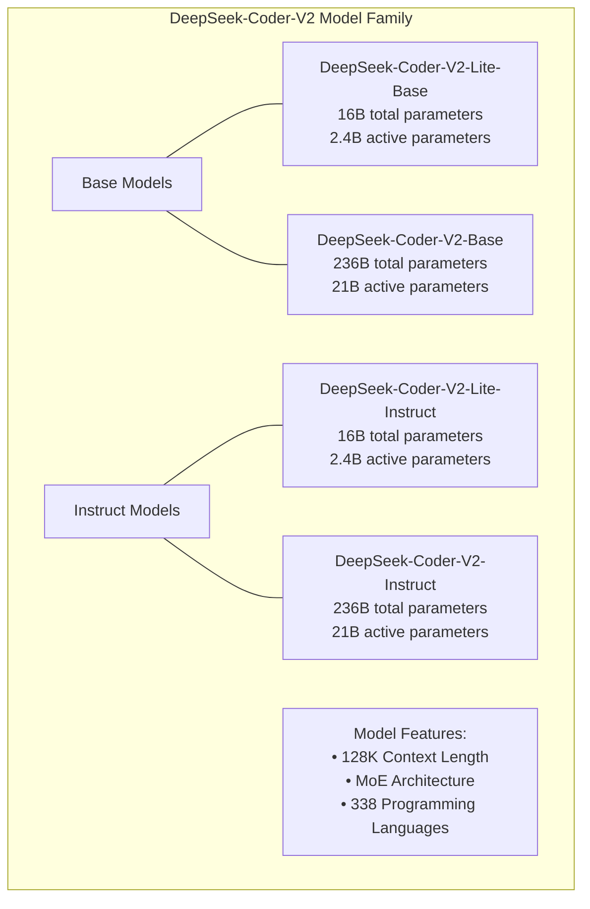
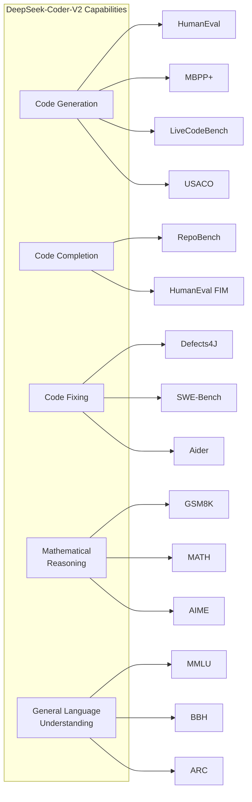
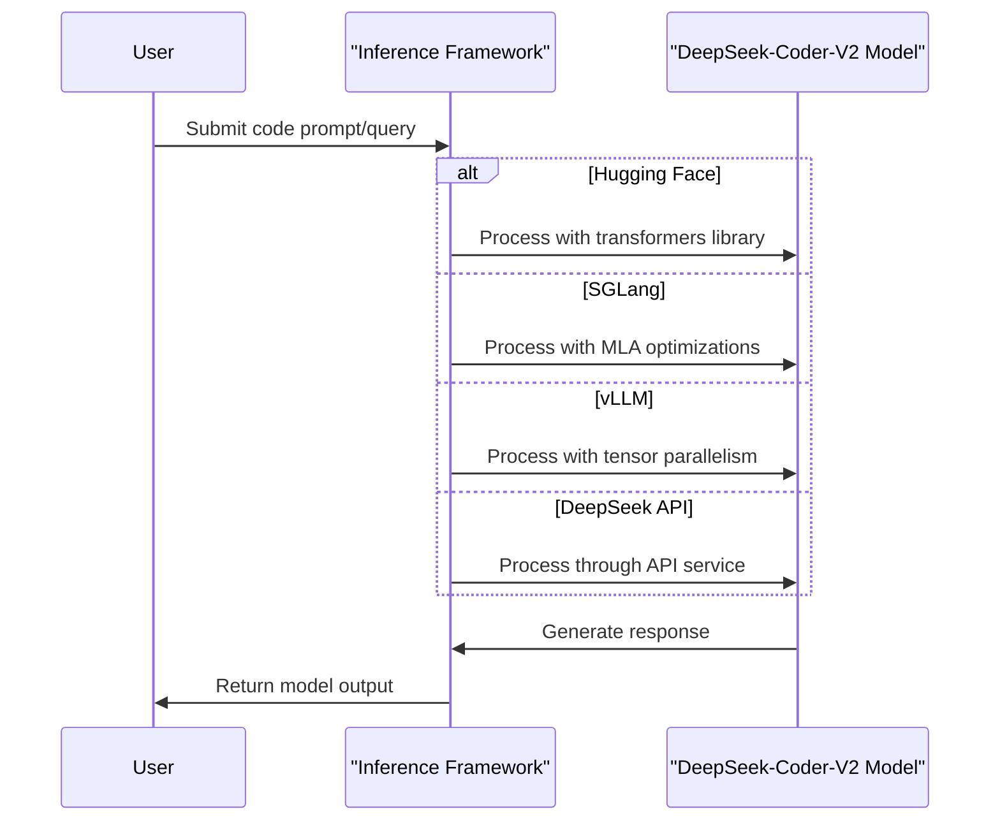
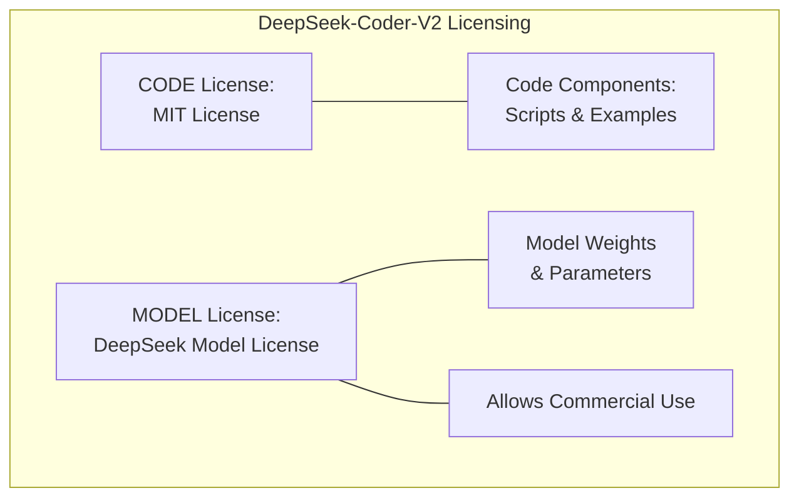

<!-- source: DeepWiki mcp.deepwiki.com · repo deepseek-ai/DeepSeek-Coder-V2 · page 1 Overview · fetched 2026-10-30 -->

# Overview

<details>
<summary>Relevant source files</summary>

The following files were used as context for generating this wiki page:

- [README.md](README.md)
- [figures/logo.svg](figures/logo.svg)
- [paper.pdf](paper.pdf)

</details>


This document provides a comprehensive introduction to DeepSeek-Coder-V2, an open-source Mixture-of-Experts (MoE) code language model designed for code intelligence tasks. The page explains the model's architecture, capabilities, and usage options, setting the foundation for more detailed discussions in subsequent sections.

## Introduction to DeepSeek-Coder-V2

DeepSeek-Coder-V2 is a state-of-the-art code language model that achieves performance comparable to closed-source models like GPT-4-Turbo in code-specific tasks. The model was created by further pre-training an intermediate checkpoint of DeepSeek-V2 with an additional 6 trillion tokens, substantially enhancing its coding and mathematical reasoning capabilities while maintaining strong performance in general language tasks.

Key advancements over previous versions include:
- Expanded programming language support from 86 to 338 languages
- Extended context length from 16K to 128K tokens
- Superior performance on coding and mathematical reasoning benchmarks
- Efficient MoE architecture that reduces active parameters

Sources: [README.md:56-66]()

## Model Architecture and Variants

DeepSeek-Coder-V2 utilizes a Mixture-of-Experts (MoE) architecture based on the DeepSeekMoE framework, enabling models with large total parameter counts but significantly reduced active parameters during inference.



The model is available in four variants:
1. **Base models** - Designed for raw generation capabilities:
   - **DeepSeek-Coder-V2-Lite-Base**: 16B total parameters, 2.4B active
   - **DeepSeek-Coder-V2-Base**: 236B total parameters, 21B active

2. **Instruct models** - Fine-tuned to follow instructions:
   - **DeepSeek-Coder-V2-Lite-Instruct**: 16B total parameters, 2.4B active
   - **DeepSeek-Coder-V2-Instruct**: 236B total parameters, 21B active

All variants support a context length of 128K tokens, enabling the model to process and understand large sections of code or documentation.

Sources: [README.md:68-81]()

## Capabilities and Performance

DeepSeek-Coder-V2 excels in a wide range of code-related tasks, outperforming many open-source models and achieving results comparable to leading closed-source models.



The model demonstrates strong performance across five key areas:

1. **Code Generation**: Creating code from natural language descriptions or problem statements
2. **Code Completion**: Automatically completing partially written code with appropriate suggestions
3. **Code Fixing**: Identifying and resolving bugs or issues in existing code
4. **Mathematical Reasoning**: Solving complex mathematical problems through step-by-step reasoning
5. **General Language Understanding**: Comprehending and responding to natural language queries

For detailed benchmark results, see the [Performance Benchmarks](#5) section.

Sources: [README.md:84-165]()

## Usage and Inference Options

DeepSeek-Coder-V2 can be used through multiple frameworks and platforms, offering flexibility for different use cases and deployment scenarios.



The model supports four primary inference methods:

1. **Hugging Face Transformers**: Direct integration with the Transformers library
   ```python
   # Example usage pattern (not actual code)
   from transformers import AutoTokenizer, AutoModelForCausalLM
   tokenizer = AutoTokenizer.from_pretrained("deepseek-ai/DeepSeek-Coder-V2-Lite-Instruct")
   model = AutoModelForCausalLM.from_pretrained("deepseek-ai/DeepSeek-Coder-V2-Lite-Instruct")
   ```

2. **SGLang** (recommended): Supports MLA optimizations, FP8, and FP8 KV Cache
   ```python
   # Example usage pattern (not actual code)
   python -m sglang.launch_server --model deepseek-ai/DeepSeek-Coder-V2-Instruct
   ```

3. **vLLM** (recommended): Efficient inference with tensor parallelism
   ```python
   # Example usage pattern (not actual code)
   from vllm import LLM
   llm = LLM(model="deepseek-ai/DeepSeek-Coder-V2-Lite-Instruct")
   ```

4. **DeepSeek Platform API**: OpenAI-compatible API endpoints

For detailed usage instructions and code examples for each method, see the [Usage & Inference](#4) section.

Sources: [README.md:188-340]()

## Supported Programming Languages

DeepSeek-Coder-V2 supports an extensive array of 338 programming languages, representing a significant expansion from the 86 languages supported in previous versions.

The supported languages span multiple categories:

| Category | Examples |
|----------|----------|
| General Purpose | Python, Java, C++, JavaScript, Go, etc. |
| Markup | HTML, XML, Markdown, LaTeX, etc. |
| Web Technologies | CSS, TypeScript, PHP, etc. |
| Data Science | R, Julia, SQL, MATLAB, etc. |
| Systems Programming | C, Rust, Assembly, CUDA, etc. |
| Configuration Formats | YAML, TOML, JSON, INI, etc. |
| Domain-Specific | GraphQL, Regex, Protocol Buffers, etc. |

For the complete list of supported languages, see the [Supported Programming Languages](#3) section.

Sources: [README.md:66]()

## Licensing Information

DeepSeek-Coder-V2 uses a dual licensing approach:



1. **Code License**: The repository code is licensed under the MIT License
2. **Model License**: The model weights and parameters are subject to the DeepSeek Model License

Both licenses support commercial use of DeepSeek-Coder-V2. For detailed information on licensing terms and conditions, see the [Licensing](#6) section.

Sources: [README.md:343-345]()

## Additional Resources

- **Chat Website**: DeepSeek-Coder-V2 is available for interactive use at [coder.deepseek.com](https://coder.deepseek.com)
- **API Platform**: OpenAI-compatible API access is available at [platform.deepseek.com](https://platform.deepseek.com)
- **Research Paper**: [DeepSeek-Coder-V2: Breaking the Barrier of Closed-Source Models in Code Intelligence](https://arxiv.org/pdf/2406.11931)

For more information about these resources, see the [Additional Resources](#8) section.

Sources: [README.md:176-186](), [README.md:51-53]()

---

