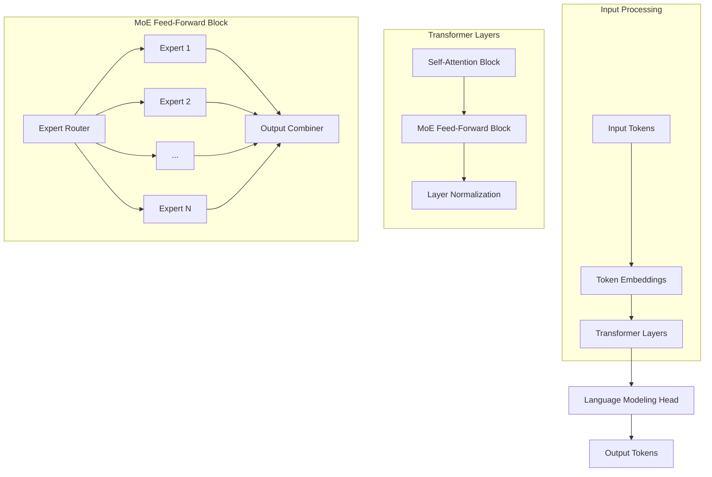
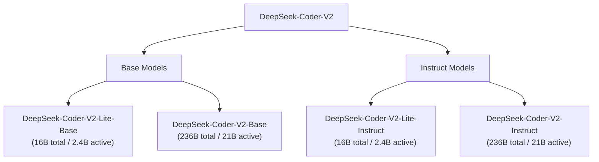
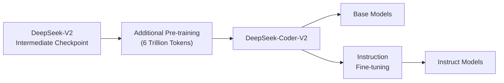
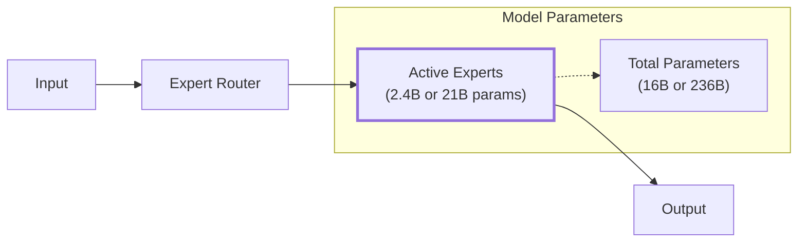
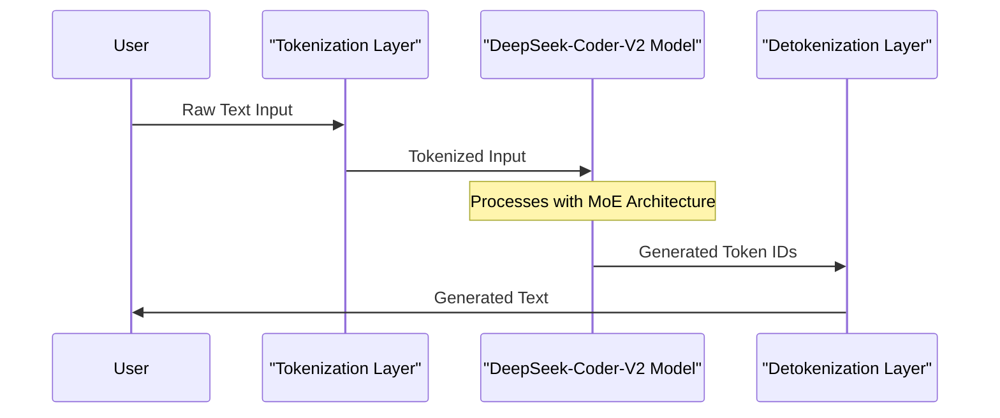

<!-- source: DeepWiki mcp.deepwiki.com · repo deepseek-ai/DeepSeek-Coder-V2 · page 2 Model Architecture · fetched 2026-10-30 -->

# Model Architecture

Relevant source files

The following files were used as context for generating this wiki page:

- [README.md](README.md)
- [paper.pdf](paper.pdf)

This document provides a technical overview of the DeepSeek-Coder-V2 model architecture. It covers the Mixture-of-Experts (MoE) design, model variants, and key architectural features that enable the model's performance in code-related tasks.

For specific information about different model sizes and implementations, see [Model Variants](#2.1). For details about the extended context window implementation, see [Context Length Capabilities](#2.2).

## Core Architecture

DeepSeek-Coder-V2 is built on the DeepSeekMoE framework, implementing a sparse Mixture-of-Experts architecture. This design allows the model to maintain a large number of total parameters while only activating a fraction of those parameters during inference.

### Mixture-of-Experts Architecture

In this architecture:
1. Input tokens are embedded into continuous vector representations
2. These embeddings pass through multiple transformer layers
3. Within each transformer layer, after self-attention, a router network selectively activates only specific experts in the MoE feed-forward blocks
4. The outputs from activated experts are combined and processed through a language modeling head to produce the final output

Sources: [README.md:57-59](), [README.md:70]()

### Parameter Efficiency

The key innovation of the MoE architecture is parameter efficiency. For example:
- The 16B parameter model activates only 2.4B parameters for each token
- The 236B parameter model activates only 21B parameters for each token

This sparse activation pattern enables DeepSeek-Coder-V2 to achieve better computational and memory efficiency than comparable dense models, making it possible to train and deploy larger models effectively.

## Model Variants

DeepSeek-Coder-V2 encompasses four primary model variants:

### Model Specifications

| Model | Total Parameters | Active Parameters | Context Length | Type |
|-------|------------------|-------------------|----------------|------|
| DeepSeek-Coder-V2-Lite-Base | 16B | 2.4B | 128K | Base |
| DeepSeek-Coder-V2-Lite-Instruct | 16B | 2.4B | 128K | Instruct |
| DeepSeek-Coder-V2-Base | 236B | 21B | 128K | Base |
| DeepSeek-Coder-V2-Instruct | 236B | 21B | 128K | Instruct |

Sources: [README.md:69-80]()

### Base vs. Instruct Models

The model family includes two types of variants:

- **Base Models**: Foundation models trained primarily for code completion and generation tasks
- **Instruct Models**: Fine-tuned versions of the base models optimized for following instructions and engaging in dialogue interactions

The Instruct models are better suited for chat-based interactions and following complex instructions, while the Base models may perform better for pure code completion tasks.

## Development Process

DeepSeek-Coder-V2 was developed through a systematic multi-stage process:

The development process included:
1. Starting from an intermediate checkpoint of the DeepSeek-V2 model
2. Additional pre-training with 6 trillion tokens of code-focused data
3. Creating base models optimized for code-related tasks
4. Fine-tuning with instruction data to create the instruct variants

This process enhanced the model's coding and mathematical reasoning capabilities while maintaining its general language understanding.

Sources: [README.md:58-59]()

## Technical Implementation

### Programming Language Coverage

The model architecture is designed to support a wide range of programming languages - 338 in total, a significant expansion from the 86 languages supported in previous DeepSeek models. This comprehensive language coverage required architectural considerations to handle the diverse syntax and patterns across different programming languages.

### Memory and Computation Design

The MoE architecture is specifically designed to optimize memory usage and computational efficiency:

This selective activation approach allows the model to maintain strong performance while reducing the computational requirements for both training and inference.

### Inference Optimizations

The architecture supports several inference optimization techniques:

1. **Tensor Parallelism**: Distributing the model across multiple GPUs
2. **FP8 Support**: Reduced precision for more efficient computation
3. **FP8 KV Cache**: Memory-efficient key-value caching
4. **MLA Optimizations**: Multi-layer attention optimizations

Sources: [README.md:280-291]()

## Hardware Requirements

The hardware requirements for DeepSeek-Coder-V2 reflect its architecture:

- **DeepSeek-Coder-V2-Lite models**: Can run on consumer hardware with appropriate optimizations
- **DeepSeek-Coder-V2 (full 236B models)**: Require 80GB*8 GPUs for inference when using BF16 format

These requirements stem directly from the model's architectural design and parameter count.

Sources: [README.md:188-190]()

## Model Input and Output Processing

The model architecture includes specialized tokenization designed to handle code-specific constructs effectively, including:

1. Special tokens for code-specific elements
2. Support for FIM (Fill-In-Middle) operations with dedicated tokens (`<｜fim▁begin｜>`, `<｜fim▁hole｜>`, `<｜fim▁end｜>`)
3. Chat template format with role-based tokens for dialogue interactions

Sources: [README.md:205-227](), [README.md:229-274]()

---

