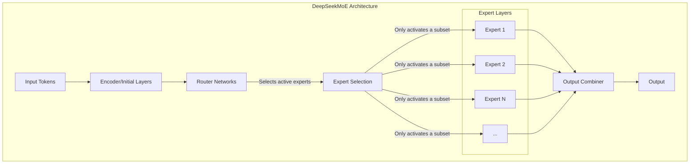
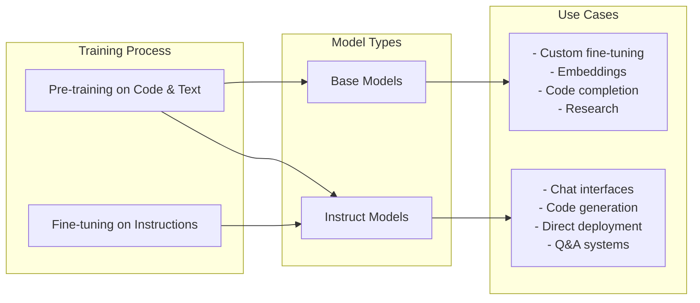
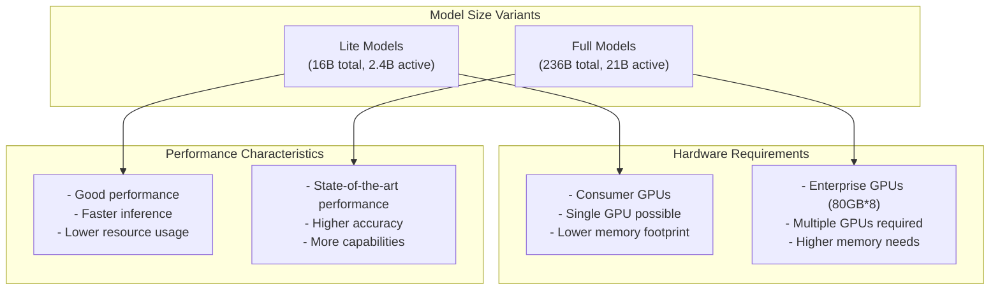
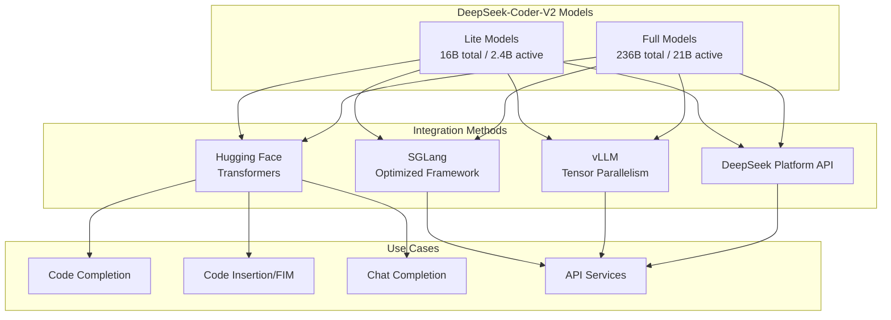
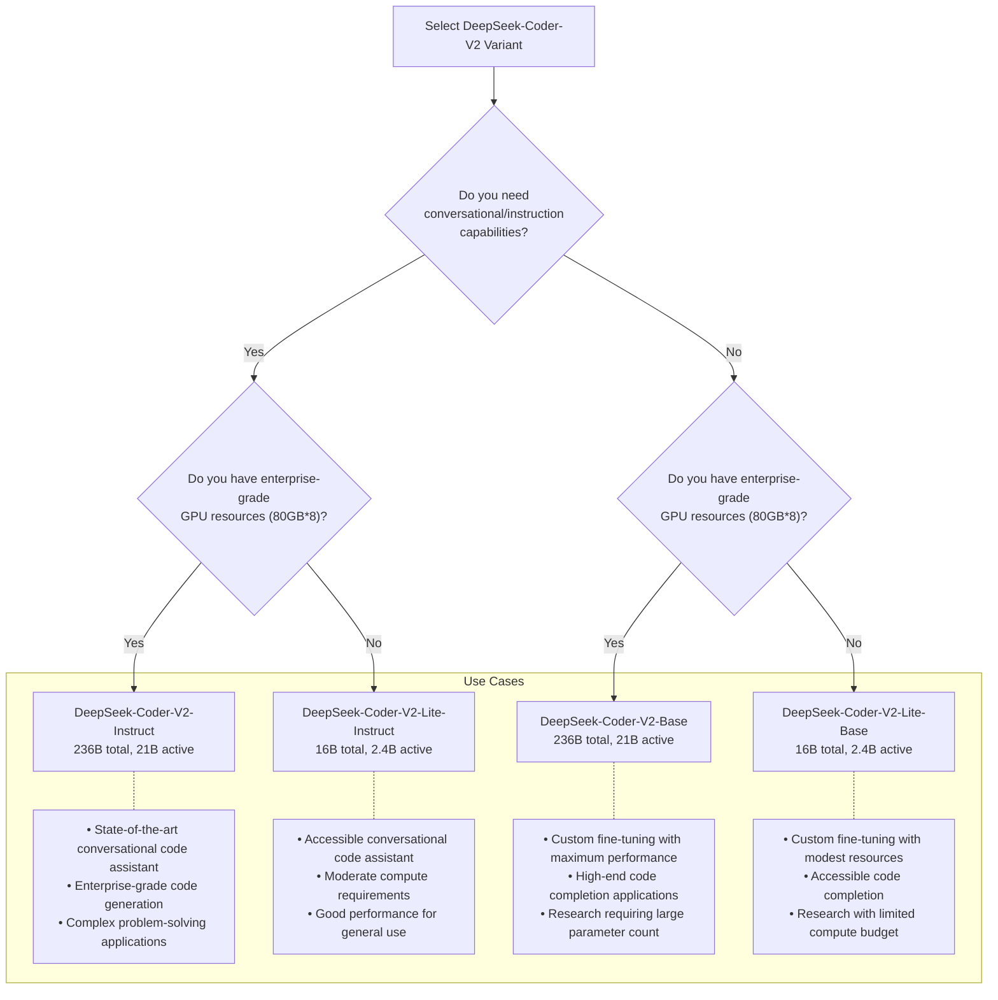

<!-- source: DeepWiki mcp.deepwiki.com · repo deepseek-ai/DeepSeek-Coder-V2 · page 2.1 Model Variants · fetched 2026-10-30 -->

# Model Variants

Relevant source files

The following files were used as context for generating this wiki page:

- [README.md](README.md)
- [paper.pdf](paper.pdf)

## Purpose and Scope

This document details the different variants of the DeepSeek-Coder-V2 model, explaining their architectures, parameters, and intended use cases. It covers the differences between Base and Instruct models as well as between Lite and full-sized versions. For information about context length capabilities, see [Context Length Capabilities](#2.2).

## Overview of DeepSeek-Coder-V2 Variants

DeepSeek-Coder-V2 is released in four main variants, all based on the DeepSeekMoE (Mixture-of-Experts) architecture:

| Model Name | Total Parameters | Active Parameters | Context Length | Type |
|------------|------------------|-------------------|----------------|------|
| DeepSeek-Coder-V2-Lite-Base | 16B | 2.4B | 128K | Base |
| DeepSeek-Coder-V2-Lite-Instruct | 16B | 2.4B | 128K | Instruct |
| DeepSeek-Coder-V2-Base | 236B | 21B | 128K | Base |
| DeepSeek-Coder-V2-Instruct | 236B | 21B | 128K | Instruct |

These variants provide different trade-offs between computational requirements, performance, and specific use cases.

Sources: [README.md:69-80]()

## MoE Architecture Fundamentals

### How DeepSeekMoE Works

In an MoE architecture, only a small subset of the total parameters (the "experts") are activated for any given input. This allows the model to have a much larger total parameter count while maintaining reasonable computational efficiency.

For DeepSeek-Coder-V2, the models have either 16B or 236B total parameters, but only 2.4B or 21B active parameters, respectively. This means that for any given input, the model routes the computation through only about 15% (for Lite) or 9% (for full) of its total parameters.

Sources: [README.md:69-70]()

## Base vs. Instruct Models

### Comparison of Base and Instruct Variants

### Base Models
Base models (DeepSeek-Coder-V2-Lite-Base and DeepSeek-Coder-V2-Base) are pre-trained on a massive corpus of code and text data. These models are designed to:

- Serve as foundation models for further fine-tuning on specific tasks
- Excel at code completion tasks (completing partially written code)
- Generate code in a completion format rather than a conversational format
- Provide a strong basis for research and custom applications

Base models are recommended when you need to fine-tune on your own data or when you're working on code completion applications.

### Instruct Models
Instruct models (DeepSeek-Coder-V2-Lite-Instruct and DeepSeek-Coder-V2-Instruct) start with the Base models and undergo additional fine-tuning on instruction-following data. They are designed to:

- Respond to natural language instructions in a conversational manner
- Follow complex, multi-step instructions
- Generate complete code solutions based on natural language prompts
- Work well in chatbot or assistant-like interfaces

Instruct models are recommended for direct deployment in chat applications, code generation based on natural language prompts, and Q&A systems.

Sources: [README.md:69-80](), [README.md:194-227](), [README.md:229-276]()

## Lite vs. Full Models

### Hardware and Performance Comparison

### Lite Models
The Lite variants (DeepSeek-Coder-V2-Lite-Base and DeepSeek-Coder-V2-Lite-Instruct) have 16B total parameters with 2.4B active parameters. These models:

- Require significantly less computational resources
- Can potentially run on consumer-grade GPUs (with sufficient VRAM)
- Offer faster inference times
- Provide good performance across a wide range of tasks
- Are suitable for deployment in resource-constrained environments

### Full Models
The full-sized variants (DeepSeek-Coder-V2-Base and DeepSeek-Coder-V2-Instruct) have 236B total parameters with 21B active parameters. These models:

- Require substantial computational resources (80GB*8 GPUs for BF16 inference)
- Deliver state-of-the-art performance on coding and mathematical reasoning tasks
- Approach the capabilities of closed-source models like GPT-4 Turbo
- Are best suited for enterprise applications where performance is critical

Sources: [README.md:69-80](), [README.md:189-190]()

## Performance Comparison

The following comparison shows the performance of the different DeepSeek-Coder-V2 variants across various benchmarks.

### Code Generation Performance

| Model | HumanEval | MBPP+ | LiveCodeBench | USACO |
|-------|-----------|-------|---------------|-------|
| DeepSeek-Coder-V2-Lite-Instruct | 81.1 | 68.8 | 24.3 | 6.5 |
| DeepSeek-Coder-V2-Instruct | 90.2 | 76.2 | 43.4 | 12.1 |
| GPT-4-Turbo-0409 (for reference) | 88.2 | 72.2 | 45.7 | 12.3 |

### Code Completion Performance

| Model | RepoBench (Python) | RepoBench (Java) | HumanEval FIM |
|-------|-------------------|------------------|---------------|
| DeepSeek-Coder-V2-Lite-Base | 38.9 | 43.3 | 86.4 |
| DeepSeek-Coder-Base-33B (for reference) | 39.1 | 44.8 | 86.4 |

### Code Fixing Performance

| Model | Defects4J | SWE-Bench | Aider |
|-------|-----------|-----------|-------|
| DeepSeek-Coder-V2-Lite-Instruct | 9.2 | 0.0 | 44.4 |
| DeepSeek-Coder-V2-Instruct | 21.0 | 12.7 | 73.7 |
| GPT-4-Turbo-0409 (for reference) | 24.3 | 18.3 | 63.9 |

### Mathematical Reasoning Performance

| Model | GSM8K | MATH | AIME 2024 | Math Odyssey |
|-------|-------|------|-----------|--------------|
| DeepSeek-Coder-V2-Lite-Instruct | 86.4 | 61.8 | 0/30 | 44.4 |
| DeepSeek-Coder-V2-Instruct | 94.9 | 75.7 | 4/30 | 53.7 |
| GPT-4-Turbo-0409 (for reference) | 93.7 | 73.4 | 3/30 | 46.8 |

### General Language Understanding Performance

| Benchmark | DeepSeek-Coder-V2-Lite-Instruct | DeepSeek-Coder-V2-Instruct |
|-----------|----------------------------------|----------------------------|
| BBH | 61.2 | 83.9 |
| MMLU | 60.1 | 79.2 |
| ARC-Challenge | 77.4 | 92.8 |
| C-Eval | 61.6 | 79.4 |
| MT-Bench | 7.81 | 8.77 |

The full-sized models consistently outperform the Lite variants across all benchmarks, sometimes by substantial margins. In particular, the full DeepSeek-Coder-V2-Instruct model competes with or exceeds the performance of GPT-4-Turbo on many code and mathematical reasoning tasks.

Sources: [README.md:86-166]()

## Usage Recommendations

### Integration Options and Code Structure

Based on the performance characteristics and resource requirements, here are general recommendations for choosing the appropriate model variant:

### When to use DeepSeek-Coder-V2-Lite-Base:
- For code completion tasks with limited computing resources
- As a foundation for custom fine-tuning when working with a modest compute budget
- For research purposes where the full models would be prohibitively expensive
- When you need to implement the model in environments with consumer-grade GPUs

### When to use DeepSeek-Coder-V2-Lite-Instruct:
- For conversational coding assistants with limited computing resources
- For code generation tasks where good (but not state-of-the-art) performance is sufficient
- For deployment in environments with constrained GPU resources
- For prototyping applications before scaling up to the full model

### When to use DeepSeek-Coder-V2-Base:
- For state-of-the-art code completion applications
- As a foundation for custom fine-tuning when performance is critical
- For enterprises with substantial computing resources who need the best possible performance
- For applications that require top-tier code completion capabilities

### When to use DeepSeek-Coder-V2-Instruct:
- For high-performance conversational coding assistants
- For critical code generation and problem-solving applications
- For enterprise solutions where performance justifies the computing cost
- When you need capabilities competitive with closed-source models like GPT-4 Turbo

Sources: [README.md:189-339]()

## Model Selection Guide

### Decision Flow for Model Selection

This guide helps determine which model variant to use based on your computational resources and whether you need conversational capabilities (Instruct models) or foundation models for custom applications (Base models).

Sources: [README.md:69-80](), [README.md:189-190]()

## Availability and Download

All four model variants are available to download from Hugging Face:

| Model | Hugging Face Repository |
|-------|-------------------------|
| DeepSeek-Coder-V2-Lite-Base | [deepseek-ai/DeepSeek-Coder-V2-Lite-Base](https://huggingface.co/deepseek-ai/DeepSeek-Coder-V2-Lite-Base) |
| DeepSeek-Coder-V2-Lite-Instruct | [deepseek-ai/DeepSeek-Coder-V2-Lite-Instruct](https://huggingface.co/deepseek-ai/DeepSeek-Coder-V2-Lite-Instruct) |
| DeepSeek-Coder-V2-Base | [deepseek-ai/DeepSeek-Coder-V2-Base](https://huggingface.co/deepseek-ai/DeepSeek-Coder-V2-Base) |
| DeepSeek-Coder-V2-Instruct | [deepseek-ai/DeepSeek-Coder-V2-Instruct](https://huggingface.co/deepseek-ai/DeepSeek-Coder-V2-Instruct) |

The models are also available through the DeepSeek Platform API and can be used with frameworks such as SGLang and vLLM for optimized inference.

Sources: [README.md:69-80](), [README.md:180-181]()

---

