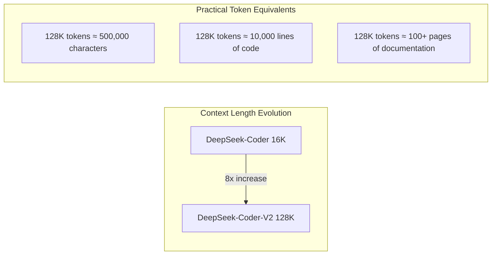
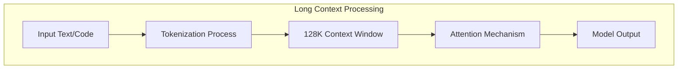
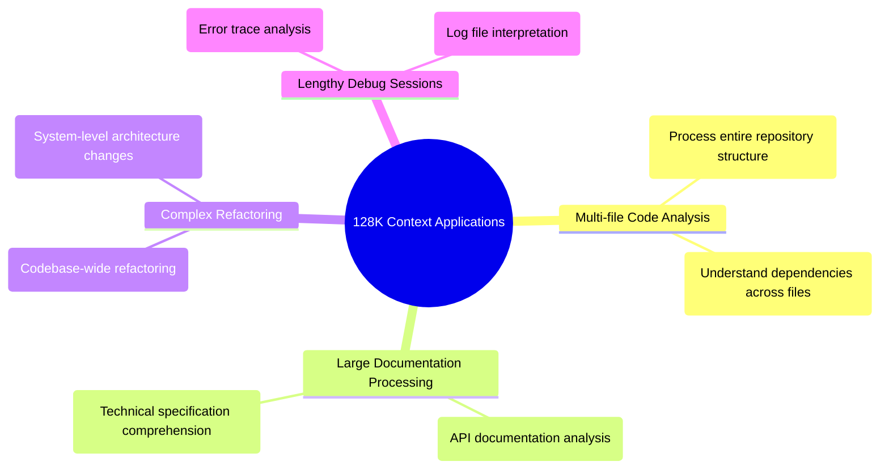
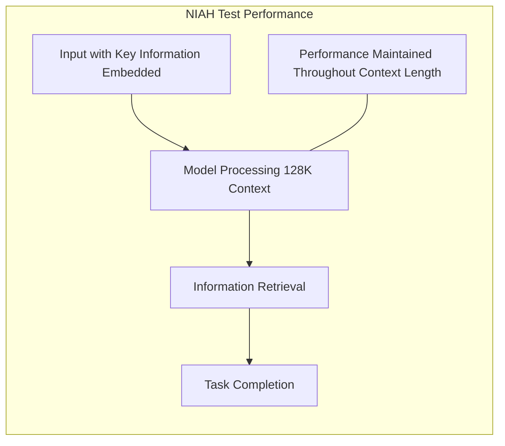
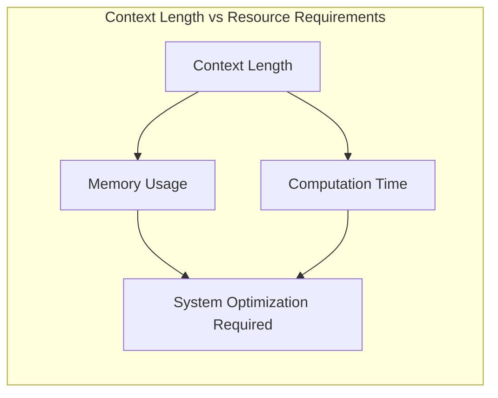
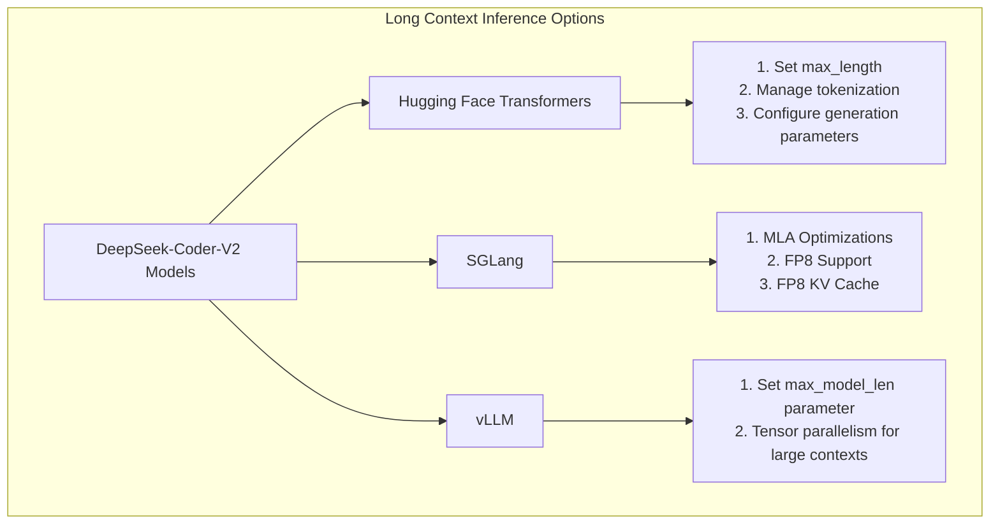
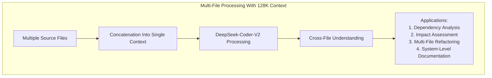

<!-- source: DeepWiki mcp.deepwiki.com · repo deepseek-ai/DeepSeek-Coder-V2 · page 2.2 Context Length Capabilities · fetched 2026-10-30 -->

# Context Length Capabilities

Relevant source files

The following files were used as context for generating this wiki page:

- [README.md](README.md)
- [figures/long_context.png](figures/long_context.png)

## Purpose and Scope

This document provides detailed information about the 128K context length capabilities of DeepSeek-Coder-V2 models. It explains the technical aspects of how the extended context window functions, its applications for large-scale code understanding and generation, and performance characteristics. For information about the model variants that implement this context length, see [Model Variants](#2.1).

## Context Length Overview

DeepSeek-Coder-V2 features a 128K token context window, a significant improvement from the 16K context length of its predecessor. This expansion enables the model to process, understand, and generate code within much larger contexts, making it suitable for working with complex codebases and extensive documentation.

All model variants in the DeepSeek-Coder-V2 family (Base and Instruct versions, in both Lite and full configurations) support this extended context length.

Sources: [README.md:61-61](), [README.md:76-79]()

## Technical Implementation

The 128K context length capability is implemented across all DeepSeek-Coder-V2 model variants through architectural modifications that enable efficient processing of longer sequences without degradation in performance.

Sources: [README.md:58-61](), [README.md:168-174]()

## Applications of Extended Context

The 128K context length enables several advanced code-related tasks that were challenging or impossible with shorter context windows.

Sources: [README.md:58-61]()

## Performance Characteristics

DeepSeek-Coder-V2's context length capabilities have been evaluated using the "Needle In A Haystack" (NIAH) test methodology, which assesses how well the model can locate and utilize information embedded within large contexts.

The model demonstrates consistent performance across varying context lengths up to the full 128K capacity, indicating effective attention and information retrieval mechanisms even with extremely long sequences.

Sources: [README.md:168-174]()

## Memory and Computational Requirements

Working with the maximum context length of 128K tokens requires substantial computational resources, particularly for the larger model variants.

| Model Variant | Parameters | Min GPU Requirements (for 128K context) |
|---------------|------------|----------------------------------------|
| DeepSeek-Coder-V2-Lite-Base/Instruct | 16B total, 2.4B active | 24-32GB VRAM |
| DeepSeek-Coder-V2-Base/Instruct | 236B total, 21B active | 80GB×8 GPUs |

Note that for the full-sized DeepSeek-Coder-V2 models with 236B parameters, inference with the full 128K context window requires significant computing resources as indicated in the README.

Sources: [README.md:189-190]()

## Integration with Inference Frameworks

The extended context capabilities of DeepSeek-Coder-V2 can be utilized through multiple inference frameworks, each with its own approach to handling long contexts.

When working with inference frameworks, you'll need to specify the maximum context length appropriately and ensure sufficient computational resources are available.

Sources: [README.md:191-339]()

## Use Case: Multi-File Code Understanding

One of the primary benefits of the 128K context window is the ability to process multiple source files simultaneously, enabling the model to understand complex inter-file relationships and dependencies.

This capability is particularly valuable for:
- Understanding complex codebases with numerous interdependent components
- Analyzing how changes in one file might affect functionality in others
- Generating explanations of system-level behavior that spans multiple files
- Creating or refactoring code that needs to integrate with existing systems

Sources: [README.md:58-61](), [README.md:168-174]()

## Comparison with Other Models

The 128K context length of DeepSeek-Coder-V2 positions it among the models with the largest context windows available, particularly for code-specific tasks.

| Model | Context Length | Code-Specific | Open Source |
|-------|---------------|---------------|------------|
| DeepSeek-Coder-V2 | 128K | Yes | Yes |
| DeepSeek-Coder (previous) | 16K | Yes | Yes |
| GPT-4 Turbo | 128K | No | No |
| Claude 3 Opus | 200K | No | No |
| Llama 3 | 8K-128K (variant dependent) | No | Yes |

This extended context capability, combined with specialized code training, allows DeepSeek-Coder-V2 to handle more complex coding tasks than models with shorter context windows.

Sources: [README.md:58-61](), [README.md:168-174]()

## Best Practices for Long Context Usage

To effectively utilize the 128K context capabilities:

1. **Structured Input Organization**: Place the most relevant information early in the context when possible
2. **Resource Management**: Allocate sufficient computational resources, especially for the larger model variants
3. **Context Prioritization**: When approaching context limits, prioritize inclusion of code over comments or less relevant files
4. **Efficient Prompting**: Be explicit about what parts of the context the model should focus on
5. **Framework-Specific Optimization**: Utilize the specific long-context optimizations available in your chosen inference framework

Sources: [README.md:189-339]()

## Limitations

While the 128K context length represents a significant advance, users should be aware of certain limitations:

1. **Computational Requirements**: Working with full context length requires substantial computational resources
2. **Token Efficiency**: Not all content is equally token-efficient; code in different languages may consume tokens at different rates
3. **Attention Dilution**: Very long contexts may experience some attention dilution at extremely large scales
4. **Framework Support**: Not all inference frameworks handle long contexts equally well

Sources: [README.md:189-190]()

---

