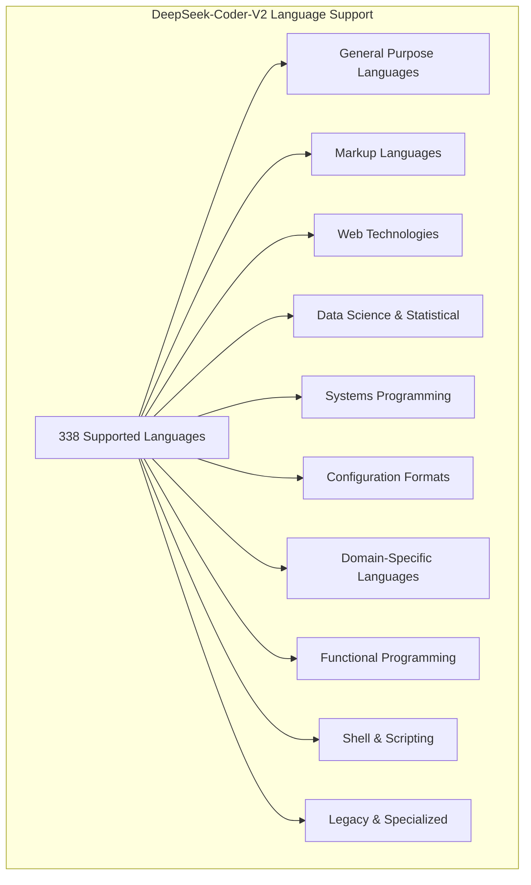
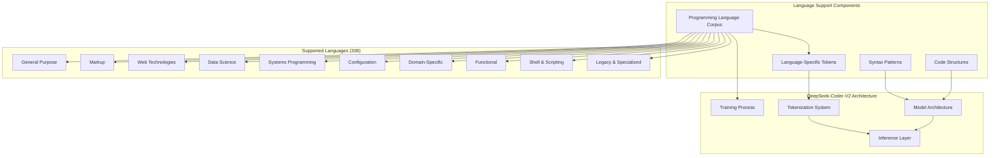
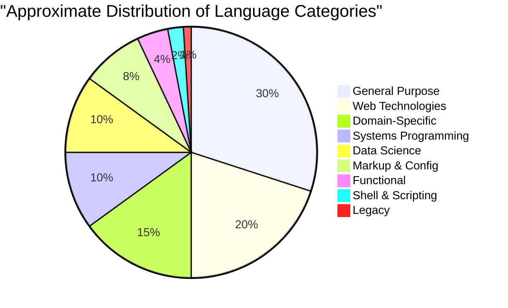
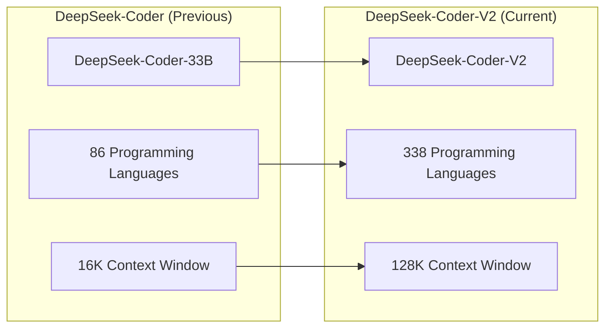

<!-- source: DeepWiki mcp.deepwiki.com · repo deepseek-ai/DeepSeek-Coder-V2 · page 3 Supported Programming Languages · fetched 2026-10-30 -->

# Supported Programming Languages

Relevant source files

The following files were used as context for generating this wiki page:

- [README.md](README.md)
- [supported_langs.txt](supported_langs.txt)

## Purpose and Scope

This document provides a comprehensive overview of the 338 programming languages supported by DeepSeek-Coder-V2. It outlines the categories of supported languages and their organization within the model's capabilities. For information about model architecture and variants, see [Model Architecture](#2).

DeepSeek-Coder-V2 significantly expands language support from 86 languages in the previous version to 338 languages, enabling broader code intelligence capabilities across multiple programming domains.

Sources: [README.md:58-66]()

## Language Support Overview

DeepSeek-Coder-V2 supports 338 programming languages, covering everything from mainstream languages to specialized and legacy systems. This extensive support allows the model to understand, generate, and complete code across virtually all major programming ecosystems.

The complete list of supported languages can be found in the repository's `supported_langs.txt` file.

Sources: [README.md:66](), [supported_langs.txt:1-338]()

## Language Categories

The 338 supported languages can be organized into several major categories:

### General Purpose Languages

Includes widely-used languages for application development across multiple domains.

**Key Languages**: Python, Java, C++, C#, JavaScript, Go, Ruby, PHP, Swift, Kotlin, Dart, Rust

These languages form the core of modern software development and are comprehensively supported by the model for code generation, completion, and fixing tasks.

### Markup and Template Languages

Languages for document structuring, data serialization, and templating.

**Key Languages**: HTML, XML, YAML, JSON, Markdown, LaTeX, Twig, Handlebars, Pug

### Web Technologies

Languages and technologies specifically focused on web development.

**Key Languages**: CSS, SCSS, Sass, TypeScript, JSX, Vue, Angular templates

### Data Science and Statistical Languages

Languages optimized for data analysis, statistical computing, and mathematical operations.

**Key Languages**: R, Julia, MATLAB, SQL, SAS, Octave

### Systems Programming

Low-level languages used for operating systems, embedded systems, and hardware interfaces.

**Key Languages**: C, Assembly, CUDA, Verilog, VHDL

### Configuration Formats

Languages and formats used for configuration files and settings.

**Key Languages**: YAML, TOML, JSON, INI, HCL, Dockerfile

### Domain-Specific Languages (DSLs)

Languages designed for specific application domains or purposes.

**Key Languages**: GraphQL, Regular Expressions, Protocol Buffers, GLSL, HLSL

### Functional Programming Languages

Languages that emphasize functional programming paradigms.

**Key Languages**: Haskell, Clojure, Erlang, Elixir, F#, OCaml, Scala, Lisp

### Shell and Scripting Languages

Languages used for automation and system scripting.

**Key Languages**: Shell/Bash, PowerShell, Perl, AWK, Tcl

### Legacy and Specialized Languages

Older or industry-specific languages with continued usage in specific sectors.

**Key Languages**: COBOL, Fortran, Ada, ABAP

Sources: [supported_langs.txt:1-338]()

## Programming Language Support Implementation

The following diagram illustrates how programming language support is integrated into the DeepSeek-Coder-V2 architecture:

Sources: [README.md:58-66]()

## Language Distribution and Prevalence

The following diagram shows the relative distribution of language categories in the model's training and capabilities:

Note: This distribution is an approximation based on the languages listed in the supported_langs.txt file and typical usage patterns in modern software development.

Sources: [supported_langs.txt:1-338]()

## Top 20 Most Common Languages

The following table highlights 20 of the most commonly used programming languages supported by DeepSeek-Coder-V2, along with their primary application domains:

| Language    | Primary Domain                | Category              |
|-------------|------------------------------|----------------------|
| Python      | General/Data Science/AI      | General Purpose      |
| JavaScript  | Web Development              | General Purpose      |
| Java        | Enterprise/Android           | General Purpose      |
| C++         | Systems/Performance          | General Purpose      |
| C           | Systems                      | Systems Programming  |
| C#          | Windows/.NET                 | General Purpose      |
| Go          | Cloud/Networking             | General Purpose      |
| TypeScript  | Web Development              | Web Technologies     |
| Rust        | Systems/Safety               | Systems Programming  |
| PHP         | Web Development              | Web Technologies     |
| Ruby        | Web/Scripting                | General Purpose      |
| Swift       | iOS/macOS                    | General Purpose      |
| Kotlin      | Android/JVM                  | General Purpose      |
| R           | Data Analysis/Statistics     | Data Science         |
| SQL         | Database                     | Data Science         |
| Shell/Bash  | System Administration        | Shell & Scripting    |
| HTML/CSS    | Web Structure/Styling        | Markup/Web           |
| Scala       | Big Data/Functional          | Functional           |
| MATLAB      | Scientific Computing         | Data Science         |
| Dart        | Mobile (Flutter)             | General Purpose      |

Sources: [supported_langs.txt:1-338]()

## Language Support Evolution

DeepSeek-Coder-V2 represents a significant expansion in language support compared to its predecessor:

The expansion from 86 to 338 languages represents a 293% increase in language coverage, enabling broader applicability across diverse programming ecosystems.

Sources: [README.md:58-66]()

## Language Support and Performance

The extensive language support contributes to DeepSeek-Coder-V2's strong performance across various code-related benchmarks, including code generation, completion, and fixing tasks. The model's training on diverse programming languages enables it to understand and generate code across multiple paradigms and syntaxes.

For detailed performance benchmarks across different programming tasks and languages, see [Performance Benchmarks](#5).

Sources: [README.md:86-146]()

---

