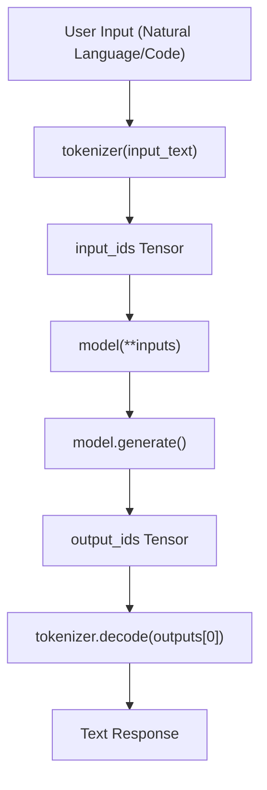
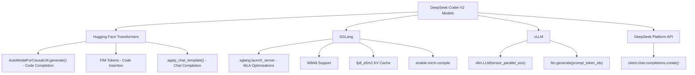

<!-- source: DeepWiki mcp.deepwiki.com · repo deepseek-ai/DeepSeek-Coder-V2 · page 4 Usage & Inference · fetched 2026-10-30 -->

# Usage & Inference

<details>
<summary>Relevant source files</summary>

The following files were used as context for generating this wiki page:

- [README.md](README.md)

</details>


This document provides a comprehensive guide to using DeepSeek-Coder-V2 models for inference across various platforms and methods. It covers different integration options, usage patterns, and optimization techniques to help users effectively utilize these models for code-related tasks.

For information about the model architecture itself, see [Model Architecture](#2). For details on supported programming languages, refer to [Supported Programming Languages](#3).

## Model Variants Overview

Before exploring usage methods, it's important to understand the available model variants:

| Model | Total Parameters | Active Parameters | Context Length | Purpose |
|-------|------------|-------------------|---------------|---------|
| DeepSeek-Coder-V2-Lite-Base | 16B | 2.4B | 128K | Code completion and generation (base model) |
| DeepSeek-Coder-V2-Lite-Instruct | 16B | 2.4B | 128K | Chat and instruction following |
| DeepSeek-Coder-V2-Base | 236B | 21B | 128K | Code completion and generation (base model) |
| DeepSeek-Coder-V2-Instruct | 236B | 21B | 128K | Chat and instruction following |

The Lite variants require fewer computational resources while maintaining good performance. The full models (236B parameters) require 8 GPUs with 80GB memory each for BF16 inference.

Sources: [README.md:68-80]()

## Inference Pipeline

The following diagram shows the general inference flow from user input to model response:



Sources: [README.md:189-205]()

## Inference Methods

DeepSeek-Coder-V2 supports multiple inference methods, each with its own advantages. The following diagram illustrates these methods and their key components:



Sources: [README.md:188-338]()

### 1. Hugging Face Transformers

The most straightforward way to use DeepSeek-Coder-V2 is through Hugging Face's Transformers library. This method supports several use cases:

#### Code Completion

Code completion is when you provide a partial code snippet and the model completes it:

```python
from transformers import AutoTokenizer, AutoModelForCausalLM
import torch
tokenizer = AutoTokenizer.from_pretrained("deepseek-ai/DeepSeek-Coder-V2-Lite-Base", trust_remote_code=True)
model = AutoModelForCausalLM.from_pretrained("deepseek-ai/DeepSeek-Coder-V2-Lite-Base", trust_remote_code=True, torch_dtype=torch.bfloat16).cuda()
input_text = "#write a quick sort algorithm"
inputs = tokenizer(input_text, return_tensors="pt").to(model.device)
outputs = model.generate(**inputs, max_length=128)
print(tokenizer.decode(outputs[0], skip_special_tokens=True))
```

Sources: [README.md:194-204]()

#### Code Insertion (FIM)

The Fill-in-the-Middle (FIM) feature allows you to have the model fill in a gap in the middle of a code snippet:

```python
from transformers import AutoTokenizer, AutoModelForCausalLM
import torch
tokenizer = AutoTokenizer.from_pretrained("deepseek-ai/DeepSeek-Coder-V2-Lite-Base", trust_remote_code=True)
model = AutoModelForCausalLM.from_pretrained("deepseek-ai/DeepSeek-Coder-V2-Lite-Base", trust_remote_code=True, torch_dtype=torch.bfloat16).cuda()
input_text = """<｜fim▁begin｜>def quick_sort(arr):
    if len(arr) <= 1:
        return arr
    pivot = arr[0]
    left = []
    right = []
<｜fim▁hole｜>
        if arr[i] < pivot:
            left.append(arr[i])
        else:
            right.append(arr[i])
    return quick_sort(left) + [pivot] + quick_sort(right)<｜fim▁end｜>"""
inputs = tokenizer(input_text, return_tensors="pt").to(model.device)
outputs = model.generate(**inputs, max_length=128)
print(tokenizer.decode(outputs[0], skip_special_tokens=True)[len(input_text):])
```

The FIM format uses special tokens to indicate the beginning of the code (`<｜fim▁begin｜>`), the hole to be filled (`<｜fim▁hole｜>`), and the end of the code (`<｜fim▁end｜>`).

Sources: [README.md:207-227]()

#### Chat Completion

For instruction-tuned models, you can use the chat completion functionality:

```python
from transformers import AutoTokenizer, AutoModelForCausalLM
import torch
tokenizer = AutoTokenizer.from_pretrained("deepseek-ai/DeepSeek-Coder-V2-Lite-Instruct", trust_remote_code=True)
model = AutoModelForCausalLM.from_pretrained("deepseek-ai/DeepSeek-Coder-V2-Lite-Instruct", trust_remote_code=True, torch_dtype=torch.bfloat16).cuda()
messages=[
    { 'role': 'user', 'content': "write a quick sort algorithm in python."}
]
inputs = tokenizer.apply_chat_template(messages, add_generation_prompt=True, return_tensors="pt").to(model.device)
# tokenizer.eos_token_id is the id of <｜end▁of▁sentence｜> token
outputs = model.generate(inputs, max_new_tokens=512, do_sample=False, top_k=50, top_p=0.95, num_return_sequences=1, eos_token_id=tokenizer.eos_token_id)
print(tokenizer.decode(outputs[0][len(inputs[0]):], skip_special_tokens=True))
```

Sources: [README.md:232-243]()

#### Chat Template Format

The chat template follows a specific structure:

```
<｜begin▁of▁sentence｜>User: {user_message_1}

---

