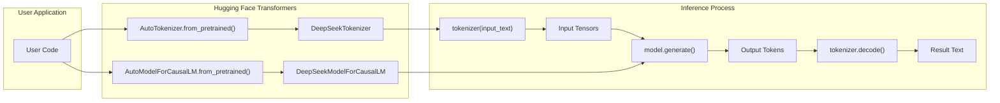
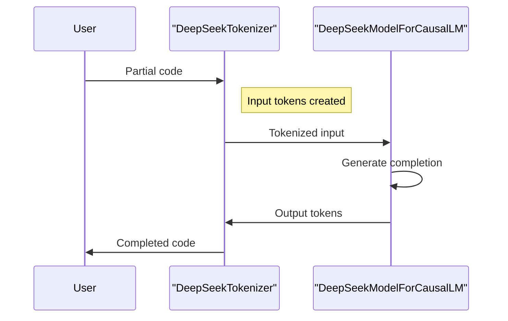
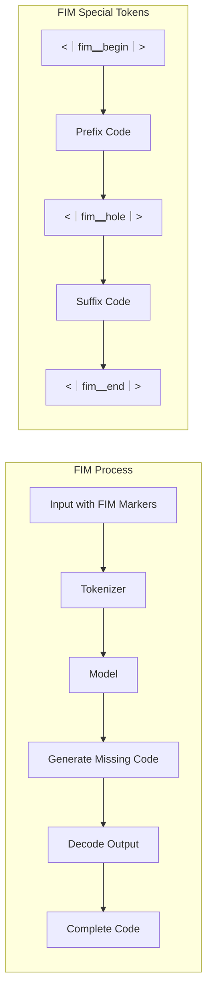

<!-- source: DeepWiki mcp.deepwiki.com · repo deepseek-ai/DeepSeek-Coder-V2 · page 4.1 Hugging Face Integration · fetched 2026-10-30 -->

# Hugging Face Integration

<details>
<summary>Relevant source files</summary>

The following files were used as context for generating this wiki page:

- [README.md](README.md)

</details>


This document provides a detailed technical guide on integrating DeepSeek-Coder-V2 models using the Hugging Face Transformers library. For alternative integration methods, see [SGLang Integration](#4.2), [vLLM Integration](#4.3), or [DeepSeek Platform API](#4.4).

## Model Variants Available on Hugging Face

DeepSeek-Coder-V2 offers four model variants on Hugging Face Hub, each with different parameter counts and capabilities:

| Model | Total Parameters | Active Parameters | Context Length | Repository Name |
|-------|------------------|-------------------|----------------|-----------------|
| DeepSeek-Coder-V2-Lite-Base | 16B | 2.4B | 128K | deepseek-ai/DeepSeek-Coder-V2-Lite-Base |
| DeepSeek-Coder-V2-Lite-Instruct | 16B | 2.4B | 128K | deepseek-ai/DeepSeek-Coder-V2-Lite-Instruct |
| DeepSeek-Coder-V2-Base | 236B | 21B | 128K | deepseek-ai/DeepSeek-Coder-V2-Base |
| DeepSeek-Coder-V2-Instruct | 236B | 21B | 128K | deepseek-ai/DeepSeek-Coder-V2-Instruct |

- **Base** models are pre-trained only, while **Instruct** models are fine-tuned for instruction following
- **Lite** models require less computational resources than full models

Sources: [README.md:69-80]()

## Hardware Requirements

- **Lite models**: Suitable for consumer-grade GPUs with sufficient VRAM
- **Full models**: Require 8 GPUs with 80GB each for BF16 inference

Sources: [README.md:189-190]()

## Integration Architecture

The following diagram illustrates how DeepSeek-Coder-V2 integrates with Hugging Face Transformers:



Sources: [README.md:192-204]()

## Basic Setup

Loading the model and tokenizer requires the following code pattern:

```python
from transformers import AutoTokenizer, AutoModelForCausalLM
import torch

tokenizer = AutoTokenizer.from_pretrained("deepseek-ai/DeepSeek-Coder-V2-Lite-Base", trust_remote_code=True)
model = AutoModelForCausalLM.from_pretrained("deepseek-ai/DeepSeek-Coder-V2-Lite-Base", 
                                            trust_remote_code=True, 
                                            torch_dtype=torch.bfloat16).cuda()
```

Important parameters:
- `trust_remote_code=True`: Required as model implementation contains custom code
- `torch_dtype=torch.bfloat16`: Reduces memory usage with BF16 precision
- `.cuda()`: Moves model to GPU

Sources: [README.md:196-199]()

## Use Cases

### Code Completion

Code completion provides suggestions to complete partial code:



Example usage:

```python
input_text = "#write a quick sort algorithm"
inputs = tokenizer(input_text, return_tensors="pt").to(model.device)
outputs = model.generate(**inputs, max_length=128)
print(tokenizer.decode(outputs[0], skip_special_tokens=True))
```

Sources: [README.md:194-204]()

### Code Insertion (Fill-in-the-Middle)

The Fill-in-the-Middle (FIM) capability allows generating code to fill a gap between existing code segments:



Example usage:

```python
input_text = """<｜fim▁begin｜>def quick_sort(arr):
    if len(arr) <= 1:
        return arr
    pivot = arr[0]
    left = []
    right = []
<｜fim▁hole｜>
    for i in range(1, len(arr)):
        if arr[i] < pivot:
            left.append(arr[i])
        else:
            right.append(arr[i])
    return quick_sort(left) + [pivot] + quick_sort(right)<｜fim▁end｜>"""

inputs = tokenizer(input_text, return_tensors="pt").to(model.device)
outputs = model.generate(**inputs, max_length=128)
print(tokenizer.decode(outputs[0], skip_special_tokens=True)[len(input_text):])
```

Special tokens:
- `<｜fim▁begin｜>`: Marks the beginning of the code segment
- `<｜fim▁hole｜>`: Marks where code should be inserted
- `<｜fim▁end｜>`: Marks the end of the code segment

Sources: [README.md:206-227]()

### Chat Completion

For interacting with the Instruct models in a conversational manner:

```mermaid
flowchart TD
    subgraph "Chat Completion Flow"
        MC["Messages Collection"] --> CT["Chat Template Application"]
        CT --> TOK["Tokenization"]
        TOK --> GEN["Generation"]
        GEN --> DEC["Decoding"]
        DEC --> RES["AI Response"]
    end
    
    subgraph "Chat Template Structure"
        BOS["<｜begin▁of▁sentence｜>"] --> UM1["User: {message}"]
        UM1 --> AM1["Assistant: {response}"]
        AM1 --> EOS["<｜end▁of▁sentence｜>"]
        EOS --> UM2["User: {new_message}"]
        UM2 --> AP["Assistant:"]
    end
```



Example usage:

```python
messages=[
    { 'role': 'user', 'content': "write a quick sort algorithm in python."}
]
inputs = tokenizer.apply_chat_template(messages, add_generation_prompt=True, return_tensors="pt").to(model.device)
outputs = model.generate(
    inputs, 
    max_new_tokens=512, 
    do_sample=False, 
    top_k=50, 
    top_p=0.95, 
    num_return_sequences=1, 
    eos_token_id=tokenizer.eos_token_id
)
print(tokenizer.decode(outputs[0][len(inputs[0]):], skip_special_tokens=True))
```

Sources: [README.md:229-243]()

## Chat Template

The complete chat template can be found in the `tokenizer_config.json` file in the Hugging Face model repository. The template follows this structure:

```
<｜begin▁of▁sentence｜>User: {user_message_1}

---

