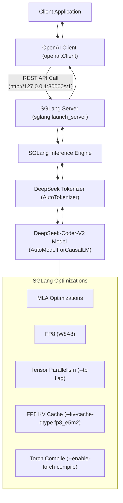
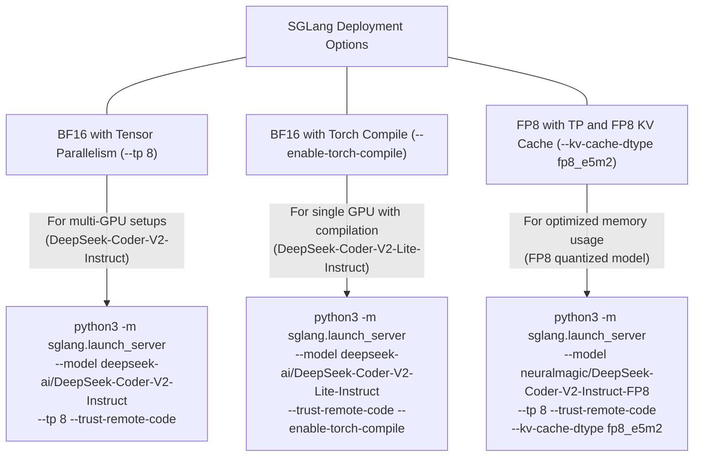
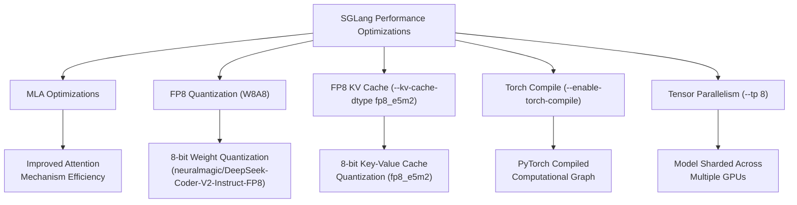

<!-- source: DeepWiki mcp.deepwiki.com · repo deepseek-ai/DeepSeek-Coder-V2 · page 4.2 SGLang Integration · fetched 2026-10-30 -->

# SGLang Integration

<details>
<summary>Relevant source files</summary>

The following files were used as context for generating this wiki page:

- [README.md](README.md)

</details>


This document provides a comprehensive guide for integrating DeepSeek-Coder-V2 models with SGLang for optimized inference. SGLang is one of the recommended inference frameworks for DeepSeek-Coder-V2, offering significant performance advantages over standard implementations.

For alternative inference methods, see [Hugging Face Integration](#4.1) or [vLLM Integration](#4.3).

## Overview

SGLang is an inference optimization framework that provides several key features specifically beneficial for large language models like DeepSeek-Coder-V2:

- MLA (Multi-Level Attention) optimizations
- FP8 (W8A8) quantization support
- FP8 KV Cache for memory efficiency
- Torch Compile integration for acceleration
- OpenAI-compatible API endpoints

According to the repository documentation, SGLang currently offers "the best latency and throughput among open-source frameworks" for DeepSeek-Coder-V2 inference.

Sources: [README.md:279-282]()

## SGLang Integration Architecture



Sources: [README.md:279-293]()

## Setting Up a SGLang Server

SGLang provides an OpenAI API-compatible server for interfacing with DeepSeek-Coder-V2 models. You can launch the server with different configurations depending on your hardware capabilities and performance requirements.

### Deployment Options



Sources: [README.md:282-290]()

### Option 1: BF16 with Tensor Parallelism

This configuration is suitable for running the full-sized DeepSeek-Coder-V2-Instruct model across multiple GPUs with tensor parallelism:

```bash
python3 -m sglang.launch_server --model deepseek-ai/DeepSeek-Coder-V2-Instruct --tp 8 --trust-remote-code
```

Sources: [README.md:283-284]()

### Option 2: BF16 with Torch Compile

This configuration uses the lightweight DeepSeek-Coder-V2-Lite-Instruct model with Torch compilation for additional optimization:

```bash
python3 -m sglang.launch_server --model deepseek-ai/DeepSeek-Coder-V2-Lite-Instruct --trust-remote-code --enable-torch-compile
```

**Note**: The compilation process can take several minutes but offers improved performance afterward.

Sources: [README.md:286-287]()

### Option 3: FP8 with Tensor Parallelism and FP8 KV Cache

For maximum memory efficiency using the FP8 quantized model with tensor parallelism and FP8 KV cache:

```bash
python3 -m sglang.launch_server --model neuralmagic/DeepSeek-Coder-V2-Instruct-FP8 --tp 8 --trust-remote-code --kv-cache-dtype fp8_e5m2
```

Sources: [README.md:289-290]()

## Using the OpenAI-Compatible API

Once the SGLang server is running, you can interact with it using the OpenAI API client. The server exposes an endpoint compatible with the OpenAI API format, allowing you to use existing OpenAI SDK clients.

### Example: Chat Completion

```python
import openai
client = openai.Client(
    base_url="http://127.0.0.1:30000/v1", api_key="EMPTY")

# Chat completion
response = client.chat.completions.create(
    model="default",
    messages=[
        {"role": "system", "content": "You are a helpful AI assistant"},
        {"role": "user", "content": "List 3 countries and their capitals."},
    ],
    temperature=0,
    max_tokens=64,
)
print(response)
```

Sources: [README.md:294-311]()

## Performance Optimizations

SGLang offers several optimizations that can significantly improve the performance of DeepSeek-Coder-V2 model inference:



Sources: [README.md:279-282]()

## Hardware Requirements

The hardware requirements depend on which model variant you're using:

| Model | Parameter Size | Active Parameters | Minimum Hardware |
|-------|----------------|-------------------|------------------|
| DeepSeek-Coder-V2-Lite | 16B | 2.4B | Single GPU with sufficient VRAM |
| DeepSeek-Coder-V2 | 236B | 21B | Multiple GPUs (80GB*8 recommended for BF16) |

Using the FP8 quantized version (`neuralmagic/DeepSeek-Coder-V2-Instruct-FP8`) can significantly reduce memory requirements.

Sources: [README.md:189-190](), [README.md:70-79]()

## Common Issues and Troubleshooting

When using SGLang with DeepSeek-Coder-V2, be aware of these potential issues:

1. **Long compilation time with Torch Compile**:
   - The compilation process can take several minutes
   - This is a one-time cost that improves subsequent inference performance

2. **Memory requirements**:
   - The full DeepSeek-Coder-V2 model requires significant GPU memory
   - Consider using FP8 quantization and FP8 KV cache for reduced memory footprint
   - Alternatively, use the Lite model variant for lower resource environments

3. **OpenAI API compatibility**:
   - Ensure you're using the correct base URL when configuring the OpenAI client
   - The default URL is `http://127.0.0.1:30000/v1`
   - Use `api_key="EMPTY"` as shown in the example

Sources: [README.md:286-290](), [README.md:294-311]()

## Integration with SGLang Special Features

The SGLang integration supports several special features for DeepSeek-Coder-V2 that aren't available with other inference frameworks:

| Feature | Description | Provided By |
|---------|-------------|-------------|
| MLA Optimizations | Attention mechanism optimizations | SGLang Core |
| FP8 Support | 8-bit weight quantization | neuralmagic quantized model |
| FP8 KV Cache | Memory-efficient key-value cache | SGLang `--kv-cache-dtype fp8_e5m2` |
| Tensor Parallelism | Distributed computation | SGLang `--tp` parameter |
| Torch Compile | Computational graph optimization | SGLang `--enable-torch-compile` |
| OpenAI API | OpenAI-compatible interface | SGLang server |

Sources: [README.md:279-282]()

## Conclusion

SGLang provides an optimized inference solution for DeepSeek-Coder-V2 models, offering better performance than other frameworks through its specialized optimization features. By following the instructions in this guide, you can set up a SGLang server with various optimization configurations and interact with DeepSeek-Coder-V2 models using the familiar OpenAI API interface.

For larger production deployments, you may want to consider using the [DeepSeek Platform API](#4.4) instead of self-hosting.

Sources: [README.md:279-313]()

---

