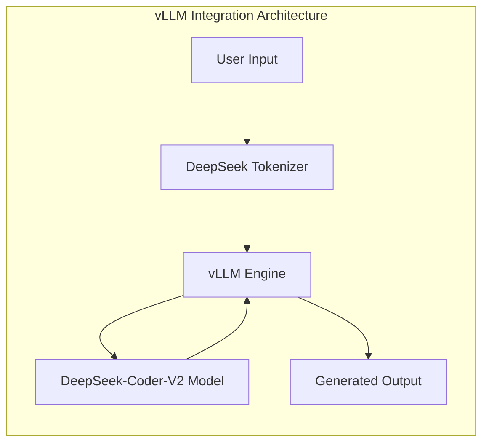
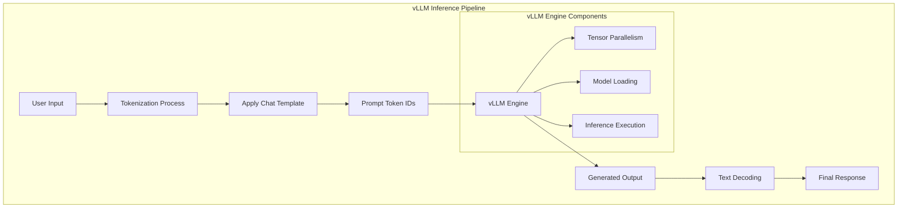
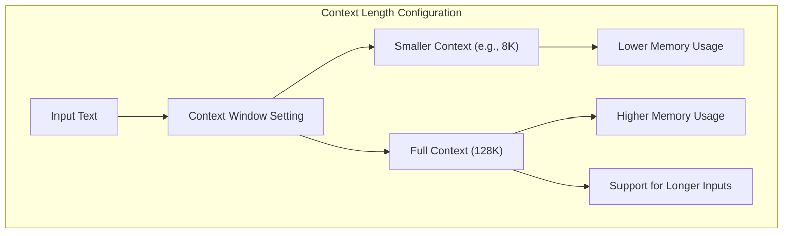

<!-- source: DeepWiki mcp.deepwiki.com · repo deepseek-ai/DeepSeek-Coder-V2 · page 4.3 vLLM Integration · fetched 2026-10-30 -->

# vLLM Integration

<details>
<summary>Relevant source files</summary>

The following files were used as context for generating this wiki page:

- [README.md](README.md)

</details>


This document covers how to use [vLLM](https://github.com/vllm-project/vllm) for efficient inference with DeepSeek-Coder-V2 models. vLLM is one of the recommended inference engines that provides optimized performance through features like tensor parallelism and efficient memory management. For other inference methods, see [Hugging Face Integration](#4.1) or [SGLang Integration](#4.2).

## 1. Overview of vLLM Integration

vLLM is a high-performance, open-source library for LLM inference that focuses on memory efficiency and optimized throughput. For DeepSeek-Coder-V2, vLLM offers several advantages:

- Tensor parallelism support for large models
- Efficient memory management
- High throughput for batch inference
- Support for the DeepSeek-Coder-V2 architecture



Sources: [README.md:314-339]()

## 2. Setup Requirements

To use vLLM with DeepSeek-Coder-V2, you must first apply a specific pull request to your vLLM installation. This PR adds support for the DeepSeek-Coder-V2 architecture.

### 2.1 Required Pull Request

Before using vLLM with DeepSeek-Coder-V2, you need to merge this Pull Request into your vLLM codebase:
- PR #4650: https://github.com/vllm-project/vllm/pull/4650

This PR adds the necessary modifications to support DeepSeek-Coder-V2's architecture within vLLM.

Sources: [README.md:315-316]()

## 3. Implementation Details

The vLLM integration consists of several key components working together to provide efficient inference for DeepSeek-Coder-V2 models.



Sources: [README.md:318-339]()

## 4. Basic Usage

Here's how to set up and use vLLM for inference with DeepSeek-Coder-V2 models:

### 4.1 Loading the Model and Tokenizer

```python
from transformers import AutoTokenizer
from vllm import LLM, SamplingParams

# Initialize tokenizer and model
model_name = "deepseek-ai/DeepSeek-Coder-V2-Lite-Instruct"
tokenizer = AutoTokenizer.from_pretrained(model_name)

# Configure vLLM parameters
max_model_len = 8192  # Context length to use
tp_size = 1          # Tensor parallelism size

# Initialize LLM with vLLM
llm = LLM(
    model=model_name, 
    tensor_parallel_size=tp_size, 
    max_model_len=max_model_len, 
    trust_remote_code=True, 
    enforce_eager=True
)
```

Key parameters:
- `model`: HuggingFace model path or name
- `tensor_parallel_size`: Number of GPUs for tensor parallelism
- `max_model_len`: Maximum sequence length
- `trust_remote_code`: Required for DeepSeek-Coder-V2 models
- `enforce_eager`: Uses eager execution mode

Sources: [README.md:318-324]()

### 4.2 Setting Sampling Parameters

```python
# Configure sampling parameters
sampling_params = SamplingParams(
    temperature=0.3,  # Lower values for more deterministic output
    max_tokens=256,   # Maximum number of tokens to generate
    stop_token_ids=[tokenizer.eos_token_id]  # Stop when EOS token is generated
)
```

Sources: [README.md:325]()

### 4.3 Preparing Input and Generating Output

```python
# Prepare input messages
messages_list = [
    [{"role": "user", "content": "Who are you?"}],
    [{"role": "user", "content": "write a quick sort algorithm in python."}],
    # Add more message sequences for batch inference
]

# Apply chat template to format messages for the model
prompt_token_ids = [
    tokenizer.apply_chat_template(messages, add_generation_prompt=True) 
    for messages in messages_list
]

# Generate responses
outputs = llm.generate(prompt_token_ids=prompt_token_ids, sampling_params=sampling_params)

# Extract generated text
generated_text = [output.outputs[0].text for output in outputs]
```

This example demonstrates batch inference, processing multiple prompts simultaneously for improved throughput.

Sources: [README.md:327-338]()

## 5. Configuration Options

### 5.1 Tensor Parallelism

Tensor parallelism is critical for running large models efficiently across multiple GPUs. The full DeepSeek-Coder-V2 model (236B parameters) requires multiple high-memory GPUs to run efficiently.

| Model | Parameters | Active Parameters | Recommended TP Size |
|-------|------------|-------------------|---------------------|
| DeepSeek-Coder-V2-Lite | 16B | 2.4B | 1-2 |
| DeepSeek-Coder-V2 | 236B | 21B | 8+ |

For the full 236B parameter model, the README recommends 8 GPUs with 80GB memory each when using BF16 format.

Sources: [README.md:189-190]()

### 5.2 Model Context Length

DeepSeek-Coder-V2 models support up to 128K context length, but you can configure vLLM to use a smaller context window through the `max_model_len` parameter to save memory if the full context length isn't needed.



Sources: [README.md:322-323](), [README.md:168-174]()

## 6. Comparison with Other Inference Methods

DeepSeek-Coder-V2 supports multiple inference methods, each with different characteristics:

| Feature | vLLM | Hugging Face | SGLang |
|---------|------|-------------|--------|
| Tensor Parallelism | ✓ | Limited | ✓ |
| Batch Inference | ✓ | Limited | ✓ |
| Memory Efficiency | High | Medium | High |
| Setup Complexity | Medium (requires PR) | Low | Low |
| Special Optimizations | - | - | MLA, FP8, FP8 KV Cache, Torch Compile |

### When to choose vLLM:
- For batch inference with high throughput requirements
- When deploying larger models that need tensor parallelism
- For applications requiring efficient memory management

Sources: [README.md:190-340]()

## 7. Limitations and Requirements

When using vLLM with DeepSeek-Coder-V2, be aware of the following:

1. Hardware requirements:
   - For DeepSeek-Coder-V2 (236B): 8 GPUs with 80GB memory each for BF16 inference
   - For DeepSeek-Coder-V2-Lite (16B): Can run on a single GPU with sufficient memory

2. Software requirements:
   - vLLM with PR #4650 applied
   - PyTorch

3. Integration status:
   - As mentioned in the README, the vLLM integration requires a specific PR to be merged, indicating that support may still be in development or not yet fully integrated into the main vLLM branch.

Sources: [README.md:189-190](), [README.md:315-316]()

## 8. Additional Resources

For more information about DeepSeek-Coder-V2 inference methods:
- See [Hugging Face Integration](#4.1) for basic transformer-based inference
- See [SGLang Integration](#4.2) for a framework with additional optimizations
- See [DeepSeek Platform API](#4.4) for cloud-based API access

Sources: [README.md:181-340]()

---

