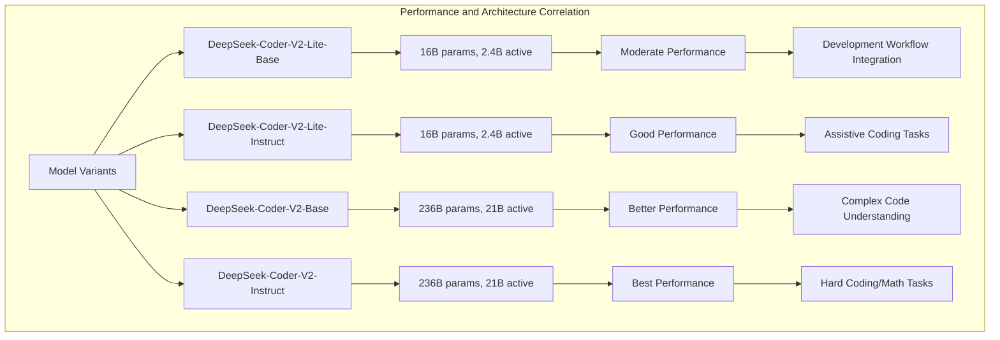
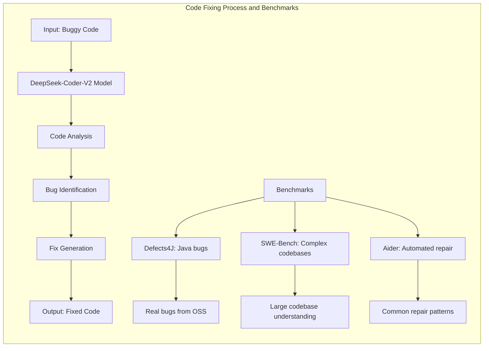
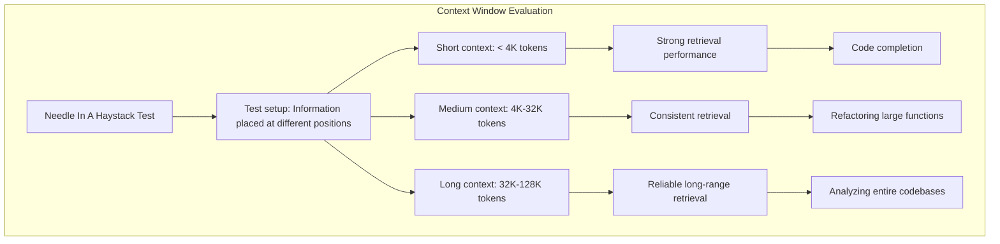
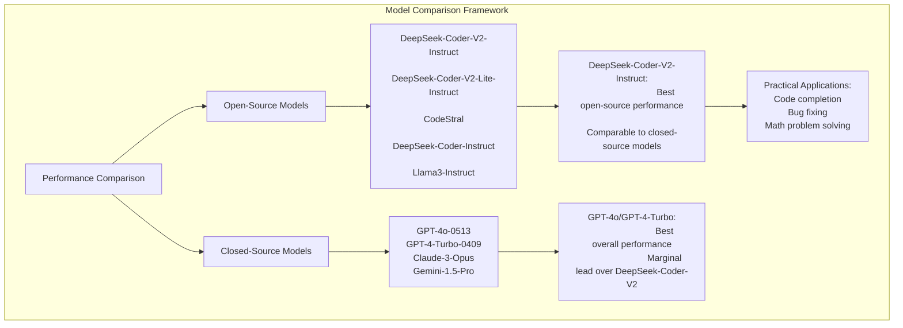

<!-- source: DeepWiki mcp.deepwiki.com · repo deepseek-ai/DeepSeek-Coder-V2 · page 5 Performance Benchmarks · fetched 2026-10-30 -->

# Performance Benchmarks

Relevant source files

The following files were used as context for generating this wiki page:

- [README.md](README.md)
- [figures/performance.png](figures/performance.png)

## Purpose and Scope

This document provides a comprehensive overview of DeepSeek-Coder-V2's performance across various benchmark categories. It details how the different model variants perform on code generation, code completion, code fixing, mathematical reasoning, and general language understanding tasks. For information about the model architecture that enables these capabilities, see [Model Architecture](#2).

Sources: [README.md:56-59]()

## Benchmark Overview

DeepSeek-Coder-V2 has been evaluated on an extensive set of benchmarks to assess its capabilities across different domains. The model demonstrates performance comparable to leading closed-source models like GPT-4-Turbo in code-specific tasks.

```mermaid
flowchart TD
    Benchmarks["DeepSeek-Coder-V2 Benchmarks"] --> CodeGen["Code Generation"]
    Benchmarks --> CodeComp["Code Completion"]
    Benchmarks --> CodeFix["Code Fixing"]
    Benchmarks --> MathReason["Mathematical Reasoning"]
    Benchmarks --> GenLang["General Language Understanding"]
    Benchmarks --> ContextWin["Context Window Evaluation"]
    
    CodeGen --> HumanEval["HumanEval"]
    CodeGen --> MBPP["MBPP+"]
    CodeGen --> LiveCode["LiveCodeBench"]
    CodeGen --> USACO["USACO"]
    
    CodeComp --> RepoBench["RepoBench (Python/Java)"]
    CodeComp --> HumanEvalFIM["HumanEval FIM"]
    
    CodeFix --> Defects4J["Defects4J"]
    CodeFix --> SWEBench["SWE-Bench"]
    CodeFix --> Aider["Aider"]
    
    MathReason --> GSM8K["GSM8K"]
    MathReason --> MATH["MATH"]
    MathReason --> AIME["AIME"]
    MathReason --> MathOdyssey["Math Odyssey"]
    
    GenLang --> BBH["BBH"]
    GenLang --> MMLU["MMLU"]
    GenLang --> ARC["ARC-Easy/Challenge"]
    GenLang --> TriviaQA["TriviaQA"]
    GenLang --> OtherNLP["Various NLP Benchmarks"]
    
    ContextWin --> NIAH["Needle In A Haystack"]
```

Sources: [README.md:61-166]()

## Model Variants Performance Profile

DeepSeek-Coder-V2 comes in different variants with varying parameter counts and capabilities. The performance of each model scales with its size and whether it's an instruction-tuned version.

| Model | Total Parameters | Active Parameters | Context Length |
|-------|------------------|-------------------|----------------|
| DeepSeek-Coder-V2-Lite-Base | 16B | 2.4B | 128k |
| DeepSeek-Coder-V2-Lite-Instruct | 16B | 2.4B | 128k |
| DeepSeek-Coder-V2-Base | 236B | 21B | 128k |
| DeepSeek-Coder-V2-Instruct | 236B | 21B | 128k |

Sources: [README.md:71-80]()

## Code Generation Performance

Code generation evaluates the model's ability to generate complete, functional code solutions from natural language descriptions.

| Model | HumanEval | MBPP+ | LiveCodeBench | USACO |
|-------|-----------|-------|---------------|-------|
| DeepSeek-Coder-V2-Lite-Instruct | 81.1 | 68.8 | 24.3 | 6.5 |
| DeepSeek-Coder-V2-Instruct | **90.2** | **76.2** | **43.4** | **12.1** |
| GPT-4o-0513 (closed-source) | 91.0 | 73.5 | 43.4 | 18.8 |
| Claude-3-Opus (closed-source) | 84.2 | 72.0 | 34.6 | 7.8 |
| Gemini-1.5-Pro (closed-source) | 83.5 | 74.6 | 34.1 | 4.9 |

DeepSeek-Coder-V2-Instruct demonstrates performance comparable to closed-source models like GPT-4-Turbo in these benchmarks, with particularly strong results on HumanEval and MBPP+.

Sources: [README.md:87-102]()

## Code Completion Performance

Code completion measures the model's ability to fill in missing parts of code, which is crucial for productivity tools and coding assistants.

| Model | RepoBench (Python) | RepoBench (Java) | HumanEval FIM |
|-------|-------------------|------------------|---------------|
| DeepSeek-Coder-Base (7B) | 36.2 | 43.3 | 86.1 |
| DeepSeek-Coder-Base (33B) | 39.1 | 44.8 | **86.4** |
| DeepSeek-Coder-V2-Lite-Base | 38.9 | 43.3 | **86.4** |
| CodeStral | **46.1** | **45.7** | 83.0 |

This benchmark category evaluates how well the model can predict and complete code in real-world repositories and mid-function contexts.

Sources: [README.md:104-113]()

## Code Fixing Performance

Code fixing evaluates the model's ability to identify and correct bugs or issues in existing code.

| Model | Defects4J | SWE-Bench | Aider |
|-------|-----------|-----------|-------|
| DeepSeek-Coder-V2-Lite-Instruct | 9.2 | 0.0 | 44.4 |
| DeepSeek-Coder-V2-Instruct | **21.0** | **12.7** | **73.7** |
| GPT-4o-0513 (closed-source) | 26.1 | 26.7 | 72.9 |
| CodeStral | 17.8 | 2.7 | 51.1 |

DeepSeek-Coder-V2-Instruct demonstrates strong performance in code fixing, particularly on the Aider benchmark where it slightly outperforms GPT-4o.

Sources: [README.md:115-130]()

## Mathematical Reasoning Performance

Mathematical reasoning assesses the model's ability to understand and solve mathematical problems of varying complexity.

| Model | GSM8K | MATH | AIME 2024 | Math Odyssey |
|-------|-------|------|-----------|--------------|
| DeepSeek-Coder-V2-Lite-Instruct | 86.4 | 61.8 | 0/30 | 44.4 |
| DeepSeek-Coder-V2-Instruct | **94.9** | **75.7** | **4/30** | **53.7** |
| GPT-4o-0513 (closed-source) | 95.8 | 76.6 | 2/30 | 53.2 |
| Claude-3-Opus (closed-source) | 95.0 | 60.1 | 2/30 | 40.6 |

DeepSeek-Coder-V2-Instruct shows particularly impressive performance on mathematical reasoning tasks, even outperforming some closed-source models on AIME 2024 and Math Odyssey.

Sources: [README.md:132-146]()

## General Language Understanding

Beyond coding-specific tasks, DeepSeek-Coder-V2 also demonstrates strong capabilities in general language understanding.

| Benchmark | DeepSeek-V2-Lite Chat | DeepSeek-Coder-V2-Lite Instruct | DeepSeek-V2 Chat | DeepSeek-Coder-V2 Instruct |
|-----------|----------------------|-------------------------------|-----------------|---------------------------|
| BBH | 48.1 | 61.2 | 79.7 | **83.9** |
| MMLU | 55.7 | 60.1 | 78.1 | **79.2** |
| ARC-Easy | 86.1 | 88.9 | **98.1** | 97.4 |
| ARC-Challenge | 73.4 | 77.4 | 92.3 | **92.8** |
| TriviaQA | 65.2 | 59.5 | **86.7** | 82.3 |
| C-Eval | 60.1 | 61.6 | 78.0 | **79.4** |
| Arena-Hard | 11.4 | 38.1 | 41.6 | **65.0** |
| MT-Bench | 7.37 | 7.81 | **8.97** | 8.77 |

Interestingly, DeepSeek-Coder-V2-Instruct sometimes outperforms the general-purpose DeepSeek-V2 Chat model on certain language benchmarks, despite being optimized for code.

Sources: [README.md:148-166]()

## Context Window Performance

DeepSeek-Coder-V2 models support a 128K token context length, enabling them to process large codebases and documents.

The "Needle In A Haystack" (NIAH) tests demonstrate that DeepSeek-Coder-V2 maintains performance across the entire 128K context window, which is crucial for tasks involving large codebases or documentation.

Sources: [README.md:168-174]()

## Comparison with State-of-the-Art Models

DeepSeek-Coder-V2's performance can be directly compared with both open-source and closed-source models across key benchmark categories.

DeepSeek-Coder-V2-Instruct represents a significant advancement in open-source code models, achieving performance comparable to closed-source alternatives across multiple benchmark categories. While GPT-4o and GPT-4-Turbo maintain a slight edge in some areas, the gap has narrowed considerably, making DeepSeek-Coder-V2 a compelling open-source alternative.

Sources: [README.md:87-146]()

## Performance Factors and Practical Considerations

Several factors influence DeepSeek-Coder-V2's benchmark performance:

1. **Mixture-of-Experts Architecture**: Enables high parameter count (236B total) with lower active parameters (21B) for efficient inference
2. **Context Length**: 128K context allows processing large code repositories and complex problems
3. **Training Corpus**: Pre-trained on 6 trillion tokens with coverage of 338 programming languages
4. **Instruction Tuning**: Instruct variants typically outperform Base variants on applied tasks

When implementing DeepSeek-Coder-V2 for practical applications, consider:

- Lite models (16B total, 2.4B active) provide good performance with lower resource requirements
- Full models (236B total, 21B active) offer state-of-the-art performance for demanding tasks
- Instruct models are better suited for direct interaction and problem-solving
- Base models may be preferable for lower-level code completion tasks

Sources: [README.md:58-59](), [README.md:71-80]()

## Performance Across Programming Languages

DeepSeek-Coder-V2 supports 338 programming languages, with varying performance across different language families.

While comprehensive language-specific benchmarks aren't available, general observations from the results suggest:

- Strong performance on widely-used languages (Python, JavaScript, Java, C++)
- Good performance on less common languages included in the training data
- The 128K context window enables effective processing of code in any supported language

For the complete list of supported programming languages, see [Supported Programming Languages](#3).

Sources: [README.md:66]()

---

