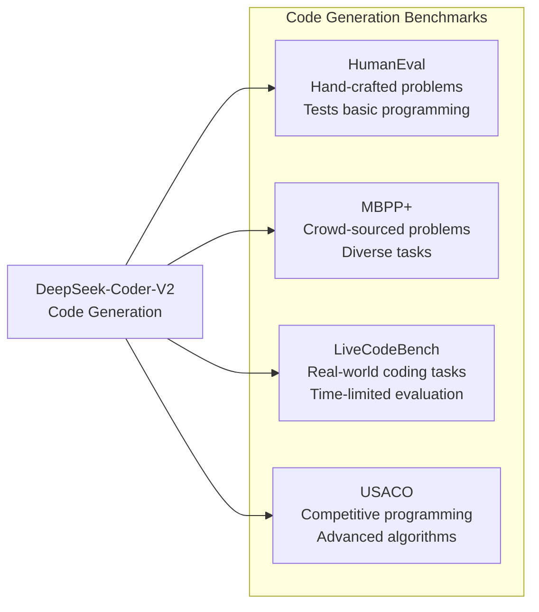
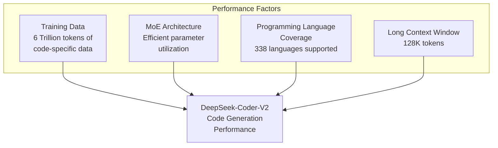
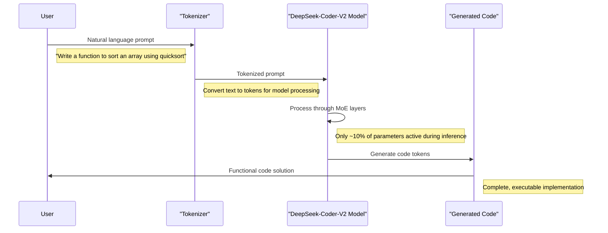
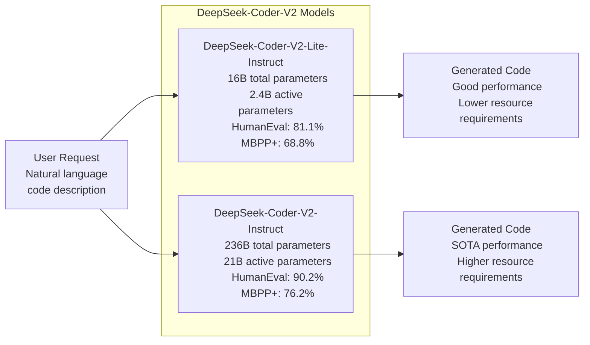

<!-- source: DeepWiki mcp.deepwiki.com · repo deepseek-ai/DeepSeek-Coder-V2 · page 5.1 Code Generation Performance · fetched 2026-10-30 -->

# Code Generation Performance

<details>
<summary>Relevant source files</summary>

The following files were used as context for generating this wiki page:

- [README.md](README.md)
- [figures/performance.png](figures/performance.png)

</details>


This page documents the code generation performance of DeepSeek-Coder-V2 models across various benchmarks. For information about code completion and fixing capabilities, see [Code Completion & Fixing](#5.2).

## Overview

DeepSeek-Coder-V2 demonstrates exceptional code generation capabilities across multiple standard benchmarks. Code generation refers to the model's ability to produce complete, functional code from natural language descriptions or prompts. This is a fundamental capability for code models and represents one of the primary use cases for DeepSeek-Coder-V2.

## Benchmarks

DeepSeek-Coder-V2 is evaluated on four key code generation benchmarks, each testing different aspects of coding ability:



Sources: [README.md:86-102]()

### HumanEval

HumanEval is a widely-used benchmark consisting of hand-crafted programming problems that test a model's ability to generate functional Python code from natural language descriptions. Each problem includes:
- A function signature
- A docstring describing the function's purpose
- Test cases to verify the correctness of the generated solution

### MBPP+

MBPP+ (MathBench Plus) is an extended version of the original MBPP benchmark containing a diverse set of crowd-sourced Python programming problems. This benchmark tests the model's ability to handle a wide range of everyday coding tasks.

### LiveCodeBench

LiveCodeBench evaluates models on real-world coding challenges with time constraints, simulating practical development scenarios. This benchmark tests the model's ability to generate solutions for complex, realistic problems.

### USACO

The USA Computing Olympiad (USACO) problems represent competitive programming challenges that require advanced algorithmic knowledge and problem-solving skills. This benchmark tests the model's ability to solve complex algorithmic problems.

## Performance Results

The table below summarizes DeepSeek-Coder-V2 models' performance on code generation benchmarks compared to other leading models:

| Model | #Total Params | #Active Params | HumanEval | MBPP+ | LiveCodeBench | USACO |
|:---------------------|:--------:|:--------:|:--------:|:--------:|:--------:|:-----------:|
| **DeepSeek-Coder-V2-Lite-Instruct** | 16B | 2.4B | 81.1 | 68.8 | 24.3 | 6.5 |
| **DeepSeek-Coder-V2-Instruct** | 236B | 21B  | **90.2** | **76.2** | **43.4** | **12.1** |
| **DeepSeek-Coder-Instruct** (v1) | 33B  | 33B  | 79.3 | 70.1 | 22.5 | 4.2 |
| **Llama3-Instruct** | 70B  | 70B  | 81.1 | 68.8 | 28.7 | 3.3 |
| **CodeStral** | 22B  | 22B  | 78.1 | 68.2 | 31.0 | 4.6 |
| **GPT-4-Turbo-0409** | - | - | 88.2 | 72.2 | 45.7 | 12.3 |
| **GPT-4o-0513** | - | - | 91.0 | 73.5 | 43.4 | 18.8 |

Sources: [README.md:86-102]()

### Key Observations

1. **Comparable to Closed-Source Models**: DeepSeek-Coder-V2-Instruct (236B) achieves performance comparable to leading closed-source models like GPT-4o and GPT-4-Turbo across all benchmarks.

2. **Efficient Parameter Usage**: Despite having fewer active parameters (21B) than models like Llama3 (70B), DeepSeek-Coder-V2-Instruct significantly outperforms them, demonstrating the efficiency of its MoE architecture.

3. **Scaling Benefits**: The performance gap between the Lite (16B total/2.4B active) and full (236B total/21B active) versions shows the benefits of scaling in code generation tasks.

4. **Competitive Edge**: DeepSeek-Coder-V2-Instruct achieves the highest scores among all open-source models on HumanEval, MBPP+, LiveCodeBench, and USACO.

## Performance Factors

Several factors contribute to DeepSeek-Coder-V2's strong code generation performance:



Sources: [README.md:58-66]()

### MoE Architecture

DeepSeek-Coder-V2 uses a Mixture-of-Experts (MoE) architecture based on the DeepSeekMoE framework. This approach allows the model to have a large total parameter count (236B) while only activating a small portion (21B) during inference. This design enables efficient computation while maintaining strong performance.

### Training Data

DeepSeek-Coder-V2 builds upon an intermediate checkpoint of DeepSeek-V2, with additional pre-training on 6 trillion tokens of code data. This extensive code-specific training significantly enhances its code generation capabilities.

### Programming Language Coverage

The model supports 338 programming languages (compared to 86 in the previous version), enabling it to generate code across a vast range of languages and domains.

### Context Length

With a 128K token context length (up from 16K in the previous version), DeepSeek-Coder-V2 can process and generate code based on much longer contexts, improving its ability to understand complex requirements and generate appropriate solutions.

## Code Generation Process

The following diagram illustrates the high-level process of code generation with DeepSeek-Coder-V2:



Sources: [README.md:195-204]()

## Usage Example

To use DeepSeek-Coder-V2 for code generation, you can employ any of the supported inference methods. Here's an example using Hugging Face Transformers:

For the DeepSeek-Coder-V2-Lite-Instruct model:

```python
from transformers import AutoTokenizer, AutoModelForCausalLM
import torch

tokenizer = AutoTokenizer.from_pretrained("deepseek-ai/DeepSeek-Coder-V2-Lite-Instruct", trust_remote_code=True)
model = AutoModelForCausalLM.from_pretrained("deepseek-ai/DeepSeek-Coder-V2-Lite-Instruct", trust_remote_code=True, torch_dtype=torch.bfloat16).cuda()

messages = [
    { 'role': 'user', 'content': "write a quick sort algorithm in python."}
]

inputs = tokenizer.apply_chat_template(messages, add_generation_prompt=True, return_tensors="pt").to(model.device)
outputs = model.generate(inputs, max_new_tokens=512, do_sample=False, top_k=50, top_p=0.95, eos_token_id=tokenizer.eos_token_id)
print(tokenizer.decode(outputs[0][len(inputs[0]):], skip_special_tokens=True))
```

Sources: [README.md:232-243]()

## Comparing Model Variants

The relationship between model size, architecture, and performance is illustrated below:



Sources: [README.md:69-80](), [README.md:86-102]()

## Summary

DeepSeek-Coder-V2 demonstrates exceptional code generation capabilities across multiple benchmarks, achieving performance comparable to leading closed-source models. The Mixture-of-Experts architecture enables efficient parameter utilization while maintaining strong performance. The full model (DeepSeek-Coder-V2-Instruct) achieves state-of-the-art results among open-source models on all code generation benchmarks, while even the Lite version offers competitive performance with significantly reduced computational requirements.

This performance makes DeepSeek-Coder-V2 suitable for a wide range of code generation applications, from everyday programming tasks to complex algorithmic challenges.

---

