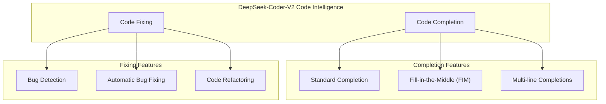
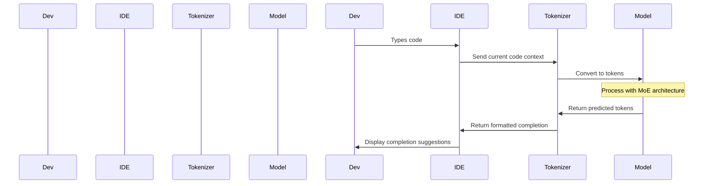
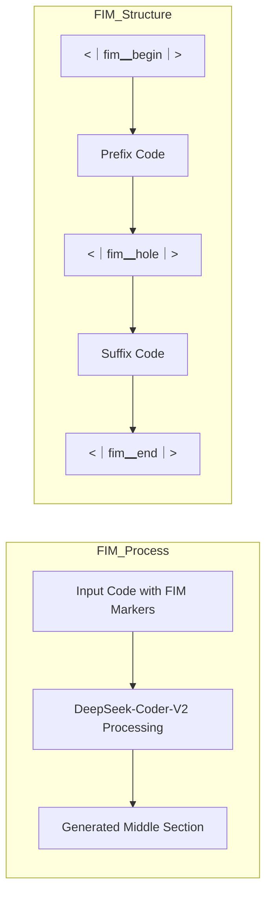
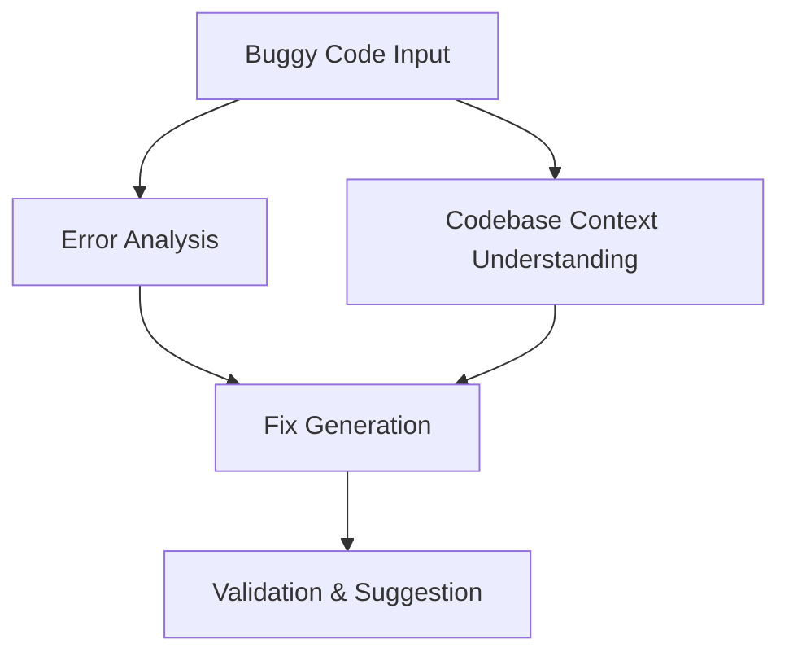
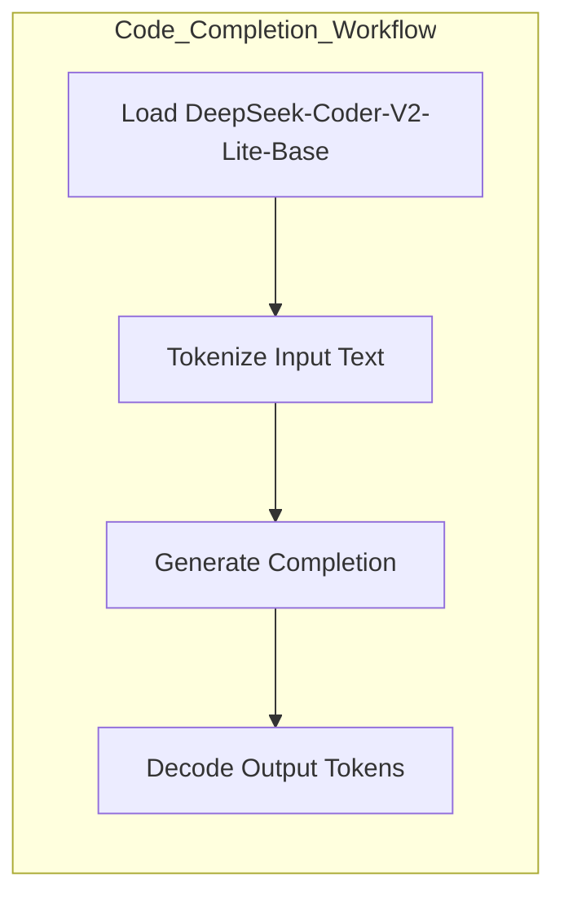
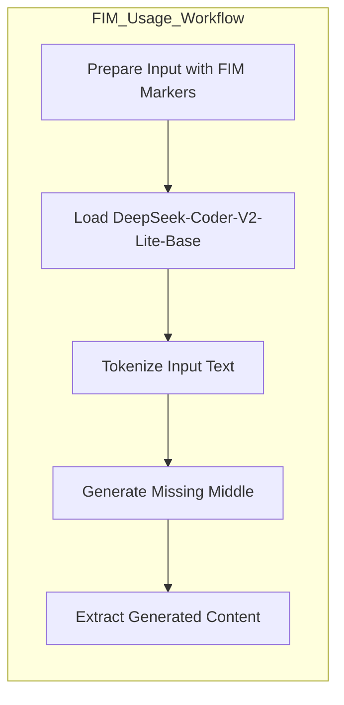
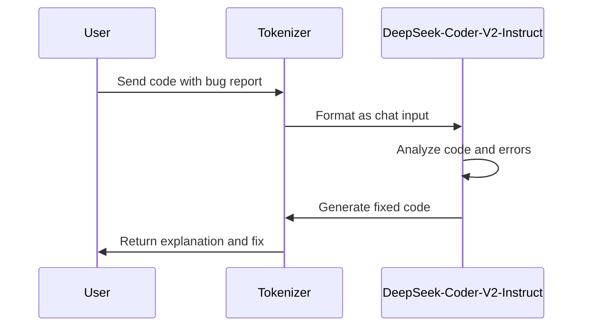
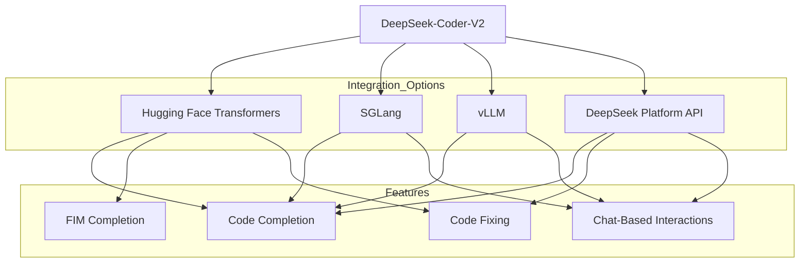

<!-- source: DeepWiki mcp.deepwiki.com · repo deepseek-ai/DeepSeek-Coder-V2 · page 5.2 Code Completion & Fixing · fetched 2026-10-30 -->

# Code Completion & Fixing

Relevant source files

The following files were used as context for generating this wiki page:

- [README.md](README.md)
- [figures/performance.png](figures/performance.png)

This document details DeepSeek-Coder-V2's capabilities in code completion and fixing, covering benchmark performances, technical implementations, and usage examples. For information about code generation from scratch, see [Code Generation Performance](#5.1).

## 1. Overview

DeepSeek-Coder-V2 provides two key code intelligence features:

1. **Code Completion**: Predicting and suggesting code as developers type, including:
   - Standard completion (predicting next tokens)
   - Fill-in-the-Middle (FIM) completion
   - Multi-line completions

2. **Code Fixing**: Identifying and resolving bugs in existing code:
   - Bug detection capabilities
   - Automatic bug fixing
   - Code refactoring and improvement suggestions

Sources: [README.md:194-227]()

## 2. Benchmark Performance

### 2.1 Code Completion Benchmarks

DeepSeek-Coder-V2 models have been evaluated on standard code completion benchmarks, demonstrating strong performance:

| Model | #TP | #AP | RepoBench (Python) | RepoBench (Java) | HumanEval FIM |
| :-- | :--: | :--: | :--: | :--: | :--: |
| CodeStral | 22B | 22B | **46.1** | **45.7** | 83.0 |
| DeepSeek-Coder-Base | 7B | 7B | 36.2 | 43.3 | 86.1 |
| DeepSeek-Coder-Base | 33B | 33B | 39.1 | 44.8 | **86.4** |
| DeepSeek-Coder-V2-Lite-Base | 16B | 2.4B | 38.9 | 43.3 | **86.4** |

*Note: #TP = Total Parameters, #AP = Active Parameters*

Sources: [README.md:104-113]()

### 2.2 Code Fixing Benchmarks

DeepSeek-Coder-V2 has been evaluated on code fixing benchmarks, with the full model showing competitive performance against closed-source models:

| Model | #TP | #AP | Defects4J | SWE-Bench | Aider |
| :-- | :--: | :--: | :--: | :--: | :--: |
| **Closed-Source Models** | | | | | |
| Gemini-1.5-Pro | - | - | 18.6 | 19.3 | 57.1 |
| Claude-3-Opus | - | - | 25.5 | 11.7 | 68.4 |
| GPT-4-Turbo-1106 | - | - | 22.8 | 22.7 | 65.4 |
| GPT-4-Turbo-0409 | - | - | 24.3 | 18.3 | 63.9 |
| GPT-4o-0513 | - | - | **26.1** | **26.7** | **72.9** |
| **Open-Source Models** | | | | | |
| CodeStral | 22B | 22B | 17.8 | 2.7 | 51.1 |
| DeepSeek-Coder-Instruct | 33B | 33B | 11.3 | 0.0 | 54.5 |
| Llama3-Instruct | 70B | 70B | 16.2 | - | 49.2 |
| DeepSeek-Coder-V2-Lite-Instruct | 16B | 2.4B | 9.2 | 0.0 | 44.4 |
| DeepSeek-Coder-V2-Instruct | 236B | 21B | **21.0** | **12.7** | **73.7** |

Sources: [README.md:114-131]()

## 3. Code Completion Technical Implementation

Code completion in DeepSeek-Coder-V2 uses the model's next-token prediction capability augmented with specialized training for code contexts.

Sources: [README.md:194-204]()

### 3.1 Standard Completion

Standard completion predicts the next tokens based on preceding code, using the model's autoregressive capabilities.

### 3.2 Fill-in-the-Middle (FIM) Completion

FIM allows the model to complete code with context on both sides (before and after the cursor), using special tokens to mark the completion area.

Sources: [README.md:207-227]()

## 4. Code Fixing Technical Implementation

Code fixing in DeepSeek-Coder-V2 involves several stages, from understanding the broken code to generating appropriate fixes.

Sources: [README.md:114-131]()

### 4.1 Bug Detection

The model identifies potential bugs by analyzing code semantics, syntax, and logical issues. It leverages its training on extensive code repositories to recognize common error patterns.

### 4.2 Automatic Bug Fixing

For identified issues, the model generates fixes by:
1. Understanding the intended functionality
2. Identifying the problematic code section
3. Generating corrected code that maintains the original code's intent
4. Ensuring compatibility with surrounding code

### 4.3 Benchmark Tests

The model is evaluated on three main fixing benchmarks:

1. **Defects4J**: Java program defects with test cases
2. **SWE-Bench**: Real-world software engineering tasks
3. **Aider**: Evaluation of AI assistance for code fixing

## 5. Usage Examples

### 5.1 Code Completion with Hugging Face Transformers

Example usage:

- Load the model and tokenizer
- Provide input code context
- Generate completions with appropriate parameters
- Decode and display the result

Sources: [README.md:194-204]()

### 5.2 Fill-in-the-Middle (FIM) with Hugging Face Transformers

Key to using FIM is proper formatting with the special tokens:
- `<｜fim▁begin｜>`: Marks the start of the FIM context
- `<｜fim▁hole｜>`: Indicates where the model should insert code
- `<｜fim▁end｜>`: Marks the end of the FIM context

Sources: [README.md:207-227]()

### 5.3 Chat-Based Code Fixing

The DeepSeek-Coder-V2-Instruct model can be used in a dialogue format to fix code issues:

Sources: [README.md:229-243]()

## 6. Integration with Other Components

DeepSeek-Coder-V2's code completion and fixing capabilities are integrated with various frameworks and tools for deployment.

Sources: [README.md:188-339]()

### 6.1 Framework-Specific Notes

- **Hugging Face Transformers**: Provides straightforward integration but may require more resources
- **SGLang**: Offers optimizations like MLA, FP8 support, and FP8 KV Cache for improved performance
- **vLLM**: Provides efficient tensor parallelism and batch inference capabilities
- **DeepSeek Platform API**: Offers OpenAI-compatible endpoints for easy integration

Sources: [README.md:188-339]()

## 7. Performance Comparison

The full DeepSeek-Coder-V2-Instruct model (236B parameters, 21B active) shows particularly strong performance in code fixing, achieving:

- **21.0** on Defects4J (top among open-source models)
- **12.7** on SWE-Bench (top among open-source models)
- **73.7** on Aider (exceeding even GPT-4o-0513's 72.9)

For code completion, the DeepSeek-Coder-V2-Lite-Base model (16B parameters, 2.4B active) achieves **86.4** on HumanEval FIM, matching the performance of the 33B parameter DeepSeek-Coder-Base model.

Sources: [README.md:104-131]()

---

