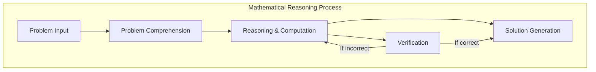
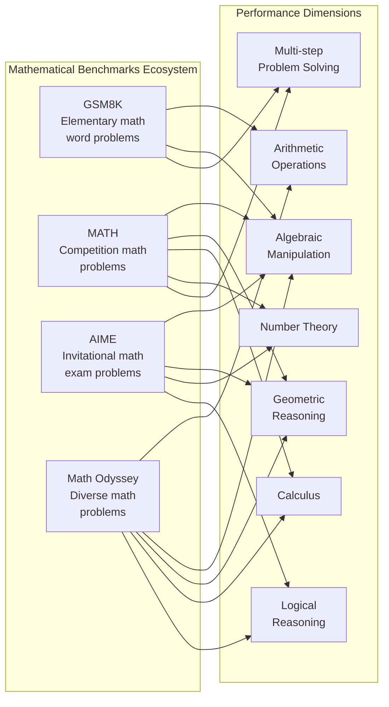
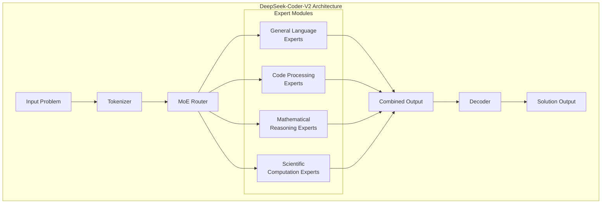
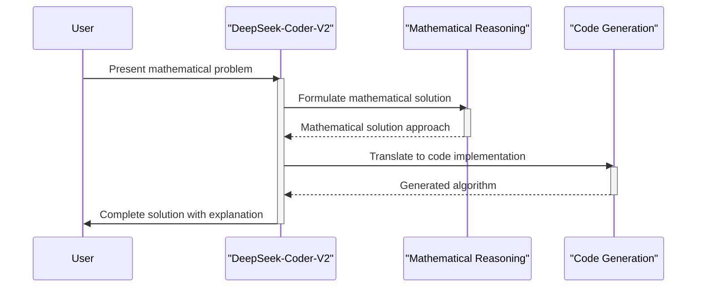

<!-- source: DeepWiki mcp.deepwiki.com · repo deepseek-ai/DeepSeek-Coder-V2 · page 5.3 Mathematical Reasoning · fetched 2026-10-30 -->

# Mathematical Reasoning

<details>
<summary>Relevant source files</summary>

The following files were used as context for generating this wiki page:

- [README.md](README.md)

</details>


## Purpose and Scope

This document details the mathematical reasoning capabilities of DeepSeek-Coder-V2, covering its performance on standard mathematical benchmarks, how these capabilities are integrated into the model, and practical applications. Mathematical reasoning is a key capability that complements DeepSeek-Coder-V2's core coding abilities, as many programming tasks require strong mathematical foundations, especially in algorithm development, optimization problems, and scientific computing.

For information about general language understanding capabilities, see [General Language Understanding](#5.4). For details about code generation performance, see [Code Generation Performance](#5.1).

## Overview of Mathematical Reasoning Capabilities

DeepSeek-Coder-V2 demonstrates exceptional mathematical reasoning abilities, reaching performance levels comparable to leading closed-source models like GPT-4o and GPT-4-Turbo. These capabilities were significantly enhanced from the base DeepSeek-V2 model through additional pre-training with 6 trillion tokens, with a specific focus on improving mathematical problem-solving skills.

The model can:
- Solve complex word problems requiring multi-step reasoning
- Handle advanced mathematical concepts across algebra, geometry, calculus, and number theory
- Apply mathematical principles to algorithm development and optimization
- Conduct mathematical proofs and logical reasoning chains
- Translate between natural language math problems and formal mathematical notation



Sources: [README.md:130-146]()

## Benchmark Performance

DeepSeek-Coder-V2's mathematical reasoning abilities have been evaluated on several standardized mathematical benchmarks:

| Benchmark | Description | DeepSeek-Coder-V2-Instruct | GPT-4o-0513 | Llama3-Instruct |
|-----------|-------------|----------------------------|-------------|-----------------|
| **GSM8K** | Grade school math word problems | 94.9% | 95.8% | 93.0% |
| **MATH** | High school competition-level problems | 75.7% | 76.6% | 50.4% |
| **AIME 2024** | American Invitational Mathematics Examination | 4/30 | 2/30 | 1/30 |
| **Math Odyssey** | Diverse math problems | 53.7% | 53.2% | 27.9% |

Notable observations:
- DeepSeek-Coder-V2-Instruct achieves state-of-the-art performance among open-source models across all math benchmarks
- It outperforms GPT-4o-0513 on AIME 2024 and Math Odyssey benchmarks
- The Lite version (16B parameters, 2.4B active) still achieves 86.4% on GSM8K and 61.8% on MATH
- The significant improvement over other open-source models like Llama3-Instruct demonstrates the effectiveness of DeepSeek's training approach



Sources: [README.md:134-146]()

## Integration with Model Architecture

DeepSeek-Coder-V2's mathematical reasoning capabilities are deeply integrated into its Mixture-of-Experts (MoE) architecture. This architecture enables specialized processing of mathematical content while maintaining efficiency in parameter usage.



The MoE architecture plays a crucial role in supporting mathematical reasoning:

1. **Parameter Efficiency**: DeepSeek-Coder-V2's full model has 236B total parameters but only 21B active parameters during inference, allowing for more efficient handling of mathematical computations.

2. **Specialized Expert Routing**: Mathematical problems likely activate specific experts within the network that specialize in numerical reasoning and mathematical operations.

3. **Context Integration**: The 128K context window allows for handling lengthy mathematical proofs, derivations, and multi-step solutions while maintaining coherence throughout the reasoning process.

Sources: [README.md:58-81]()

## Mathematical Reasoning Use Cases

DeepSeek-Coder-V2's mathematical reasoning capabilities enable it to excel in various programming scenarios that require mathematical foundations:

### 1. Algorithm Development
- Developing optimization algorithms that require understanding of mathematical concepts
- Creating numerical algorithms for simulation and scientific computing
- Implementing machine learning algorithms that rely on statistical concepts

### 2. Problem-Solving in Competitive Programming
- Solving complex algorithmic challenges from platforms like USACO
- Tackling problems that require mathematical insights to develop efficient solutions

### 3. Scientific Computing
- Implementing numerical methods for differential equations, linear algebra, and other scientific domains
- Verifying mathematical correctness of scientific code

### 4. Education and Explanation
- Explaining mathematical concepts and their implementation in code
- Breaking down complex problems into step-by-step solutions

## Example Application: Mathematical Problem to Code Implementation



Sources: [README.md:56-146]()

## Comparison with Other Models

DeepSeek-Coder-V2-Instruct's mathematical reasoning capabilities compare favorably with both closed-source and open-source alternatives. The table below summarizes how it stacks up against other models in mathematical reasoning benchmarks:

| Model Type | Model Name | GSM8K | MATH | AIME 2024 |
|------------|------------|-------|------|----------|
| **Closed-Source** | GPT-4o-0513 | 95.8% | 76.6% | 2/30 |
| **Closed-Source** | GPT-4-Turbo-0409 | 93.7% | 73.4% | 3/30 |
| **Closed-Source** | Claude-3-Opus | 95.0% | 60.1% | 2/30 |
| **Open-Source** | DeepSeek-Coder-V2-Instruct | **94.9%** | **75.7%** | **4/30** |
| **Open-Source** | Llama3-Instruct (70B) | 93.0% | 50.4% | 1/30 |
| **Open-Source** | DeepSeek-Coder-V2-Lite-Instruct | 86.4% | 61.8% | 0/30 |

Key observations:
- DeepSeek-Coder-V2-Instruct is the best performing open-source model across all mathematical benchmarks
- It outperforms GPT-4o-0513 on the AIME 2024 benchmark, solving 4 out of 30 problems
- The model's performance on GSM8K and MATH is extremely close to the best closed-source models
- The significant gap between DeepSeek-Coder-V2 and other open-source alternatives like Llama3-Instruct highlights its exceptional mathematical reasoning capabilities

Sources: [README.md:134-146]()

## Practical Usage for Mathematical Reasoning

To utilize DeepSeek-Coder-V2's mathematical reasoning capabilities, users can interact with the model in various ways:

### Via Hugging Face Transformers
```python
from transformers import AutoTokenizer, AutoModelForCausalLM
import torch

tokenizer = AutoTokenizer.from_pretrained("deepseek-ai/DeepSeek-Coder-V2-Lite-Instruct", trust_remote_code=True)
model = AutoModelForCausalLM.from_pretrained("deepseek-ai/DeepSeek-Coder-V2-Lite-Instruct", trust_remote_code=True, torch_dtype=torch.bfloat16).cuda()

messages = [
    {"role": "user", "content": "Solve the following problem: A circle has radius 5cm. Find the area of the circle in terms of π, and then calculate the approximate value using π ≈ 3.14159."}
]

inputs = tokenizer.apply_chat_template(messages, add_generation_prompt=True, return_tensors="pt").to(model.device)
outputs = model.generate(inputs, max_new_tokens=512, do_sample=False, top_k=50, top_p=0.95, num_return_sequences=1, eos_token_id=tokenizer.eos_token_id)
print(tokenizer.decode(outputs[0][len(inputs[0]):], skip_special_tokens=True))
```

### For Complex Mathematical Workflows
For complex mathematical reasoning tasks, it's often helpful to:

1. Break down the problem into clear steps
2. Ask the model to show its reasoning process
3. Verify intermediate steps where possible
4. Use code implementation to validate mathematical results

Sources: [README.md:191-268]()

## Conclusion

DeepSeek-Coder-V2's mathematical reasoning capabilities represent a significant advancement in open-source language models. The model demonstrates near-parity with leading closed-source alternatives on most mathematical benchmarks and even surpasses them in some cases.

These capabilities make DeepSeek-Coder-V2 particularly valuable for programming tasks that require strong mathematical foundations, such as algorithm development, scientific computing, and competitive programming. The integration of mathematical reasoning with code generation abilities creates a powerful tool for tackling complex computational problems that span both mathematical theory and practical implementation.

Sources: [README.md:56-81](), [README.md:134-146]()

---

