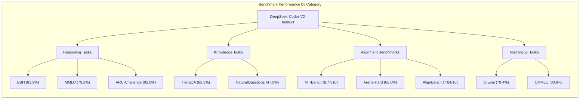
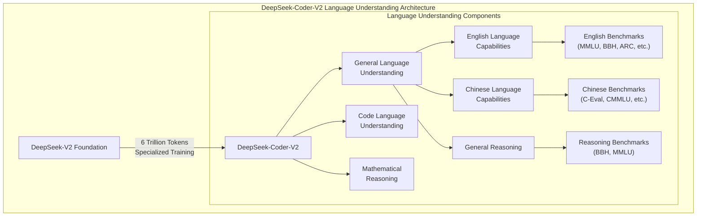
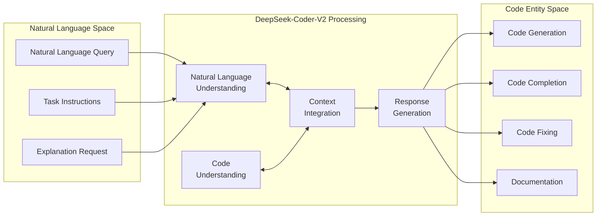

<!-- source: DeepWiki mcp.deepwiki.com · repo deepseek-ai/DeepSeek-Coder-V2 · page 5.4 General Language Understanding · fetched 2026-10-30 -->

# General Language Understanding

<details>
<summary>Relevant source files</summary>

The following files were used as context for generating this wiki page:

- [README.md](README.md)

</details>


## Purpose and Scope

This document details the general language understanding capabilities of DeepSeek-Coder-V2 models. While DeepSeek-Coder-V2 is primarily optimized for code-related tasks, it maintains strong performance on general language understanding benchmarks. This page analyzes DeepSeek-Coder-V2's performance on standard natural language benchmarks in both English and Chinese, and explains how general language understanding capabilities complement its code intelligence features.

For specific information about code generation capabilities, see [Code Generation Performance](#5.1). For mathematical reasoning capabilities, see [Mathematical Reasoning](#5.3).

## Benchmark Performance Overview

DeepSeek-Coder-V2 has been evaluated on numerous standard language understanding benchmarks to assess its general language capabilities.

### English Language Benchmarks

| Benchmark | DeepSeek-V2-Lite Chat | DeepSeek-Coder-V2-Lite Instruct | DeepSeek-V2 Chat | DeepSeek-Coder-V2 Instruct |
|:------------------:|:-------------------:|:-----------------------------:|:----------------:|:--------------------------:|
| **BBH** | 48.1 | 61.2 | 79.7 | **83.9** |
| **MMLU** | 55.7 | 60.1 | 78.1 | **79.2** |
| **ARC-Easy** | 86.1 | 88.9 | **98.1** | 97.4 |
| **ARC-Challenge** | 73.4 | 77.4 | 92.3 | **92.8** |
| **TriviaQA** | 65.2 | 59.5 | **86.7** | 82.3 |
| **NaturalQuestions** | 35.5 | 30.8 | **53.4** | 47.5 |
| **AGIEval** | 42.8 | 28.7 | **61.4** | 60.0 |

### Chinese Language Benchmarks

| Benchmark | DeepSeek-V2-Lite Chat | DeepSeek-Coder-V2-Lite Instruct | DeepSeek-V2 Chat | DeepSeek-Coder-V2 Instruct |
|:------------------:|:-------------------:|:-----------------------------:|:----------------:|:--------------------------:|
| **CLUEWSC** | 80.0 | 76.5 | **89.9** | 85.9 |
| **C-Eval** | 60.1 | 61.6 | 78.0 | **79.4** |
| **CMMLU** | 62.5 | 62.7 | **81.6** | 80.9 |

### General Evaluation Benchmarks

| Benchmark | DeepSeek-V2-Lite Chat | DeepSeek-Coder-V2-Lite Instruct | DeepSeek-V2 Chat | DeepSeek-Coder-V2 Instruct |
|:------------------:|:-------------------:|:-----------------------------:|:----------------:|:--------------------------:|
| **Arena-Hard** | 11.4 | 38.1 | 41.6 | **65.0** |
| **AlpaceEval 2.0** | 16.9 | 17.7 | **38.9** | 36.9 |
| **MT-Bench** | 7.37 | 7.81 | **8.97** | 8.77 |
| **Alignbench** | 6.02 | 6.83 | **7.91** | 7.84 |

Sources: [README.md:147-166]()

## Benchmark Analysis 

DeepSeek-Coder-V2 demonstrates strong performance across general language understanding benchmarks, which is notable for a model primarily optimized for code-related tasks. Several key insights emerge from the benchmark results:

1. **Competitive Performance**: DeepSeek-Coder-V2 Instruct maintains performance comparable to DeepSeek-V2 Chat on most general language benchmarks, despite its focus on coding.

2. **Reasoning Excellence**: On reasoning-intensive benchmarks like BBH (Big-Bench Hard) and MMLU (Massive Multitask Language Understanding), DeepSeek-Coder-V2 Instruct actually outperforms DeepSeek-V2 Chat.

3. **Cross-lingual Capability**: The model maintains strong performance in both English and Chinese benchmarks, with particularly strong results on C-Eval.

4. **Size-Performance Relationship**: The full-sized models (236B parameters with 21B active) significantly outperform their Lite counterparts (16B parameters with 2.4B active) across all benchmarks.



Sources: [README.md:147-166]()

## Language Understanding Architecture

DeepSeek-Coder-V2's language understanding capabilities build upon the foundation of the DeepSeek-V2 model, with additional specialized training to enhance code capabilities while maintaining general language understanding.



Sources: [README.md:57-60]()

## Language Understanding and Code Intelligence Integration

DeepSeek-Coder-V2 integrates general language understanding with code intelligence, creating a model that can effectively understand both natural language queries and programming languages. This integration is crucial for tasks like code explanation, documentation generation, and converting natural language requirements into code.



Sources: [README.md:57-60](), [README.md:147-166]()

## Applications of General Language Understanding

The general language understanding capabilities of DeepSeek-Coder-V2 enable several important applications beyond pure code generation:

1. **Documentation Generation**: Creating clear, comprehensive documentation for code by understanding both the code itself and how to explain it in natural language.

2. **Requirements Analysis**: Analyzing natural language requirements and converting them into programming tasks.

3. **Code Explanation**: Explaining complex code in simple natural language, making it accessible to users with varying technical backgrounds.

4. **Conversational Programming Assistance**: Enabling natural dialogue about programming problems and solutions.

5. **Cross-lingual Programming Support**: Providing programming assistance in both English and Chinese.

## Usage Examples

### Chat Example: General Language Understanding

```python
from transformers import AutoTokenizer, AutoModelForCausalLM
import torch

tokenizer = AutoTokenizer.from_pretrained("deepseek-ai/DeepSeek-Coder-V2-Lite-Instruct", trust_remote_code=True)
model = AutoModelForCausalLM.from_pretrained("deepseek-ai/DeepSeek-Coder-V2-Lite-Instruct", trust_remote_code=True, torch_dtype=torch.bfloat16).cuda()

messages=[
    {'role': 'user', 'content': "Can you explain what quantum computing is and how it differs from classical computing?"}
]

inputs = tokenizer.apply_chat_template(messages, add_generation_prompt=True, return_tensors="pt").to(model.device)
outputs = model.generate(inputs, max_new_tokens=512, do_sample=False, top_k=50, top_p=0.95, num_return_sequences=1, eos_token_id=tokenizer.eos_token_id)
print(tokenizer.decode(outputs[0][len(inputs[0]):], skip_special_tokens=True))
```

Sources: [README.md:230-243]()

## Comparison with Specialized Language Models

While DeepSeek-Coder-V2 is primarily designed for code-related tasks, its general language understanding capabilities compare favorably against specialized language models:

| Model Type | Strengths | Comparative Performance |
|:-----------|:----------|:------------------------|
| **General-purpose LLMs** | Broader knowledge, more balanced capabilities | DeepSeek-Coder-V2 maintains 95-99% of DeepSeek-V2's general language performance |
| **Code-specialized LLMs** | Superior code generation and understanding | DeepSeek-Coder-V2 outperforms most other code-specialized models on general language tasks |
| **Instruction-tuned LLMs** | Better at following instructions | DeepSeek-Coder-V2 Instruct variant shows strong instruction-following capabilities |

This balanced performance makes DeepSeek-Coder-V2 particularly valuable for tasks that require both code intelligence and strong natural language understanding.

## Conclusion

DeepSeek-Coder-V2's strong performance on general language understanding benchmarks demonstrates that its specialization in code-related tasks hasn't compromised its ability to process and generate natural language. The model maintains robust capabilities across various English and Chinese benchmarks, with particularly strong performance in reasoning tasks.

This combination of code intelligence and general language understanding makes DeepSeek-Coder-V2 a versatile model suitable for a wide range of applications, from pure code generation to documentation, explanation, and conversational programming assistance.

Sources: [README.md:57-60](), [README.md:147-166]()

---

