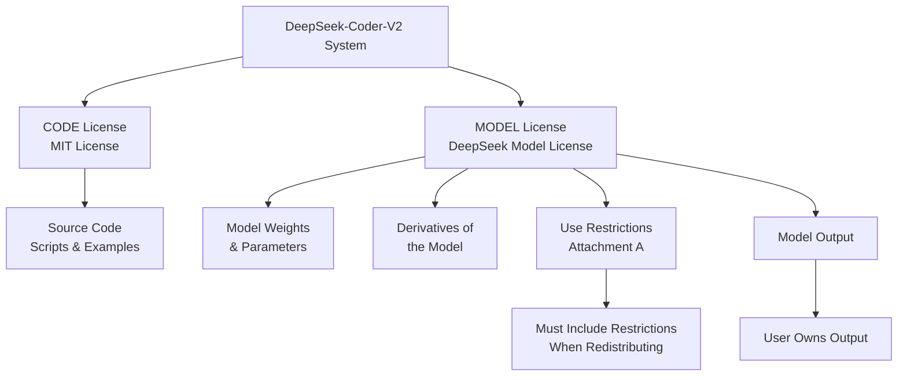
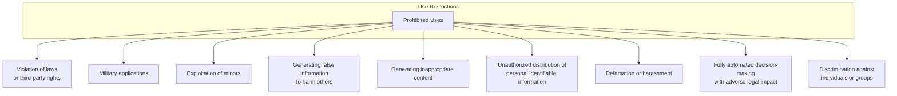
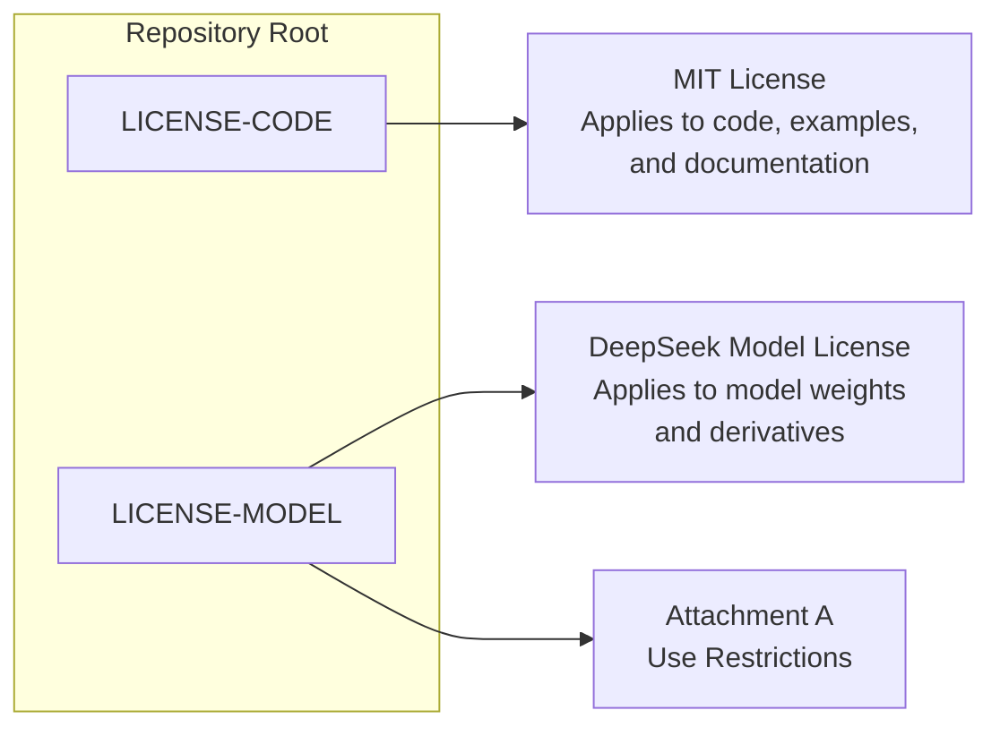

<!-- source: DeepWiki mcp.deepwiki.com · repo deepseek-ai/DeepSeek-Coder-V2 · page 6 Licensing · fetched 2026-10-30 -->

# Licensing

Relevant source files

The following files were used as context for generating this wiki page:

- [LICENSE-CODE](LICENSE-CODE)
- [LICENSE-MODEL](LICENSE-MODEL)
- [README.md](README.md)

This page documents the licensing model used by DeepSeek-Coder-V2, which employs a dual-licensing approach that distinguishes between the repository code and the model weights. Understanding these license terms is essential for both non-commercial and commercial usage of the codebase and models.

For more detailed information about commercial usage considerations, see [Commercial Considerations](#7).

## 1. License Overview

DeepSeek-Coder-V2 uses a dual-licensing approach:

1. **Repository Code**: Licensed under the MIT License
2. **Model Weights**: Licensed under the DeepSeek Model License

This separation allows for flexible use of the codebase while placing specific restrictions on the use of the trained models.

Sources: [README.md:344-345]()

## 2. License Structure

The following diagram illustrates the licensing structure of DeepSeek-Coder-V2:

Sources: [README.md:39-40](), [README.md:344-345]()

## 3. Code License (MIT)

The source code, scripts, examples, and documentation in the DeepSeek-Coder-V2 repository are licensed under the standard MIT License.

### Key Provisions

| Provision | Description |
|-----------|-------------|
| Rights Granted | Permission to use, copy, modify, merge, publish, distribute, sublicense, and/or sell copies of the software |
| Conditions | The above copyright notice and permission notice must be included in all copies or substantial portions of the software |
| Warranty | The software is provided "as is", without warranty of any kind |
| Liability | In no event shall the authors or copyright holders be liable for any claim, damages or other liability |

The complete MIT License text can be found in the [LICENSE-CODE](LICENSE-CODE) file in the repository root.

Sources: [LICENSE-CODE:1-21]()

## 4. Model License (DeepSeek Model License)

The model weights, parameters, and any derivatives of the model are governed by the DeepSeek Model License.

### 4.1 Grant of Rights

The DeepSeek Model License grants:

- A perpetual, worldwide, non-exclusive, no-charge, royalty-free, irrevocable copyright license
- A patent license for patents necessarily infringed by DeepSeek's contribution

### 4.2 Distribution Conditions

When distributing the model or derivatives:

1. Use-based restrictions in Attachment A must be included in any distribution agreement
2. Recipients must receive a copy of the license
3. Modified files must carry notices of changes
4. All copyright, patent, trademark, and attribution notices must be retained

### 4.3 Use Restrictions

The following diagram outlines the key use restrictions specified in Attachment A of the DeepSeek Model License:

### 4.4 Model Output Ownership

The license explicitly states that users own the output they generate using the model. However, uses of the output must not contravene any provisions stated in the license.

The complete DeepSeek Model License text can be found in the [LICENSE-MODEL](LICENSE-MODEL) file in the repository root.

Sources: [LICENSE-MODEL:1-92]()

## 5. Commercial Use

DeepSeek-Coder-V2 series (including both Base and Instruct models) explicitly supports commercial use, subject to the terms and conditions specified in the respective licenses.

Key considerations for commercial users:

1. The code (under MIT License) can be freely used, modified, and integrated into commercial products
2. The model weights can be used commercially as long as the use-based restrictions in the DeepSeek Model License are respected
3. When offering commercial services using the model, you may add additional warranty, indemnity, or support obligations, but these are your sole responsibility

Sources: [README.md:345]()

## 6. License Files

The repository contains two license files:

1. **LICENSE-CODE** - Contains the full MIT License text
2. **LICENSE-MODEL** - Contains the full DeepSeek Model License text with Attachment A

These files should be preserved and included when distributing copies of the code or model.

Sources: [README.md:33-38](), [LICENSE-CODE:1-21](), [LICENSE-MODEL:1-92]()

---

