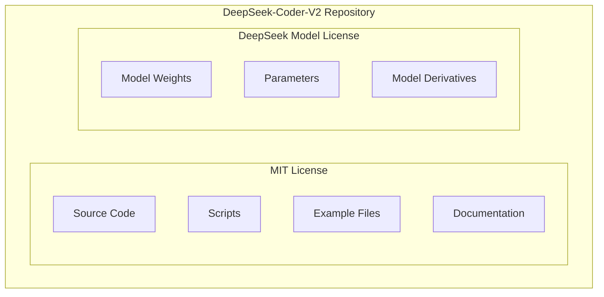
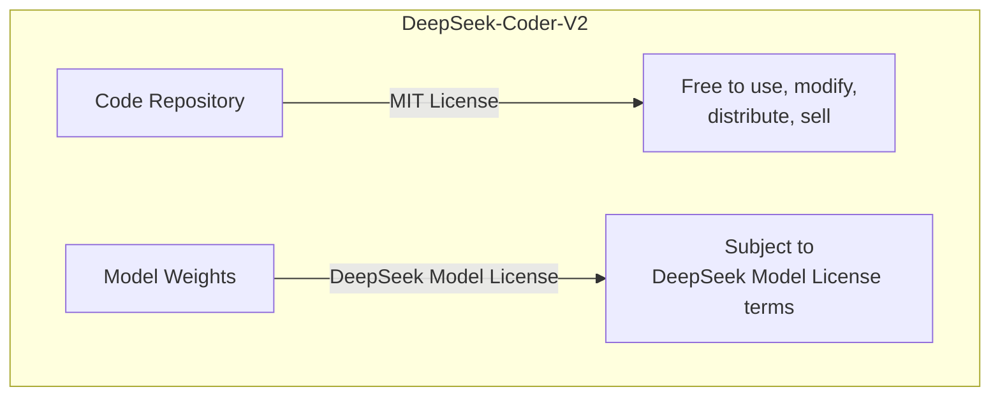

<!-- source: DeepWiki mcp.deepwiki.com · repo deepseek-ai/DeepSeek-Coder-V2 · page 6.1 Code License (MIT) · fetched 2026-10-30 -->

# Code License (MIT)

<details>
<summary>Relevant source files</summary>

The following files were used as context for generating this wiki page:

- [LICENSE-CODE](LICENSE-CODE)
- [README.md](README.md)

</details>


This page describes the MIT License that applies to the source code in the DeepSeek-Coder-V2 repository. For information about the license terms governing the use of the DeepSeek-Coder-V2 model weights and parameters, see [Model License](#6.2).

## Overview

The DeepSeek-Coder-V2 project employs a dual licensing approach:
1. **Code components** (scripts, examples, utility functions, documentation files) are licensed under the MIT License
2. **Model components** (model weights, parameters, and derivatives) are licensed under the DeepSeek Model License

This document focuses specifically on the MIT License covering the code components.

## License Scope

The MIT License applies to all source code and documentation files in the DeepSeek-Coder-V2 repository, but not to the model weights and parameters.



Sources: [README.md:343-346](), [LICENSE-CODE:1-22]()

## MIT License Terms

The MIT License is one of the most permissive open source licenses. The full license text can be found in the `LICENSE-CODE` file in the repository root.

### Key Provisions

```mermaid
flowchart LR
    MIT["MIT License"]
    
    subgraph "Rights Granted"
        Use["Use"]
        Copy["Copy"]
        Modify["Modify"]
        Merge["Merge"]
        Publish["Publish"]
        Distribute["Distribute"]
        Sublicense["Sublicense"]
        Sell["Sell"]
    end
    
    subgraph "Conditions"
        Notice["Include Copyright Notice"]
    end
    
    subgraph "Disclaimer"
        Warranty["No Warranty"]
        Liability["No Liability"]
    end
    
    MIT --> "Rights Granted"
    MIT --> "Conditions"
    MIT --> "Disclaimer"
```

Sources: [LICENSE-CODE:5-21]()

### Rights Granted

The MIT License grants the following rights to any person obtaining a copy of the software:

- **Use**: Use the software for any purpose
- **Copy**: Make copies of the software
- **Modify**: Modify the software to suit your needs
- **Merge**: Merge the software into other programs
- **Publish**: Publish your own versions of the software
- **Distribute**: Distribute copies to others
- **Sublicense**: Grant licenses to others
- **Sell**: Sell copies of the software

Sources: [LICENSE-CODE:5-9]()

### Conditions

The only condition required by the MIT License is:

- Include the original copyright notice and permission notice in all copies or substantial portions of the software

This means you must retain the copyright statement and the MIT License text in any code you distribute that includes or is derived from the DeepSeek-Coder-V2 codebase.

Sources: [LICENSE-CODE:12-13]()

### Disclaimer of Warranty and Liability

The MIT License explicitly states:

- The software is provided "as is" without warranty of any kind
- The authors or copyright holders are not liable for any claims, damages, or liabilities arising from the use of the software

Sources: [LICENSE-CODE:15-21]()

## Practical Implications

| What You Can Do | What You Must Do |
|----------------|------------------|
| Use the code in commercial projects | Include the original MIT License text |
| Modify the code | Include the copyright notice |
| Integrate the code with other software | |
| Distribute modified versions | |
| Sell products that include the code | |

Sources: [LICENSE-CODE:1-22]()

## Relationship to Model License

It's important to understand the distinction between the code license and model license:



The MIT License applies only to the code components of the repository. If you plan to use the DeepSeek-Coder-V2 models themselves (the pre-trained weights and parameters), your use is governed by the separate DeepSeek Model License, which has different terms and conditions.

Sources: [README.md:343-346]()

## Copyright Holder

The copyright for the DeepSeek-Coder-V2 code is held by DeepSeek (Copyright (c) 2023 DeepSeek).

Sources: [LICENSE-CODE:3]()

## Summary

The MIT License governing the code in the DeepSeek-Coder-V2 repository is highly permissive, allowing you to use, modify, and distribute the code with minimal restrictions. This gives developers significant freedom to build upon and integrate the code into their own projects, including commercial ones. However, remember that the model weights themselves are subject to a different license with its own terms and conditions.

Sources: [README.md:343-346](), [LICENSE-CODE:1-22]()

---

