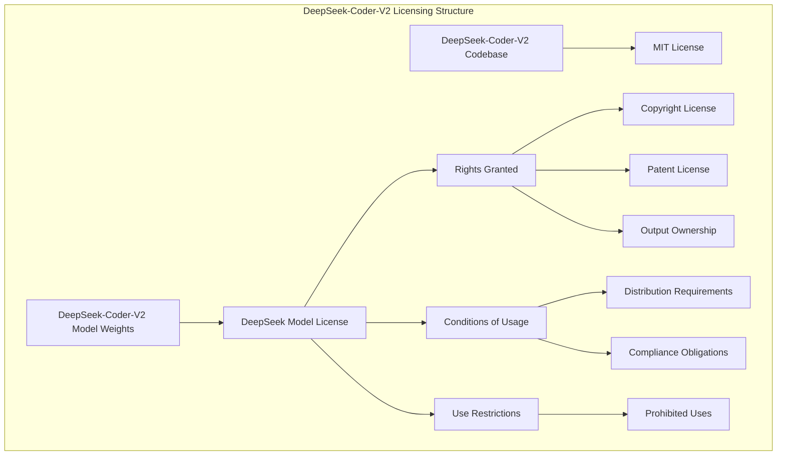
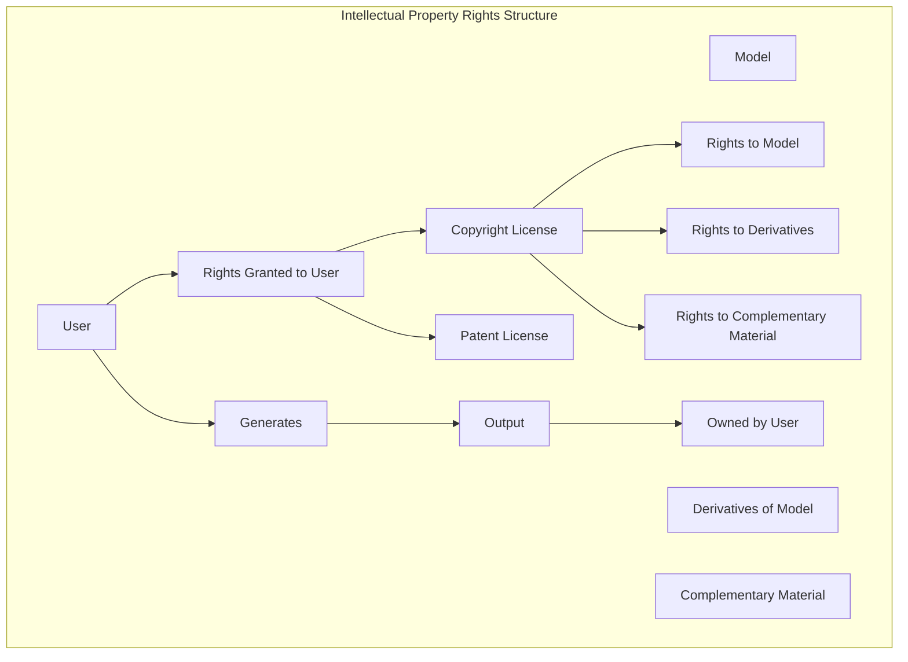
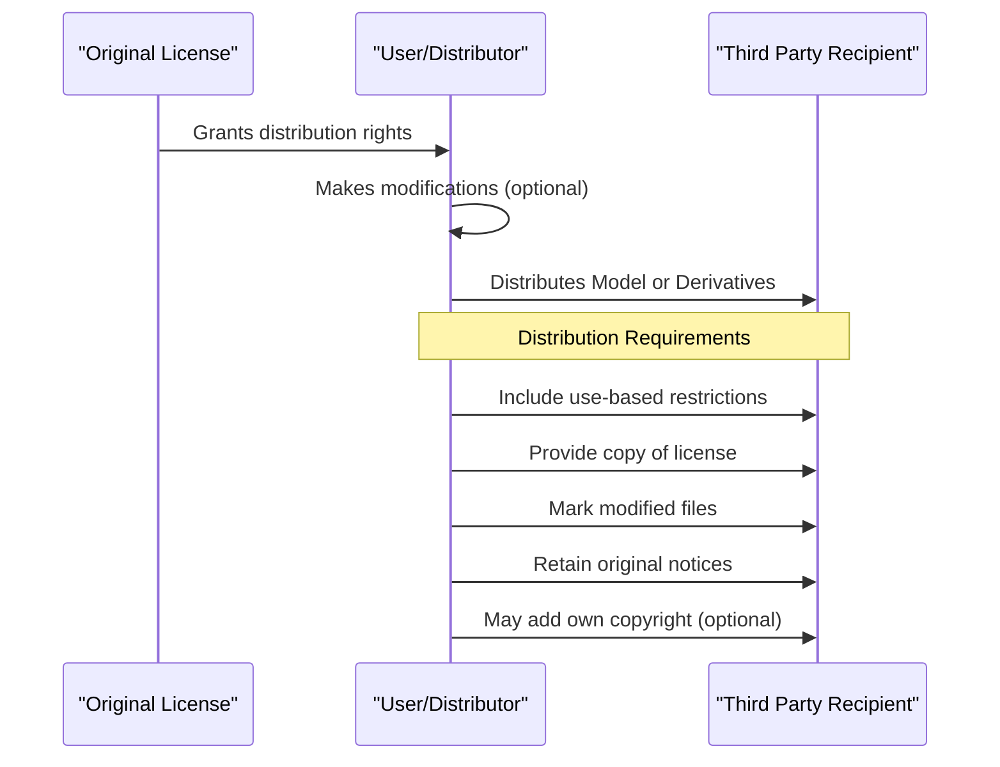
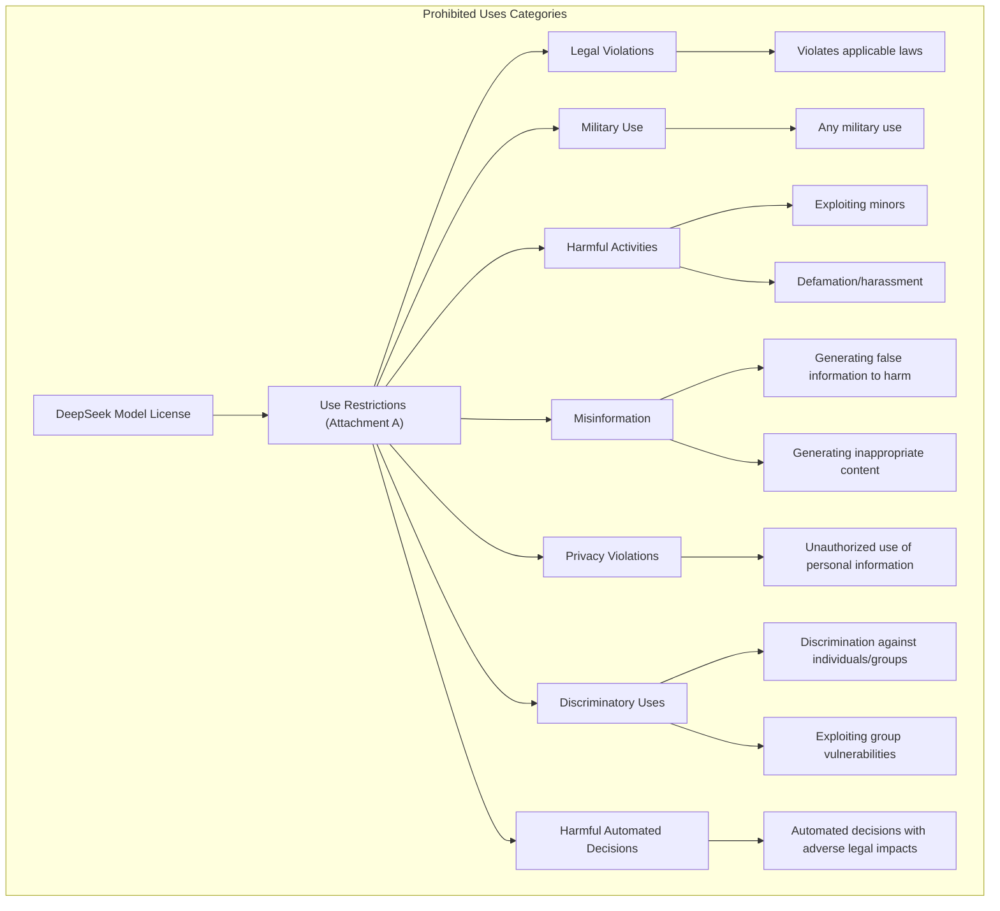
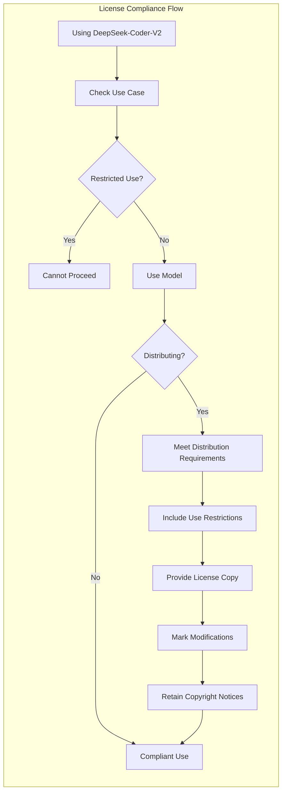

<!-- source: DeepWiki mcp.deepwiki.com · repo deepseek-ai/DeepSeek-Coder-V2 · page 6.2 Model License · fetched 2026-10-30 -->

# Model License

Relevant source files

The following files were used as context for generating this wiki page:

- [LICENSE-MODEL](LICENSE-MODEL)
- [README.md](README.md)

## Purpose and Scope

This document provides a technical overview of the DeepSeek Model License that governs the use of DeepSeek-Coder-V2 models. It covers the rights granted, usage restrictions, and compliance requirements. For information about the MIT license that covers the code in this repository, see [Code License (MIT)](#6.1).

Sources: [README.md:343-345](), [LICENSE-MODEL:1-6]()

## License Overview

The DeepSeek Model License (Version 1.0, dated October 23, 2023) is designed to balance open access with responsible use. It allows commercial use of the DeepSeek-Coder-V2 models while imposing specific use restrictions to prevent potential misuse.

Title: DeepSeek-Coder-V2 Licensing Structure

Sources: [README.md:343-345](), [LICENSE-MODEL:7-15]()

## License Components and Definitions

The license contains several key definitions that clarify its scope and application:

| Term | Definition |
|------|------------|
| Model | Machine-learning based assemblies (including checkpoints) with learned weights and parameters |
| Derivatives of the Model | Modifications, works based on the Model, or models created by transferring patterns from the Model |
| Complementary Material | Accompanying source code, scripts, documentation used to define, run, or evaluate the Model |
| Output | Results of operating the Model as embodied in informational content |
| Distribution | Transmission, reproduction, publication or sharing of the Model with third parties |

Sources: [LICENSE-MODEL:21-32]()

## Rights Granted

### Copyright License

The license grants users a "perpetual, worldwide, non-exclusive, no-charge, royalty-free, irrevocable copyright license" to reproduce, prepare, display, perform, sublicense, and distribute the Complementary Material, the Model, and Derivatives of the Model.

### Patent License

Where applicable, the license grants a patent license for patents that are necessarily infringed by the Model or Complementary Material. This patent license terminates if the user initiates patent litigation against any entity alleging infringement by the Model.

### Output Ownership

A significant aspect of the license is that DeepSeek claims no rights to the output generated by users with the Model. Users retain ownership of and accountability for the output they generate.

Title: Intellectual Property Rights Structure Under DeepSeek License

Sources: [LICENSE-MODEL:33-41](), [LICENSE-MODEL:53-54]()

## Distribution Requirements

When distributing the Model or Derivatives of the Model, users must:

1. Include the use-based restrictions as an enforceable provision in any legal agreement
2. Give recipients a copy of the DeepSeek License
3. Include notices of any modifications made
4. Retain all copyright, patent, trademark, and attribution notices
5. May add their own copyright statement to modifications, provided use otherwise complies with the license

Title: Distribution Process and Requirements

Sources: [LICENSE-MODEL:42-51]()

## Use Restrictions

Attachment A of the license defines specific prohibited uses. These restrictions are a critical component of the license and must be included in any redistribution agreement.

Title: Categories of Prohibited Uses Under DeepSeek License

Sources: [LICENSE-MODEL:75-91]()

## Legal Provisions

The license includes standard legal provisions:

1. **Disclaimer of Warranty**: The Model and Complementary Material are provided "AS IS" without warranties
2. **Limitation of Liability**: DeepSeek is not liable for damages arising from use of the Model
3. **Governing Law**: The agreement is governed by PRC laws, with exclusive jurisdiction in the domicile of Hangzhou DeepSeek Artificial Intelligence Fundamental Technology Research Co., Ltd.

Sources: [LICENSE-MODEL:56-73]()

## Compliance Requirements

To use DeepSeek-Coder-V2 models in compliance with the license:

1. Ensure your use case does not violate any of the restrictions in Attachment A
2. When distributing the Model or Derivatives:
   - Include the use restrictions in your legal agreements
   - Provide the DeepSeek License to recipients
   - Mark any modifications
   - Retain notices
3. Be aware that you are responsible for the output generated using the Model

Title: License Compliance Process

Sources: [LICENSE-MODEL:42-51](), [LICENSE-MODEL:75-91]()

## Commercial Use

The DeepSeek-Coder-V2 models support commercial use under the terms of the license. Users can charge fees for services built on the models and may offer warranties or additional liability terms, but only on their own behalf and responsibility, not on behalf of DeepSeek.

Sources: [README.md:345](), [LICENSE-MODEL:67-68]()

## Comparison with Other Licenses

The DeepSeek License differs from the MIT License (which covers the code) in several key ways:

| Aspect | DeepSeek Model License | MIT License |
|--------|------------------------|-------------|
| Scope | Covers model weights and derivatives | Covers code only |
| Use Restrictions | Contains specific use-based restrictions | Permits any use without restriction |
| Commercial Use | Allowed with restrictions | Unrestricted |
| Redistribution | Must include use restrictions | Minimal requirements |
| Output Ownership | Explicitly granted to users | Not specified |
| Liability | Extensive disclaimer | Basic disclaimer |
| Governing Law | PRC laws | Not specified |

Sources: [README.md:343-345](), [LICENSE-MODEL:1-91]()

---

