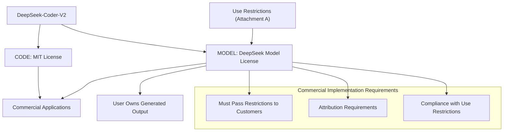
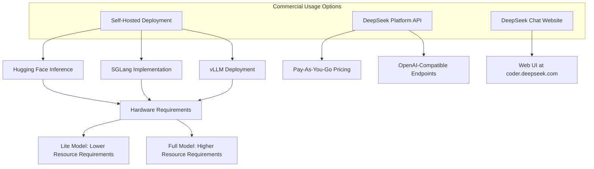
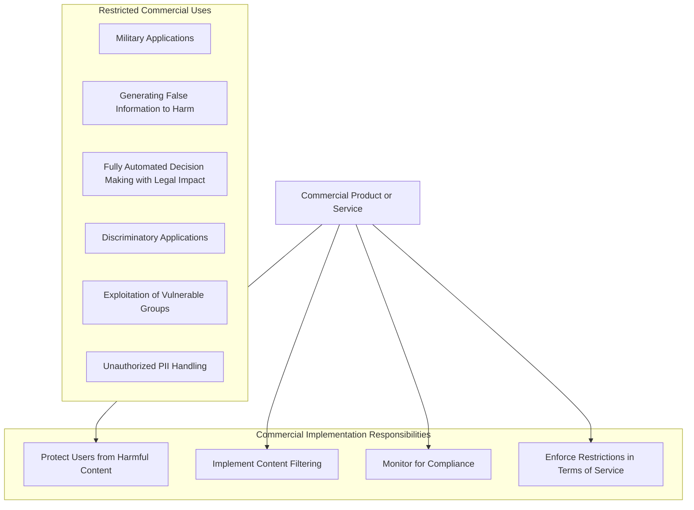
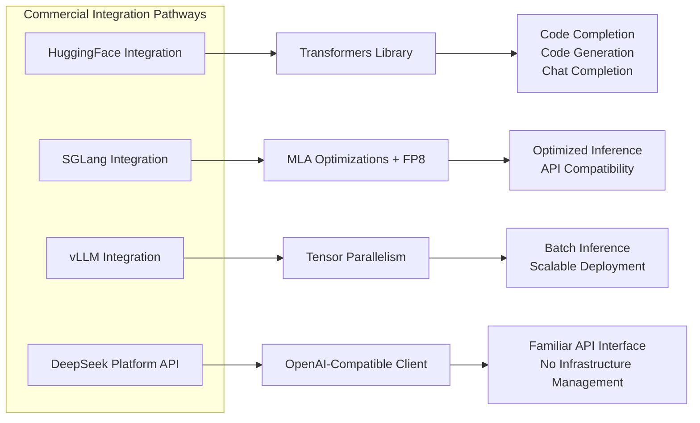

<!-- source: DeepWiki mcp.deepwiki.com · repo deepseek-ai/DeepSeek-Coder-V2 · page 7 Commercial Considerations · fetched 2026-10-30 -->

# Commercial Considerations

<details>
<summary>Relevant source files</summary>

The following files were used as context for generating this wiki page:

- [LICENSE-MODEL](LICENSE-MODEL)
- [README.md](README.md)
- [figures/model_price.jpg](figures/model_price.jpg)

</details>


## Purpose and Scope

This document outlines the commercial aspects of DeepSeek-Coder-V2, including licensing implications for business use, pricing information, deployment options, and usage restrictions that may impact commercial applications. For detailed information about the specific license terms, please refer to the [Licensing](#6) page and its subpages on the [Code License (MIT)](#6.1) and [Model License](#6.2).

Sources: [README.md:344-345]()

## License Overview for Commercial Use

DeepSeek-Coder-V2 employs a dual licensing approach that explicitly supports commercial use. Understanding this structure is essential for businesses planning to integrate the model into their products or services.



The key points of the licensing structure for commercial use include:

1. **Explicit Commercial Permission**: DeepSeek-Coder-V2 series (including Base and Instruct variants) supports commercial use.
2. **Dual Licensing**: 
   - Code components are under the MIT License
   - Model weights and parameters are under the DeepSeek Model License
3. **Output Ownership**: Businesses retain ownership of the content generated by the model
4. **Restriction Propagation**: When redistributing the model, businesses must include the same use-based restrictions

Sources: [README.md:343-345](), [LICENSE-MODEL:1-92]()

## Commercial Usage Options

There are multiple ways to utilize DeepSeek-Coder-V2 in commercial settings, each with different considerations for pricing, resources, and implementation effort.



### DeepSeek Platform API Pricing

The DeepSeek Platform provides an OpenAI-compatible API with pay-as-you-go pricing. The pricing structure is designed to be cost-effective compared to similar models in the market.

| Model | Context Length | Input Price (per 1M tokens) | Output Price (per 1M tokens) |
|-------|---------------|---------------------------|----------------------------|
| DeepSeek-Coder-V2-Instruct | 128K | $0.20 | $0.60 |
| DeepSeek-Coder-V2-Lite-Instruct | 128K | $0.05 | $0.15 |

Sources: [README.md:180-185]()

### Self-Hosted Deployment Requirements

For businesses considering self-hosted deployments, hardware requirements vary by model size:

| Model | Parameters | Active Parameters | Minimum Hardware Requirements |
|-------|-----------|-------------------|------------------------------|
| DeepSeek-Coder-V2-Lite-Base/Instruct | 16B | 2.4B | Single GPU with sufficient VRAM |
| DeepSeek-Coder-V2-Base/Instruct | 236B | 21B | 80GB * 8 GPUs (for BF16 inference) |

Sources: [README.md:189]()

## Use Restrictions for Commercial Applications

When implementing DeepSeek-Coder-V2 in commercial applications, it's crucial to adhere to the use restrictions specified in the DeepSeek Model License. These restrictions define boundaries for permissible commercial applications.



Key restrictions that impact commercial use include:

1. Prohibition against fully automated decision-making that affects legal rights
2. Restrictions on discriminatory applications
3. Prohibition against military applications
4. Restrictions on generating false or harmful information
5. Restrictions on unauthorized handling of personal identifiable information

Commercial implementers must enforce these restrictions through their terms of service and technical safeguards.

Sources: [LICENSE-MODEL:79-91]()

## Integration Pathways for Commercial Applications

There are several integration options for incorporating DeepSeek-Coder-V2 into commercial products and services.



### API Integration

For businesses seeking the simplest integration path, the DeepSeek Platform API provides an OpenAI-compatible interface that can be integrated with minimal code changes.

```python
# Example of API integration
import openai
client = openai.Client(
    base_url="https://platform.deepseek.com/v1", 
    api_key="YOUR_API_KEY")

response = client.chat.completions.create(
    model="deepseek-coder-v2-instruct",
    messages=[
        {"role": "system", "content": "You are a helpful AI assistant"},
        {"role": "user", "content": "Write a Python function to calculate Fibonacci numbers."},
    ],
    temperature=0,
    max_tokens=512,
)
```

### Self-Hosted Integration

For businesses with specific performance or privacy requirements, self-hosted deployments using Hugging Face Transformers, SGLang, or vLLM provide greater control.

Sources: [README.md:191-341]()

## Commercial Optimization Considerations

When deploying DeepSeek-Coder-V2 in production environments, several optimization techniques can improve performance and reduce costs.

| Optimization Technique | Compatible With | Benefits | Implementation Complexity |
|------------------------|-----------------|----------|---------------------------|
| FP8 Quantization | SGLang | Reduced memory usage, faster inference | Medium |
| Tensor Parallelism | vLLM | Distributed computation across GPUs | Medium |
| FP8 KV Cache | SGLang | Reduced memory footprint for context | Medium |
| Torch Compile | SGLang | Improved throughput | Low |
| Batch Inference | vLLM | Higher throughput for multiple requests | Medium |

Sources: [README.md:279-291](), [README.md:314-339]()

## Comparison with Other Commercial LLM Solutions

When evaluating DeepSeek-Coder-V2 for commercial use, it's helpful to compare its capabilities with other code-focused LLMs.

| Feature | DeepSeek-Coder-V2 | Other Open LLMs | Closed Commercial LLMs |
|---------|-------------------|-----------------|------------------------|
| License | Commercial use permitted | Varies (some restrict) | Usually proprietary |
| Programming Languages | 338 supported | Typically fewer | Varies |
| Context Length | 128K tokens | Typically 8K-32K | Varies (8K-128K) |
| Performance | Competitive with closed models | Generally lower | Benchmark leaders |
| Deployment Options | Self-hosted or API | Usually self-hosted only | Usually API only |
| Pricing Model | Pay-as-you-go API or self-host | Usually self-host costs only | Usually pay-as-you-go |

Sources: [README.md:58-66](), [README.md:180-185]()

---

