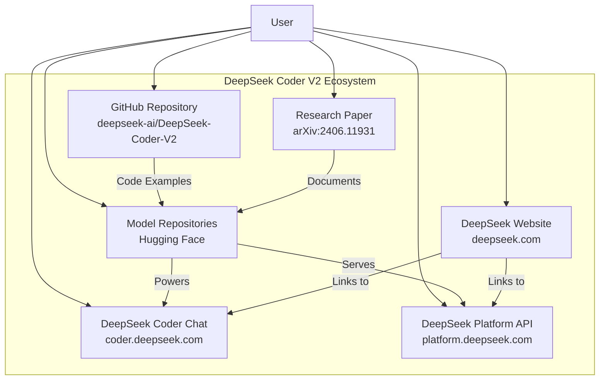
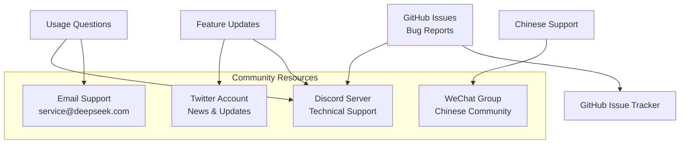
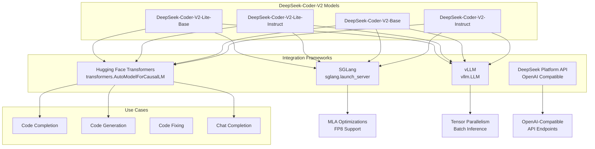

<!-- source: DeepWiki mcp.deepwiki.com · repo deepseek-ai/DeepSeek-Coder-V2 · page 8 Additional Resources · fetched 2026-10-30 -->

# Additional Resources

<details>
<summary>Relevant source files</summary>

The following files were used as context for generating this wiki page:

- [README.md](README.md)
- [figures/badge.svg](figures/badge.svg)
- [paper.pdf](paper.pdf)

</details>


## Purpose of This Document

This document provides a comprehensive collection of additional resources for the DeepSeek-Coder-V2 model ecosystem. It compiles official documentation, community channels, academic materials, and integration tools to help users effectively utilize, understand, and get support for DeepSeek-Coder-V2. For specific usage instructions, refer to [Usage & Inference](#4), and for licensing details, see [Licensing](#6).

Sources: [README.md:1-47]()

## Official Resources

The following table lists the official DeepSeek-Coder-V2 resources:

| Resource | Description | URL |
|----------|-------------|-----|
| DeepSeek Website | Company homepage with model information | https://www.deepseek.com/ |
| DeepSeek Coder Chat | Interactive chat interface for DeepSeek-Coder-V2 | https://coder.deepseek.com |
| DeepSeek Platform API | OpenAI-compatible API service | https://platform.deepseek.com/ |
| Hugging Face Models | Official model repositories | https://huggingface.co/deepseek-ai |
| GitHub Repository | Source code and documentation | https://github.com/deepseek-ai/DeepSeek-Coder-V2 |
| Research Paper | Technical details and evaluation results | https://arxiv.org/pdf/2406.11931 |

Sources: [README.md:10-18](), [README.md:176-186](), [README.md:50-53]()

### Resource Ecosystem Diagram



Sources: [README.md:10-18](), [README.md:50-53](), [README.md:176-178]()

## Community Resources

DeepSeek-Coder-V2 has several community channels for support, discussions, and announcements:

| Channel | Purpose | Access |
|---------|---------|--------|
| Discord Server | Community discussion, support, announcements | https://discord.gg/Tc7c45Zzu5 |
| Twitter | News and updates | https://twitter.com/deepseek_ai |
| WeChat Group | Chinese community discussion | QR code in repository |
| Email Support | Technical assistance and inquiries | service@deepseek.com |

Sources: [README.md:21-30](), [README.md:358-359]()

### Community Interaction Flow



Sources: [README.md:21-30](), [README.md:358-359]()

## Academic Resources

### Research Paper

The DeepSeek-Coder-V2 model is documented in a research paper titled "DeepSeek-Coder-V2: Breaking the Barrier of Closed-Source Models in Code Intelligence" (2024). The paper provides detailed information on the model architecture, training methodology, and evaluation results.

Paper URL: https://arxiv.org/pdf/2406.11931

### Citation

If you use DeepSeek-Coder-V2 in your research, please cite:

```
@article{zhu2024deepseek,
  title={DeepSeek-Coder-V2: Breaking the Barrier of Closed-Source Models in Code Intelligence},
  author={Zhu, Qihao and Guo, Daya and Shao, Zhihong and Yang, Dejian and Wang, Peiyi and Xu, Runxin and Wu, Y and Li, Yukun and Gao, Huazuo and Ma, Shirong and others},
  journal={arXiv preprint arXiv:2406.11931},
  year={2024}
}
```

Sources: [README.md:50-53](), [README.md:347-355]()

## Integration Resources

DeepSeek-Coder-V2 can be integrated with several frameworks and tools for inference and deployment:

### Framework Integration Diagram



Sources: [README.md:188-339]()

### Integration Options

| Framework | Features | Example Location |
|-----------|----------|------------------|
| Hugging Face Transformers | Basic inference, code completion, chat | [README.md:191-275]() |
| SGLang | MLA optimizations, FP8 support, FP8 KV cache, OpenAI API compatibility | [README.md:279-311]() |
| vLLM | Tensor parallelism, batch inference | [README.md:314-339]() |
| DeepSeek Platform API | OpenAI-compatible API, pay-as-you-go pricing | [README.md:180-186]() |

Sources: [README.md:191-339](), [README.md:180-186]()

## Performance Benchmarks

For detailed benchmark results, refer to the [Performance Benchmarks](#5) section of the wiki. Key highlights available in the paper include:

- Code generation performance on HumanEval, MBPP+, LiveCodeBench, and USACO
- Code completion benchmarks on RepoBench and HumanEval FIM
- Code fixing benchmarks on Defects4J, SWE-Bench, and Aider
- Mathematical reasoning performance on GSM8K, MATH, and AIME
- General language understanding on various benchmarks

Sources: [README.md:85-172]()

## Supported Programming Languages

The DeepSeek-Coder-V2 model supports 338 programming languages. For the complete list, refer to the [Supported Programming Languages](#3) section of the wiki or the `supported_langs.txt` file in the repository.

Sources: [README.md:66]()

## Contact Information

For questions, issues, or technical support:

- Raise an issue on GitHub: https://github.com/deepseek-ai/DeepSeek-Coder-V2/issues
- Email: service@deepseek.com

Sources: [README.md:358-359]()

## License Information

Detailed license information can be found in the [Licensing](#6) section of the wiki. Quick reference:

- Code License: MIT License ([LICENSE-CODE](https://github.com/deepseek-ai/DeepSeek-V2/blob/main/LICENSE-CODE))
- Model License: DeepSeek Model License ([LICENSE-MODEL](https://github.com/deepseek-ai/DeepSeek-V2/blob/main/LICENSE-MODEL))
- Commercial use is permitted under the terms of the licenses

Sources: [README.md:33-38](), [README.md:343-345]()