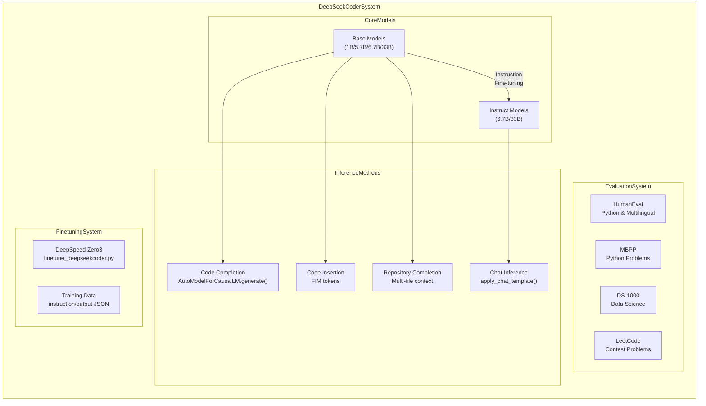
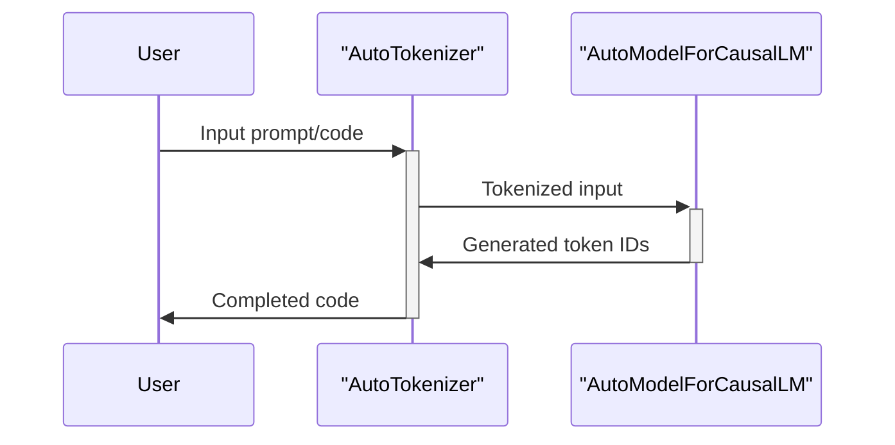
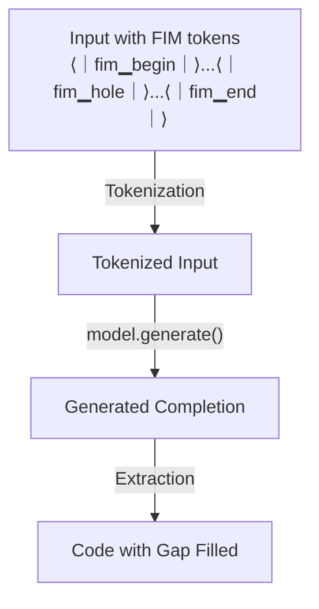
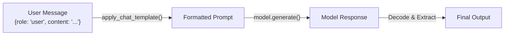
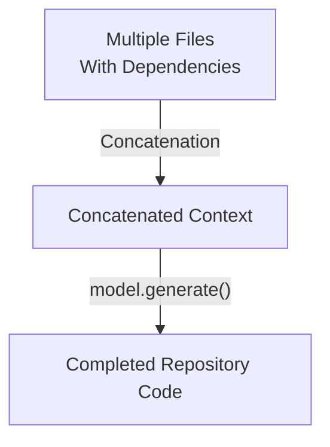
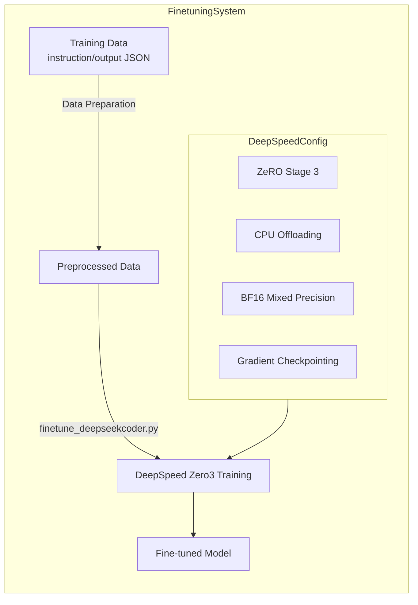
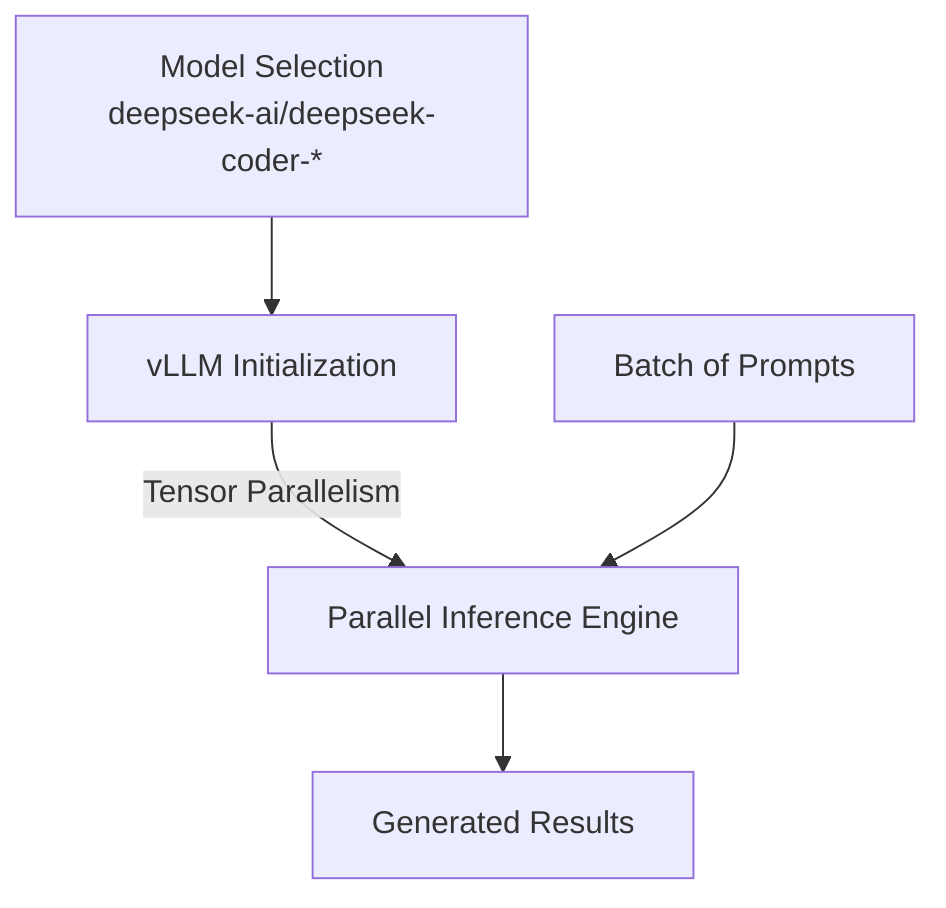

<!-- source: DeepWiki mcp.deepwiki.com · repo deepseek-ai/DeepSeek-Coder · page 1 Overview · fetched 2026-10-30 -->

# Overview

<details>
<summary>Relevant source files</summary>

The following files were used as context for generating this wiki page:

- [README.md](README.md)

</details>


This document provides a technical introduction to DeepSeek Coder, a system of code language models designed for advanced code generation, comprehension, and manipulation tasks. DeepSeek Coder includes models ranging from 1B to 33B parameters, supports multiple inference methods, and offers state-of-the-art performance on code generation benchmarks.

For detailed information about specific model architectures, see [Architecture](#2.1). For usage instructions and inference methods, see [Usage and Inference Methods](#3).

## System Description

DeepSeek Coder consists of a family of transformer-based language models specialized for code, trained from scratch on 2 trillion tokens. The training data comprises 87% code and 13% natural language content in both English and Chinese. The models support over 80 programming languages and are designed for tasks ranging from basic code completion to complex cross-file code generation.

The system offers both base models and instruction-tuned variants:
- **Base Models**: Optimized for code completion, infilling, and project-level understanding
- **Instruct Models**: Fine-tuned specifically for interactive code generation through chat interfaces

The models are available in multiple parameter sizes to accommodate different resource constraints and performance requirements:

| Model Size | Variants             | Context Window | Primary Use Cases                         |
|------------|----------------------|----------------|------------------------------------------|
| 1B         | Base                 | 16K tokens     | Lightweight code completion               |
| 5.7B       | Base                 | 16K tokens     | Medium-scale code generation              |
| 6.7B       | Base, Instruct       | 16K tokens     | Versatile code generation and instruction |
| 33B        | Base, Instruct       | 16K tokens     | High-performance code generation          |

Sources: [README.md:11-27]()

## Architecture Overview

DeepSeek Coder follows a modular system architecture that enables flexibility in deployment and usage:



Sources: [README.md:11-27](), [README.md:66-166](), [README.md:273-316]()

## Model Training Workflow

DeepSeek Coder models are trained through a multi-stage process to achieve optimal performance for code-related tasks:

```mermaid
flowchart LR
    subgraph "DataCreation"
        direction TB
        GithubData["GitHub Code<br>Repositories"] -->|"Filtering & Cleaning"| FilteredData["Filtered Code Data"]
        FilteredData -->|"Dependency Parsing"| DependencySorted["Dependency-Sorted Files"]
        DependencySorted -->|"Concatenation &<br>Deduplication"| ProcessedData["Processed Training Data"]
    end
    
    subgraph "TrainingPipeline"
        direction TB
        PretrainingStep1["Initial Pretraining<br>1.8T tokens, 4K window"] -->|"87% code<br>13% text"| BaseModels["Base Models<br>4K context"]
        BaseModels -->|"Extended Pretraining<br>200B tokens, 16K window"| ExtendedModels["Extended Base Models<br>16K context"]
        ExtendedModels -->|"Instruction Finetuning<br>2B tokens"| InstructModels["Instruct Models"]
    end
    
    ProcessedData -->|"Training Data"| PretrainingStep1
```



Sources: [README.md:46-63]()

## Inference Methods

DeepSeek Coder supports several inference methods to accommodate different use cases:

### 1. Code Completion

The base models excel at completing code from comments or partial implementations, generating coherent and contextually appropriate code continuations.



Sources: [README.md:74-100]()

### 2. Code Insertion (Fill-in-the-Middle)

The models support filling gaps in existing code using special FIM tokens to mark the beginning, hole, and end of the context.



Sources: [README.md:102-127]()

### 3. Chat Model Inference

The instruction-tuned models are designed for interactive code generation through a chat interface, using a specific template format.



Sources: [README.md:129-175]()

### 4. Repository-Level Completion

DeepSeek Coder can understand and complete code across multiple files in a repository, leveraging its 16K context window to maintain coherence between related files.



Sources: [README.md:177-272]()

## Evaluation Framework

DeepSeek Coder includes a comprehensive evaluation system to measure performance across standard coding benchmarks:

| Benchmark | Description | Focus Area | Metrics |
|-----------|-------------|------------|---------|
| HumanEval | 164 hand-written programming problems | Algorithm implementation | pass@k |
| MultiPL-E | HumanEval translated to multiple languages | Cross-language capabilities | pass@k |
| MBPP | 974 Python programming problems | Basic Python scripting | pass@k |
| DS-1000 | Data science-specific problems | Data manipulation libraries | pass@k |
| LeetCode | Competitive programming problems | Algorithm efficiency | pass@k |

Sources: [README.md:30-43](), [README.md:319-332]()

## Fine-tuning Capabilities

DeepSeek Coder provides a fine-tuning system built on DeepSpeed for efficient adaptation to specific domains or tasks:



Sources: [README.md:273-316]()

## Inference Deployment Options

DeepSeek Coder models can be deployed for inference using various methods depending on performance and resource requirements:

### Standard Inference with Hugging Face

```python
from transformers import AutoTokenizer, AutoModelForCausalLM
import torch

tokenizer = AutoTokenizer.from_pretrained("deepseek-ai/deepseek-coder-6.7b-base", trust_remote_code=True)
model = AutoModelForCausalLM.from_pretrained("deepseek-ai/deepseek-coder-6.7b-base", trust_remote_code=True, torch_dtype=torch.bfloat16).cuda()
```

### High-throughput Inference with vLLM

For scenarios requiring higher throughput, vLLM provides optimized inference capabilities:



Sources: [README.md:333-382]()

## Supported Programming Languages

DeepSeek Coder supports a wide range of programming languages (over 80), including but not limited to:

- Python, JavaScript, TypeScript, Java, C, C++, C#, Go
- Ruby, Rust, PHP, Scala, Swift, Kotlin
- HTML, CSS, SQL, Shell scripting
- Domain-specific languages like GLSL, Verilog, and more

For the complete list of supported languages, refer to the [Model details](#2).

Sources: [README.md:27-28]()

---

