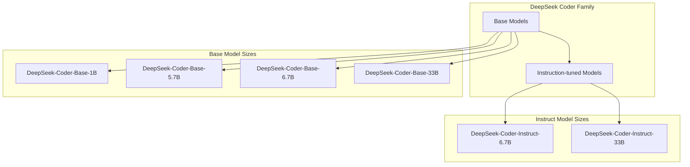
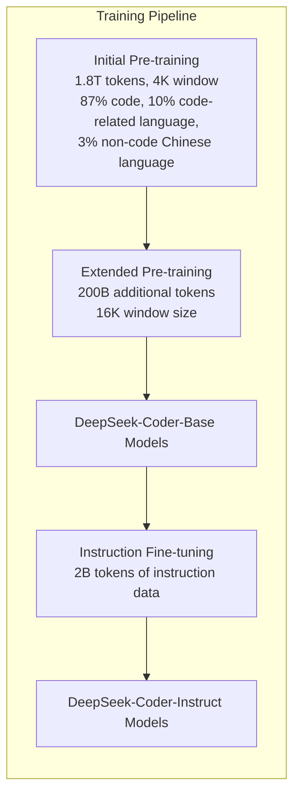
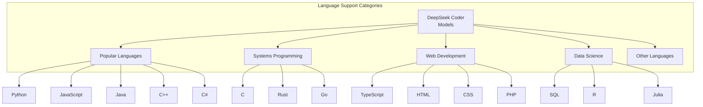
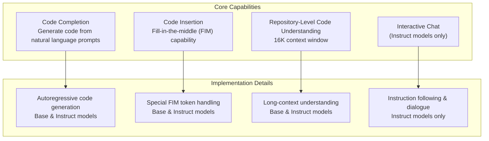
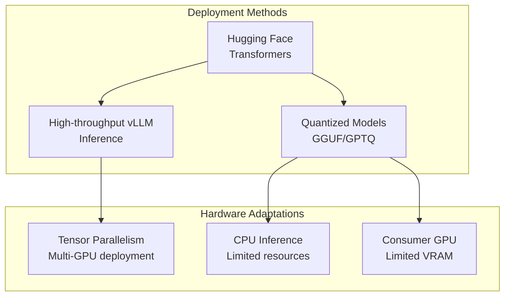

<!-- source: DeepWiki mcp.deepwiki.com · repo deepseek-ai/DeepSeek-Coder · page 2 Models · fetched 2026-10-30 -->

# Models

Relevant source files

The following files were used as context for generating this wiki page:

- [README.md](README.md)

This page provides an overview of the DeepSeek Coder model family, including different model sizes, variants, and their general characteristics. For detailed information about the model architecture, refer to [Architecture](#2.1). For comprehensive benchmark results and performance metrics, see [Performance and Benchmarks](#2.2).

## Model Family Overview

DeepSeek Coder consists of a series of transformer-based language models specifically trained for code understanding and generation. All models were trained from scratch on a massive corpus of 2 trillion tokens, with a composition of 87% code and 13% natural language (both English and Chinese).

The model family includes:

1. **Base Models** - Foundation models trained on code and related texts
2. **Instruction-tuned Models** - Enhanced versions fine-tuned on instruction data for interactive coding assistance

Sources: [README.md:11-26](). [README.md:57-62]()

## Model Size Comparison

The DeepSeek Coder family comes in various parameter sizes to suit different deployment requirements, from more efficient smaller models to higher-capability larger models.

| Model | Parameters | Context Window | Variants Available |
|-------|------------|----------------|-------------------|
| DeepSeek-Coder-1B | 1 billion | 16K tokens | Base |
| DeepSeek-Coder-5.7B | 5.7 billion | 16K tokens | Base |
| DeepSeek-Coder-6.7B | 6.7 billion | 16K tokens | Base, Instruct |
| DeepSeek-Coder-33B | 33 billion | 16K tokens | Base, Instruct |

Sources: [README.md:21-22](). [README.md:25]()

## Training Process

The DeepSeek Coder models underwent a comprehensive multi-stage training process to develop both their general code understanding and specialized capabilities.

Sources: [README.md:58-62]()

## Supported Programming Languages

The models support a wide range of programming languages, making them versatile for various development environments and coding tasks.

The models support over 80 programming languages in total, including: Ada, Agda, Alloy, ANTLR, AppleScript, Assembly, and many others. See the README for the complete list.

Sources: [README.md:27-28]()

## Model Capabilities

DeepSeek Coder models offer a range of capabilities that make them suitable for various coding tasks:

Sources: [README.md:74-104](). [README.md:102-141](). [README.md:178-254]()

### Feature Support by Model Variant

| Feature | Base Models | Instruct Models |
|---------|------------|-----------------|
| Code Completion | ✅ | ✅ |
| Fill-in-the-Middle (FIM) | ✅ | ✅ |
| Repository-Level Understanding | ✅ | ✅ |
| Interactive Chat | ❌ | ✅ |

Sources: [README.md:74-266]()

## Performance Overview

DeepSeek Coder models have demonstrated strong performance across various benchmarks. The largest model, DeepSeek-Coder-Base-33B, outperforms other open-source models of similar size, while even the smaller 6.7B model achieves performance comparable to much larger models from other families.

| Model | HumanEval (Python) | MBPP | DS-1000 |
|-------|-------------------|------|---------|
| DeepSeek-Coder-Base-33B | Leading performance | Leading performance | Leading performance |
| DeepSeek-Coder-Base-6.7B | Comparable to CodeLlama-34B | Comparable to CodeLlama-34B | Comparable to CodeLlama-34B |
| DeepSeek-Coder-Instruct-33B | Outperforms GPT3.5-turbo | Comparable to GPT3.5-turbo | - |

For detailed benchmark results, please refer to [Performance and Benchmarks](#2.2).

Sources: [README.md:30-43]()

## Model Deployment Options

The DeepSeek Coder models support various deployment options to accommodate different hardware and performance requirements.

Sources: [README.md:333-382](). [README.md:386-417]()

## Model License and Availability

All DeepSeek Coder models are available for download from Hugging Face and support commercial use. The models are subject to the Model License, while the code in the repository is licensed under the MIT License.

Sources: [README.md:423-426]()

## Conclusion

DeepSeek Coder models represent a family of code language models designed specifically for software development tasks. Available in different sizes and variants, they offer state-of-the-art performance for code completion, code insertion, repository-level understanding, and interactive assistance. The models support a wide range of programming languages and can be deployed through various methods depending on hardware availability and performance requirements.

For more detailed information about these models, refer to:
- [Architecture](#2.1) - Detailed technical architecture information
- [Performance and Benchmarks](#2.2) - Comprehensive benchmark results
- [Usage and Inference Methods](#3) - How to use the models for different tasks

---

