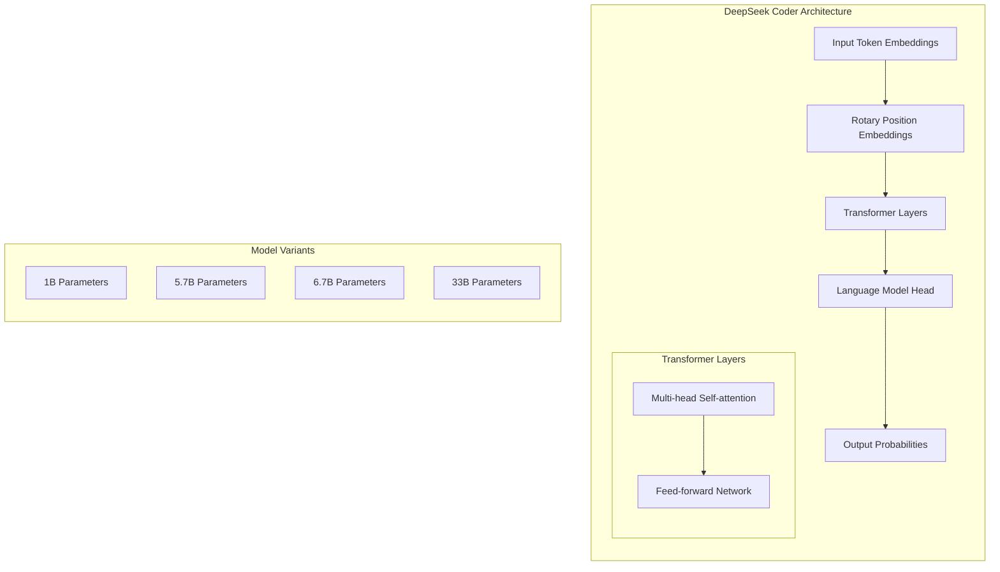
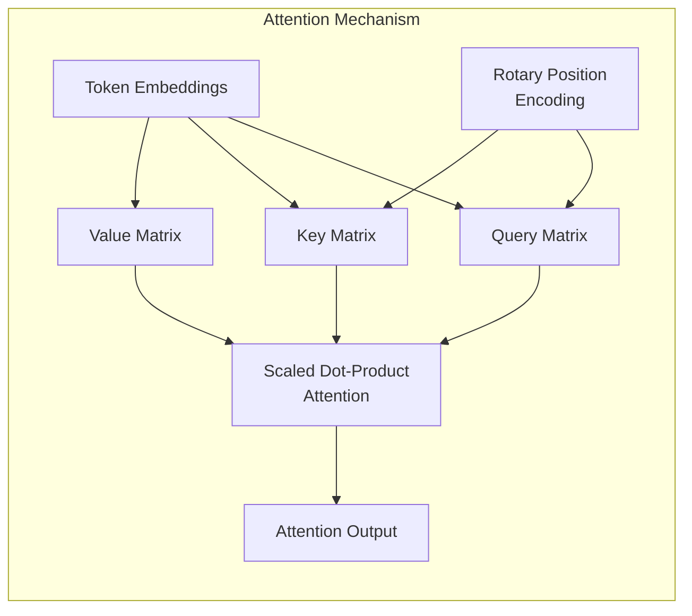
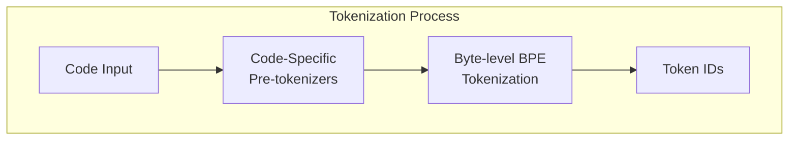
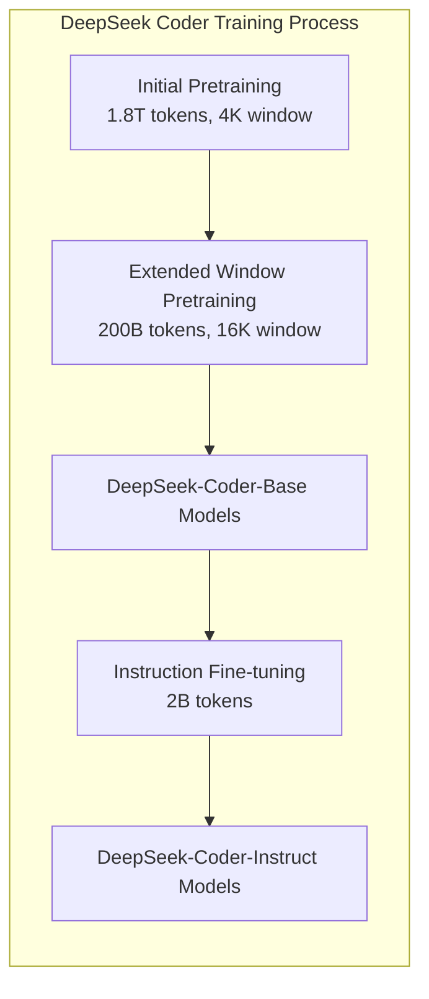
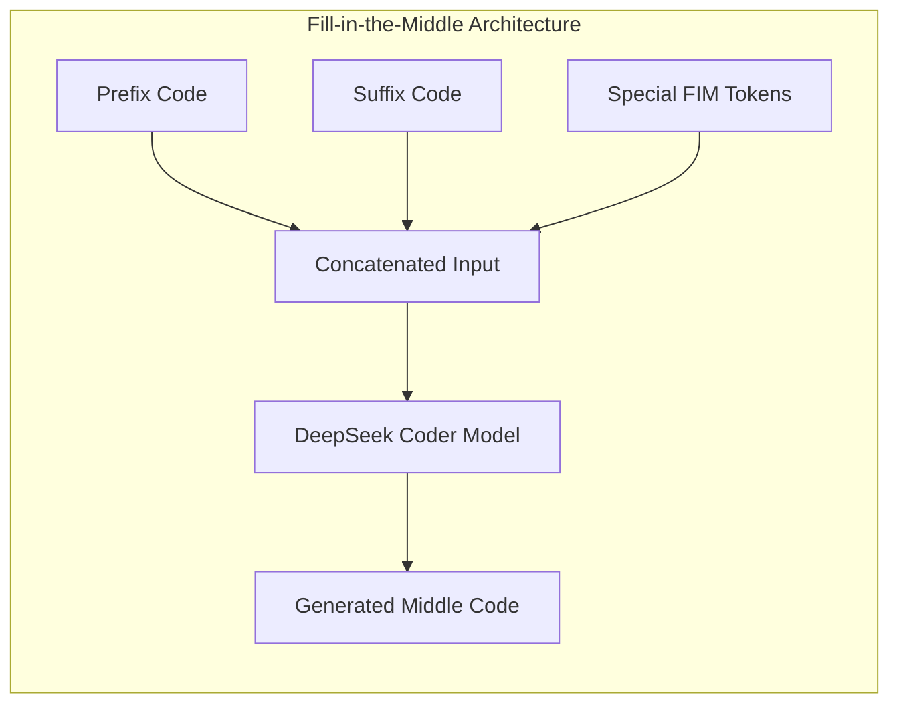
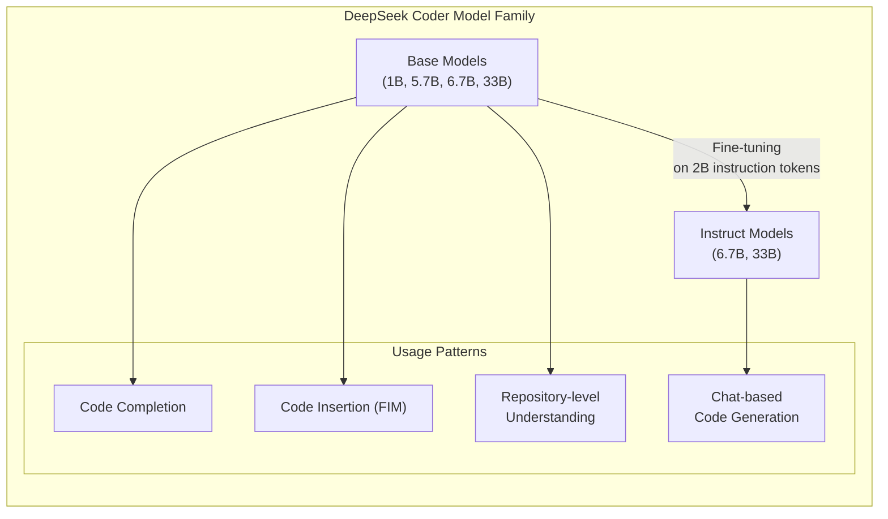

<!-- source: DeepWiki mcp.deepwiki.com · repo deepseek-ai/DeepSeek-Coder · page 2.1 Architecture · fetched 2026-10-30 -->

# Architecture

Relevant source files

The following files were used as context for generating this wiki page:

- [README.md](README.md)

This document details the technical architecture of the DeepSeek Coder models, focusing on the transformer structure, parameter configurations, training methodology, and special architectural features designed for code understanding. For information about model performance across various benchmarks, see [Performance and Benchmarks](#2.2).

## Model Overview

DeepSeek Coder consists of a family of decoder-only transformer language models specifically designed for code generation and understanding. The models are available in multiple sizes ranging from 1 billion to 33 billion parameters, with both base and instruction-tuned variants.

Key architectural characteristics:
- Decoder-only transformer architecture
- Extended context window of 16K tokens
- Specialized fill-in-the-middle (FIM) capabilities
- Support for multiple programming languages (80+)
- Models trained from scratch on 2T tokens

Sources: [README.md:11-27]()

## Transformer Architecture

DeepSeek Coder follows a decoder-only transformer architecture with modifications specifically designed for code generation tasks. The model family is available in several sizes, each with different parameter counts and architectural dimensions.

### Model Size Variants

The DeepSeek Coder family includes models of different sizes, each optimized for different use cases:

| Model Size | Parameters | Typical Use Cases |
|------------|------------|-------------------|
| 1B         | 1 billion  | Lightweight applications, edge devices |
| 5.7B       | 5.7 billion | Medium complexity tasks |
| 6.7B       | 6.7 billion | General code generation and understanding |
| 33B        | 33 billion  | Complex code generation, multilingual programming |

Each model size represents a different trade-off between computational requirements and generation capabilities, with the larger models providing higher quality code generation at the cost of increased computational demands.

Sources: [README.md:19-22]()

## Attention Mechanism and Position Encoding

DeepSeek Coder uses a rotary position embedding (RoPE) mechanism for handling positional information. This approach directly encodes relative positional information in the attention matrix, allowing the model to better understand code structure across long distances.

The rotary position encoding is particularly important for the extended context window (16K tokens) as it helps maintain performance over longer sequences, which is essential for understanding large code files or entire repositories.

Sources: [README.md:25-26](), [README.md:412-414]()

## Tokenization Approach

DeepSeek Coder uses a Byte-level BPE (Byte Pair Encoding) tokenization algorithm implemented through the Hugging Face Tokenizers library. The tokenizer is specifically designed to handle code efficiently.

The tokenizer includes special tokens for the fill-in-the-middle task, such as `<｜fim▁begin｜>`, `<｜fim▁hole｜>`, and `<｜fim▁end｜>`, which enable the model to perform code insertion tasks. For instruction-tuned models, additional special tokens like `<|EOT|>` are used to manage the chat dialogue format.

Sources: [README.md:101-127](), [README.md:387-389]()

## Training Methodology

DeepSeek Coder was trained using a multi-stage approach designed to optimize both general code understanding and specific task capabilities.

### Training Data Composition

The training data for DeepSeek Coder was carefully curated and processed:

1. **Initial Data Collection**: Code data collected from GitHub with filtering rules similar to StarCoder
2. **Dependency Analysis**: Files within repositories were rearranged based on their dependencies
3. **Example Formation**: Dependent files were concatenated to form cohesive examples
4. **Quality Filtering**: Low-quality code (syntax errors, poor readability) was filtered out

The final training data comprised:
- 87% code from various programming languages
- 10% code-related language (GitHub Markdown, StackExchange)
- 3% non-code-related Chinese language content

Sources: [README.md:48-56](), [README.md:58-62]()

### Training Procedure

The training was conducted in three main phases:

1. **Initial Pretraining**: Models were pretrained on 1.8T tokens with a 4K window size
2. **Extended Window Pretraining**: Further pretraining on an additional 200B tokens with a 16K window size, resulting in the base models
3. **Instruction Fine-tuning**: Base models were fine-tuned on 2B tokens of instruction data, resulting in the instruction-tuned models

This staged approach allowed the models to first learn general code patterns before being optimized for specific tasks and longer context understanding.

Sources: [README.md:58-62]()

## Special Architectural Features

### 16K Context Window

DeepSeek Coder features an extended context window of 16K tokens, which is significantly larger than many other language models. This extended window is particularly valuable for code-related tasks as it allows the model to:

1. Understand large code files in their entirety
2. Maintain context across multiple functions or classes
3. Process repository-level code with dependencies
4. Generate coherent, contextually appropriate code completions for complex projects

The 16K window was achieved through a dedicated pretraining phase focused on extending the context understanding capabilities beyond the initial 4K window.

Sources: [README.md:25-26](), [README.md:59-60]()

### Fill-in-the-Middle (FIM) Capability

DeepSeek Coder was explicitly trained with a fill-in-the-middle task, enabling it to understand and generate code that fits within an existing context. This capability is particularly useful for code editing and insertion tasks.

The FIM capability is implemented using special tokens:
- `<｜fim▁begin｜>`: Marks the beginning of a FIM example
- `<｜fim▁hole｜>`: Indicates where the model should insert code
- `<｜fim▁end｜>`: Marks the end of a FIM example

This architecture allows the model to understand both the preceding and following context when generating code insertions, resulting in more coherent and contextually appropriate code.

Sources: [README.md:101-127]()

## Model Variants

### Base Models

DeepSeek Coder Base models are the foundation models trained on the full 2T token dataset. These models excel at code completion, code insertion, and repository-level understanding tasks. Available sizes include 1B, 5.7B, 6.7B, and 33B parameters.

### Instruction-tuned Models

The instruction-tuned variants (DeepSeek Coder Instruct) are fine-tuned from the base models using an additional 2B tokens of instruction data. These models are optimized for interactive coding assistance through natural language instructions and conversations. Currently available in 6.7B and 33B parameter sizes.

The instruction-tuned models use a specific formatting template for chat interactions, enabling them to follow user instructions and generate appropriate code responses in a conversational manner.

Sources: [README.md:129-176]()

## Inference Optimization

DeepSeek Coder models support various inference optimization techniques:

1. **Tensor Parallelism**: Models can be distributed across multiple GPUs using tensor parallelism for efficient inference
2. **vLLM Integration**: Support for high-throughput inference using the vLLM framework
3. **Quantization Options**: Support for GGUF and GPTQ quantization formats for deployment on resource-constrained environments

These optimizations make DeepSeek Coder adaptable to different deployment scenarios, from high-performance servers to more limited computing environments.

Sources: [README.md:333-382](), [README.md:386-414]()

## Summary

DeepSeek Coder features a decoder-only transformer architecture optimized specifically for code generation tasks. Key architectural features include an extended 16K context window, specialized fill-in-the-middle capabilities, and a staged training process. The model family spans from 1B to 33B parameters with both base and instruction-tuned variants, offering a range of options for different deployment scenarios and use cases.

---

