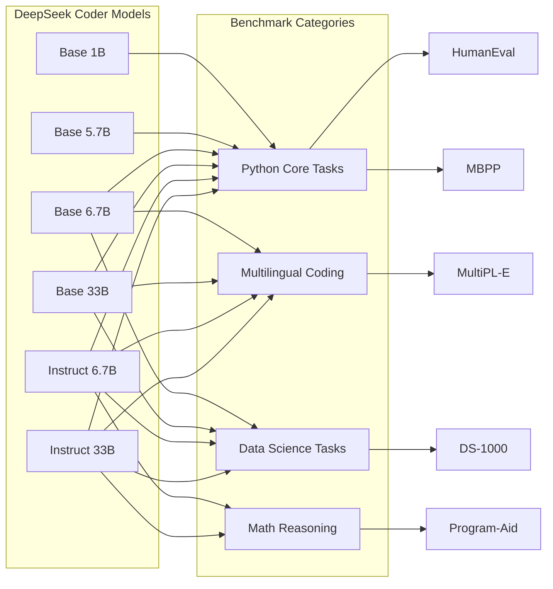
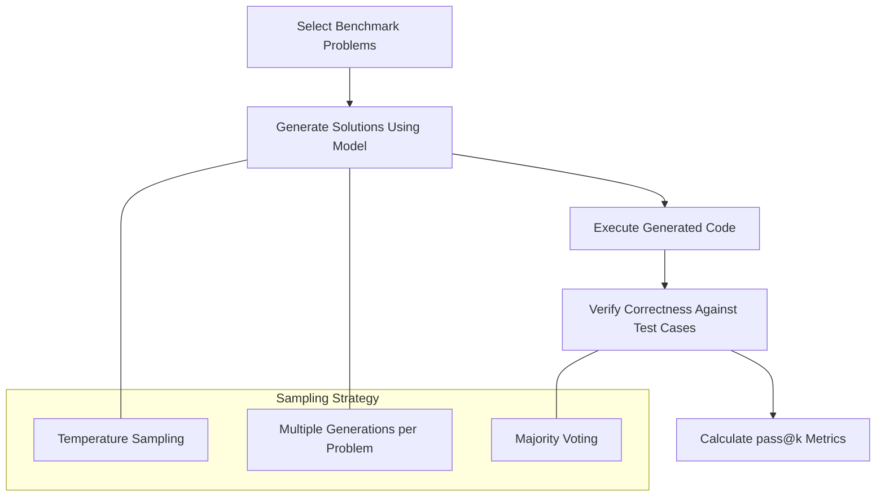
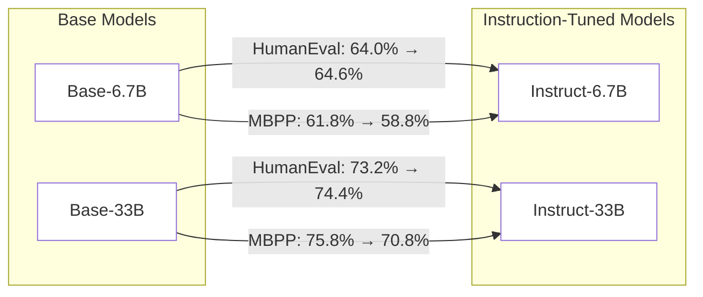
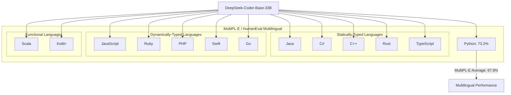
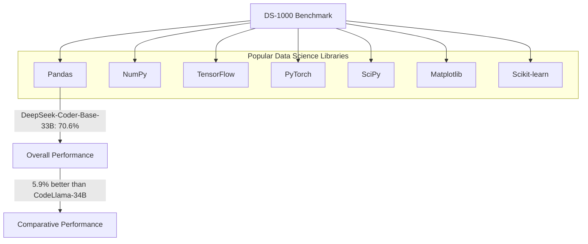
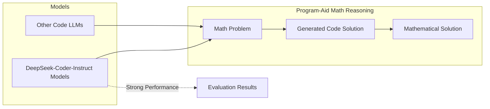

<!-- source: DeepWiki mcp.deepwiki.com · repo deepseek-ai/DeepSeek-Coder · page 2.2 Performance and Benchmarks · fetched 2026-10-30 -->

# Performance and Benchmarks

Relevant source files

The following files were used as context for generating this wiki page:

- [README.md](README.md)
- [pictures/HumanEval.png](pictures/HumanEval.png)
- [pictures/MBPP.png](pictures/MBPP.png)
- [pictures/result.png](pictures/result.png)
- [pictures/table.png](pictures/table.png)

## Purpose and Scope

This page provides a detailed overview of DeepSeek Coder models' performance across standard code generation and understanding benchmarks. It presents quantitative evaluation results, comparison with other leading models, and analysis of performance across different model sizes and variants. For information about model architecture, see [Architecture](#2.1), and for fine-tuning performance, see [Fine-tuning](#5).

## Overview of DeepSeek Coder Performance

DeepSeek Coder models demonstrate strong performance across various standard code-related benchmarks, with the larger models achieving state-of-the-art results among open-source code models. The models have been evaluated on Python-specific tasks (HumanEval, MBPP), multilingual code generation (MultiPL-E), domain-specific tasks (DS-1000), and mathematical reasoning tasks.

Sources: [README.md:12-26](), [README.md:30-42]()

## Benchmark Methodology

DeepSeek Coder's performance is primarily measured using standard coding benchmarks with a focus on functional correctness. The most commonly reported metric is **pass@k**, which measures the probability that at least one correct solution is generated in k samples.

### Key Benchmarks

| Benchmark | Description | Focus | Programming Languages |
|-----------|-------------|-------|----------------------|
| HumanEval | 164 hand-written programming problems | Algorithm implementation | Python (original) + 18 languages in MultiPL-E |
| MBPP | 974 Python programming problems | Basic programming tasks | Python |
| DS-1000 | 1,000 data science problems | Library-specific tasks | Python (focusing on data science libraries) |
| Program-Aid | Math reasoning problems | Mathematical reasoning | Python |

Sources: [README.md:321-332]()

### Evaluation Process

The evaluation process follows this general workflow:

Sources: [README.md:321-332]()

## Performance Results

### Overall Results

The following table shows the pass@1 performance of DeepSeek Coder models compared to other code models across key benchmarks:

| Model | HumanEval (Python) | HumanEval (Multilingual) | MBPP | DS-1000 |
|-------|-------------------|--------------------------|------|---------|
| DeepSeek-Coder-Base-33B | 73.2% | 67.8% | 75.8% | 70.6% |
| DeepSeek-Coder-Instruct-33B | 74.4% | - | 70.8% | - |
| CodeLlama-34B | 65.3% | 58.5% | 65.0% | 64.7% |
| GPT-3.5-Turbo | 72.6% | - | 70.8% | - |
| DeepSeek-Coder-Base-6.7B | 64.0% | 56.3% | 61.8% | 61.1% |
| DeepSeek-Coder-Instruct-6.7B | 64.6% | - | 58.8% | - |
| DeepSeek-Coder-Base-5.7B | 61.6% | - | - | - |
| DeepSeek-Coder-Base-1B | 36.6% | - | - | - |

Key findings:
- DeepSeek-Coder-Base-33B outperforms CodeLlama-34B by 7.9%, 9.3%, 10.8%, and 5.9% on HumanEval Python, HumanEval Multilingual, MBPP, and DS-1000 respectively
- DeepSeek-Coder-Base-6.7B reaches performance comparable to CodeLlama-34B despite being 5x smaller
- DeepSeek-Coder-Instruct-33B outperforms GPT-3.5-Turbo on HumanEval and achieves comparable results on MBPP

Sources: [README.md:30-42](), [README.md:321-332]()

### Performance by Model Size

The performance of DeepSeek Coder scales with model size, as shown in the following visualization:

Sources: [README.md:33-42](), [README.md:321-332]()

### Base vs. Instruction-Tuned Models

Observations:
- Instruction tuning slightly improves HumanEval performance
- However, it may reduce performance on MBPP benchmark
- This suggests instruction-tuned models may excel at following complex instructions but might trade off some performance on straightforward programming tasks

Sources: [README.md:33-42]()

## Multilingual Performance

DeepSeek Coder demonstrates strong multilingual capabilities, performing well across multiple programming languages in the HumanEval benchmark.

DeepSeek Coder's multilingual performance is attributed to its diverse training corpus, which includes code in multiple programming languages. The model achieves an average of 67.8% pass@1 across multiple programming languages, which is 9.3% higher than CodeLlama-34B.

Sources: [README.md:321-323](), [README.md:27-29]()

## Domain-Specific Performance

### Data Science Tasks (DS-1000)

DeepSeek Coder performs particularly well on data science tasks, demonstrating strong capability in code generation involving popular data science libraries.

The DS-1000 benchmark tests the model's ability to solve complex data science problems that require understanding of specific libraries and their APIs. DeepSeek-Coder-Base-33B achieves 70.6% pass@1 on this benchmark, outperforming CodeLlama-34B by 5.9%.

Sources: [README.md:328-329]()

### Program-Aided Math Reasoning

DeepSeek Coder also demonstrates capabilities in mathematical reasoning when generating code, as evaluated on the Program-Aid Math Reasoning benchmark.

The ability to solve mathematical problems through code generation is an important aspect of code models' versatility, particularly for scientific and engineering applications.

Sources: [README.md:330-331]()

## Evaluation Insights and Analysis

DeepSeek Coder's strong performance can be attributed to several factors:

1. **Training Data Scale**: Trained on 2T tokens with 87% code content
2. **Model Size Efficiency**: Achieves strong results at both large (33B) and medium (6.7B) scales
3. **Window Size Advantage**: 16K window size enabling understanding of larger code contexts
4. **Fill-in-the-Middle Training**: Special training for code insertion/completion tasks
5. **Diverse Language Coverage**: Training on a wide range of programming languages

The model's superior performance demonstrates the effectiveness of the training methodology, which includes:
- Initial pre-training with 1.8T tokens at 4K window size
- Further pre-training with 200B additional tokens at 16K window size
- Instruction fine-tuning on 2B tokens of instruction data (for Instruct variants)

Sources: [README.md:12-26](), [README.md:47-63]()

## Evaluation Methodology and Reproducibility

The evaluation results presented are reproducible, with code available in the repository's Evaluation directory. The evaluation process typically involves:

1. Loading the model
2. Generating multiple solutions for each problem
3. Executing the generated code against test cases
4. Computing pass@k metrics based on the execution results

For example, to evaluate the model on HumanEval or MBPP benchmarks, the repository provides scripts such as `eval_instruct.py`. For LeetCode evaluation, a combination of `vllm_inference.py` and `evaluate_leetcode.py` is used.

Sources: [README.md:320-332]()

## Conclusion

DeepSeek Coder models demonstrate state-of-the-art performance among open-source code models across various benchmarks. The 33B parameter models outperform comparable-sized competitors, while the smaller 6.7B models offer an excellent balance of performance and efficiency. The instruction-tuned variants show particular strength in following complex instructions while maintaining strong coding capabilities.

The performance results validate DeepSeek's approach to model training, including the use of a large, diverse code corpus, extended context window, and specialized training techniques like fill-in-the-blank tasks.

---

