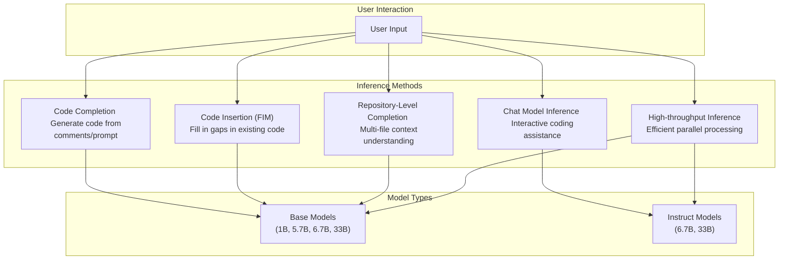
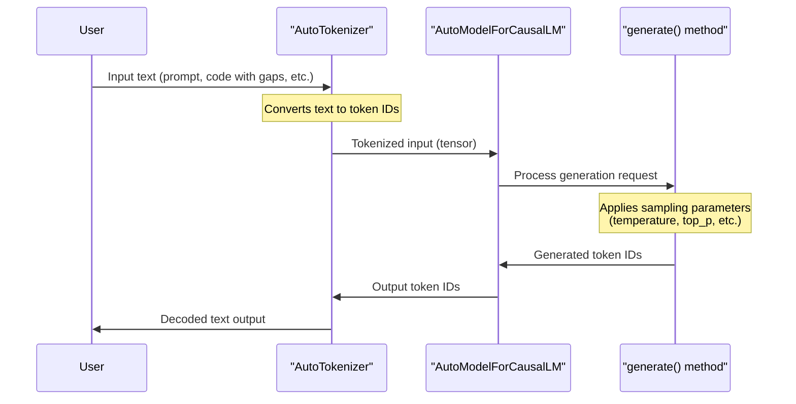
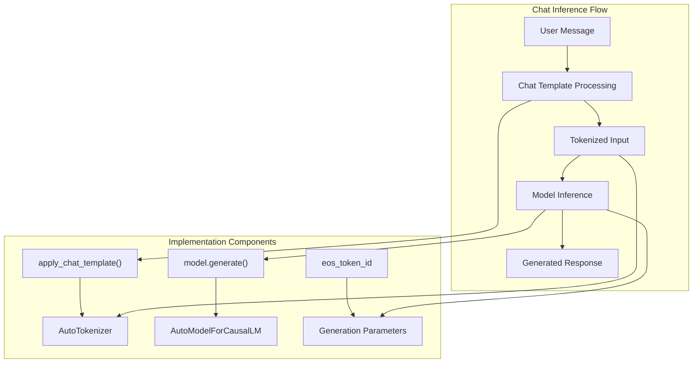
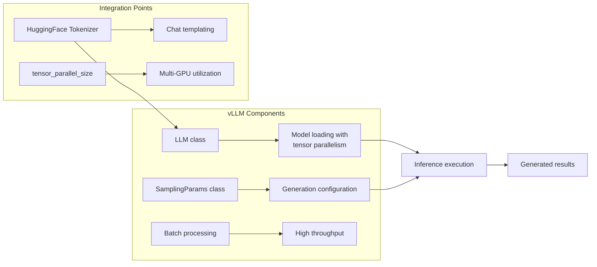

<!-- source: DeepWiki mcp.deepwiki.com · repo deepseek-ai/DeepSeek-Coder · page 3 Usage and Inference Methods · fetched 2026-10-30 -->

# Usage and Inference Methods

<details>
<summary>Relevant source files</summary>

The following files were used as context for generating this wiki page:

- [README.md](README.md)

</details>


This document provides a comprehensive guide to using DeepSeek Coder for inference across different use cases. It covers the various inference methods supported by the models, including code completion, code insertion, chat-based interaction, repository-level completion, and high-throughput inference with vLLM. For information about fine-tuning the models, see [Fine-tuning](#5).

## Inference Methods Overview

DeepSeek Coder offers multiple inference methods depending on your use case. Each method is optimized for specific scenarios and leverages different capabilities of the models.



Sources: [README.md:11-27]()

The table below summarizes each inference method, its appropriate model types, and typical use cases:

| Inference Method | Model Type | Use Case | Key Features |
|------------------|------------|----------|--------------|
| Code Completion | Base | Generate code from comments/prompts | Simple, straightforward generation |
| Code Insertion (FIM) | Base | Fill gaps in existing code | Contextual code insertion |
| Chat Model Inference | Instruct | Interactive coding assistance | Dialog-based interaction |
| Repository-Level Completion | Base | Complete code across multiple files | Cross-file understanding |
| vLLM Inference | Both | High-throughput production scenarios | Efficient, parallel processing |

Sources: [README.md:67-269]()

## Inference Process Flow

All inference methods follow a similar process flow, with variations in how inputs are processed and outputs are generated.



Sources: [README.md:76-142]()

## Code Completion

Code completion is the most basic inference method, where the model generates code based on a comment or prompt.

### Usage Example

```python
from transformers import AutoTokenizer, AutoModelForCausalLM
import torch

tokenizer = AutoTokenizer.from_pretrained("deepseek-ai/deepseek-coder-6.7b-base", trust_remote_code=True)
model = AutoModelForCausalLM.from_pretrained("deepseek-ai/deepseek-coder-6.7b-base", 
                                            trust_remote_code=True, 
                                            torch_dtype=torch.bfloat16).cuda()

input_text = "#write a quick sort algorithm"
inputs = tokenizer(input_text, return_tensors="pt").to(model.device)
outputs = model.generate(**inputs, max_length=128)
print(tokenizer.decode(outputs[0], skip_special_tokens=True))
```

Sources: [README.md:76-85]()

### Key Parameters for Generation

| Parameter | Description | Example Value |
|-----------|-------------|---------------|
| max_length | Maximum length of generated sequence | 128 |
| max_new_tokens | Maximum number of tokens to generate | 512 |
| do_sample | Whether to use sampling | False (greedy) or True (sampling) |
| temperature | Sampling temperature (higher = more random) | 0.7 |
| top_p | Nucleus sampling probability | 0.95 |
| top_k | Top-k sampling | 50 |

Sources: [README.md:140-141]()

## Code Insertion (FIM)

Code Insertion, also known as Fill-in-the-Middle (FIM), allows the model to fill in gaps in existing code.

### FIM Special Tokens

The FIM task uses special tokens to mark different parts of the input:
- `<｜fim▁begin｜>`: Marks the beginning of the context
- `<｜fim▁hole｜>`: Marks the gap that needs to be filled
- `<｜fim▁end｜>`: Marks the end of the context

### Usage Example

```python
from transformers import AutoTokenizer, AutoModelForCausalLM
import torch

tokenizer = AutoTokenizer.from_pretrained("deepseek-ai/deepseek-coder-6.7b-base", trust_remote_code=True)
model = AutoModelForCausalLM.from_pretrained("deepseek-ai/deepseek-coder-6.7b-base", 
                                            trust_remote_code=True, 
                                            torch_dtype=torch.bfloat16).cuda()

input_text = """<｜fim▁begin｜>def quick_sort(arr):
    if len(arr) <= 1:
        return arr
    pivot = arr[0]
    left = []
    right = []
<｜fim▁hole｜>
        if arr[i] < pivot:
            left.append(arr[i])
        else:
            right.append(arr[i])
    return quick_sort(left) + [pivot] + quick_sort(right)<｜fim▁end｜>"""

inputs = tokenizer(input_text, return_tensors="pt").to(model.device)
outputs = model.generate(**inputs, max_length=128)
print(tokenizer.decode(outputs[0], skip_special_tokens=True)[len(input_text):])
```

Sources: [README.md:102-122]()

## Chat Model Inference

Chat Model Inference uses the instruction-tuned models for interactive, dialog-based code generation.



Sources: [README.md:129-176]()

### Usage Example

```python
from transformers import AutoTokenizer, AutoModelForCausalLM
import torch

tokenizer = AutoTokenizer.from_pretrained("deepseek-ai/deepseek-coder-6.7b-instruct", trust_remote_code=True)
model = AutoModelForCausalLM.from_pretrained("deepseek-ai/deepseek-coder-6.7b-instruct", 
                                            trust_remote_code=True, 
                                            torch_dtype=torch.bfloat16).cuda()

messages = [
    { 'role': 'user', 'content': "write a quick sort algorithm in python."}
]

inputs = tokenizer.apply_chat_template(messages, add_generation_prompt=True, return_tensors="pt").to(model.device)
outputs = model.generate(inputs, max_new_tokens=512, do_sample=False, 
                        top_k=50, top_p=0.95, num_return_sequences=1, 
                        eos_token_id=tokenizer.eos_token_id)

print(tokenizer.decode(outputs[0][len(inputs[0]):], skip_special_tokens=True))
```

Sources: [README.md:129-142]()

### Chat Template

If not using the `apply_chat_template` method, you can manually format the chat input using this template:

```
You are an AI programming assistant, utilizing the DeepSeek Coder model, developed by DeepSeek Company, and you only answer questions related to computer science. For politically sensitive questions, security and privacy issues, and other non-computer science questions, you will refuse to answer.
### Instruction:
['content']
### Response:
['content']
<|EOT|>
### Instruction:
['content']
### Response:

```

Sources: [README.md:164-176]()

## Repository-Level Completion

Repository-Level Completion allows the model to understand and complete code across multiple files, demonstrating cross-file contextual understanding.

### Usage Example

This example shows how the model can understand code dependencies across utility, model, and main files to complete appropriate implementation:

```python
from transformers import AutoTokenizer, AutoModelForCausalLM
import torch

tokenizer = AutoTokenizer.from_pretrained("deepseek-ai/deepseek-coder-6.7b-base", trust_remote_code=True)
model = AutoModelForCausalLM.from_pretrained("deepseek-ai/deepseek-coder-6.7b-base", 
                                            trust_remote_code=True, 
                                            torch_dtype=torch.bfloat16).cuda()

# Input containing multiple files with imports and class references
input_text = """#utils.py
import torch
from sklearn import datasets
from sklearn.model_selection import train_test_split
from sklearn.preprocessing import StandardScaler
from sklearn.metrics import accuracy_score

def load_data():
    # Function implementation...
    
def evaluate_predictions(y_test, y_pred):
    # Function implementation...

# model.py
import torch
import torch.nn as nn
import torch.optim as optim
from torch.utils.data import DataLoader, TensorDataset

class IrisClassifier(nn.Module):
    # Class implementation...

# main.py
from utils import load_data, evaluate_predictions
from model import IrisClassifier as Classifier

def main():
    # Model training and evaluation
"""

inputs = tokenizer(input_text, return_tensors="pt").to(model.device)
outputs = model.generate(**inputs, max_new_tokens=140)
print(tokenizer.decode(outputs[0]))
```

Sources: [README.md:178-266]()

## High-throughput Inference with vLLM

For production scenarios requiring efficient inference, DeepSeek Coder supports integration with vLLM for high-throughput processing.



Sources: [README.md:333-382]()

### Text Completion with vLLM

```python
from vllm import LLM, SamplingParams

tp_size = 4  # Tensor Parallelism
sampling_params = SamplingParams(temperature=0.7, top_p=0.9, max_tokens=100)
model_name = "deepseek-ai/deepseek-coder-6.7b-base"
llm = LLM(model=model_name, trust_remote_code=True, 
          gpu_memory_utilization=0.9, tensor_parallel_size=tp_size)

prompts = [
    "If everyone in a country loves one another,",
    "The research should also focus on the technologies",
    "To determine if the label is correct, we need to"
]
outputs = llm.generate(prompts, sampling_params)

generated_text = [output.outputs[0].text for output in outputs]
print(generated_text)
```

Sources: [README.md:339-356]()

### Chat Completion with vLLM

```python
from transformers import AutoTokenizer
from vllm import LLM, SamplingParams

tp_size = 4  # Tensor Parallelism
sampling_params = SamplingParams(temperature=0.7, top_p=0.9, max_tokens=100)
model_name = "deepseek-ai/deepseek-coder-6.7b-instruct"
tokenizer = AutoTokenizer.from_pretrained(model_name)
llm = LLM(model=model_name, trust_remote_code=True, 
          gpu_memory_utilization=0.9, tensor_parallel_size=tp_size)

messages_list = [
    [{"role": "user", "content": "Who are you?"}],
    [{"role": "user", "content": "What can you do?"}],
    [{"role": "user", "content": "Explain Transformer briefly."}],
]
prompts = [tokenizer.apply_chat_template(messages, add_generation_prompt=True, tokenize=False) 
           for messages in messages_list]

sampling_params.stop = [tokenizer.eos_token]
outputs = llm.generate(prompts, sampling_params)

generated_text = [output.outputs[0].text for output in outputs]
print(generated_text)
```

Sources: [README.md:358-382]()

## Special Configurations

### Using Instruct Models for Code Completion

Although the instruction-tuned models are primarily designed for chat interactions, they can be used for code completion by modifying the `eos_token_id` parameter:

```python
# When using instruct models for code completion, set eos_token_id to 32014
# instead of the default 32021
outputs = model.generate(inputs, max_new_tokens=512, eos_token_id=32014)
```

This adjustment enables the instruction-tuned models to perform code completion by changing how they recognize the end of a sequence.

Sources: [README.md:415-418]()

## Model Variants and Recommended Inference Methods

| Model | Size | Recommended Inference Methods |
|-------|------|------------------------------|
| deepseek-coder-1b-base | 1B | Code Completion, Code Insertion |
| deepseek-coder-5.7b-base | 5.7B | Code Completion, Code Insertion, Repository-Level |
| deepseek-coder-6.7b-base | 6.7B | Code Completion, Code Insertion, Repository-Level |
| deepseek-coder-33b-base | 33B | Code Completion, Code Insertion, Repository-Level |
| deepseek-coder-6.7b-instruct | 6.7B | Chat Model Inference, Code Completion* |
| deepseek-coder-33b-instruct | 33B | Chat Model Inference, Code Completion* |

*Requires modified `eos_token_id` as noted above.

Sources: [README.md:19-26](), [README.md:415-418]()

---

