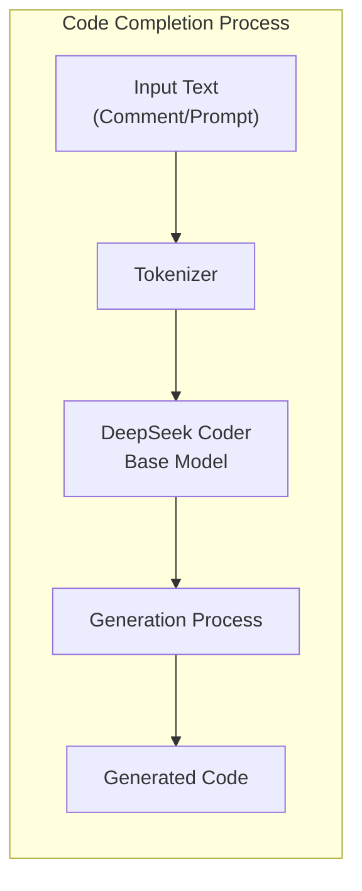
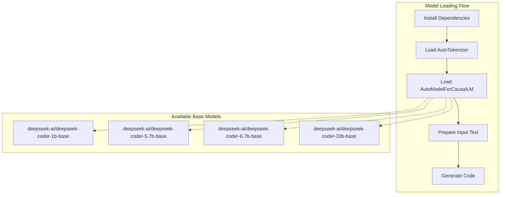
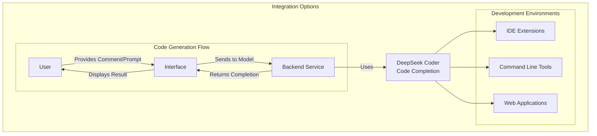
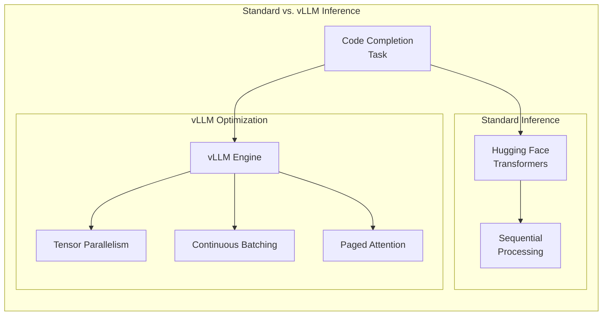

<!-- source: DeepWiki mcp.deepwiki.com · repo deepseek-ai/DeepSeek-Coder · page 3.1 Code Completion · fetched 2026-10-30 -->

# Code Completion

<details>
<summary>Relevant source files</summary>

The following files were used as context for generating this wiki page:

- [README.md](README.md)

</details>


## Purpose and Scope

This document describes how to use DeepSeek Coder for code completion tasks. Code completion enables models to generate code snippets or entire functions based on comments, prompts, or partial code. This page focuses specifically on basic code completion from prompts - for other related functionalities, see:
- [Code Insertion](#3.2) for filling gaps in existing code
- [Chat Model Inference](#3.3) for interactive code generation with the instruct models
- [Repository-Level Completion](#3.4) for completing code with awareness of multiple files
- [High-throughput Inference with vLLM](#3.5) for optimized inference performance

## DeepSeek Coder Code Completion Overview

Code completion is a fundamental capability of the DeepSeek Coder base models. These models can transform natural language descriptions or code comments into functional code implementations across more than 80 programming languages.



Sources: [README.md:75-100]()

## Basic Setup and Usage

### Required Dependencies

To use DeepSeek Coder for code completion, you need the following dependencies:

```
transformers
torch
```

### Loading the Model

The first step is to load the appropriate tokenizer and model:



Sources: [README.md:75-85]()

### Basic Example

The following code demonstrates how to use DeepSeek Coder for a simple code completion task - generating a quick sort algorithm from a comment:

1. Import required libraries
2. Load the tokenizer and model
3. Define the input text (a comment describing what you want)
4. Tokenize the input text
5. Generate the completion
6. Decode and print the result

Sources: [README.md:76-85]()

## Generation Parameters

When using the `generate()` method, you can control various aspects of the code generation process:

| Parameter | Description | Example Value |
|-----------|-------------|---------------|
| max_length | Maximum length of the generated sequence | 128 |
| max_new_tokens | Maximum number of new tokens to generate | 512 |
| do_sample | Whether to use sampling | False |
| temperature | Controls randomness (higher = more random) | 0.7 |
| top_k | Limits sampling to top k most likely tokens | 50 |
| top_p | Nucleus sampling parameter | 0.95 |
| num_return_sequences | Number of sequences to return | 1 |

Sources: [README.md:76-84]()

## Integration with Application Workflows

Code completion can be integrated into various developer workflows, including IDE extensions, CLI tools, and web applications.



Sources: [README.md:75-100]()

## Model Selection Considerations

DeepSeek Coder offers multiple model sizes for code completion, each with different trade-offs:

| Model | Parameters | Advantages | Considerations |
|-------|------------|------------|----------------|
| deepseek-coder-1b-base | 1B | Lightweight, fast inference | Lower quality completions |
| deepseek-coder-5.7b-base | 5.7B | Good balance of quality and resource usage | Moderate resource requirements |
| deepseek-coder-6.7b-base | 6.7B | High quality completions | Higher resource requirements |
| deepseek-coder-33b-base | 33B | Highest quality completions | Significant resource requirements |

Sources: [README.md:19-22]()

## Language Support

DeepSeek Coder supports over 80 programming languages for code completion, including:

- Python, JavaScript, Java, C++, C#, Go, Rust, PHP, Ruby
- TypeScript, Swift, Kotlin, Scala, Perl, Shell
- SQL, HTML, CSS, and many more

The full list of supported languages is available in the README file.

Sources: [README.md:27-28]()

## Performance Optimization

For high-throughput inference scenarios, you can use vLLM with DeepSeek Coder models:



Sources: [README.md:335-356]()

## Notes for Instruct Models

While the base models are primarily designed for code completion, the instruct models can also be used for this purpose with a small adjustment:

For DeepSeek Coder instruct models, set `eos_token_id=32014` instead of the default value of 32021 to enable effective code completion.

Sources: [README.md:415-417]()

## Example Use Cases

DeepSeek Coder code completion excels at various programming tasks:

1. Implementing algorithms from descriptions
2. Generating function implementations from signatures and comments
3. Converting pseudocode to actual code
4. Completing partial code snippets
5. Generating boilerplate code

Sources: [README.md:85-100]()

## Comparison with Other Inference Methods

| Inference Method | Primary Use Case | Key Difference from Code Completion |
|------------------|------------------|-------------------------------------|
| Code Completion | Generate code from comments/prompts | Base functionality |
| Code Insertion | Fill in gaps in existing code | Requires context before and after the insertion point |
| Chat Model Inference | Interactive code generation | Uses instruction-tuned models with chat templates |
| Repository-Level Completion | Complete code across multiple files | Maintains awareness of dependencies across files |

Sources: [README.md:75-272]()

---

