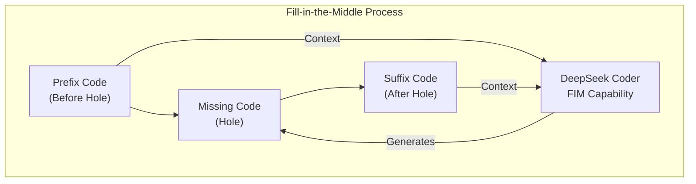
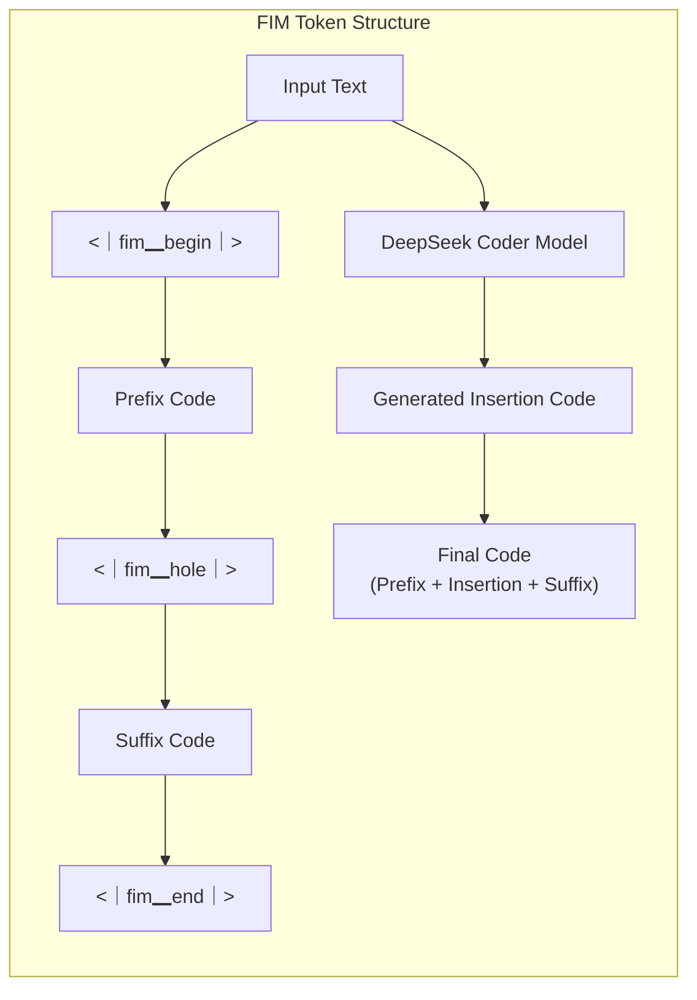
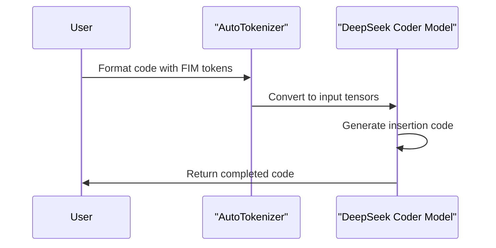
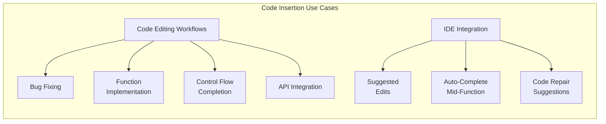
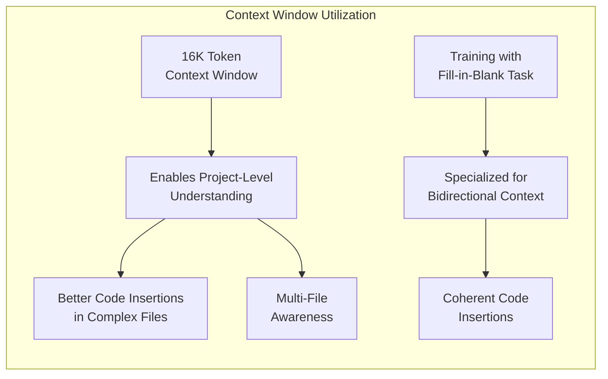

<!-- source: DeepWiki mcp.deepwiki.com · repo deepseek-ai/DeepSeek-Coder · page 3.2 Code Insertion · fetched 2026-10-30 -->

# Code Insertion

Relevant source files

The following files were used as context for generating this wiki page:

- [README.md](README.md)

## Purpose and Scope

This document explains the Code Insertion feature of DeepSeek Coder, also known as Fill-in-the-Middle (FIM) capability. Code Insertion allows the model to generate code to fill in gaps within existing code, making it useful for code repair, enhancement, or completing missing implementation details in partially written code. For information about standard code completion that generates code after a prompt, see [Code Completion](#3.1).

Sources: [README.md:25-25](), [README.md:102-102]()

## Technical Overview

### What is Fill-in-the-Middle (FIM)?

Fill-in-the-Middle is a specialized capability of DeepSeek Coder models that allows them to understand code context both before and after a gap, and generate appropriate code to fill that gap. Unlike traditional code completion that only considers preceding context, FIM leverages bidirectional context to produce more coherent and contextually appropriate insertions.

The model was trained with a dedicated fill-in-the-blank task as part of its pre-training process, enabling it to understand code structure and dependencies in a more comprehensive way.

Sources: [README.md:13-13](), [README.md:25-25]()

### FIM Special Tokens

DeepSeek Coder uses special marker tokens to indicate the beginning, gap, and end of the code section for insertion:

1. `<｜fim▁begin｜>` - Marks the beginning of the entire code section
2. `<｜fim▁hole｜>` - Marks the location where code should be inserted
3. `<｜fim▁end｜>` - Marks the end of the entire code section

These tokens help the model understand which part of the input represents the code segment to consider and where exactly to generate the insertion.

Sources: [README.md:108-119]()

## Usage Guide

### Basic Usage

To use the Code Insertion feature:

1. Prepare your code with a gap where you want the model to generate content
2. Wrap the entire code with `<｜fim▁begin｜>` and `<｜fim▁end｜>` tokens
3. Mark the insertion point with the `<｜fim▁hole｜>` token
4. Pass this formatted input to the model
5. The model will generate code to fill the gap

Here's the basic implementation pattern:

Sources: [README.md:104-123]()

### Example Implementation

The Code Insertion feature can be accessed through the Hugging Face Transformers API, following the pattern shown in the README example:

1. Load the DeepSeek Coder model and tokenizer
2. Format your input with the FIM special tokens
3. Generate text using the model
4. Extract the generated code 

To separate the generated insertion from the input, you may need to slice the output to only include the newly generated content.

Sources: [README.md:104-123]()

## Integration and Applications

### When to Use Code Insertion

Code Insertion is particularly useful in scenarios such as:

1. **Code Refactoring**: Replacing implementation details while maintaining function signatures and return statements
2. **Implementing Missing Functions**: Filling in function bodies between declarations and endings
3. **Fixing Bugs**: Adding missing code in the middle of a function to fix logical errors
4. **Loop and Condition Bodies**: Generating the content inside loop or conditional blocks

Sources: [README.md:102-127]()

### Comparison with Code Completion

| Feature | Code Completion | Code Insertion |
|---------|----------------|----------------|
| Context Direction | Unidirectional (preceding text only) | Bidirectional (before and after the gap) |
| Use Case | Writing new code sequentially | Filling gaps in existing code |
| Special Tokens | None required | Requires FIM markers |
| Typical Applications | Writing new functions, continuing implementations | Fixing bugs, implementing missing logic, refactoring |

Sources: [README.md:75-100](), [README.md:102-127]()

## Performance Considerations

### Model Size Impact

Larger models generally produce better quality code insertions as they have a better understanding of code structure and can handle more complex contexts. The DeepSeek Coder models are available in sizes from 1B to 33B parameters, with the larger models providing more sophisticated insertions.

### Context Window Utilization

DeepSeek Coder has a context window of 16K tokens, which makes it particularly effective for FIM tasks in larger codebases where understanding the full context is important for generating appropriate insertions.

Sources: [README.md:13-13](), [README.md:60-61]()

## Advanced Usage

### Repository-Level Context

One of the strengths of DeepSeek Coder is its ability to understand repository-level context. When using Code Insertion in a multi-file project, you can provide relevant context from other files to help the model generate more accurate insertions that maintain consistency with the overall codebase.

### Combining with Instruction Tuning

While the base models are specifically trained for tasks like code insertion, the instruction-tuned models can also be used for more complex insertion tasks that might require understanding of natural language instructions along with the code context.

Sources: [README.md:178-266]()

## Limitations

Code Insertion has certain limitations to be aware of:

1. The model might struggle with very complex or specialized code that requires deep domain knowledge
2. The quality of insertions depends on the clarity and completeness of the surrounding code
3. For highly interdependent code, the local context might not be sufficient to generate optimal insertions

Understanding these limitations helps in using the feature more effectively and setting appropriate expectations for the results.

Sources: [README.md:102-127]()

---

