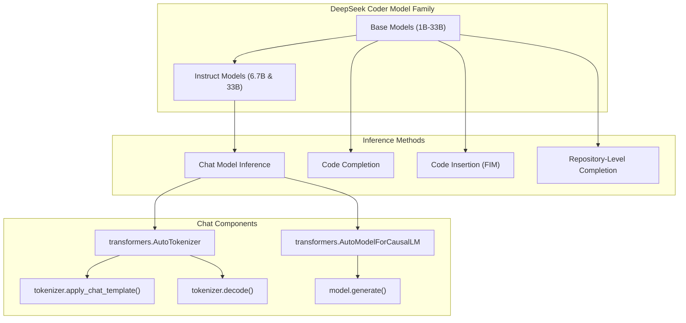
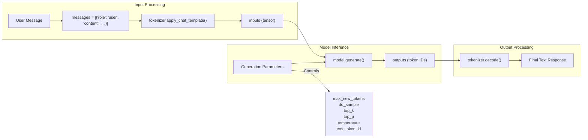
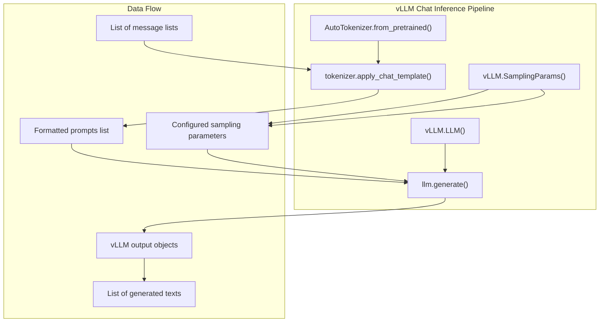

<!-- source: DeepWiki mcp.deepwiki.com · repo deepseek-ai/DeepSeek-Coder · page 3.3 Chat Model Inference · fetched 2026-10-30 -->

# Chat Model Inference

<details>
<summary>Relevant source files</summary>

The following files were used as context for generating this wiki page:

- [README.md](README.md)

</details>


This page documents the Chat Model Inference functionality in DeepSeek Coder, which enables interactive, conversation-based code generation using instruction-tuned models. Unlike basic code completion (see [Code Completion](#3.1)) or code insertion (see [Code Insertion](#3.2)), chat inference supports multi-turn dialogues where the model understands follow-up questions and generates code based on natural language instructions.

## Supported Models and Architecture

Chat Model Inference is specifically designed to work with the instruction-tuned variants of DeepSeek Coder:
- deepseek-coder-6.7b-instruct
- deepseek-coder-33b-instruct

These models were created by fine-tuning the base models on 2B tokens of instruction data, making them capable of understanding and responding to natural language instructions in a conversational context.

### Chat Model Architecture



Sources: [README.md:130-142](), [README.md:164-176]()

## Chat Template Format

DeepSeek Coder uses a structured chat template to format conversations for the model. The standard template is:

```
You are an AI programming assistant, utilizing the DeepSeek Coder model, developed by DeepSeek Company, and you only answer questions related to computer science. For politically sensitive questions, security and privacy issues, and other non-computer science questions, you will refuse to answer.
### Instruction:
['content']
### Response:
['content']
<|EOT|>
### Instruction:
['content']
### Response:
```

Key components of this template:
- System message defining the model's role
- "Instruction" sections for user inputs
- "Response" sections for model outputs
- The special token `<|EOT|>` marking the end of each exchange

The template is stored in the `tokenizer_config.json` file and is automatically loaded when using `tokenizer.apply_chat_template()`.

Sources: [README.md:164-176]()

## Chat Inference Workflow

The following diagram illustrates the data flow in the Chat Model Inference process:



Sources: [README.md:130-142]()

## Basic Usage with Hugging Face Transformers

Implementation example:

```python
from transformers import AutoTokenizer, AutoModelForCausalLM
import torch

# Load tokenizer and model
tokenizer = AutoTokenizer.from_pretrained("deepseek-ai/deepseek-coder-6.7b-instruct", trust_remote_code=True)
model = AutoModelForCausalLM.from_pretrained("deepseek-ai/deepseek-coder-6.7b-instruct", trust_remote_code=True, torch_dtype=torch.bfloat16).cuda()

# Prepare messages
messages = [
    { 'role': 'user', 'content': "write a quick sort algorithm in python."}
]

# Apply chat template
inputs = tokenizer.apply_chat_template(messages, add_generation_prompt=True, return_tensors="pt").to(model.device)

# Generate response
outputs = model.generate(inputs, max_new_tokens=512, do_sample=False, top_k=50, top_p=0.95, num_return_sequences=1, eos_token_id=tokenizer.eos_token_id)

# Decode output
response = tokenizer.decode(outputs[0][len(inputs[0]):], skip_special_tokens=True)
print(response)
```

Sources: [README.md:130-142]()

## Multi-turn Conversations

For multi-turn conversations, add previous exchanges to the `messages` list:

```python
messages = [
    { 'role': 'user', 'content': "write a quick sort algorithm in python." },
    { 'role': 'assistant', 'content': "... model's previous response ..." },
    { 'role': 'user', 'content': "Now explain the time complexity of this algorithm." }
]
```

The `apply_chat_template()` method will format this conversation history according to the chat template.

Sources: [README.md:164-176]()

## Generation Parameters

You can control various aspects of the generation process with these parameters:

| Parameter | Description | Typical Values |
|-----------|-------------|----------------|
| `max_new_tokens` | Maximum number of tokens to generate | 512, 1024, 2048 |
| `do_sample` | Whether to use sampling (True) or greedy decoding (False) | True, False |
| `top_k` | Only sample from top k most likely tokens | 50, 100 |
| `top_p` | Only sample from tokens with cumulative probability < top_p | 0.9, 0.95 |
| `temperature` | Controls randomness (higher = more random) | 0.7, 1.0 |
| `num_return_sequences` | Number of sequences to generate | 1 |
| `eos_token_id` | Token ID that signals end of generation | tokenizer.eos_token_id |

Example with temperature control:

```python
# More creative responses
outputs = model.generate(inputs, max_new_tokens=512, do_sample=True, temperature=0.8, top_p=0.95)

# More deterministic responses
outputs = model.generate(inputs, max_new_tokens=512, do_sample=True, temperature=0.2, top_p=0.95)
```

Sources: [README.md:130-142]()

## High-throughput Inference with vLLM

For higher throughput and efficiency, vLLM provides an optimized implementation:



Implementation example:

```python
from transformers import AutoTokenizer
from vllm import LLM, SamplingParams

# Setup
tp_size = 4  # Tensor Parallelism
sampling_params = SamplingParams(temperature=0.7, top_p=0.9, max_tokens=100)
model_name = "deepseek-ai/deepseek-coder-6.7b-instruct"

# Load tokenizer and model
tokenizer = AutoTokenizer.from_pretrained(model_name)
llm = LLM(model=model_name, trust_remote_code=True, gpu_memory_utilization=0.9, tensor_parallel_size=tp_size)

# Prepare batch of conversations
messages_list = [
    [{"role": "user", "content": "Who are you?"}],
    [{"role": "user", "content": "What can you do?"}],
    [{"role": "user", "content": "Explain Transformer briefly."}],
]

# Apply chat template to each conversation
prompts = [tokenizer.apply_chat_template(messages, add_generation_prompt=True, tokenize=False) for messages in messages_list]

# Set stop token and generate
sampling_params.stop = [tokenizer.eos_token]
outputs = llm.generate(prompts, sampling_params)

# Extract generated text
generated_text = [output.outputs[0].text for output in outputs]
print(generated_text)
```

Sources: [README.md:359-382]()

## Code Completion with Instruct Models

While the instruction-tuned models are primarily designed for chat interactions, they can also perform code completion by adjusting the `eos_token_id`:

```python
# For code completion with instruct model
outputs = model.generate(inputs, max_new_tokens=512, eos_token_id=32014)  # Instead of default 32021
```

This modification enables the instruction-tuned model to recognize sequence endings differently for code completion tasks.

Sources: [README.md:415-418]()

## Example Use Case: Interactive Code Generation

The following example demonstrates a multi-turn conversation for code generation and explanation:

**First User Message:**
```
Write a function to check if a string is a palindrome in Python.
```

**Model Response:**
```
Sure, here's a function to check if a string is a palindrome in Python:

def is_palindrome(string):
    """
    Check if a string is a palindrome.
    
    Args:
        string (str): The string to check.
        
    Returns:
        bool: True if the string is a palindrome, False otherwise.
    """
    # Convert to lowercase and remove non-alphanumeric characters
    string = ''.join(char.lower() for char in string if char.isalnum())
    
    # Check if the string equals its reverse
    return string == string[::-1]

# Example usage
test_strings = ["racecar", "A man, a plan, a canal: Panama", "hello"]
for string in test_strings:
    print(f"'{string}' is a palindrome: {is_palindrome(string)}")
```

**Follow-up User Message:**
```
Explain how the string[::-1] syntax works.
```

**Model Response:**
```
The string[::-1] syntax in Python is a slicing operation with a step of -1, which reverses the string. Let me break down the slicing syntax [start:stop:step]:

- start: The index to start slicing from (inclusive). When omitted, it defaults to 0 (beginning of the string).
- stop: The index to stop slicing at (exclusive). When omitted, it defaults to the length of the string.
- step: How many characters to move forward after each character is taken. When omitted, it defaults to 1.

When you use [::-1]:
- The first colon with nothing before it means start from the beginning (default 0)
- The second colon with nothing after it means go until the end (default len(string))
- The -1 means "step backwards by 1 character"

So string[::-1] means "take the entire string and step through it backwards one character at a time," effectively reversing it.
```

This example demonstrates how Chat Model Inference supports multi-turn conversations with follow-up questions and detailed explanations.

Sources: [README.md:130-142](), [README.md:164-176]()

---

