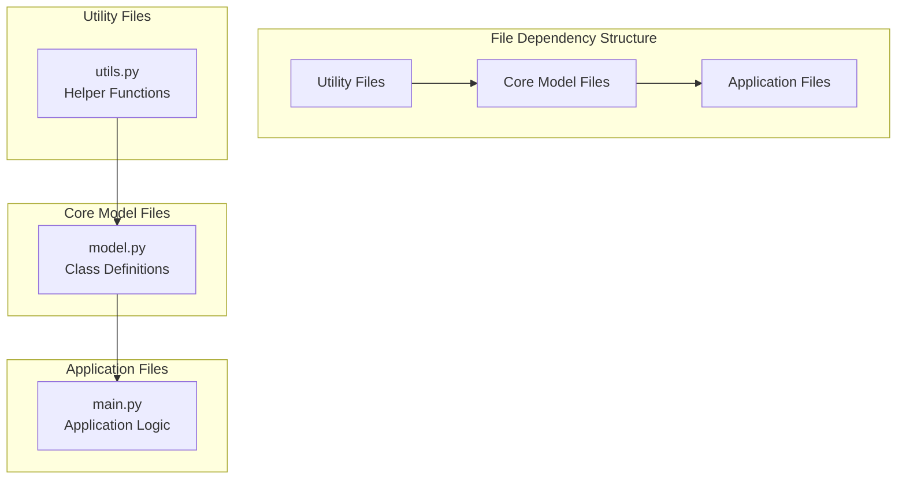
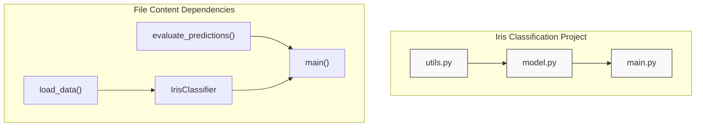
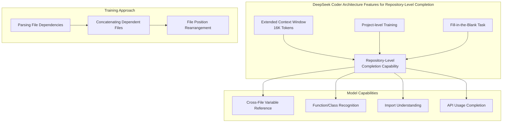
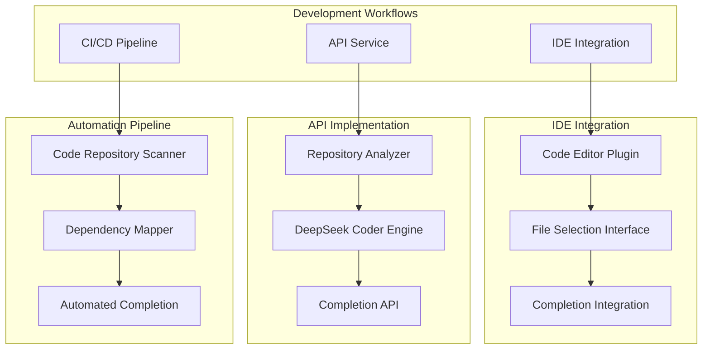

<!-- source: DeepWiki mcp.deepwiki.com · repo deepseek-ai/DeepSeek-Coder · page 3.4 Repository-Level Completion · fetched 2026-10-30 -->

# Repository-Level Completion

<details>
<summary>Relevant source files</summary>

The following files were used as context for generating this wiki page:

- [README.md](README.md)

</details>


## Purpose and Scope

This document explains the Repository-Level Completion feature of DeepSeek Coder, which enables intelligent code completion across multiple files within a repository. Unlike standard code completion that operates on a single file, repository-level completion allows the model to understand inter-file dependencies and context, resulting in more accurate and contextually relevant completions.

For standard single-file code completion, see [Code Completion](#3.1). For code insertion within files (Fill-in-the-Middle capability), see [Code Insertion](#3.2).

## Overview

Repository-Level Completion enables DeepSeek Coder to understand and generate code while maintaining awareness of multiple files and their interrelationships within a project. This capability is crucial for real-world programming scenarios where code is structured across multiple modules with complex dependencies.

The feature takes advantage of DeepSeek Coder's 16K token context window and special training on project-level code corpus to maintain coherence across files.

Sources: [README.md:13-13](), [README.md:25-25]()

## How Repository-Level Completion Works

Repository-Level Completion processes multiple files simultaneously by:

1. Concatenating the content of multiple files with clear file boundary indicators
2. Maintaining the dependency structure between files
3. Leveraging the model's understanding of file relationships to generate contextually appropriate completions


Sources: [README.md:179-271]()

## File Preparation and Structure

When preparing input for repository-level completion, files should be structured with clear headers to maintain separation and provide context to the model. Each file should be prefixed with its filename as a comment.

### File Ordering

Files should ideally be ordered based on their dependency relationships, with base/utility files appearing before the files that depend on them.



Sources: [README.md:185-262]()

## Usage Instructions

To use repository-level completion, follow these steps:

1. Concatenate multiple files with clear file headers
2. Pass the concatenated content to the model
3. Specify where the completion should occur

Here's how to implement repository-level completion:

```python
from transformers import AutoTokenizer, AutoModelForCausalLM
import torch

# Load the model and tokenizer
tokenizer = AutoTokenizer.from_pretrained("deepseek-ai/deepseek-coder-6.7b-base", trust_remote_code=True)
model = AutoModelForCausalLM.from_pretrained("deepseek-ai/deepseek-coder-6.7b-base", 
                                            trust_remote_code=True, 
                                            torch_dtype=torch.bfloat16).cuda()

# Prepare input containing multiple files with clear headers
input_text = """# file1.py
def utility_function():
    # Utility code here

# file2.py
# Code that requires completion
"""

# Generate completion
inputs = tokenizer(input_text, return_tensors="pt").to(model.device)
outputs = model.generate(**inputs, max_new_tokens=100)
completed_code = tokenizer.decode(outputs[0])
```

Sources: [README.md:179-265]()

## Example: Iris Classification Project

The following example demonstrates repository-level completion across three Python files that make up a machine learning project for Iris flower classification.

### Project Structure



### Input Format

The input to the model consists of three files concatenated together:

1. `utils.py`: Contains data loading and evaluation functions
2. `model.py`: Defines the `IrisClassifier` neural network model
3. `main.py`: Contains a partial `main()` function that needs to be completed

### Generated Completion

When the model is prompted with the partial `main()` function, it generates code that correctly:

1. Loads data using functions from `utils.py`
2. Instantiates the `IrisClassifier` class from `model.py`
3. Trains the model with appropriate parameters
4. Evaluates the model using the utility functions

The completed `main()` function demonstrates the model's understanding of the inter-file relationships and API usage.

Sources: [README.md:185-271]()

## Technical Implementation Details

Repository-level completion leverages several key features of the DeepSeek Coder architecture:

1. **Extended Context Window**: The 16K token window allows processing multiple files simultaneously
2. **Project-level Training**: The model was specifically trained on project-level code corpus using concatenated dependent files
3. **Fill-in-the-Blank Task**: Special training helps the model understand code context across file boundaries



Sources: [README.md:48-56](), [README.md:59-62]()

## Best Practices

For optimal results with repository-level completion:

| Best Practice | Description |
|---------------|-------------|
| Include necessary imports | Make sure all relevant import statements are included in each file |
| Maintain clear file headers | Start each file with a comment containing the filename |
| Order files by dependency | List files in order of dependency (base files first) |
| Keep context concise | Remove unnecessary code to stay within token limits |
| Include complete class/function definitions | Ensure critical classes and functions are completely defined |
| Limit to related files | Only include files that are relevant to the completion task |

Sources: [README.md:179-271]()

## Limitations and Considerations

When using repository-level completion, be aware of the following limitations:

1. **Token Limit**: Despite the 16K token window, very large projects may exceed this limit
2. **Dependency Complexity**: Extremely complex dependency relationships might not be fully captured
3. **Language Mixing**: Performance may vary when mixing multiple programming languages
4. **Partial Context**: The model may not recognize subtle relationships if key context is missing

These limitations can be mitigated by carefully selecting the most relevant files and code sections for inclusion in the prompt.

Sources: [README.md:13-26]()

## Comparison with Other Completion Methods

Repository-level completion differs from standard code completion and code insertion in several key ways:

| Feature | Repository-Level Completion | Standard Code Completion | Code Insertion (FIM) |
|---------|----------------------------|-------------------------|----------------------|
| Context awareness | Multiple files | Single file | Single file |
| Use case | Complex project development | Single file development | Bug fixing, code refinement |
| Input format | Multiple files with headers | Single file or code snippet | Code with marked insertion point |
| Token usage | Higher (multiple files) | Lower (single file) | Medium (requires before/after context) |
| Dependency handling | Handles cross-file dependencies | Limited to file scope | Limited to file scope |

Sources: [README.md:74-128](), [README.md:179-271]()

## Integration with Development Workflows

Repository-level completion can be integrated into various development workflows:



Sources: [README.md:179-271]()

## Conclusion

Repository-Level Completion represents a significant advancement in code generation capabilities, enabling DeepSeek Coder to understand and complete code across multiple files while maintaining awareness of their interrelationships. This feature is particularly valuable for complex software development projects where code is distributed across multiple modules with intricate dependencies.

By leveraging DeepSeek Coder's extended context window and project-level training, developers can obtain more contextually appropriate and accurate code completions that respect the structure and dependencies of their projects.

---

